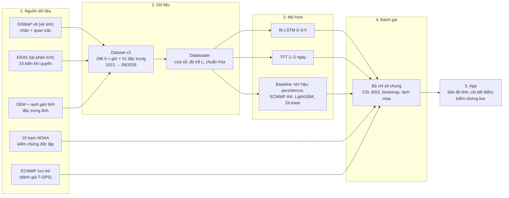

# Kế hoạch dự án PBL6: Dự báo mưa cho Đà Nẵng mới

> **Dành cho các thành viên trong nhóm.** File này trả lời bốn câu hỏi: dự án làm gì, quy trình ra sao, đang ở giai đoạn nào, và mỗi người cần làm gì tiếp theo.
> Chi tiết kỹ thuật và số liệu đầy đủ nằm ở [`project_plan_v2.md`](project_plan_v2.md). Bối cảnh dành cho AI agent nằm ở [`CLAUDE.md`](CLAUDE.md).
> **Cập nhật:** 13/10/2026. Khi chuyển sang giai đoạn mới hoặc chốt một quyết định, hãy sửa mục 4, mục 6 và ngày cập nhật.

---

## 1. Đọc nhanh trong 1 phút

- **Mục tiêu:** dự báo mưa cho **Đà Nẵng mới** (Đà Nẵng cũ cộng Quảng Nam) theo hai sản phẩm. Kết quả cuối là **một app**.
  - **Sản phẩm A**, 0–6 giờ tới, dùng **Bi-LSTM**.
  - **Sản phẩm B**, 1–3 ngày tới, dùng **TFT** (Temporal Fusion Transformer).
- **Câu hỏi nghiên cứu:** nhóm thông tin nào (quan trắc vệ tinh, độ bất ổn định, dòng ẩm, dự báo số…) giúp mô hình AI **vượt dự báo số ECMWF** ở hạn nào và mùa nào?
- **Đang ở đâu:** **phần dữ liệu và bộ đánh giá đã xong**. Phần này vốn là phần khó và rủi ro nhất, và đã xong sớm khoảng 1 tuần so với lộ trình. **Bước tiếp theo là huấn luyện**, bắt đầu bằng một pilot Bi-LSTM.
- **Việc cần làm ngay:**
  1. Tập trung thí nghiệm tại Đà Nẵng trước; vùng phía nam chưa chốt.
  2. Phân vai cho 3 thành viên (đề xuất ở mục 7).
  3. Chạy pilot Bi-LSTM.
  4. Bật ghi log dự báo live, vì mùa mưa đang diễn ra.

---

## 2. Dự án làm gì

### 2.1. Hai sản phẩm

| | Sản phẩm A: cực ngắn | Sản phẩm B: hạn ngắn |
| --- | --- | --- |
| Mô hình | Bi-LSTM | TFT |
| Hạn dự báo | 1–6 giờ tới, từng giờ | 1–3 ngày tới (72 giờ) |
| Phát hành | Mỗi giờ | 4 lần/ngày (00, 06, 12, 18 giờ UTC) |
| Hiển thị trên app | Tổng mưa 3 giờ tới; xác suất có mưa hoặc mưa to | Tổng mưa ngày 1, 2, 3; xác suất mưa vừa (≥16 mm), mưa to (≥50 mm), mưa rất to (≥100 mm) |
| Vai trò của AI | Kết hợp quan trắc vệ tinh gần nhất với dự báo số | Sửa sai số và đưa ra xác suất cho dự báo số ECMWF |

Về tên gọi: theo Thông tư 08/2022, hạn 1–3 ngày là **hạn ngắn**, không phải "dài hạn". Báo cáo nên dùng đúng thuật ngữ này.

### 2.2. Phạm vi không gian

- Dự báo theo **ô lưới khoảng 11 km × 11 km** (0,1°). Đà Nẵng mới gồm **93 ô đất**. Lưới cũng phủ một phần Huế (32 ô) và Quảng Ngãi (85 ô).
- **Một mô hình chung** cho mọi ô. Mô hình phân biệt các ô nhờ đặc trưng tĩnh: độ cao, khoảng cách tới biển, sườn đón gió. Nhóm **không** huấn luyện riêng cho từng tỉnh.
- App hiển thị ở hai cấp:
  - **Cấp tỉnh:** trung bình, nơi mưa nhiều nhất, % diện tích có mưa to.
  - **Cấp một điểm** (xã/phường hoặc vị trí người dùng): lấy giá trị của ô chứa điểm đó.
- Sau khi xong phần Đà Nẵng, thêm **2 vùng khí hậu khác** (Hà Nội, và TP.HCM hoặc Đắk Lắk) để kiểm tra mô hình có dùng được ở nơi khác không.

### 2.3. Điều mà kết quả phải chứng minh

Đối thủ chính là **dự báo số ECMWF**, không phải các mô hình AI khác. Đồ án trả lời 4 câu hỏi:
1. Nhóm thông tin nào quyết định ở hạn nào, mùa nào?
2. AI có thêm giá trị so với ECMWF không?
3. Lợi ích đó còn giữ được khi chạy với dữ liệu thật không (đánh giá T-OPS)?
4. Một mô hình có dùng được cho vùng khác không?

---

## 3. Quy trình tổng thể



| Bước | Làm gì | File chính |
| --- | --- | --- |
| 1. Tải dữ liệu | GSMaP, ERA5 và đặc trưng tĩnh từ Google Earth Engine; trạm NOAA; Open-Meteo | `scripts/extract_gee_*.py`, `scripts/fetch_*.py` |
| 2. Dựng dataset | Ghép mọi nguồn về lưới 0,1°, thống nhất quy ước giờ, kiểm tra chất lượng | `scripts/build_dataset_v2.py`, `src/dataset_v2.py` |
| 3. Dataloader | Cắt cửa sổ (24 giờ cho A, 168 giờ cho B), dịch quan trắc theo độ trễ, chuẩn hóa, chia train/val/test theo năm | `src/dataloader_v2.py` |
| 4. Huấn luyện | Bi-LSTM, TFT, các baseline. Một thí nghiệm = một cấu hình nhóm đặc trưng | *(sắp viết)* |
| 5. Đánh giá | Mọi mô hình chấm trên cùng tập mẫu, cùng chỉ số, có khoảng tin cậy | `src/verification.py`, `scripts/station_daily_benchmark.py` |
| 6. App | Chạy định kỳ, hiển thị và tự kiểm chứng | `demo/` *(sẽ nâng cấp)* |

### Cách so sánh các mô hình (thiết kế thí nghiệm)

- **Ablation theo nhóm đặc trưng:** giữ nguyên kiến trúc, chỉ thêm hoặc bớt từng nhóm đặc trưng, để đo đóng góp của từng nhóm.

  | Nhóm (sản phẩm A) | Nội dung |
  | --- | --- |
  | A0 | Biến bề mặt và thời gian |
  | A1 | Mưa vệ tinh gần nhất, có độ trễ |
  | A2 | Đối lưu: CAPE, CIN, TCWV… |
  | A3 | Gió và ẩm trên cao, dòng ẩm |
  | A4 | Dự báo số cho các giờ tới |
  | A5 | Bối cảnh vùng |

  Sản phẩm B có các nhóm tương tự B0–B5, thêm chỉ số không khí lạnh và các chỉ số khí hậu.
- **Thí nghiệm độ trễ quan trắc:** dữ liệu vệ tinh có độ trễ khi chạy thật (khoảng 4 giờ). Thí nghiệm đo kỹ năng thay đổi thế nào khi độ trễ là 0,5 / 4 / 14 giờ hoặc không có quan trắc.
- **Quy tắc bắt buộc:**
  - Mỗi cấu hình chạy 3 seed.
  - Chỉ chọn cấu hình dựa trên tập validation. Tập test (năm 2025) chỉ mở **một lần**.
  - So sánh theo cặp bằng bootstrap, kèm khoảng tin cậy 95 %.
  - Mọi bảng kết quả **tách theo mùa**.

---

## 4. Đang ở giai đoạn nào

| Giai đoạn | Tuần | Trạng thái | Kết quả / bằng chứng |
| --- | --- | --- | --- |
| 0. Khảo sát và quyết định | 1 | ✅ Xong (còn 2 câu hỏi nhỏ, xem mục 8) | `project_plan_v2.md` |
| 1. Dữ liệu và bộ đánh giá | 1–2 | ✅ **Xong** | Dataset v2, dataloader, bảng baseline ở `reports/station_benchmark/README.md` |
| 2. Baseline trên lưới | 2 | ⏳ Tiếp theo | — |
| 3. Sản phẩm A: Bi-LSTM | 3–4 | ✅ Pilot 2 seed; ablation đầy đủ chưa bắt đầu | `reports/pilot_bilstm_v2/README.md`: S4 tăng BSS nhưng chưa tăng chắc CSI; tiếp theo 3 seed và so kiến trúc |
| 4. Sản phẩm B: TFT | 5–6 | Chưa bắt đầu | — |
| 5. Đánh giá vận hành thật và độ bền | 7 | Chưa bắt đầu | — |
| 6. Mở rộng 2 vùng | 8 | Chưa bắt đầu | — |
| 7. App và kiểm định live | 9–10 (ghi log live: **ngay**) | Chưa bắt đầu | Bản demo cũ ở `demo/` |
| 8. Báo cáo và bảo vệ | Viết song song từ tuần 2 | Chưa bắt đầu | — |

### Những gì đã có trong tay

**Cập nhật 13/10:** dữ liệu verify 2233/2233; CUDA hoạt động; dataset 93 ô Đà Nẵng đã dựng; inspect bốn cấu hình đạt 0 mẫu lệch và batch hữu hạn. **58 kiểm tra đã đạt** trên Windows (57 bộ chung và 1 kiểm tra baseline giờ). Pilot 2 seed đã xong. Repo làm việc chuyển sang `D:\PBL6_v2`; giữ nguyên bản USB `D:\PBL6` cũ. Kết quả chưa chứng minh vượt ECMWF, và chưa so Bi-LSTM với TFT.
<!-- OFFLINE_BATCH_STATUS --> Chuẩn bị batch Python 3 seed trên 30 ô, rồi 93 ô; giới hạn đến 14:00 ngày 13/10/2026 giờ Việt Nam; log ở `data/operational/offline_pilot_batch/`.

- **Nhãn mưa** đã được chọn bằng cách đối chiếu với 10 trạm đo thật (xem mục 5).
- **Dataset v2:** 296 ô, mỗi giờ từ 2015 đến 09/2026, 51 đặc trưng. Đã kiểm tra chất lượng; dữ liệu thiếu dưới 0,2 %.
- **Dataloader:** đọc theo từng cửa sổ trực tiếp từ đĩa, vừa máy 8 GB. Không có rò rỉ dữ liệu (đã có test kiểm chứng).
- **Bộ đánh giá dùng chung**, kèm bảng "mức sàn" của các nguồn hiện có (khí hậu, ECMWF, GFS, ERA5).
- **34 unit test** cho các phần mới, tất cả đều đạt.

---

## 5. Kết quả quan trọng đến nay (để hiểu vì sao làm như vậy)

1. **Nhãn mưa cũ (ERA5) sai mưa to nghiêm trọng.** Tại trạm Đà Nẵng, ERA5 chỉ bắt được 8 % số ngày mưa ≥100 mm. Ví dụ ngày 14/10/2022, trạm đo 396 mm, ERA5 chỉ có 186 mm. Vì vậy nhóm đổi nhãn.
2. **Nhãn mới được chọn bằng đối chiếu với 10 trạm** (2021–2024, 437 ngày mưa ≥50 mm):

   | Nguồn | CSI ≥50 mm (càng cao càng tốt) |
   | --- | ---: |
   | **GSMaP hiệu chỉnh trạm (nhãn được chọn)** | **0,33** |
   | IMERG | 0,22 |
   | ERA5 (nhãn cũ) | 0,17 |

3. **Mức sàn cần vượt:**
   - Dự báo ECMWF trước 1 ngày chỉ báo được khoảng một nửa số ngày mưa to.
   - Mọi dự báo dạng "có / không" đều thua việc chỉ dùng xác suất khí hậu (BSS âm).
   - Vì vậy mô hình của nhóm phải **xuất xác suất**. Chỉ cần đạt BSS > 0 là đã hơn mọi nguồn hiện có trên chỉ số này.
4. **Vệ tinh gần như không thấy mưa mùa đông (tháng 11–2) ở Trung Bộ**, vì đây là mưa từ mây thấp, mưa địa hình. Hệ quả:
   - Sản phẩm A được chấm theo giờ chủ yếu trên tháng 5–10.
   - Mùa đông chỉ chấm tổng 6 giờ và 24 giờ.
   - Quan trắc vệ tinh dự kiến ít giúp vào mùa đông.
5. **Vì sao dùng TFT thay Informer:**
   - Trên bộ dữ liệu chuẩn, Informer thua cả cách đoán "lặp lại giá trị gần nhất".
   - Lần chạy cũ của nhóm chỉ đạt R² = 0,04.
   - TFT được thiết kế đúng cho loại đầu vào của bài toán: dự báo số cho tương lai và đặc trưng tĩnh.
   - Informer vẫn chạy một cấu hình để đối chiếu.

---

## 6. Lộ trình các tuần tới

Người dùng ưu tiên có đầu ra mới mỗi tuần; hạn nộp chưa phải ràng buộc (chốt 13/10/2026). Các mốc dưới đây là tham khảo, điều chỉnh theo bằng chứng từ thí nghiệm; tập trung Đà Nẵng trước khi mở rộng vùng.

| Tuần | Thời gian | Việc chính | Đầu ra / cổng kiểm soát |
| --- | --- | --- | --- |
| 1–2 | 12–25/10 | **Đã xong:** verify 2233/2233, CUDA, dataset Đà Nẵng, inspect, pilot 2 seed. **Tiếp theo:** batch 3 seed, baseline hiệu chỉnh, protocol 2×2 kiến trúc; ghi log live và ECMWF T-OPS | Pilot có tín hiệu xác suất, chưa chốt CSI; xem `reports/research_rainfall/README.md`; test 2025 giữ kín |
| 3–4 | 26/10–08/11 | Bi-LSTM: ablation A0–A5 (3 seed), thí nghiệm độ trễ, đánh giá tách mùa | Cổng 3: Bi-LSTM có vượt ECMWF thô và persistence không? |
| 5–6 | 09–22/11 | TFT: cài đặt, ablation B0–B5; DLinear; Informer một cấu hình; bảng 2×2 Bi-LSTM với TFT | Cổng 4: TFT có vượt ECMWF và ECMWF + hiệu chỉnh không? |
| 7 | 23–29/11 | Đánh giá với đầu vào dự báo thật (T-OPS); chọn cấu hình cho app; mở tập test 2025 | Đóng băng kết quả chính |
| 8 | 30/11–06/12 | Tải và chạy 2 vùng kiểm tra; thí nghiệm bỏ ô và bỏ vùng | Kết quả tổng quát hóa |
| 9–10 | 07–20/12 | App: bản đồ tỉnh, chi tiết điểm, hai sản phẩm, bảng kiểm chứng live | Demo chạy liên tục |
| 11 | 21–27/12 | Hoàn thiện báo cáo, slide, phân tích các trận mưa lớn (14/10/2022, 10/2023, 10/2025) | Nộp bài |

**Phạm vi tối thiểu nếu trễ tiến độ (MVP):**
- Chỉ Đà Nẵng.
- Bi-LSTM với các nhóm A0, A1, A2, A4 và 3 mức trễ.
- TFT với các nhóm B0, B1, B3.
- Baseline: khí hậu, persistence, ECMWF thô, LightGBM, DLinear.
- T-OPS trên năm 2025.
- App cho một tỉnh, có ghi log live.

Những thứ bỏ trước tiên nếu phải cắt: nhóm bối cảnh vùng, 2 vùng mở rộng, hạn 7 ngày.

---

## 7. Phân công gợi ý

**Nhóm có 3 người, chưa chốt phân vai (13/10/2026).** Mỗi người vẫn nghiên cứu toàn bộ, nhưng nên có một người chịu trách nhiệm chính cho từng đầu ra:

| Thành viên (tạm gọi) | Trách nhiệm chính | Người phản biện |
| --- | --- | --- |
| 1 | Dữ liệu, baseline, chống rò rỉ, bootstrap và tổng hợp kết quả | 2 |
| 2 | Bi-LSTM trước; TFT sau; checkpoint, cấu hình và nhật ký huấn luyện | 3 |
| 3 | Ghi log live, đầu vào ECMWF/vệ tinh, pipeline suy luận và app | 1 |

Cuối mỗi tuần, cả nhóm đọc cùng bảng kết quả và chốt một việc cần giải quyết tiếp. Người phụ trách ghi bằng chứng, cập nhật mục 4/6 và `CLAUDE.md`, rồi commit/push code và báo cáo; dữ liệu và checkpoint thử nghiệm giữ ngoài Git. Đây là đề xuất, chưa gán tên người.

Mọi người dùng chung `src/dataloader_v2.py` (dữ liệu vào) và `src/verification.py` (chấm điểm), nên phần việc của từng người ghép lại được với nhau.

| Mảng | Việc | Cần từ người khác | Giao cho người khác |
| --- | --- | --- | --- |
| **Dữ liệu và đánh giá** | Baseline trên lưới, tải ECMWF lưu trữ (T-OPS), bootstrap, bảng tổng hợp | — | Bảng mức sàn; script chấm điểm chung |
| **Sản phẩm A (Bi-LSTM)** | Pilot, ablation A0–A5, thí nghiệm độ trễ | Dataloader, bảng mức sàn | Checkpoint và dự báo trên tập test |
| **Sản phẩm B (TFT)** | Cài đặt TFT, ablation B0–B5, DLinear, Informer một cấu hình | Dataloader, bảng mức sàn | Checkpoint và dự báo trên tập test |
| **App và ghi log live** | Ghi log ECMWF và vệ tinh ngay; pipeline suy luận; giao diện | Checkpoint của A và B (từ tuần 7) | Demo và số liệu kiểm chứng live |
| **Báo cáo** (cả nhóm) | Viết song song từ tuần 2: dữ liệu → phương pháp → kết quả → hạn chế | — | — |

Máy huấn luyện chính là **máy có RTX 4060**. Máy Mac 8 GB dùng để xử lý dữ liệu, viết code và chạy thử nhỏ.

---

## 8. Câu hỏi còn mở

1. Vùng kiểm tra phía nam: **TP.HCM** (mưa nhiệt đới đồng bằng) hay **Đắk Lắk** (mưa dông Tây Nguyên)? Vùng phía bắc là Hà Nội.
2. Phân vai cụ thể cho 3 thành viên (điền tên ở mục 7). Hạn nộp chưa phải ràng buộc; ưu tiên kết quả mỗi tuần.

---

## 9. Bắt đầu cho thành viên mới

**Thứ tự đọc:** file này → [`CLAUDE.md`](CLAUDE.md) (quy ước và các lỗi đã gặp) → [`project_plan_v2.md`](project_plan_v2.md) (khi cần chi tiết) → [`reports/station_benchmark/README.md`](reports/station_benchmark/README.md) (kết quả baseline).

**Cài đặt và khôi phục dữ liệu:** dữ liệu nguồn khoảng 2,9 GB, file `pbl6_data_v2_2026-10-11.tar`, nằm trên Google Drive của nhóm.

```bash
git clone https://github.com/nibsu05/PBL6.git && cd PBL6
python3 -m venv .venv
.venv/bin/pip install -r requirements.txt          # Windows: .venv\Scripts\pip install -r requirements.txt
tar -xf pbl6_data_v2_2026-10-11.tar                 # đặt file tar ở thư mục gốc repo
.venv/bin/python scripts/package_data.py verify      # phải báo 2233/2233 file khớp
.venv/bin/python scripts/build_dataset_v2.py --years 2015 2026
.venv/bin/python -c "from src.dataloader_v2 import build_cell_major; build_cell_major()"
.venv/bin/python scripts/inspect_dataloader_v2.py    # kiểm tra: 0 mẫu lệch
```

Trên máy có GPU NVIDIA, cài PyTorch bản CUDA theo hướng dẫn tại pytorch.org. Ví dụ: `pip install torch --index-url https://download.pytorch.org/whl/cu124`.

**Windows RTX 3050 Ti, driver 546.92 (đã kiểm tra 13/10/2026):** dùng Python Windows, tránh bản MSYS2 trong PATH. Trong `.venv` cài `torch==2.5.1` từ index `cu121`, rồi cài `requirements_windows.txt`. Các phiên bản NumPy/SciPy/scikit-learn/PyArrow được giữ cố định vì DLL của một số bản mới bị Application Control trên máy này chặn.

```powershell
.venv\Scripts\python.exe -m pip install torch==2.5.1 --index-url https://download.pytorch.org/whl/cu121
.venv\Scripts\python.exe -m pip install -r requirements_windows.txt
.venv\Scripts\python.exe scripts/package_data.py verify
# Chỉ lưu 93 ô Đà Nẵng, vẫn tính lân cận từ toàn bộ lưới nguồn:
.venv\Scripts\python.exe scripts/build_dataset_v2.py --years 2015 2026 --cell-major-only --provinces "Đà Nẵng" --out data/processed/dataset_v2_danang
.venv\Scripts\python.exe scripts/inspect_dataloader_v2.py --dataset-dir data/processed/dataset_v2_danang --out reports/dataloader_v2_danang
.venv\Scripts\python.exe scripts/pilot_bilstm_v2.py --dataset-dir data/processed/dataset_v2_danang
```

Pilot có 30 ô, bước trượt 6 h, seed 42/43; tối đa 15 epoch, mỗi epoch 30.000 cửa sổ, early stopping patience 4. Chọn epoch/hiệu chỉnh xác suất trên 2022, so cặp trên 2023; chỉ số chính tổng 3 h trên tháng 5–10, mùa đông chỉ tổng 6 h. ERA5 trong báo cáo pilot là tham chiếu perfect prog, chưa thay thế kiểm định với ECMWF thật. Không chấm mô hình trên test 2025 ở bước này.

## 10. Quy tắc làm việc chung

- **Không commit dữ liệu, file PDF bài báo hay token** (repo công khai). Dữ liệu đặt trên Google Drive.
- **Một cách chấm điểm duy nhất:** dùng `src/verification.py`. Không tự viết hàm chỉ số riêng.
- **Không dùng MAE làm chỉ số chính.** Ở bài toán này, "luôn dự báo 0" đã có MAE rất thấp.
- **Không nhìn tập test để chọn mô hình.** Chỉ chọn dựa trên validation.
- **Báo cáo trung thực,** kể cả khi AI không thắng ECMWF. Đó vẫn là kết quả có giá trị nếu đo đúng.
- **Khi chốt một quyết định mới,** ghi vào `CLAUDE.md`, mục "Quyết định", và cập nhật mục 4 và 6 của file này.

## 11. Thuật ngữ

| Thuật ngữ | Nghĩa |
| --- | --- |
| **Nhãn** | Lượng mưa "thật" mà mô hình học để dự báo. Ở đây là GSMaP hiệu chỉnh trạm. |
| **ERA5** | Dữ liệu tái phân tích khí quyển của ECMWF. Dùng làm đầu vào khi huấn luyện, không dùng làm nhãn. |
| **ECMWF (IFS)** | Mô hình dự báo số của châu Âu, là đối thủ chính cần vượt. |
| **Perfect prog** | Khi huấn luyện, dùng ERA5 thay cho dự báo số ở các giờ tương lai; khi chạy app thì thay bằng dự báo ECMWF thật. |
| **T-ERA5 / T-OPS** | Đánh giá với đầu vào ERA5 (giới hạn trên) và với dự báo thật đã lưu trữ (giống khi chạy app). |
| **Độ trễ L** | Số giờ từ khi mưa rơi đến khi dữ liệu vệ tinh có sẵn để dùng (GSMaP khoảng 4 giờ). |
| **Ablation / LOGO** | Thêm dần hoặc bỏ từng nhóm đặc trưng để đo đóng góp của nhóm đó. |
| **Baseline** | Cách dự báo đơn giản để so sánh: khí hậu (trung bình nhiều năm), persistence (giữ nguyên giá trị gần nhất), ECMWF thô, LightGBM. |
| **POD / FAR / CSI** | Tỷ lệ bắt được sự kiện / tỷ lệ báo sai / chỉ số tổng hợp của hai tỷ lệ này (0 đến 1, càng cao càng tốt). |
| **FBI** | Tỷ lệ số lần báo có trên số lần xảy ra thật (1 là đúng tần suất). |
| **BSS** | Kỹ năng của dự báo xác suất so với xác suất khí hậu (> 0 là có kỹ năng). |
| **Bootstrap theo cặp** | Lấy mẫu lại theo khối ngày để tính khoảng tin cậy cho chênh lệch giữa hai mô hình. |
