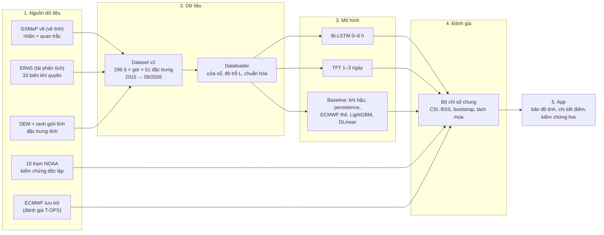

# Kế hoạch PBL6: nghiên cứu dự đoán mưa vùng trực tiếp tại Đà Nẵng mới

> **Dành cho các thành viên trong nhóm.** File này trả lời bốn câu hỏi: dự án làm gì, quy trình ra sao, đang ở giai đoạn nào, và mỗi người cần làm gì tiếp theo.
> Chi tiết kỹ thuật và số liệu đầy đủ nằm ở [`project_plan_v2.md`](project_plan_v2.md). Bối cảnh dành cho AI agent nằm ở [`CLAUDE.md`](CLAUDE.md).
> **Cập nhật:** 21/10/2026. [Phương án nghiên cứu hợp nhất](reports/regional_research_plan_2026_10_20/PHUONG_AN_CUOI.md) là nền cho nhánh 6 giờ; người dùng đã duyệt thêm [nhánh TFT vùng 24–72 giờ](reports/short_range_plan_2026_10_21/README.md). Các phần hai sản phẩm/app trước đây giữ để tra cứu lịch sử. Khi chuyển giai đoạn hoặc chốt quyết định, sửa mục 4, mục 6 và ngày cập nhật.

---

## 1. Đọc nhanh trong 1 phút

- **Mục tiêu hiện tại:** nghiên cứu thêm/bớt đặc trưng để **dự đoán vùng trực tiếp** cho Đà Nẵng mới. Chuỗi khí tượng/nhãn được tổng hợp theo diện tích trước mô hình; app không phải đầu ra chính. Giữ các quyết định có bằng chứng D1/D2/D9/D10/D14/D15 và đánh giá đủ sáu tiêu chí trong phương án hợp nhất. Hai nhánh được phân công:
  - **Nhánh cực ngắn**, 1–6 giờ tới, dùng **Bi-LSTM**, thành viên khác phụ trách.
  - **Nhánh hạn ngắn**, ba tổng mưa 24 giờ riêng, dùng **TFT**, người dùng phụ trách; giao thức nhánh ngày được duyệt ngày 21/10.
- **Câu hỏi nghiên cứu:** nhóm đặc trưng và biểu diễn không gian nào cải thiện mưa vùng ngoài mẫu, ở mùa/hạn nào? Chấp nhận kết quả âm, không đặt trước phải thắng ECMWF.
- **Đang ở đâu:** nhánh ngày đã có E0–E7, ba fold/ba seed TFT và LightGBM trên footprint xấp xỉ; xem bộ báo cáo mở rộng ở mục 4. V1/V2 và phương án hợp nhất đã có trên main; chưa xác nhận thành viên đã hoàn tất Bi-LSTM vùng mới sau bản rà soát dev.
- **Việc cần làm ngay:** chốt ranh/trọng số/độ phủ và kiểm chứng nhãn; nếu đổi dữ liệu phải chạy lại phần phát triển liên quan. Rà soát nhánh Bi-LSTM riêng. Giữ kín 2025, khóa thiết kế trước đánh giá cuối; app/live chưa là ưu tiên.

---

## 2. Dự án làm gì

### 2.1. Hai cấu hình sản phẩm trước đây (tham khảo, chưa chốt lại hạn nghiên cứu)

| | Sản phẩm A: cực ngắn | Sản phẩm B: hạn ngắn |
| --- | --- | --- |
| Mô hình | Bi-LSTM | TFT |
| Hạn dự báo | 1–6 giờ tới, từng giờ | 1–3 ngày tới (72 giờ) |
| Phát hành | Mỗi giờ | 4 lần/ngày (00, 06, 12, 18 giờ UTC) |
| Hiển thị trên app | Tổng mưa 3 giờ tới; xác suất có mưa hoặc mưa to | Tổng mưa ngày 1, 2, 3; xác suất mưa vừa (≥16 mm), mưa to (≥50 mm), mưa rất to (≥100 mm) |
| Vai trò của AI | Kết hợp quan trắc vệ tinh gần nhất với dự báo số | Sửa sai số và đưa ra xác suất cho dự báo số ECMWF |

Về tên gọi: theo Thông tư 08/2022, hạn 1–3 ngày là **hạn ngắn**, không phải "dài hạn". Báo cáo nên dùng đúng thuật ngữ này.

### 2.2. Phạm vi không gian

- Dự báo theo **ô lưới khoảng 11 km × 11 km** (0,1°). Đà Nẵng mới gồm **93 ô đất**. Lưới cũng phủ một phần Huế (32 ô) và Quảng Ngãi (85 ô).
- **Một mô hình chung** cho mọi ô. Mô hình phân biệt các ô nhờ đặc trưng tĩnh: độ cao, khoảng cách tới biển, sườn đón gió. Nhóm **không** huấn luyện riêng cho từng tỉnh.
- App hiển thị ở hai cấp:
  - **Cấp tỉnh:** trung bình, nơi mưa nhiều nhất, % diện tích có mưa to.
  - **Cấp một điểm** (xã/phường hoặc vị trí người dùng): lấy giá trị của ô chứa điểm đó.
- Sau khi xong phần Đà Nẵng, thêm **2 vùng khí hậu khác** (Hà Nội, và TP.HCM hoặc Đắk Lắk) để kiểm tra mô hình có dùng được ở nơi khác không.

### 2.3. Điều mà kết quả phải chứng minh

Đồ án làm **hai phép so bổ sung cho nhau**: (1) Bi-LSTM/LightGBM/TFT và các nhóm đặc trưng trên cùng dữ liệu để hiểu yếu tố nào giúp; (2) cấu hình được chọn so với **dự báo ECMWF thô/hiệu chỉnh** trên cùng ô, cùng giờ, cùng nhãn để đo giá trị thêm cho app. ERA5 là tái phân tích của thời tiết đã qua, dùng trong thí nghiệm hồi cứu; ECMWF IFS Single Runs là các **bản dự báo đã phát hành trong quá khứ**, vẫn dự báo tương lai so với thời điểm phát hành đó. Thư viện [Single Runs](https://open-meteo.com/en/docs/single-runs-api) giữ từng lần chạy riêng từ 03/2024. Mốc `run` là giờ khởi tạo, chưa phải giờ bản dự báo đã sẵn có; kiểm định T-OPS phải bảo đảm `available_at ≤ issue_at` (hoặc dùng độ trễ bảo thủ và kiểm tra độ nhạy), rồi mới so cùng mẫu. Phép so này chưa hoàn tất; không diễn giải điểm validation 2021–2023 là đã thắng ECMWF. Đồ án trả lời 4 câu hỏi:
1. Nhóm thông tin nào quyết định ở hạn nào, mùa nào?
2. AI có thêm giá trị so với ECMWF không?
3. Lợi ích đó còn giữ được khi chạy với dữ liệu thật không (đánh giá T-OPS)?
4. Một mô hình có dùng được cho vùng khác không?

---

## 3. Quy trình tổng thể



| Bước | Làm gì | File chính |
| --- | --- | --- |
| 1. Tải dữ liệu | GSMaP, ERA5 và đặc trưng tĩnh từ Google Earth Engine; trạm NOAA; Open-Meteo | `scripts/extract_gee_*.py`, `scripts/fetch_*.py` |
| 2. Dựng dataset | Ghép mọi nguồn về lưới 0,1°, thống nhất quy ước giờ, kiểm tra chất lượng | `scripts/build_dataset_v2.py`, `src/dataset_v2.py` |
| 3. Dataloader | Cắt cửa sổ (24 giờ cho A, 168 giờ cho B), dịch quan trắc theo độ trễ, chuẩn hóa, chia train/val/test theo năm | `src/dataloader_v2.py` |
| 4. Huấn luyện | Bi-LSTM, TFT, các baseline. Một thí nghiệm = một cấu hình nhóm đặc trưng | *(sắp viết)* |
| 5. Đánh giá | Mọi mô hình chấm trên cùng tập mẫu, cùng chỉ số, có khoảng tin cậy | `src/verification.py`, `scripts/station_daily_benchmark.py` |
| 6. App | Chạy định kỳ, hiển thị và tự kiểm chứng | `demo/` *(sẽ nâng cấp)* |

### Cách so sánh các mô hình (thiết kế thí nghiệm)

- **Ablation theo nhóm đặc trưng:** giữ nguyên kiến trúc, chỉ thêm hoặc bớt từng nhóm đặc trưng, để đo đóng góp của từng nhóm.

  | Nhóm (sản phẩm A) | Nội dung |
  | --- | --- |
  | A0 | Biến bề mặt và thời gian |
  | A1 | Mưa vệ tinh gần nhất, có độ trễ |
  | A2 | Đối lưu: CAPE, CIN, TCWV… |
  | A3 | Gió và ẩm trên cao, dòng ẩm |
  | A4 | Dự báo số cho các giờ tới |
  | A5 | Bối cảnh vùng |

  Sản phẩm B có các nhóm tương tự B0–B5, thêm chỉ số không khí lạnh và các chỉ số khí hậu.
- **Thí nghiệm độ trễ quan trắc:** dữ liệu vệ tinh có độ trễ khi chạy thật (khoảng 4 giờ). Thí nghiệm đo kỹ năng thay đổi thế nào khi độ trễ là 0,5 / 4 / 14 giờ hoặc không có quan trắc.
- **Quy tắc bắt buộc:**
  - Mỗi cấu hình chạy 3 seed.
  - Chỉ chọn cấu hình dựa trên tập validation. Tập test (năm 2025) chỉ mở **một lần**.
  - So sánh theo cặp bằng bootstrap, kèm khoảng tin cậy 95 %.
  - Mọi bảng kết quả **tách theo mùa**.

---

## 4. Đang ở giai đoạn nào

**Cập nhật 21/10, đã hoàn thành ma trận phát triển nhánh ngày:** người dùng làm TFT 24–72 giờ, ưu tiên kết quả trong 3–4 giờ. [Bộ mở rộng có Word, 8 slide, FAQ và danh mục biến](reports/short_range_ablation_2026_10_21/README.md) gồm 72 lượt TFT (E0–E7 × ba fold × ba seed) và 24 pipeline LightGBM, 27 kiểm tra đạt, 96/96 lượt tái lập calibration/evaluation. Đã giữ nguyên [pilot](reports/short_range_pilot_2026_10_21/README.md). TFT ngày 1: thêm riêng A hoặc M có CI điều chỉnh trên 0 trong gia đình 9 phép so, 20.000 bootstrap khối 7/14 ngày; SST và ngày 2–3 chưa có bằng chứng tương tự. E7 TFT ngày 3 BSS −0,038. Footprint vẫn xấp xỉ; chưa mở 2025 hoặc hoàn thiện ranh/kiểm chứng nhãn. Tiến trình ma trận khoảng 27,9 phút, không đồng nhất với thời gian hoàn thiện nghiên cứu.

**Mốc báo cáo nhanh tiếp theo:** [Word ngắn, 5 slide và lời trình bày 5 phút](reports/short_range_brief_2026_10_21/README.md) đã tổng hợp từ kết quả này. Commit đầu tiên `ad78de3` đã push lên nhánh TFT, [PR #1](https://github.com/nibsu05/PBL6/pull/1) đang mở vào main. Đây là bước trình bày kết quả, không phải đợt thí nghiệm mới.

**Bản giải thích đầy đủ theo yêu cầu tiếp theo:** [Word/Markdown và Excel 18 sheet](reports/short_range_explained_2026_10_21/README.md) có đủ 48 dòng kết quả chính, 44 biến, trạng thái 96 lượt và hướng dẫn từ mục tiêu đến metrics bằng ví dụ. Giải thích rõ ba tổng mưa vùng 24 giờ, vai trò TFT/Informer/LightGBM và khác biệt lượng mm/xác suất/quyết định sự kiện. Chỉ tổng hợp aggregate, không thêm lần huấn luyện hoặc chấm 2025.

**Bộ slide tiếp theo:** [34 slide và hồ sơ phân tích LightGBM/POD/FAR](reports/short_range_presentation_2026_10_21/README.md), có cơ sở paper và giới hạn, audit dev theo commit, ví dụ E7 số đếm, công thức/ví dụ metrics và đủ 48 dòng phụ lục. In đậm có quy tắc, BSS âm màu đỏ. Giữ nguyên dữ liệu/protocol, không mở 2025 hoặc thêm lượt huấn luyện.

**Bản sửa theo phản hồi dễ hiểu hơn:** [42 slide và tài liệu đi kèm](reports/short_range_revised_2026_10_21/README.md) có bảng 8 metrics, đủ mô tả bốn nhóm biến, giải thích ba seed và kiểm chứng POD 0,4 theo bối cảnh paper. Người dùng cho phép thử Informer trong 30 phút: đã chạy [18 lượt E0/E7 × ba năm × ba seed](reports/informer_regional_pilot_2026_10_21/README.md), khoảng 5,3 phút fitting/save/calibration, độc lập phát lại đủ checkpoint. Informer khả thi tính toán; ngày 1 E7 tốt hơn TFT ở BSS/CSI/FAR, kém hơn nhẹ ở RMSE/POD. Ngày 3 cả hai BSS âm. Không mở 2025, không sửa giao thức TFT hoặc bản kết quả cũ; chưa có đủ E1–E6 hay tuning/kiểm định chênh lệch để thay TFT.

**Trạng thái hiện tại 20/10:** đã hoàn tất [tài liệu hợp nhất gửi nhóm](reports/regional_research_plan_2026_10_20/PHUONG_AN_CUOI.docx), với đầu ra vùng trực tiếp, E0–E7/Bi-LSTM/LightGBM, chính sách bằng chứng giữ nguyên và 18 quyết định × 6 tiêu chí. Dữ liệu vùng V1/V2 và pilot có trên main; chưa có Bi-LSTM vùng theo protocol cuối và chưa hoàn thiện giao ranh/kiểm chứng nhãn. Bảng 14/10 sau đây là kết quả của các giai đoạn trước, không phải trạng thái toàn bộ phương án mới.

**Đổi trọng tâm20/10:** nghiên cứu thêm/bớt đặc trưng, không tập trung app. Đã tạo hai bộ vùng102.984giờ:V1/49predictor,V2/138predictor; nhãn cùngmeanGauge93ô, trọng số toàn ô xấp xỉ vùng. Đã chạy pilotLightGBM2021–2023; V2 có CI dương về cải thiện ởmộtsốphépso2021, chưa lặp chắc2022/2023. Verify2233/2233,22test vàparity thực đạt; không trainNN hoặc chấmtest2025. [Kết quả/CI](reports/regional_danang_v1_v2/README.md). Domain screen30ô/pilot93ô trước đây là các đợt khác.

**Bổ sung20/10:** [Phản biện dữ liệu](reports/research_rainfall/phan_bien_du_lieu_2026_10_20.md) phát hiện nhãn Open-Meteo cũ không khóa ERA5; bootstrap mới tại Đà Nẵng chưa xác nhận chắc ưu thế CSI≥50/ngày của GSMaP so ERA5 trong cube; probe kho forecast2024thiếu850hPa. Đây là rà soát nguồn/diễn giải, chưa chọn lại mô hình hoặc xác nhận logger chạy liên tục đến20/10.

| Giai đoạn | Trạng thái 14/10/2026 | Bằng chứng |
| --- | --- | --- |
| Dữ liệu và đánh giá | Xong | Verify 2233/2233, dataloader 0 mẫu lệch; `reports/station_benchmark/` |
| Bi-LSTM/LightGBM Đà Nẵng | Pilot và BASE/RAW/DOMAIN 3 fold xong | `reports/pilot_bilstm_v2_93cells_3seeds/`, `reports/domain_screen_danang/` |
| Follow-up có giả thuyết | Xong: Tweedie cây/NN, bỏ proxy địa hình, 63 ô; thêm stress và retrain lag5 ba fold | `reports/followup_danang/bilstm_tweedie_lag5/`: RMSE lag5 tăng nhỏ cả3 năm với CI dương; chưa là T-OPS |
| Nguồn vận hành | 4 snapshot hiện tại/93 ô không biết run; **pilot ECMWF 56/56 run, 30 ô × 14 ngày đã chấm**; 24h NRT đã kiểm; watcher 12h đang chạy, thấy file raw mới đầu tiên sau10phút, lỗi0 | `reports/research_rainfall/ecmwf_pilot_14d/`, `reports/followup_danang/jaxa_binary_audit.json`; chưa có đầu vào AI as-of hay điểm AI–ECMWF cùng mẫu |
| App Đà Nẵng | Demo archive từ checkpoint, HTTP parity 36 case đạt; watcher thấy file mới16:41 UTC. Lag4/issue17 thử: 24/24 tệp đã nhận trước mốc (lúc audit issue còn tương lai) | `demo/domain_api.py`, `reports/followup_danang/nrt_latency_sensitivity.json`; checkpoint lag4, AI live chưa bật |
| Sản phẩm B TFT, hai vùng ngoài Đà Nẵng | Chưa bắt đầu | Sau MVP và kiểm định nguồn |
| Trao đổi giảng viên 08:00 ngày 14/10 | Bộ mở rộng 12 slide (11 chính, 1 ECMWF dự phòng) giải thích từ dữ liệu đến app; bộ 8 slide và slide khảo sát riêng vẫn có | `reports/presentation_2026_10_14/PBL6_Da_Nang_full_brief_2026_10_14.pptx`, `reports/presentation_2026_10_14/presenter_guide_full_2026_10_14.md`; nguồn/lời dẫn trong ghi chú, nhu cầu người dùng mới là khảo sát tài liệu |

**Lựa chọn hiện tại:** Tweedie cải thiện ước lượng mm rõ trên validation; RAW và DOMAIN chưa phân định chắc ở CSI xác suất. Không chọn model chỉ vì điểm một năm hoặc tên đặc trưng. 87 kiểm tra code đạt chứng minh pipeline chạy đúng trong phạm vi được kiểm, không chứng minh kỹ năng dự báo. Test 2025 vẫn niêm phong. Bảng năm, CI và giới hạn ở `reports/followup_danang/` và brief 14/10.

## 5. Kết quả quan trọng đến nay (để hiểu vì sao làm như vậy)

1. **Nhãn mưa cũ (ERA5) sai mưa to nghiêm trọng.** Tại trạm Đà Nẵng, ERA5 chỉ bắt được 8 % số ngày mưa ≥100 mm. Ví dụ ngày 14/10/2022, trạm đo 396 mm, ERA5 chỉ có 186 mm. Vì vậy nhóm đổi nhãn.
2. **Nhãn mới được chọn bằng đối chiếu với 10 trạm** (2021–2024, 437 ngày mưa ≥50 mm):

   | Nguồn | CSI ≥50 mm (càng cao càng tốt) |
   | --- | ---: |
   | **GSMaP hiệu chỉnh trạm (nhãn được chọn)** | **0,33** |
   | IMERG | 0,22 |
   | ERA5 (nhãn cũ) | 0,17 |

3. **Mức sàn cần vượt:**
   - Dự báo ECMWF trước 1 ngày chỉ báo được khoảng một nửa số ngày mưa to.
   - Mọi dự báo dạng "có / không" đều thua việc chỉ dùng xác suất khí hậu (BSS âm).
   - Vì vậy mô hình của nhóm phải **xuất xác suất**. BSS > 0 chỉ xác nhận tốt hơn khí hậu tham chiếu; để so nguồn phải cùng mẫu, nhãn, hạn và cách xuất xác suất.
4. **Nhãn mưa giờ thay đổi chất lượng theo mùa.** Audit 93 ô Đà Nẵng 2021–2023: 67,6% tổng GC mùa11–2 nằm ở giờ raw≤0,01mm, so với20,8% mùa5–10. Đây là phụ thuộc hiệu chỉnh, chưa chứng minh mọi giờ mưa đều sai. Hệ quả:
   - Sản phẩm A được chấm theo giờ chủ yếu trên tháng 5–10.
   - Mùa đông chấm tổng 6 giờ như chỉ số phụ; 24 giờ dùng QC nhãn với trạm hoặc sản phẩm B.
   - Quan trắc vệ tinh dự kiến ít giúp vào mùa đông.
5. **Vì sao thử TFT, cập nhật 21/10:** lựa chọn biến/gating và thiết kế nhiều hạn là cơ sở thiết kế. Chưa có phép so Informer cùng giao thức vùng; không dùng benchmark khác hoặc R² cũ để tuyên bố nó không khả thi. Bản TFT hiện chỉ nhận lịch tương lai, không có static context hay phân vị. LightGBM đã chạy đủ cùng nguyên liệu, là đối chứng thực nghiệm cần đọc cả khi có điểm tốt hơn TFT. Informer là lựa chọn mở rộng khi cần trả lời câu hỏi kiến trúc, không phải đã chạy để chứng minh thất bại.

---

## 6. Lộ trình thực hiện tiếp

**Quy trình Git, người dùng đồng ý 21/10:** nhánh `research/tft-regional` dùng cho phần TFT; commit/push mã và báo cáo, tạo PR vào `main` để review và tích hợp. `main` dùng chung cho cả nhánh giờ và nhánh ngày; dữ liệu/checkpoint tiếp tục ngoài Git.

Đã có PR #1 và bộ trình bày nhanh cho báo cáo. Các bước dữ liệu/holdout dưới đây vẫn còn nguyên; tài liệu ngắn không thay kết luận hoặc phạm vi của báo cáo đầy đủ.

Đã bổ sung bản giải thích đầy đủ và Excel 18 sheet cho nhóm theo yêu cầu. Nhận định cần giữ: A/M có tín hiệu xác suất ngày 1; cả hai họ và mọi E hiện BSS âm ngày 3; chưa chứng minh TFT thắng LightGBM hoặc Informer. Khi dữ liệu/giao thức chưa đổi, dùng kết quả đã kiểm chứng để giải thích, không chạy lại chỉ vì cần báo cáo dài hơn. Nếu đổi tiêu chí chọn mô hình từ sự kiện sang RMSE, phải khóa trước holdout.

Đã bổ sung 34 slide theo yêu cầu tiếp theo. POD/FAR tiếp tục cần thiết ở hạn ngày, đọc cùng CSI/BSS và sai số lượng mm; ưu tiên bỏ sót/báo nhầm phải có mục tiêu và chọn τ trên calibration. Không tự đổi tiêu chí sau khi thấy kết quả. Audit hai tệp dev chỉ ra báo cáo POD/FAR không đồng nghĩa đã tối ưu POD/FAR; việc sửa code dev thuộc nhánh của thành viên, chưa thực hiện trong lượt làm slide.

**Nhánh ngày đã duyệt 21/10:** loader/baseline/TFT, pilot, ma trận E0–E7 ba seed và pilot Informer E0/E7 đã hoàn thành trên footprint 93 ô cố định, xấp xỉ. Giữ Informer làm đối chứng bổ sung, chưa cần mở rộng ma trận ngay để báo cáo đợt này. Tiếp theo chốt ranh/QC nhãn và tương thích định nghĩa vùng với Bi-LSTM; chạy lại development nếu vùng/nhãn thay đổi; sau khóa mới train/cal/test 2025 E0/E7. Không gọi ma trận phát triển là hoàn tất cổng dữ liệu hoặc nghiên cứu cuối. Bộ Word/slide/FAQ đã sẵn sàng.

**Lộ trình hiện tại:** G0 chốt dữ liệu/nhãn/trọng số vùng → G1 sửa và kiểm tra loader/loss/baseline → G2 E0–E7 ba fold → G3 nhánh V2, raw và độ bền nhãn đã đăng ký → G4 khóa thiết kế, train/cal và chấm 2025 một lần. Phân công theo ba vai trò dữ liệu, mô hình, đánh giá; không tự gán người hoặc hạn nộp giả định. Giữ D9 CSI/BSS chính và D10 tách mùa; các mở rộng app/TFT/đa vùng không chặn nghiên cứu vùng trực tiếp. Chi tiết điều kiện hoàn thành ở mục 12 của phương án cuối.

**Đầu ra đã hoàn tất theo yêu cầu tiếp theo:** V1/V2 và sofull_featurescũ có báo cáo,Word,hình vàscript tái lập. V1mean vùng chưa chắc thắng đầu vào cũ khi giữ loại biến; thêm biến/không gian có tín hiệu nhưng dao động theo năm/hạn. Bước tiếp nên kiểm tra mưa quá khứ và ablation nhóm trên bộ vùng đã chốt, không dùngtest2025để lựa chọn. Nếu cần trung bình địa giới chính xác, bổ sung giao ranh polygon trước đóng băng dữ liệu cuối.

**Theo dõi phản biện dữ liệu 20/10:** xác minh provenance nhãn cũ và giờ tích lũy GSOD, kiểm tra nhãn dưới ngày. Đề xuất hậu xử lý ECMWF với bộ biến forecast tối thiểu thuộc hướng vận hành trước đây, không thay nghiên cứu vùng trực tiếp hiện tại. Không dùng bảng Open-Meteo best_match làm bằng chứng ERA5 thuần yếu hoặc coi trainERA5→ECMWF là thay nguồn đã được xác nhận.

**Lịch sử kế hoạch vận hành:** bảng dưới đây lưu những việc đã làm/đề xuất trước khi người dùng đổi trọng tâm; không tự triển khai theo ưu tiên cũ.

| Mốc | Việc đã có / cần làm | Cổng bằng chứng |
| --- | --- | --- |
| 13/10 — đã xong | BASE/RAW/DOMAIN 3 fold; Tweedie LightGBM và Bi-LSTM; NO_TERRAIN; 63 ô; demo archive | Số liệu, CI, 87 test, 36 HTTP parity; chưa mở 2025 |
| 14/10 08:00 — đã chuẩn bị | Bộ 12 slide có thêm vai trò dữ liệu, thiết kế phép so và luồng triển khai app; kết quả mô hình giữ nguyên | `reports/presentation_2026_10_14/PBL6_Da_Nang_full_brief_2026_10_14.pptx`, `reports/presentation_2026_10_14/presenter_guide_full_2026_10_14.md`; xin ý kiến về phạm vi 0–6 giờ, thước đo và trạm giờ độc lập |
| Sau buổi 14/10 | Phỏng vấn người dùng về quyết định cần chuẩn bị và chọn mốc 1/3/6 giờ; kiểm tra họ hiểu tổng mưa 3 giờ, xác suất và độ mới dữ liệu | Ghi số mẫu/đối tượng/câu trả lời; không suy nhu cầu từ ví dụ HKO/CWA; [slide khảo sát](reports/presentation_2026_10_14/Khao_sat_de_tai_1_slide_2026_10_14.pptx) |
| 14–20/10 | Đã tải/kiểm 24 tệp NRT liên tiếp, 93/93 ô hữu hạn; lag4/issue16 kịp 21/24, lag5/issue17 thử kịp 24/24. Đã stress và train lại Bi-LSTM Tweedie lag5 cùng30ô/3seed/3fold: RMSE tăng nhỏ cả3 năm. Watcher `scripts/watch_gsmap_nrt.py` đã chạy phiên12h từ16:31 UTC; poll2 thấy file mới12 UTC lúc16:41, lỗi0, lag4/issue thử17 có24/24 file kịp máy nhận. Để watcher tiếp tục và đo latency nhiều ngày (backfill không đo latency JAXA), kiểm tra lệch train→NRT và popup | Chỉ chọn lag/giờ phát hành khi có phân phối latency và kỹ năng T-OPS; xét model không cần vệ tinh nếu lag4 không kịp/lag5 yếu; app vẫn archive/ECMWF nguồn |
| 21–27/10 | **Pilot nguồn ECMWF 56 run/30 ô đã xong**: 1.680 cặp đủ forecast/nhãn; CI còn rộng do 4 ngày mưa mạnh. Tiếp theo kiểm tra NRT/khí tượng đầu vào AI as-of, tăng ngày/sự kiện và mở 93 ô chỉ khi parity đạt | Bảng AI–ECMWF cùng mẫu chỉ công bố sau cổng đầu vào; `available_at` lịch sử còn là giả định bảo thủ, 2025 giữ kín |
| Sau cổng vận hành | App AI live 6 h Đà Nẵng nếu đủ nguồn và kỹ năng; TFT 1–3 ngày, hai vùng khác theo sau | Mỗi dự báo lưu thời điểm phát hành, nguồn, version/hash; kiểm chứng sau khi nhãn đến |

Tweedie LightGBM giảm RMSE 3 h tháng 5–10 cả ba năm so đầu L1(log), nhưng không thay đầu xác suất. Tweedie Bi-LSTM cũng giảm RMSE cả ba năm, song BSS ≥1 năm 2022 giảm từ 0,186 xuống 0,148. DOMAIN cải thiện CSI ở hai năm nhưng CI chứa 0; kết quả bỏ proxy và 63 ô chưa train không xác nhận chắc. Vì vậy giữ nhiều ứng viên có lý do, chưa quảng cáo một cấu hình thắng mọi chỉ số.

JAXA FTP cổng 21 hoạt động nhưng trả 504 cho FTPS; đăng nhập và tải raw/Gauge_NRT v8 thành công bằng prompt terminal. Script chỉ dùng FTP thường khi có `--allow-plain-ftp`; không đưa UID/password vào lệnh, file hay Git. Một tệp lúc 10 UTC ngày 13/10 đã qua SHA-256, định dạng và 93/93 ô; raw/Gauge tương quan 0,998 nhưng popup web không khớp 3/3 ô có mưa, chưa rõ lý do. Popup chỉ để tham khảo, không dùng làm nhãn/đầu vào ML. Demo ở `http://127.0.0.1:8766/` vẫn là archive validation và ECMWF thô; AI live cần lịch sử quan trắc, T-OPS và máy ghi liên tục.

**Mốc sáng 14/10 lúc 08:00:** bộ 12 slide và lời dẫn đã hoàn thành, số liệu mô hình giữ nguyên. Sau khi trao đổi với giảng viên, ghi lại góp ý về thước đo, phạm vi và kiểm chứng trạm; tiếp tục đo độ trễ nguồn trước quyết định AI live.

Cuối mỗi tuần, cập nhật mục 4/6 và quyết định/trạng thái trong `CLAUDE.md`, rồi commit/push code và báo cáo; dữ liệu/checkpoint ngoài Git.

## 7. Phân công gợi ý

**Nhóm có 3 người, chưa chốt phân vai (13/10/2026).** Mỗi người vẫn nghiên cứu toàn bộ, nhưng nên có một người chịu trách nhiệm chính cho từng đầu ra:

**Cập nhật phân công 21/10:** người dùng đảm nhiệm TFT 24–72 giờ; một thành viên khác đảm nhiệm Bi-LSTM 1–6 giờ. Bảng vai trò dưới đây là đề xuất cũ, chưa phải danh sách giao việc có tên. Các kết quả nhánh ngày không tự xác nhận tiến độ mã Bi-LSTM của thành viên khác.

| Thành viên (tạm gọi) | Trách nhiệm chính | Người phản biện |
| --- | --- | --- |
| 1 | Dữ liệu, baseline, chống rò rỉ, bootstrap và tổng hợp kết quả | 2 |
| 2 | Bi-LSTM trước; TFT sau; checkpoint, cấu hình và nhật ký huấn luyện | 3 |
| 3 | Ghi log live, đầu vào ECMWF/vệ tinh, pipeline suy luận và app | 1 |

Cuối mỗi tuần, cả nhóm đọc cùng bảng kết quả và chốt một việc cần giải quyết tiếp. Người phụ trách ghi bằng chứng, cập nhật mục 4/6 và `CLAUDE.md`, rồi commit/push code và báo cáo; dữ liệu và checkpoint thử nghiệm giữ ngoài Git. Đây là đề xuất, chưa gán tên người.

Mọi người dùng chung `src/dataloader_v2.py` (dữ liệu vào) và `src/verification.py` (chấm điểm), nên phần việc của từng người ghép lại được với nhau.

| Mảng | Việc | Cần từ người khác | Giao cho người khác |
| --- | --- | --- | --- |
| **Dữ liệu và đánh giá** | Baseline trên lưới, tải ECMWF lưu trữ (T-OPS), bootstrap, bảng tổng hợp | — | Bảng mức sàn; script chấm điểm chung |
| **Sản phẩm A (Bi-LSTM)** | Pilot, ablation A0–A5, thí nghiệm độ trễ | Dataloader, bảng mức sàn | Checkpoint và dự báo trên tập test |
| **Sản phẩm B (TFT)** | Cài đặt TFT, ablation B0–B5, DLinear, Informer một cấu hình | Dataloader, bảng mức sàn | Checkpoint và dự báo trên tập test |
| **App và ghi log live** | Ghi log ECMWF và vệ tinh ngay; pipeline suy luận; giao diện | Checkpoint của A và B (từ tuần 7) | Demo và số liệu kiểm chứng live |
| **Báo cáo** (cả nhóm) | Viết song song từ tuần 2: dữ liệu → phương pháp → kết quả → hạn chế | — | — |

Máy huấn luyện chính là **máy có RTX 4060**. Máy Mac 8 GB dùng để xử lý dữ liệu, viết code và chạy thử nhỏ.

---

## 8. Câu hỏi còn mở

1. Vùng kiểm tra phía nam: **TP.HCM** (mưa nhiệt đới đồng bằng) hay **Đắk Lắk** (mưa dông Tây Nguyên)? Vùng phía bắc là Hà Nội.
2. Phân vai cụ thể cho 3 thành viên (điền tên ở mục 7). Hạn nộp chưa phải ràng buộc; ưu tiên kết quả mỗi tuần.

---

## 9. Bắt đầu cho thành viên mới

**Thứ tự đọc:** file này → [`CLAUDE.md`](CLAUDE.md) (quy ước và các lỗi đã gặp) → [`project_plan_v2.md`](project_plan_v2.md) (khi cần chi tiết) → [`reports/station_benchmark/README.md`](reports/station_benchmark/README.md) (kết quả baseline).

**Cài đặt và khôi phục dữ liệu:** dữ liệu nguồn khoảng 2,9 GB, file `pbl6_data_v2_2026-10-11.tar`, nằm trên Google Drive của nhóm.

```bash
git clone https://github.com/nibsu05/PBL6.git && cd PBL6
python3 -m venv .venv
.venv/bin/pip install -r requirements.txt          # Windows: .venv\Scripts\pip install -r requirements.txt
tar -xf pbl6_data_v2_2026-10-11.tar                 # đặt file tar ở thư mục gốc repo
.venv/bin/python scripts/package_data.py verify      # phải báo 2233/2233 file khớp
.venv/bin/python scripts/build_dataset_v2.py --years 2015 2026
.venv/bin/python -c "from src.dataloader_v2 import build_cell_major; build_cell_major()"
.venv/bin/python scripts/inspect_dataloader_v2.py    # kiểm tra: 0 mẫu lệch
```

Trên máy có GPU NVIDIA, cài PyTorch bản CUDA theo hướng dẫn tại pytorch.org. Ví dụ: `pip install torch --index-url https://download.pytorch.org/whl/cu124`.

**Windows RTX 3050 Ti, driver 546.92 (đã kiểm tra 13/10/2026):** dùng Python Windows, tránh bản MSYS2 trong PATH. Trong `.venv` cài `torch==2.5.1` từ index `cu121`, rồi cài `requirements_windows.txt`. Các phiên bản NumPy/SciPy/scikit-learn/PyArrow được giữ cố định vì DLL của một số bản mới bị Application Control trên máy này chặn.

```powershell
.venv\Scripts\python.exe -m pip install torch==2.5.1 --index-url https://download.pytorch.org/whl/cu121
.venv\Scripts\python.exe -m pip install -r requirements_windows.txt
.venv\Scripts\python.exe scripts/package_data.py verify
# Chỉ lưu 93 ô Đà Nẵng, vẫn tính lân cận từ toàn bộ lưới nguồn:
.venv\Scripts\python.exe scripts/build_dataset_v2.py --years 2015 2026 --cell-major-only --provinces "Đà Nẵng" --out data/processed/dataset_v2_danang
.venv\Scripts\python.exe scripts/inspect_dataloader_v2.py --dataset-dir data/processed/dataset_v2_danang --out reports/dataloader_v2_danang
.venv\Scripts\python.exe scripts/pilot_bilstm_v2.py --dataset-dir data/processed/dataset_v2_danang
```

Pilot có 30 ô, bước trượt 6 h, seed 42/43; tối đa 15 epoch, mỗi epoch 30.000 cửa sổ, early stopping patience 4. Chọn epoch/hiệu chỉnh xác suất trên 2022, so cặp trên 2023; chỉ số chính tổng 3 h trên tháng 5–10, mùa đông chỉ tổng 6 h. ERA5 trong báo cáo pilot là tham chiếu perfect prog, chưa thay thế kiểm định với ECMWF thật. Không chấm mô hình trên test 2025 ở bước này.

## 10. Quy tắc làm việc chung

- **Không commit dữ liệu, file PDF bài báo hay token** (repo công khai). Dữ liệu đặt trên Google Drive.
- **Một cách chấm điểm duy nhất:** dùng `src/verification.py`. Không tự viết hàm chỉ số riêng.
- **Không dùng MAE làm chỉ số chính.** Ở bài toán này, "luôn dự báo 0" đã có MAE rất thấp.
- **Không nhìn tập test để chọn mô hình.** Chỉ chọn dựa trên validation.
- **Báo cáo trung thực,** kể cả khi AI không thắng ECMWF. Đó vẫn là kết quả có giá trị nếu đo đúng.
- **Khi chốt một quyết định mới,** ghi vào `CLAUDE.md`, mục "Quyết định", và cập nhật mục 4 và 6 của file này.

## 11. Thuật ngữ

| Thuật ngữ | Nghĩa |
| --- | --- |
| **Nhãn** | Lượng mưa "thật" mà mô hình học để dự báo. Ở đây là GSMaP hiệu chỉnh trạm. |
| **ERA5** | Dữ liệu tái phân tích khí quyển của ECMWF. Dùng làm đầu vào khi huấn luyện, không dùng làm nhãn. |
| **ECMWF (IFS)** | Mô hình dự báo số của châu Âu, là đối thủ chính cần vượt. |
| **Perfect prog** | Khi huấn luyện, dùng ERA5 thay cho dự báo số ở các giờ tương lai; khi chạy app thì thay bằng dự báo ECMWF thật. |
| **T-ERA5 / T-OPS** | Đánh giá với đầu vào ERA5 (giới hạn trên) và với dự báo thật đã lưu trữ (giống khi chạy app). |
| **Độ trễ L** | Số giờ từ khi mưa rơi đến khi dữ liệu vệ tinh có sẵn để dùng (GSMaP khoảng 4 giờ). |
| **Ablation / LOGO** | Thêm dần hoặc bỏ từng nhóm đặc trưng để đo đóng góp của nhóm đó. |
| **Baseline** | Cách dự báo đơn giản để so sánh: khí hậu (trung bình nhiều năm), persistence (giữ nguyên giá trị gần nhất), ECMWF thô, LightGBM. |
| **POD / FAR / CSI** | Tỷ lệ bắt được sự kiện / tỷ lệ báo sai / chỉ số tổng hợp của hai tỷ lệ này (0 đến 1, càng cao càng tốt). |
| **FBI** | Tỷ lệ số lần báo có trên số lần xảy ra thật (1 là đúng tần suất). |
| **BSS** | Kỹ năng của dự báo xác suất so với xác suất khí hậu (> 0 là có kỹ năng). |
| **Bootstrap theo cặp** | Lấy mẫu lại theo khối ngày để tính khoảng tin cậy cho chênh lệch giữa hai mô hình. |
