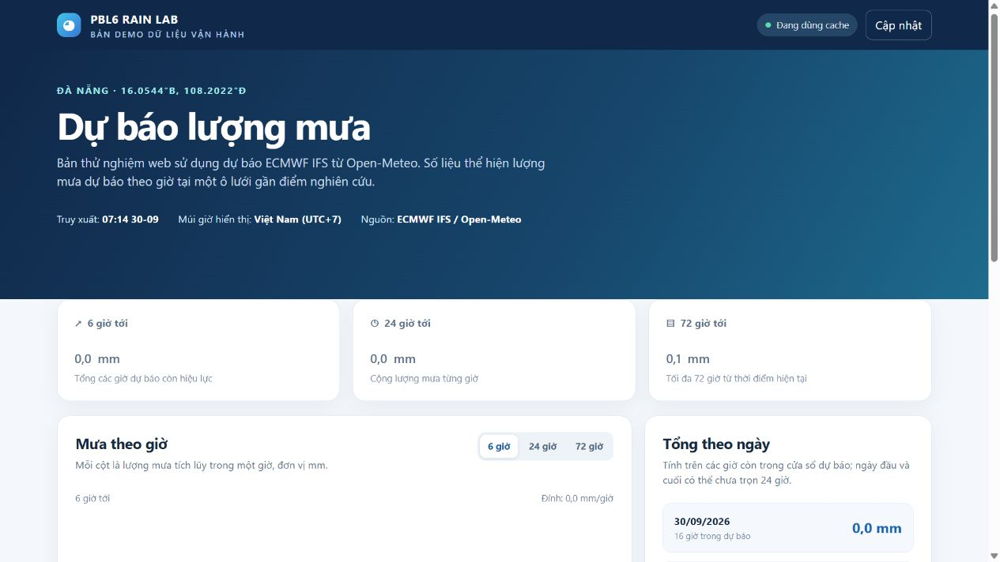
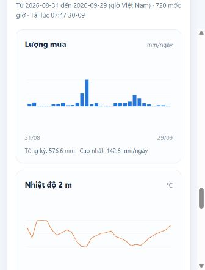
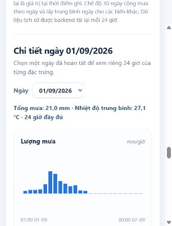
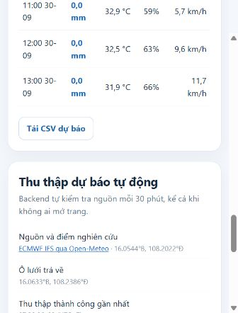

# Web demo dự báo mưa Đà Nẵng — bản trình bày nhanh

Demo này là một website chạy bằng Python 3.10+ và thư viện chuẩn. Backend tự
thu thập dự báo ECMWF IFS HRES qua Open-Meteo cho điểm nghiên cứu
**16.0544°B, 108.2022°Đ** mỗi 30 phút. Mỗi lần lấy thành công được lưu thành
một snapshot có timestamp. Trang hiển thị 6/24/72 giờ, tổng mưa theo ngày,
sáu giờ chi tiết, trạng thái thu thập và xuất CSV. Phần **Dữ liệu quá khứ**
hiển thị năm biểu đồ từ Open-Meteo Historical Weather API cho 7 hoặc 30 ngày.
Bộ chọn ngày bên dưới cho xem **24 giờ của một ngày cụ thể** qua năm biểu đồ
và bảng các giá trị theo giờ.







## Chạy trước buổi báo cáo

Tại thư mục gốc của dự án:

```powershell
python demo/app.py --refresh-once
python demo/app.py --port 8765
```

Mở **http://127.0.0.1:8765/** trong trình duyệt. Lệnh đầu kiểm tra kết nối
Open-Meteo và in tóm tắt; lệnh thứ hai giữ website chạy. Dừng bằng `Ctrl+C`.
Không cần cài thêm package, không cần VRain API key hoặc tải ERA5. Python trong
`.venv` đi kèm thư mục được chuyển từ máy khác có thể không chạy; dùng Python
3.10+ đang cài trên máy.

Tác vụ nền bắt đầu ngay khi server chạy, sau đó lặp lại mỗi 30 phút dù không
có ai mở website. Trang chỉ đọc bản đã lưu và tự cập nhật thông tin hiển thị
mỗi phút; nút **Cập nhật** cho phép kiểm tra nguồn ngay khi cần. Nếu đường
truyền Open-Meteo ngắt, backend dùng bản cache tối đa 12 giờ và giao
diện báo **Dữ liệu cũ**. Khi không còn dữ liệu phù hợp, API trả lỗi 503 thay vì
tạo số liệu giả. Cache nằm tại `.cache/demo_forecast.json` và không nằm trong Git.
Các snapshot lịch sử nằm tại `data/operational/forecast_snapshots/YYYY/MM/DD/`.
Tác vụ tự động chỉ chạy khi tiến trình `demo/app.py` còn hoạt động; triển khai
24/7 về sau cần chạy nó như một dịch vụ trên máy chủ.
Nếu lần tải lịch sử thất bại, backend thử lại sau một giờ; luồng dự báo thử lại
sau 30 phút.

## Nguồn dữ liệu và chu kỳ

| Luồng | Nguồn | Chu kỳ backend | Ý nghĩa |
| --- | --- | --- | --- |
| Dự báo 1–72 giờ | Open-Meteo Forecast API, cố định `models=ecmwf_ifs` | Kiểm tra mỗi 30 phút | ECMWF IFS HRES chạy mô hình khoảng mỗi 6 giờ. Kiểm tra API 30 phút không đồng nghĩa có bản mô hình mới 30 phút/lần. |
| Ước tính lịch sử | Open-Meteo Historical Weather API, cố định `models=ecmwf_ifs` | Tải lại mỗi 24 giờ | Lấy 30 ngày địa phương đã hoàn tất; cache tại `.cache/demo_history.json`. Đây là sản phẩm mô hình lịch sử, không phải mưa trạm. |
| Bản dự báo đã nhận | Snapshot mỗi lần tải Forecast API thành công | Theo lần tải thành công | Lưu tại `data/operational/forecast_snapshots/` để tra lại dữ liệu từng thời điểm. `fetched_at` là lúc backend nhận dữ liệu, chưa phải giờ khởi tạo ECMWF. |
| Trang web | API nội bộ của backend | Đọc lại mỗi phút đối với dự báo, mỗi 10 phút đối với lịch sử | Mở trang hoặc đổi tab không gọi Open-Meteo. |

Chế độ **7 ngày** vẽ chuỗi theo giờ. Chế độ **30 ngày** cộng mưa theo ngày và
lấy trung bình ngày cho nhiệt độ, độ ẩm, áp suất và tốc độ gió. Không vẽ hướng
gió thành đường liên tục vì giá trị 359° và 1° gần nhau về phương vị nhưng sẽ
trông như một biến động rất lớn trên biểu đồ tuyến tính. Dữ liệu lịch sử có thể
được nhà cung cấp sửa về sau; cache này dùng để xem xu hướng, còn snapshot dự
báo là bản đã nhận tại thời điểm tương ứng.

Open-Meteo ghi lượng mưa tại **cuối** khoảng tích lũy một giờ. Backend tải thêm
mốc 00:00 của ngày kế tiếp rồi nhóm mưa theo ngày của khoảng một giờ vừa kết
thúc; vì thế tổng mưa ngày có đủ 24 giờ theo lịch Việt Nam. Các biến tức thời
được lấy trung bình tại **cuối 24 khoảng giờ đó** (01:00 của ngày chọn đến
00:00 ngày kế tiếp), đúng với 24 hàng hiển thị trong bảng chi tiết.

## Kịch bản trình bày 2 phút

1. **Vấn đề:** Mô hình Bi-LSTM/Informer trong repo được nghiên cứu trên dữ liệu
   lịch sử. Nguồn mưa trạm theo giờ chưa sẵn có và ERA5 thường đến muộn vài ngày,
   nên chưa thể nối thẳng checkpoint vào đầu vào vận hành rồi tuyên bố chất lượng
   dự báo thời gian thực.
2. **Giải pháp đang chạy:** Tác vụ nền lấy dự báo ECMWF IFS từ Open-Meteo mỗi
   30 phút, lưu bản cuối và cung cấp cùng một JSON cho website. Các lượt xem
   không tạo thêm yêu cầu tới Open-Meteo. Mỗi lần thu thập thành công được lưu
   riêng để kiểm tra về sau. Người dùng thấy lần thu thập thành công, lần kiểm
   tra, lịch kế tiếp, tọa độ và ô lưới thực tế; số liệu mưa là
   **dự báo mô hình, đơn vị mm cho khoảng một giờ**.
3. **Demo:** Mở website, chuyển tab 6 → 24 → 72 giờ, xem tổng mưa theo ngày và
   tải CSV. Nhấn **Cập nhật** nếu muốn kiểm tra bản nguồn mới. Kéo xuống **Dữ
   liệu quá khứ**, chuyển 7 ngày theo giờ ↔ 30 ngày theo ngày để xem năm đặc
   trưng khí tượng, rồi chọn một ngày để đọc 24 hàng cụ thể. Chỉ rõ hai phần
   dùng hai API khác nhau.
4. **Giới hạn và bước tiếp theo:** Đây là bản web chứng minh luồng dữ liệu triển
   khai. Bi-LSTM 1–6 giờ và Informer hiện chỉ 24 giờ vẫn cần kiểm định theo thời
   điểm phát hành và với nhãn độc lập trước khi hiển thị như dự báo ML chính thức.

## Bằng chứng kiểm thử ngày 30/09/2026

- `python demo/app.py --refresh-once` gọi Open-Meteo thành công, nhận **72 giờ
  còn hiệu lực** với mô hình `ecmwf_ifs`.
- Website và `GET /api/forecast` trả HTTP 200; JSON gồm nguồn, thời điểm tải,
  ô lưới, các giờ, tổng 6/24/72 giờ và tình trạng thu thập.
- `GET /api/forecast.csv` trả HTTP 200, **73 dòng** gồm một dòng tiêu đề và
  72 giờ dự báo. Giao diện đã được kiểm tra trong trình duyệt.
- Tác vụ nền tự lấy dữ liệu ngay khi server khởi động. `GET /api/collection`
  trả lần thử, lần thành công, lần dự kiến kế tiếp và thời điểm snapshot đã lưu.
  Hai lượt đọc `/api/forecast` không làm thay đổi thời điểm thử thu thập.
- `GET /api/history?days=7` trả 168 giờ; `days=30` trả 720 giờ, tới hết ngày
  29/09/2026 theo giờ Việt Nam trong lần kiểm thử này.
- Chọn 01/09/2026 trên web cho đúng 24 hàng; tổng mưa 21,0 mm và nhiệt độ
  trung bình 27,142 °C khi tính trực tiếp từ các hàng, khớp số tổng hợp của API
  (giao diện làm tròn nhiệt độ thành 27,1 °C).
- Lượng mưa cụ thể thay đổi khi mô hình cập nhật; không nên chép con số từ ảnh
  chụp làm kết quả cố định.

## Cấu trúc và phạm vi

| Thành phần | Vai trò |
| --- | --- |
| `demo/app.py` | Thu thập, kiểm tra dữ liệu, cache, JSON API, CSV và web server. |
| `demo/index.html` | Giao diện web, biểu đồ theo giờ và bảng số liệu. |
| `.cache/demo_forecast.json` | Bản dự báo gần nhất, được tạo khi chạy. |
| `data/operational/forecast_snapshots/` | Các snapshot đã thu thập theo ngày; Git bỏ qua thư mục này. |
| `.cache/demo_history.json` | Dữ liệu lịch sử 30 ngày gần nhất cho biểu đồ. |

API chính: `/api/forecast`, `/api/forecast.csv`, `/api/collection`,
`/api/history?days=7|30`, `/api/health`. Toàn bộ thời
gian trong JSON/CSV là UTC; trang chuyển sang giờ Việt Nam (UTC+7). Backend
chỉ tải từ một mô hình cố định để tránh thay đổi nguồn ngoài ý muốn. `fetched_at`
là giờ **backend nhận dữ liệu**, không phải giờ ECMWF khởi tạo mô hình.

Website hiện chỉ đại diện cho **một điểm gần trung tâm Đà Nẵng**; nó không
đưa ra dự báo cấp phường, không dùng mưa trạm và không phát cảnh báo thiên tai
tự động. Bản tin cảnh báo chính thức được liên kết riêng trên trang. Kết quả
ML hồi cứu của repo không được dùng để tuyên bố độ chính xác của website này.

## Tài liệu nguồn

- [Open-Meteo ECMWF Forecast API](https://open-meteo.com/en/docs/ecmwf-api)
- [Open-Meteo Historical Weather API](https://open-meteo.com/en/docs/historical-weather-api)
- [Open-Meteo model updates](https://open-meteo.com/en/docs/model-updates)
- [Open-Meteo terms of use](https://open-meteo.com/en/terms) — Free API dùng cho phi thương mại.
- [ECMWF ERA5 latency](https://confluence.ecmwf.int/spaces/GCR/pages/473842427/ECMWF%2BERA5)
- [Kiểm toán dữ liệu as-of của dự án](../reports/realtime_readiness/READINESS.md)


