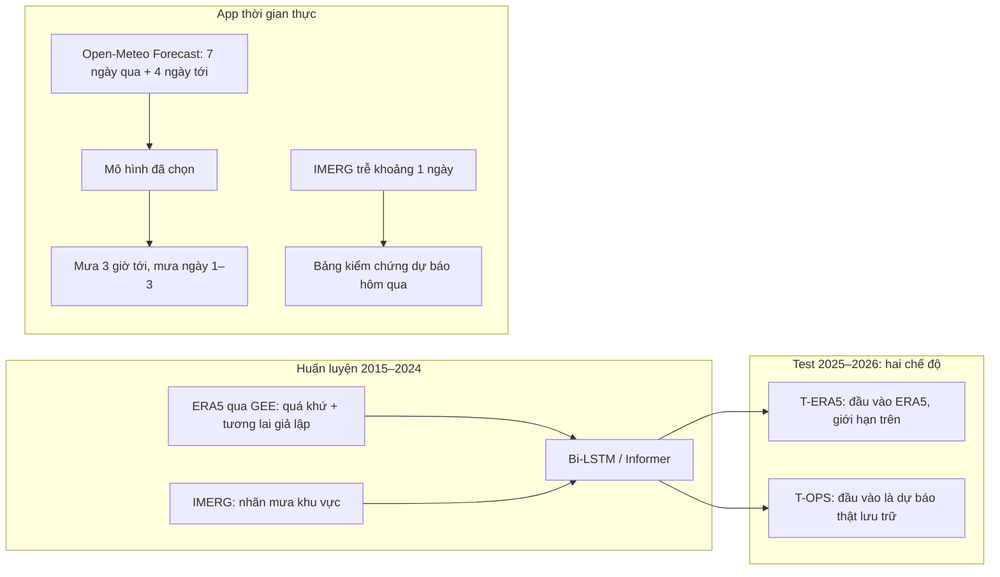

# Kế hoạch tổng thể: Dự báo mưa cực ngắn (1–6 h) và hạn ngắn (24–72 h) cho 5 thành phố Việt Nam

> [!NOTE]
> Plan này **thay thế** `multi_city_plan.md`. Mọi khẳng định về dữ liệu bên dưới đều đã được **chạy thử thật** sáng 11/10/2026 (mục 3), không phải phỏng đoán.

---

## 1. Người dùng thực sự cần dự báo mưa cho bao nhiêu giờ tới?

### 1.1. Các cơ quan khí tượng đang làm gì

| Nơi | Sản phẩm | Hạn dự báo | Dữ liệu cốt lõi |
| --- | --- | --- | --- |
| JMA (Nhật) | 高解像度降水ナウキャスト ("Mây mưa di chuyển") | **0–1 giờ**, 5 phút/lần, lưới 250 m | Radar |
| JMA (Nhật) | 降水短時間予報 ("Mưa sắp tới") | **đến 15 giờ**, theo từng giờ, lưới 1 km | Radar + trạm + mô hình số |
| JMA / tenki.jp | Dự báo theo điểm | 1–2 ngày, chia **khối 3 giờ** | Mô hình số |
| NCHMF (Việt Nam) | Tin cảnh báo dông, lốc, sét, mưa đá | **0–3 giờ tới** | Radar, vệ tinh |
| NCHMF (Việt Nam) | Bản tin thời tiết thường | 24–72 giờ, đến 10 ngày | Mô hình số |

**Về con số "3 giờ ở Nhật" bạn nghe:** nhiều khả năng đó là dự báo chia **khối 3 giờ** của JMA/tenki.jp, hoặc nhầm với nowcast 1 giờ của JMA. Nhưng con số 3 giờ vẫn hợp lý vì nó **trùng với ngưỡng 0–3 giờ** trong tin cảnh báo dông của NCHMF.

### 1.2. Thuật ngữ chính thức nên dùng trong báo cáo

Thông tư **08/2022/TT-BTNMT** quy định: **cực ngắn** là đến 12 h, **ngắn** là trên 12 h đến 72 h, **vừa** là 3–10 ngày.

> [!IMPORTANT]
> Theo thông tư này, "24–72 h" là **hạn ngắn**, không phải "dài hạn". Báo cáo nên dùng **"dự báo cực ngắn (1–6 h)"** và **"dự báo hạn ngắn (24–72 h)"** để hội đồng không bắt lỗi thuật ngữ.

### 1.3. Chốt hạn dự báo cho đồ án

| Mô hình | Đầu ra | Hiển thị trên app | Lý do |
| --- | --- | --- | --- |
| **Bi-LSTM** | Từng giờ, t+1 → t+6 | **Tổng mưa 3 giờ tới** và xác suất có mưa (mục chính); biểu đồ 6 giờ | Khớp mốc 0–3 h của NCHMF; 6 h làm vùng đệm để báo cáo độ suy giảm theo hạn |
| **Informer** | Từng giờ, t+1 → t+72 | **Tổng mưa ngày 1, 2, 3**, chia khối 6 giờ, xác suất vượt ngưỡng | Mưa từng giờ ở hạn 48–72 h quá nhiễu; người dùng cần biết "ngày mai/ngày kia có mưa to không" |

> [!WARNING]
> **Không làm 0–1 h.** Nowcast 0–1 h của JMA cần radar 250 m, cập nhật 5 phút/lần. Dữ liệu của chúng ta là vệ tinh khoảng 30 km, 30 phút/lần, nên không thể cạnh tranh ở hạn này. Báo cáo cần nói rõ giới hạn này.

---

## 2. Bài toán được định nghĩa chính xác

- **Nhãn (sự thật):** lượng mưa **trung bình khu vực khoảng 30 × 30 km** quanh trung tâm mỗi thành phố, tính theo mm/giờ, lấy từ **NASA GPM IMERG V07**.
- **Đầu vào:** các biến khí quyển mà **lúc chạy app vẫn lấy được**. Đây là nguyên tắc sống còn, xem mục 4.
- **5 thành phố:** Hà Nội, Đà Nẵng, Nha Trang, Buôn Ma Thuột, TP.HCM. Dùng **1 mô hình chung**, có embedding cho từng thành phố.
- **Chia dữ liệu theo thời gian:**
  - Train: 2015-01 → 2022-12.
  - Validation: 2023-01 → 2024-12.
  - Test: 2025-01 → 2026-05.
  - Test dừng ở 2026-05 để chỉ dùng IMERG bản **Final** đã hiệu chỉnh theo trạm. Bản Final ra muộn khoảng 3,5 tháng.

---

## 3. Kiểm chứng tính khả thi của dữ liệu (đã chạy thật)

| Nguồn | Kết quả kiểm tra | Vai trò |
| --- | --- | --- |
| **IMERG V07** (đã tải về) | 5 thành phố × 204.526 bản ghi 30 phút, 2015-01 → 2026-08, **0 giá trị thiếu**. Tỷ lệ giờ có mưa từ 13,6 % (Nha Trang) đến 28,2 % (TP.HCM) | **Nhãn** |
| IMERG trên Google Earth Engine (GEE) | Ảnh mới nhất trễ khoảng **29 giờ** so với hiện tại | **Không dùng được làm đầu vào thời gian thực.** Chỉ dùng để app tự kiểm chứng dự báo của hôm qua |
| **ERA5 hourly trên GEE** | Có 292 band, trong đó có **CAPE, CIN, K-index, Total Totals, TCWV, độ cao lớp biên (BLH), mây thấp/giữa/cao, thông lượng ẩm tích phân, tp**. Dữ liệu trễ khoảng 6 ngày | **Đầu vào huấn luyện**. Tải nhanh như IMERG (vài giờ), không phải xếp hàng CDS |
| ERA5 tầng áp suất (gió, ẩm ở 850/500 hPa) | Chỉ có trên CDS. CDS rất chậm: đêm qua mất khoảng 4 giờ cho 7 tháng. Open-Meteo Archive **không có** biến tầng áp suất và CAPE | **Tùy chọn**, không nằm trên đường găng (nhóm G3) |
| **Open-Meteo Forecast** (dùng cho app) | `past_days=7` + 4 ngày dự báo, **có đủ mọi biến**: bề mặt, CAPE, CIN, TCWV, BLH, 850/500 hPa | **Đầu vào lúc chạy app** |
| **Open-Meteo Historical Forecast** | Lưu trữ dự báo thật: đủ CAPE và biến 850 hPa **từ 2021-06** | Kiểm tra "vận hành thật" cho Bi-LSTM; nguồn dự phòng để fine-tune |
| **Open-Meteo Previous Runs** | Dự báo theo hạn ngày 1/2/3 (mưa, CAPE, nhiệt độ…) **từ 2024-02** | Baseline mô hình số ở hạn 24–72 h; đầu vào tương lai thật cho Informer khi test |
| GPU | **RTX 4060 Laptop 8 GB**, không phải GTX 1650 như plan cũ | Đủ để chạy toàn bộ thí nghiệm |

> [!CAUTION]
> **Rủi ro lớn nhất đã được phát hiện trước:** dữ liệu mưa quan trắc (IMERG) có sẵn muộn khoảng 29 giờ. Nếu cho mô hình dùng "mưa quan sát được giờ trước" làm đầu vào, điểm số lúc huấn luyện sẽ rất đẹp, nhưng **app không thể chạy được**. Vì vậy, mưa quan sát gần (độ trễ dưới 30 h) chỉ được dùng trong thí nghiệm **"Oracle"**: thí nghiệm này ghi rõ là không triển khai được, chỉ để đo giới hạn trên.

---

## 4. Nguyên tắc cốt lõi: huấn luyện một kiểu, chạy app đúng kiểu đó

- Đây là cách tiếp cận **Perfect Prognosis**, một phương pháp kinh điển trong hậu xử lý thống kê.
  - Khi huấn luyện, giá trị "tương lai" của khí quyển lấy từ ERA5, coi như một dự báo hoàn hảo.
  - Khi chạy thật, thay bằng dự báo số của Open-Meteo.
- **T-OPS** là điểm khác biệt lớn nhất so với plan cũ: nó đo xem mô hình **thực sự hoạt động thế nào khi chạy app**, chứ không chỉ đo trên dữ liệu đẹp.
- **Mọi biến đều có bảng ánh xạ ERA5 ↔ Open-Meteo**, gồm cả việc đổi đơn vị (Pa → hPa, m → mm, tỷ lệ → %).
  - Riêng K-index và Total Totals không có sẵn trong Open-Meteo. Ta tự tính chúng từ nhiệt độ và điểm sương tại 850/700/500 hPa, dùng đúng công thức mà ERA5 dùng.

---

## 5. Thiết kế so sánh: thêm/bớt nhóm đặc trưng trong cùng một kiến trúc

### 5.1. So sánh chỉ bằng cách thêm/bớt đặc trưng có hợp lệ không?

**Có.** Cách làm này gọi là **ablation study theo nhóm đặc trưng**, rất phổ biến trong các bài báo. Tuy vậy, nó **chỉ có giá trị** khi thỏa đủ 5 điều kiện sau. Plan này đáp ứng cả 5:

1. **Giữ cố định kiến trúc, siêu tham số và số epoch.** Chỉ thay đổi tập đặc trưng đầu vào.
2. **Chạy 3 seed cho mỗi cấu hình**, báo cáo trung bình ± độ lệch chuẩn. Kiểm định khác biệt bằng **bootstrap theo khối ngày**, lấy khoảng tin cậy 95 %.
3. **Luôn có baseline.** Nếu không có baseline, câu "tốt hơn" không trả lời được "tốt hơn cái gì". Baseline gồm khí hậu, mưa thô của mô hình số, và LightGBM.
4. **Chia nhóm đặc trưng theo ý nghĩa vật lý**, không thêm biến một cách ngẫu nhiên.
5. **Chọn đặc trưng cho app dựa trên kết quả T-OPS ở tập validation**, không dựa trên test và không dựa trên kết quả với đầu vào ERA5.

> [!NOTE]
> Bi-LSTM và Informer **không đấu trực tiếp** với nhau vì mỗi mô hình phụ trách một hạn dự báo khác nhau. Để bảo vệ lựa chọn kiến trúc, có một thí nghiệm phụ chi phí thấp: chạy Bi-LSTM ở hạn 24–72 h và Informer ở hạn 1–6 h với cùng tập đặc trưng tốt nhất.

### 5.2. Các nhóm đặc trưng

| Nhóm | Nội dung | Nguồn huấn luyện | Nguồn khi chạy app | Câu hỏi khoa học |
| --- | --- | --- | --- | --- |
| **G0** Nền (luôn bật) | sin/cos của giờ và ngày trong năm, embedding thành phố | Tự tính | Tự tính | — |
| **G1** Bề mặt | T2m, điểm sương, MSLP, áp suất bề mặt, gió u/v 10 m, mây tổng/thấp/giữa/cao | GEE ERA5 | Open-Meteo | Trạng thái bề mặt đủ để dự báo chưa? |
| **G2** Đối lưu – nhiệt động | CAPE, CIN, TCWV, BLH, K-index, Total Totals | GEE ERA5 | Open-Meteo (tự tính K/TT) | Độ bất ổn định có giúp bắt mưa dông không? |
| **G3** Trên cao *(tùy chọn)* | u, v, độ ẩm ở 850 và 500 hPa | CDS (chạy nền) | Open-Meteo | Gió mùa và dòng ẩm tầng thấp có giúp thêm không? |
| **G4** Mưa của mô hình số | tp quá khứ | GEE ERA5 | `precipitation` của Open-Meteo | AI có sửa được sai số mưa của mô hình số không? |
| **G5** Bối cảnh không gian | Trung bình 5 × 5 ô (khoảng 125 km) của G1, G2, G4, so với chỉ dùng 1 ô | GEE ERA5 | Open-Meteo (gọi nhiều điểm) | Một tọa độ có đủ không? (trả lời câu hỏi gốc của bạn) |
| **G6** Đặc trưng tương lai | Giá trị G1, G2, G4 tại **các giờ cần dự báo** | ERA5 (perfect prog) | Dự báo Open-Meteo | Đưa dự báo số vào mô hình giúp được bao nhiêu? |
| *Oracle* | Mưa IMERG có độ trễ 1 giờ | IMERG | **Không có** | Giới hạn trên nếu có dữ liệu quan trắc thời gian thực (radar, GSMaP_NOW) |

### 5.3. Ma trận thí nghiệm

**Bi-LSTM, hạn 1–6 h** (cửa sổ 24 h quá khứ; khi bật G6 thì nối thêm 6 bước tương lai, kèm cờ đánh dấu bước nào là tương lai):

| ID | Nhóm đặc trưng |
| --- | --- |
| S1 | G0 + G1 |
| S2 | S1 + G2 |
| S3 | S2 + G4 |
| S4 | S3 + G5 |
| S5 | S4 + G6 |
| S6 | S5 + G3 *(nếu có dữ liệu)* |
| S-LOGO | Từ cấu hình tốt nhất, **bỏ ra từng nhóm một** (leave-one-group-out), để tránh kết luận bị phụ thuộc vào thứ tự thêm nhóm |
| S-Oracle | S5 + IMERG trễ 1 h *(chỉ để tham khảo)* |

**Informer, hạn 24–72 h** (encoder 168 h, decoder 48 + 72 h): có cùng chuỗi **L1 → L6** và **L-LOGO** như trên. Ở L5, G6 được đưa vào **decoder** dưới dạng đặc trưng tương lai đã biết.

**Khối lượng tính toán:**
- Bi-LSTM: khoảng 12 cấu hình × 3 seed, mỗi lần chạy khoảng 5–10 phút → **4–6 giờ GPU**.
- Informer: khoảng 11 cấu hình × 3 seed, mỗi lần chạy khoảng 20–30 phút (lấy mẫu cửa sổ với stride 3) → **12–16 giờ GPU**, tức chạy qua 2 đêm.

**Giả thuyết dự kiến (để viết báo cáo):**
- **H1:** G2 giúp rõ nhất ở mùa mưa dông của TP.HCM, Buôn Ma Thuột và Hà Nội.
- **H2:** G6 là nhóm quan trọng nhất ở hạn 24–72 h.
- **H3:** G5 giúp Informer nhiều hơn Bi-LSTM.
- **H4:** Khoảng cách giữa T-OPS và T-ERA5 tăng dần theo hạn dự báo.

### 5.4. Đầu ra và hàm mất mát (tận dụng code đã có trong repo)

- **Hai đầu ra:**
  - Lượng mưa, biến đổi `log1p`, dùng hàm mất mát Huber có trọng số cho mưa lớn.
  - Xác suất có mưa ≥ 0,5 mm/h, dùng BCE. Phần này tái sử dụng `RainAlertBiLSTM` và `rain_alert_loss` đã có trong repo.
- **Embedding thành phố** kích thước 8, ghép vào mỗi bước thời gian.
- **Chuẩn hóa:** chỉ fit trên tập train.

---

## 6. Đánh giá

| Loại | Hạn 1–6 h (Bi-LSTM) | Hạn 24–72 h (Informer) |
| --- | --- | --- |
| Baseline triển khai được | Khí hậu (thành phố × tháng × giờ); mưa thô ERA5/Open-Meteo; LightGBM với cùng đặc trưng | Khí hậu; **mưa dự báo của mô hình số ở hạn ngày 1/2/3** (Previous Runs); LightGBM |
| Baseline tham khảo | Persistence IMERG (không triển khai được) | — |
| Sai số | MAE, RMSE theo từng giờ; MAE của **tổng 3 giờ** | MAE của **tổng 24 giờ** cho ngày 1, 2, 3 |
| Phát hiện mưa | POD, FAR, CSI với tổng 3 h ≥ 1 / 10 / 20 mm | POD, FAR, CSI với tổng 24 h ≥ 16 / 50 / 100 mm (ngưỡng mưa vừa / to / rất to của Việt Nam) |
| Xác suất | Brier score, biểu đồ reliability | Như cột bên trái |
| Phân tách kết quả | Theo thành phố, theo mùa mưa của từng vùng, theo giờ trong ngày | Theo thành phố, theo mùa |
| Hai chế độ | **T-ERA5** và **T-OPS** | **T-ERA5** và **T-OPS** |

> [!WARNING]
> **Kỳ vọng phải trung thực:** ở hạn 24–72 h, AI **rất khó thắng hẳn** mô hình số ECMWF/GFS về MAE. Tiêu chí thành công hợp lý hơn:
> 1. Thắng baseline khí hậu.
> 2. Giảm sai lệch hệ thống của mô hình số (mưa phùn giả, lệch pha chu kỳ ngày) và cải thiện CSI hoặc Brier ở ít nhất một nhóm ngưỡng.
> 3. Đưa ra xác suất mưa đáng tin cậy.
>
> Tất cả đều là kết quả có thể bảo vệ được, kể cả khi MAE không thắng.

---

## 7. App

- **Backend:** mở rộng `demo/app.py`. App này đã có sẵn phần gọi Open-Meteo ECMWF IFS, cache, lưu snapshot và máy chủ HTTP.
  - Mỗi giờ: gọi Open-Meteo cho 5 thành phố, mỗi thành phố gồm điểm tâm và lưới 5 × 5 điểm (gộp vào 1 request nhiều tọa độ).
  - Sau đó dựng đặc trưng **bằng cùng module đã dùng khi huấn luyện**, rồi chạy suy luận trên CPU (vài mili giây).
  - Kết quả được ghi vào cache JSON.
- **Giao diện:**
  - Bản đồ 5 thành phố.
  - Tab **"3 giờ tới"**: biểu đồ cột t+1…t+6, tổng 3 h, xác suất có mưa.
  - Tab **"3 ngày tới"**: tổng mưa ngày 1/2/3, khối 6 giờ, xác suất vượt ngưỡng.
  - Hiển thị kèm dự báo thô của Open-Meteo để người xem tự so sánh.
- **Bảng kiểm chứng:** khoảng 1–2 ngày sau, khi IMERG có số liệu, app tự so dự báo đã lưu với IMERG. Đây là điểm cộng lớn khi demo.
- **Chú thích bắt buộc trên app:** "Lượng mưa trung bình khu vực khoảng 30 × 30 km quanh trung tâm thành phố".
- **Khi API lỗi:** dùng snapshot gần nhất và hiện thời điểm cập nhật. Cơ chế này đã có trong `demo/app.py`.

---

## 8. Cổng kiểm soát rủi ro: mỗi bước đều có phương án dự phòng

| Cổng | Điều kiện để đi tiếp | Nếu không đạt |
| --- | --- | --- |
| **Cổng 1** – Dữ liệu | ERA5 qua GEE trích đủ cho 5 thành phố; IMERG có chu kỳ ngày hợp lý; tương quan theo ngày giữa IMERG và ERA5 `tp` ở mức hợp lý | GEE lỗi → dùng Open-Meteo Archive (có bề mặt, thiếu CAPE) + CDS. Một thành phố có IMERG bất thường → đổi sang thành phố khác cùng vùng (Huế, Quy Nhơn) |
| **Cổng 2** – Baseline | Đã có điểm số của khí hậu, mưa thô mô hình số và LightGBM | Không có rủi ro; bước này chỉ để biết mức cần vượt |
| **Cổng 3** – Bi-LSTM | S5 thắng khí hậu về MAE và thắng mưa thô về CSI hoặc sai lệch, trên validation | Thử LightGBM hoặc hậu xử lý kiểu MOS. App vẫn chạy với mưa mô hình số đã hiệu chỉnh sai lệch |
| **Cổng 4** – T-OPS | Kết quả T-OPS kém hơn T-ERA5 không quá khoảng 30 % | **Fine-tune** trên dữ liệu Historical Forecast 2021-06 → 2024 (đã kiểm tra là có đủ), tức chuyển từ perfect-prog sang MOS |
| **Cổng 5** – G3 | Dữ liệu CDS tầng áp suất tải xong trước khi bắt đầu Giai đoạn 3 | Bỏ G3. K-index và Total Totals trong G2 đã mang phần lớn thông tin tầng cao |

**Sản phẩm tối thiểu luôn còn lại, kể cả khi mọi mô hình đều không vượt được mô hình số:**
- Pipeline dữ liệu cho 5 thành phố.
- Nghiên cứu ablation nghiêm túc, có kiểm định thống kê.
- App hiển thị dự báo AI, dự báo số và bảng kiểm chứng.

Đó vẫn là một đồ án hoàn chỉnh và trung thực.

---

## 9. Lộ trình

| Giai đoạn | Việc | Thời gian ước lượng | Ai làm |
| --- | --- | --- | --- |
| **P1** Dữ liệu | Trích ERA5 từ GEE (điểm + 5 × 5) cho 5 thành phố; tải Historical Forecast và Previous Runs; CDS tầng áp suất chạy nền theo quý; dựng bảng dài + bảng ánh xạ biến; kiểm tra chất lượng → **Cổng 1** | 1–2 ngày | Tôi |
| **P2** Baseline + EDA | Khí hậu, mưa thô, LightGBM; biểu đồ chu kỳ ngày và mùa của từng thành phố → **Cổng 2** | 1 ngày | Tôi |
| **P3** Bi-LSTM | S1–S6, LOGO, Oracle, 3 seed → **Cổng 3** | 1–2 ngày (GPU chạy đêm) | Tôi, trên máy bạn |
| **P4** Informer | L1–L6, LOGO, thêm đầu vào tương lai cho decoder | 2–3 ngày | Tôi, trên máy bạn |
| **P5** Vận hành | Đánh giá T-OPS, chốt tập đặc trưng cho app theo validation → **Cổng 4**; fine-tune nếu cần | 1 ngày | Tôi |
| **P6** App | Nâng cấp `demo/app.py` lên 5 thành phố, 2 mô hình, bảng kiểm chứng | 2–3 ngày | Tôi |
| **P7** Báo cáo | Bảng, biểu đồ, phần hạn chế; viết song song từ P2 | Song song | Tôi soạn, bạn duyệt |

**Tổng cộng:** khoảng **2–3 tuần làm việc**.

**Việc bạn cần làm:** giữ máy bật khi chạy dữ liệu và huấn luyện qua đêm; cài PyTorch có CUDA (tôi sẽ hướng dẫn); duyệt kết quả tại mỗi cổng.

---

## 10. Những điểm cần ghi rõ ở phần "Hạn chế" của báo cáo

1. IMERG là **ước lượng từ vệ tinh**, không phải trạm đo. IMERG thường đánh giá thấp mưa địa hình (Đà Nẵng, Nha Trang) và các đỉnh mưa rất lớn.
2. Nhãn là **mưa trung bình khu vực khoảng 30 km**, không phải mưa tại một điểm. Vì vậy, các ngưỡng mưa to bị "pha loãng" so với số đo tại trạm.
3. Mô hình được huấn luyện theo kiểu perfect-prog trên ERA5. Khoảng cách với vận hành thật được đo bằng T-OPS.
4. Không có radar hay quan trắc thời gian thực, nên không làm 0–1 h. Thí nghiệm Oracle cho thấy phần cải thiện có thể đạt được nếu có thêm nguồn này.
5. **Hướng mở rộng:** dùng GSMaP_NOW của JAXA (độ trễ khoảng 0 giờ, cần đăng ký) làm đầu vào quan trắc thời gian thực.
