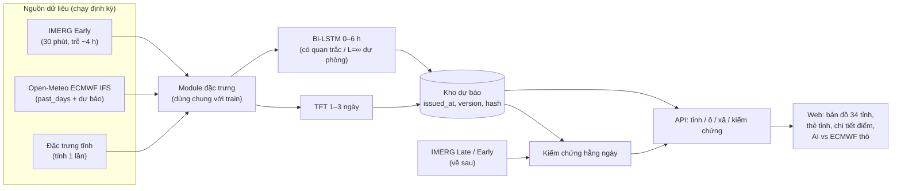

# Kế hoạch v2: Dự báo mưa 0–6 giờ (Bi-LSTM) và 1–3 ngày (TFT) cho các tỉnh/thành Việt Nam, từ so sánh mô hình đến ứng dụng

> **Định hướng mới20/10/2026 của người dùng:** ưu tiên nghiên cứu thêm/bớt đặc trưng cho mưa một vùng, không tập trungapp. Đã tạoV1/V2vùng và chạy pilotLightGBM sofull_featurescũ trên cùng nhãn: [báo cáo/CI](reports/regional_danang_v1_v2/README.md). Có tín hiệu dương2021, chưa ổn định2022–2023; chưa chốt lại toàn bộ hạn/kiến trúc hoặc mởtest2025. [Thiết kế nghiên cứu](reports/research_rainfall/thiet_ke_nghien_cuu_dac_trung_2026_10_20.md) và [phản biện dữ liệu](reports/research_rainfall/phan_bien_du_lieu_2026_10_20.md) được ưu tiên hơn kế hoạch vận hành cũ bên dưới. Không quyOpen-Meteobest_match thànhERA5thuần hoặc coi nhãnngày đãxácnhận nhãngiờ.

> Lập ngày 11/10/2026. Tài liệu này đọc cùng `project_master_plan.md` (bản sáng cùng ngày); mục 11 ghi rõ phần giữ, phần đổi.
> Các con số ở mục 1 được tính lại hôm nay từ `data/processed/danang_full_features_2015_2026.parquet`, NOAA GSOD (trạm sân bay Đà Nẵng) và Open-Meteo Previous Runs.

---

## 0. Tóm tắt các quyết định

1. **Đổi nhãn trước khi làm việc khác.** Nhãn hiện tại là mưa Open-Meteo Archive, về bản chất là tái phân tích ERA5. So với trạm Đà Nẵng, nhãn này chỉ bắt được 8 % số ngày mưa ≥100 mm (mục 1.1). Thí nghiệm 0 (mục 4.1) sẽ chọn nhãn mới, như IMERG Final hoặc GSMaP Gauge, bằng cách đối chiếu với trạm.
2. **AI không thay mô hình số mà sửa và bổ sung nó.** Câu hỏi nghiên cứu: *nhóm đặc trưng nâng cao nào giúp Bi-LSTM và TFT vượt dự báo số thô (ECMWF) cùng các baseline?*
3. **Bi-LSTM 0–6 h cần có mưa quan trắc gần thời gian thực, và điều này triển khai được.** IMERG Early có độ trễ khoảng 4 h. Thí nghiệm "độ trễ quan trắc" là đóng góp chính của sản phẩm này.
4. **Mô hình 1–3 ngày (TFT, chốt ngày 11/10/2026) phải nhận dự báo số cho các giờ tương lai.** Chỉ dùng lịch sử thì gần như không có kỹ năng: Informer hiện tại có R² = 0,04, và tự tương quan của mưa ở độ trễ 72 h chỉ còn 0,06.
5. **Đơn vị dự báo là ô lưới 0,1° (khoảng 11 km), không phải một điểm cho mỗi tỉnh.** Một mô hình chung phục vụ mọi ô và mọi tỉnh, có thêm đặc trưng tĩnh (độ cao, khoảng cách tới biển…). Một tỉnh là tập các ô nằm trong ranh giới 34 tỉnh mới. App hiển thị trung bình, giá trị lớn nhất và % diện tích của tỉnh, và cho tra cứu theo xã/phường.
6. **So sánh có kiểm soát:**
   - Cố định kiến trúc, chỉ thêm hoặc bớt nhóm đặc trưng (cả cộng dồn lẫn bỏ từng nhóm).
   - Chạy ít nhất 3 seed, dùng cùng một tập test, kiểm định bằng bootstrap khối.
   - Luôn kèm thang baseline: khí hậu, persistence, ECMWF thô, LightGBM, DLinear.
7. **Đánh giá theo hai chế độ đầu vào; so mô hình cùng dữ liệu và so thêm đối chứng ECMWF:**
   - **T-ERA5:** đầu vào là tái phân tích.
   - **T-OPS:** đầu vào là dự báo thật đã lưu trữ (ECMWF Single Runs, có từ 03/2024).

   Test cuối là năm 2025. ERA5 là tái phân tích của thời tiết đã qua; đối chứng ECMWF là **bản IFS được phát hành cho tương lai tại thời điểm dự báo**, lấy lại từ [Single Runs archive](https://open-meteo.com/en/docs/single-runs-api), không phải ERA5. `run` chỉ là giờ khởi tạo và thường cần 4–6 giờ mới có kết quả; T-OPS phải chặn theo giờ thật sự có sẵn trước `issue_at`, không chỉ `run ≤ issue_at`. Kiểm định trên tương lai thật bằng cách cho app chạy qua mùa mưa 10–12/2026.
8. **Kiểm chứng độc lập không có Vrain:** dùng 10 trạm synop NOAA GSOD đạt kiểm soát chất lượng, giai đoạn 2015 → 24/08/2025. Mức sàn đã đo ở mục 1.7.
9. **Phạm vi chia tầng:**
   - **MVP:** Đà Nẵng mới, khoảng 100 ô.
   - **Nên có:** thêm 4 vùng khí hậu.
   - **Mở rộng:** toàn quốc, GSMaP_NOW, hạn 7 ngày.

### 0b. Phạm vi và lựa chọn mô hình (ngày 11/10/2026)

> **Đã chốt về mô hình:** giảng viên không bắt buộc dùng Informer, nên **sản phẩm B dùng TFT làm mô hình chính**. Lý do và cách triển khai ở mục 4.4.
> **Phạm vi:** vẫn là đề xuất; vùng kiểm tra phía nam còn chờ chọn.

**Phạm vi**

| Vai trò | Vùng | Làm gì |
| --- | --- | --- |
| **Trọng tâm** | Trung Trung Bộ: Đà Nẵng mới (94 ô), cùng phần Huế và Quảng Ngãi đã có trong hộp | Toàn bộ ablation A0–A5 và B0–B5, thí nghiệm độ trễ, T-OPS, phân tích sự kiện |
| **Kiểm tra tổng quát hóa** | 2 vùng khí hậu khác: Bắc Bộ (Hà Nội) và Nam Bộ (TP.HCM) hoặc Tây Nguyên (Đắk Lắk) | Chỉ chạy cấu hình cuối và các baseline; thí nghiệm "mô hình chung so với mô hình riêng" và "bỏ một vùng" |

**Nguyên tắc: một mô hình chung, không huấn luyện riêng từng tỉnh.**
- Mô hình chung dùng đặc trưng tĩnh (độ cao, khoảng cách tới biển…) để phân biệt các ô.
- Mô hình riêng theo tỉnh chỉ xuất hiện ở một thí nghiệm, làm đối chứng.
- Căn cứ:
  - Kratzert et al. (2019): một LSTM huấn luyện trên 531 lưu vực thắng các mô hình hiệu chỉnh riêng cho từng lưu vực, và vẫn dự báo tốt ở lưu vực không có trong tập huấn luyện.
  - Montero-Manso & Hyndman (2021) và Rasp & Lerch (2018) cho kết luận tương tự với dữ liệu chuỗi thời gian và dữ liệu trạm.
  - Gộp nhiều vùng làm tăng số sự kiện mưa to (mục 1.7).

**Mô hình**

| Hạn | Mô hình | Đánh giá |
| --- | --- | --- |
| 0–6 h | **Bi-LSTM**, giữ nguyên | Phù hợp. Họ LSTM là lựa chọn chuẩn cho chuỗi khí tượng–thủy văn. Bằng chứng so sánh Bi-LSTM với LSTM và GRU không ngã ngũ, nên kiến trúc không phải đòn bẩy chính. |
| 1–3 ngày | **TFT (Temporal Fusion Transformer)**, kèm đối chứng: ECMWF thô, ECMWF + quantile mapping, LightGBM, DLinear, Bi-LSTM (bảng 2×2). Informer chạy một cấu hình để đối chiếu. | TFT được thiết kế cho đúng ba loại đầu vào của bài toán: đặc trưng tĩnh, dự báo số cho các giờ tương lai, và chuỗi quan sát quá khứ (Lim et al. 2021). Ngoài ra, TFT xuất được phân vị và trọng số chọn biến. |

Lý do không chọn Informer cho hạn 1–3 ngày:
- **Thiết kế không khớp bài toán:** cơ chế ProbSparse sinh ra để tiết kiệm tính toán với chuỗi rất dài, trong khi bài toán ở đây chỉ là 168 → 72 bước.
- **Kết quả trên bộ chuẩn Weather:** Informer kém cả phương án lặp lại giá trị gần nhất (MSE 0,300 so với 0,259 ở hạn 96; 1,059 so với 0,465 ở hạn 720), trong khi DLinear chỉ 0,176 / 0,323 (Zeng et al. 2023).
- **Kết quả của chính đồ án:** R² = 0,04.
- **Thiếu cơ chế cho các đầu vào quan trọng nhất:** Informer không có cơ chế riêng cho đặc trưng tĩnh và cho dự báo số ở các giờ tương lai. TFT có sẵn cả hai, và còn cho trọng số chọn biến, khớp với câu chuyện ablation.

---

### Cập nhật thực nghiệm tối 13/10/2026

Đã hoàn tất BASE/RAW/DOMAIN trên30 ô,3 fold2021–2023, NN3 seed vàLightGBM, cùng30.000 mẫu train/fold. DOMAIN thêm proxy gió–ẩm–địa hình vàoRAW, cùng số tham số174.154. CSI quyết định ≥10 mm/3h NN tăng0,051/0,007/0,031 soRAW nhưng CI95% đều chứa0, LightGBM chưa xác nhận lợi ích rõ;giữ hai ứng viên để kiểm định tiếp. Thử nghiệm không dùng khí tượng tương lai, không mởtest 2025.

Audit nhãn theo mùa và nguồn forecast 93 ô đã chạy;API checkpoint chỉ archive. Thiết kế/điểm:[domain screen](reports/domain_screen_danang/README.md),[brief 14/10](reports/research_rainfall/brief_giang_vien_2026_10_14.md). Lộ trình hiện hành ởKE_HOACH_DU_AN.md mục4/6 và [execution_plan.md](reports/research_rainfall/execution_plan.md).

### Cập nhật follow-up và điều kiện app (13/10/2026)

Đã chạy Tweedie LightGBM/Bi-LSTM RAW, phép bỏ riêng `ne_terrain_index` và suy luận trên 63 ô Đà Nẵng chưa train. RMSE tổng 3 h tháng 5–10 của LightGBM L1(log) → Tweedie: 4,607→3,947 (2021), 4,841→4,534 (2022), 4,205→3,610 (2023). Bi-LSTM RAW cũ → Tweedie: 4,046→3,876; 4,661→4,581; 3,963→3,540. CSI lượng mưa ≥10 cũng tăng; xác suất Bi-LSTM Tweedie đánh đổi BSS ≥1 trong 2022 (0,186→0,148). Kết quả là validation hồi cứu, không chứng minh triển khai tốt hơn ECMWF.

FULL DOMAIN−NO_TERRAIN CSI xác suất ≥10 tăng mô tả 0,025/0,009/0,051, CI từng năm chứa 0. Trên 63 ô chưa train DOMAIN−RAW +0,042/−0,003/+0,029, CI cũng chứa 0. Do đó câu chuyện địa hình là giả thuyết có kiểm tra, chưa là phát hiện chắc chắn. File chính ở `reports/followup_danang/`.

Demo archive `demo/domain_api.py` và `demo/research.html` dùng checkpoint thật, 36 kiểm tra parity qua HTTP đạt. Đã xác minh JAXA FTP và tải raw/Gauge_NRT v8 cùng giờ 10 UTC 13/10; hash/format đúng, raw 93/93 ô hữu hạn. Raw/Gauge tương quan 0,998 trên Đà Nẵng nhưng popup web khác cả hai ở ba ô có mưa; chưa rõ nguyên nhân, popup không được dùng làm nhãn/đầu vào. Cần lịch sử NRT theo giờ, kiểm tra `first_recorded_at ≤ issue` trên cửa sổ 24 giờ/trễ 4 giờ, dịch chuyển MVK/raw→NRT và T-OPS/ECMWF cùng mẫu trước AI live. Đã kiểm 24 tệp raw NRT liên tiếp, 93/93 ô hữu hạn; lag4/issue16 UTC có 21/24 tệp được máy nhận trước issue, lag5/issue17 UTC thử có 24/24. Mốc17 UTC khi audit còn tương lai. Đây là tải lại lịch sử, không suy latency JAXA điển hình; watcher mới đã chạy phiên12h từ16:31 UTC, poll2 16:41 thấy file raw mới và lỗi0; lag4/issue thử17 UTC có24/24 tệp máy nhận kịp (lúc audit issue còn tương lai), nhưng một file mới chưa đủ đo latency điển hình; model hiện train lag4. Đã stress và train lại Bi-LSTM RAW Tweedie lag5 cùng30ô/index/3seed: RMSE3h tăng 0,053/0,043/0,038 mm ở validation2021–23, CI hiệu số dương cả3; CSI xác suất giảm mô tả 2/3 năm nhưng CI chứa0. Đây là đánh đổi nguồn–kỹ năng khám phá, chưa đủ thay checkpoint app; xem `reports/followup_danang/bilstm_tweedie_lag5/`. Tình trạng ECMWF thực tế: 4 snapshot hiện tại cho 93 ô không có `run_init`; baseline trạm/ngày 1–5 ngày không phải đối chứng cho Bi-LSTM 0–6 h. Đã tải/chấm thêm pilot **56/56 run, 30 ô × 14 ngày tháng 10/2024**: 1.680 cặp forecast/nhãn đủ; 0–3 h RMSE ECMWF qua Open-Meteo 3,950 mm, CSI≥10 0,089, luôn 0 cùng mẫu RMSE 3,878 (CI chênh lệch chứa 0). Chỉ 4 ngày có sự kiện mạnh; `available_at` lịch sử chưa chứng thực. **Chưa có bộ 2024 trên 93 ô hoặc điểm AI–ECMWF cùng mẫu**. `reports/research_rainfall/ecmwf_pilot_14d/` ghi thiết kế, CI và giới hạn. Checkpoint domain hiện dùng ERA5 hồi cứu và GSMaP raw lưu trữ nên không thể gắn điểm 2021–2023 với ECMWF như kiểm định vận hành. Test 2025 còn niêm phong.

## 1. Hiện trạng và bằng chứng

### 1.1. Nhãn hiện tại thiếu mưa to nghiêm trọng

Phép so sánh dùng tổng mưa ngày theo UTC (tức 07h–07h giờ Việt Nam). Nhãn hiện tại được đối chiếu với trạm sân bay Đà Nẵng (NOAA GSOD 48855) trong giai đoạn 2015–2024, trên 3.546 ngày có đủ cả hai nguồn.

| Chỉ số | Trạm | Nhãn hiện tại |
| --- | ---: | ---: |
| Lượng mưa trung bình năm | 2.634 mm | 2.152 mm |
| Số ngày ≥ 50 mm | 131 | 70 (POD 0,28; CSI 0,23) |
| Số ngày ≥ 100 mm | 51 | 11 (POD 0,08; CSI 0,07) |
| Tương quan theo ngày / theo tuần | — | 0,56 / 0,79 |
| Ngày 14/10/2022 và 15/10/2022 | 396 mm và 280 mm | 186 mm và 20 mm |
| Ngày 13/10/2023 và 14/10/2023 | 409 mm và 372 mm | 84 mm và 135 mm |

**Cách hiểu:**
- Nhãn đúng xu thế (tương quan theo tuần 0,79) nhưng sai cường độ cực trị. Mô hình học theo nhãn này sẽ được dạy rằng một ngày 400 mm chỉ là ngày 85 mm.
- Một phần chênh lệch đến từ khác biệt giữa điểm trạm và ô lưới 25 km. Tuy vậy, POD 0,08 vượt xa phần chênh có thể giải thích bằng lý do đó.
- Đây nhiều khả năng là nguyên nhân gốc khiến mọi thí nghiệm "mưa lớn" trước đây đều cho kết quả yếu.

### 1.2. Mức sàn của dự báo số ECMWF khi so với trạm

Dữ liệu: Open-Meteo Previous Runs, ECMWF IFS 0,25°, từ 02/2024 đến 08/2025, gồm 534 ngày. Trong giai đoạn này trạm chỉ có 19 ngày ≥50 mm, nên mẫu nhỏ và kết quả chỉ để định hướng.

| Nguồn so với trạm | Tương quan ngày | CSI ≥16 mm | CSI ≥50 mm |
| --- | ---: | ---: | ---: |
| Nhãn hiện tại (ERA5) | 0,60 | 0,30 | 0,20 |
| ECMWF, dự báo trước 1 ngày | 0,54 | 0,29 | 0,19 |
| ECMWF, dự báo trước 2 ngày | 0,56 | 0,30 | 0,21 |
| ECMWF, dự báo trước 3 ngày | 0,55 | 0,39 | 0,15 |
| ECMWF, dự báo trước 5 ngày | 0,29 | 0,29 | 0,13 |

**Hàm ý:**
- Ở hạn 1–3 ngày, dự báo số đã gần ngang tái phân tích. Vì vậy mô hình AI 1–3 ngày phải dùng dự báo số làm đầu vào và được đánh giá theo câu hỏi "có cải thiện được dự báo số không".
- Kỹ năng sụt mạnh ở ngày 5. Khoảng 4–7 ngày là nơi các đặc trưng khí hậu quy mô lớn (ENSO, MJO, SST) có cơ hội đóng góp.

### 1.3. Thông tin quá khứ chỉ hữu ích ở hạn ngắn

Tự tương quan của mưa giảm nhanh theo độ trễ:

| Theo giờ | 1 h | 3 h | 6 h | 24 h | 72 h |
| --- | ---: | ---: | ---: | ---: | ---: |
| Tự tương quan | 0,73 | 0,50 | 0,37 | 0,18 | 0,06 |

| Theo ngày | 1 ngày | 3 ngày | 7 ngày |
| --- | ---: | ---: | ---: |
| Tự tương quan | 0,47 | 0,14 | 0,07 |

Ngoài ra, 64 % lượng mưa năm rơi vào tháng 9–12.

**Hàm ý:**
- Với Bi-LSTM 0–6 h, mưa quan trắc gần nhất là đặc trưng mạnh. Điều kiện là đặc trưng đó thật sự có sẵn lúc app chạy.
- Với mô hình 1–3 ngày, lịch sử mưa gần như không mang thông tin. Kỹ năng phải đến từ dự báo số và hình thế thời tiết quy mô lớn.

### 1.4. Đọc lại đúng các kết quả mô hình hiện có

- **Bi-LSTM bề mặt:**
  - RMSE tốt hơn persistence.
  - MAE thua phương án "luôn dự báo 0" (0,326 so với 0,265). Ở +1 h, mô hình thua persistence.
  - Recall cho mưa >5 mm/h ở +6 h chỉ đạt 6,8 %.
- **Informer 24 h:**
  - MAE 0,309, trong khi "luôn dự báo 0" đạt 0,230.
  - RMSE 0,920, trong khi dùng trung bình tập train đạt 0,939. R² = 0,039.
  - Nghĩa là mô hình **gần như chưa có kỹ năng** so với khí hậu.
  - Câu "Informer vượt trội Bi-LSTM khoảng 21 %" trong `reports/informer_baseline_report.md` so hai mô hình trên **tập test khác nhau, hạn dự báo khác nhau và tập đặc trưng khác nhau**. Không nên đưa câu này vào báo cáo.
- **Đầu vào của Bi-LSTM dùng mưa trễ lấy từ chính nguồn nhãn (tái phân tích).** Lúc chạy app không có chuỗi này: ERA5 trễ khoảng 5 ngày, và không có nguồn trạm mở theo giờ.

### 1.5. Vì sao so sánh trên dữ liệu hiện tại sẽ cho kết luận sai

**(a) Nhãn và đầu vào đến từ cùng một mô hình.**

Thử nghiệm: dùng cùng các đặc trưng ERA5 (TCWV, CAPE, CIN, q/u/v 850 hPa, độ ẩm, áp suất, mùa) để ước lượng tổng mưa của chính ngày đó bằng gradient boosting. Train 2015–2020, test 2021–2024.

| Mục tiêu | R² (log1p) | Tương quan | CSI ≥16 mm | Số ngày ≥50 mm trong test |
| --- | ---: | ---: | ---: | ---: |
| Nhãn ERA5 | 0,70 | 0,75 | 0,49 | 28 |
| Mưa trạm | 0,42 | 0,64 | 0,30 | 58 |

Đặc trưng ERA5 "giải thích" mưa ERA5 tốt hơn hẳn mưa thật, vì cả hai được sinh ra từ cùng một sơ đồ vật lý. Nếu làm ablation với nhãn ERA5, giá trị của các nhóm đối lưu và tầng cao sẽ bị **thổi phồng**. Thứ đo được khi đó là "khả năng bắt chước ERA5", không phải khả năng dự báo mưa thật.

**(b) Quá ít sự kiện để phân biệt các cấu hình.**

Bảng dưới là khoảng tin cậy 95 % của CSI giữa nhãn ERA5 và trạm Đà Nẵng, tính bằng bootstrap khối 5 ngày.

| Độ dài test (1 trạm) | Số ngày ≥50 mm | Độ rộng khoảng tin cậy của CSI ≥50 mm | Độ rộng khoảng tin cậy của CSI ≥16 mm |
| --- | ---: | ---: | ---: |
| 1 năm (2023) | 19 | 0,35 | 0,26 |
| 4 năm (2021–2024) | 58 | 0,20 | 0,15 |
| 10 năm | 131 | 0,13 | 0,09 |

Một nhóm đặc trưng thường chỉ thay đổi CSI khoảng 0,02–0,05. Vì vậy, với một năm test tại một điểm, không thể kết luận nhóm nào có ích.

**Cách khắc phục** (đưa vào mục 3, 4.2 và 5.1):
- Gộp nhiều ô lưới.
- Kéo dài số năm dữ liệu.
- Kiểm định chéo cuốn chiếu theo năm.
- So sánh **theo cặp** bằng hiệu số điểm trên cùng mẫu.
- Dùng chỉ số tận dụng mọi ngày, như Brier score và CSI ở ngưỡng vừa, làm chỉ số chính.

### 1.6. Nợ kỹ thuật cần sửa trước khi làm thí nghiệm mới

| Vấn đề | Vị trí | Cách sửa |
| --- | --- | --- |
| CIN bị thiếu (khi không có mực đối lưu tự do) đang được điền bằng 0. Nhưng CIN = 0 nghĩa là *không có lực cản*, tức ngược ý nghĩa. Hiện có 41 % số giờ mang CIN = 0 | `DATA_GAP_PLAN.md` mục 3; file parquet | Giữ NaN gốc. Tạo `cin_capped = min(CIN, 500)`, điền NaN bằng 500, thêm cờ `has_lfc` |
| `is_convective = cin.notna()` luôn bằng 1 vì CIN đã bị điền trước đó | `src/informer_dataset.py` | Sửa theo cách ở dòng trên |
| `ffill().bfill()`: bước `bfill` lấy giá trị từ tương lai | `src/informer_dataset.py` | Chỉ dùng `ffill` có giới hạn, hoặc loại cửa sổ bị thiếu |
| Hướng gió lưu dạng độ, nên 359° và 0° bị xem là cách xa nhau | Các bộ đặc trưng | Dùng thành phần u/v |
| Chia 70/15/15 theo số dòng, khiến tập test chỉ có một mùa mưa | `src/dataset_prep.py`, `src/informer_dataset.py` | Chia theo năm (mục 5.1) |
| Đơn vị gió: Open-Meteo mặc định km/h, ERA5 dùng m/s | Pipeline và app | Lập bảng ánh xạ đơn vị và viết test parity (mục 7.3) |
| Mốc thời gian của mưa không thống nhất: Open-Meteo/ERA5 ghi ở *cuối* giờ, IMERG ghi ở *đầu* nửa giờ | Bước ghép dữ liệu | Chuẩn hóa mọi nguồn về khoảng [t−1 h, t) |

### 1.7. Mức sàn trên 10 trạm (đã chạy ngày 11/10/2026)

Nguồn: `scripts/station_daily_benchmark.py`; chi tiết ở `reports/station_benchmark/README.md`.

Giai đoạn B (02/2024–08/2025), 10 trạm gộp, 5.313 trạm-ngày, 130 ngày ≥50 mm, cùng một tập mẫu cho mọi nguồn:

| Nguồn | MAE | CC | CSI ≥16 | CSI ≥50 | FBI ≥50 | BSS ≥16 | BSS ≥50 |
| --- | ---: | ---: | ---: | ---: | ---: | ---: | ---: |
| Khí hậu | 7,16 | 0,26 | 0,10 | 0,00 | 0,00 | −0,55 | −0,06 |
| Persistence | 7,54 | 0,34 | 0,17 | 0,11 | 1,02 | −0,72 | −0,72 |
| ERA5 (nhãn cũ) | 6,06 | 0,57 | 0,25 | 0,17 | 0,48 | −0,46 | −0,11 |
| ECMWF, dự báo trước 1 ngày | 6,48 | 0,52 | 0,25 | 0,16 | 0,47 | −0,53 | −0,12 |
| ECMWF, dự báo trước 3 ngày | 6,75 | 0,45 | 0,25 | 0,12 | 0,46 | −0,53 | −0,23 |
| ECMWF, dự báo trước 5 ngày | 7,14 | 0,34 | 0,20 | 0,09 | 0,46 | −0,66 | −0,29 |

**Kết luận dùng ngay:**

1. **ECMWF trước 1 ngày ngang ERA5 về khả năng phát hiện mưa.** Hiệu số CSI ≥50 mm là −0,01, khoảng tin cậy 95 % là [−0,04; 0,03]. Huấn luyện bằng tái phân tích không cho "nhãn tốt hơn dự báo".
2. **Mọi nguồn lưới chỉ báo được khoảng một nửa số ngày ≥50 mm** (FBI ≈ 0,47). Đây là mục tiêu cụ thể cho AI: hiệu chỉnh cường độ.
3. **Mọi dự báo tất định đều có BSS âm**, tức dự báo có/không còn kém hơn chỉ dùng xác suất khí hậu. Vì vậy mô hình AI phải xuất **xác suất đã hiệu chỉnh**. Chỉ cần đạt BSS > 0 đã là thắng mọi nguồn hiện có trên chỉ số này.
4. **Gộp trạm làm tăng số sự kiện đáng kể.** Giai đoạn A có 437 ngày ≥50 mm khi gộp 10 trạm, so với 58 ngày nếu chỉ dùng trạm Đà Nẵng. Nhờ đó đủ mẫu để phân biệt các cấu hình mô hình. Trung Trung Bộ chiếm 59/130 sự kiện của giai đoạn B.
5. **MAE không dùng được làm chỉ số chính.** Ví dụ: GFS trước 5 ngày có tổng mưa thấp khoảng 50 % do lỗi dữ liệu, nhưng lại cho MAE thấp nhất bảng.

---

## 2. Định nghĩa bài toán

### 2.1. Hai sản phẩm và thuật ngữ

Theo Thông tư 08/2022/TT-BTNMT:
- **Cực ngắn:** đến 12 h.
- **Ngắn:** trên 12 h đến 72 h.
- **Vừa:** trên 3 ngày đến 10 ngày.
- **Dài:** trên 10 ngày đến 1 tháng (thuộc dự báo khí hậu).

Vì vậy, gọi hạn 24–72 h là "dài hạn" sẽ bị hội đồng bắt lỗi.

| | Sản phẩm A: cực ngắn | Sản phẩm B: hạn ngắn (có thể mở rộng sang hạn vừa) |
| --- | --- | --- |
| Mô hình chính | Bi-LSTM | TFT |
| Hạn dự báo | t+1 → t+6 h, từng giờ | t+1 → t+72 h, từng giờ (mở rộng đến t+168 h) |
| Hiển thị | Tổng mưa 3 h tới; xác suất có mưa và mưa to trong 3 h; biểu đồ 6 h | Tổng mưa ngày 1–3, chia khối 6 h; xác suất mưa ≥16 / 50 / 100 mm/24 h |
| Chu kỳ phát hành | Mỗi giờ, theo dữ liệu IMERG Early mới | Mỗi 6 h, theo lượt chạy ECMWF mới |
| Vai trò của AI | Nowcasting: trộn quan trắc vệ tinh gần nhất với dự báo số | Hậu xử lý: sửa sai số hệ thống và hiệu chỉnh xác suất của dự báo số |

**Không làm "dài hạn" thật (10 ngày – 1 tháng).** 11 năm dữ liệu chỉ tương ứng khoảng 11 mùa mưa, quá ít mẫu độc lập.

### 2.2. Đơn vị không gian

- **Ô lưới 0,1°** (khoảng 11 × 11 km), trùng với lưới của IMERG và GSMaP. Các biến khí quyển từ ERA5 và ECMWF được nội suy về tâm ô.
- **Một tỉnh/thành** là tập các ô có tâm nằm trong ranh giới của 34 tỉnh mới (Nghị quyết 202/2025/QH15).
  - Ví dụ: Đà Nẵng mới gồm Đà Nẵng cũ và Quảng Nam, rộng khoảng 11.860 km², tương đương khoảng 100 ô. Địa hình trải từ ven biển lên vùng núi trên 2.000 m.
- **Một xã/phường** được gán vào ô chứa tâm của xã đó.

### 2.3. Nhãn (giá trị thật)

Nhãn được chọn bằng Thí nghiệm 0 (mục 4.1). Các ứng viên:
- **IMERG Final V07:** lưới 0,1°, bước 30 phút, hiệu chỉnh theo trạm hằng tháng, có từ năm 2000.
- **GSMaP bản Gauge:** lưới 0,1°, bước 1 h.
- **ERA5:** nhãn hiện tại, giữ lại làm đối chứng.

Kỳ vọng là một trong hai sản phẩm vệ tinh sẽ thắng ERA5 ở mưa to. Tuy nhiên vẫn phải *đo* chứ không giả định, vì nghiên cứu cho thấy cả hai đều còn sai lớn ở vùng địa hình phức tạp của miền Trung.

### 2.4. Nguyên tắc "hợp đồng dữ liệu"

Mỗi đặc trưng phải điền đủ 4 cột:
1. Nguồn dữ liệu khi huấn luyện.
2. Nguồn dữ liệu khi chạy app.
3. Độ trễ thực tế.
4. Cách quy đổi đơn vị.

Đặc trưng nào không điền được cột 2 thì chỉ được dùng trong thí nghiệm Oracle.

---

## 3. Dữ liệu

| Nhóm | Khi huấn luyện | Khi chạy app | Độ trễ | Ghi chú |
| --- | --- | --- | --- | --- |
| **Nhãn** | IMERG Final V07 hoặc GSMaP Gauge (chọn theo Thí nghiệm 0) | — | Khoảng 3,5 tháng (bản Final) | Lấy qua Google Earth Engine hoặc NASA GES DISC |
| **Quan trắc gần thời gian thực** | Lưu trữ IMERG Early V07 (có từ 2000), dịch lùi theo độ trễ L | IMERG Early (GES DISC, thư viện `earthaccess`) | Khoảng 4 h | Thay thế: GSMaP_NRT (khoảng 4 h); GSMaP_NOW (khoảng 0 h, vùng Himawari, cần đăng ký JAXA) |
| **Khí quyển** (bề mặt, đối lưu, tầng cao, dòng ẩm) | ERA5 0,25° (perfect prog) | Open-Meteo Forecast, ECMWF IFS (`past_days` + phần dự báo) | Lượt chạy mới mỗi 6 h | Cách lấy ERA5: xem ghi chú ngay dưới bảng. Hộp ERA5 PL850/SST hiện có (14–18°B, 107–111°Đ) đã phủ Đà Nẵng mới và Huế. Hộp CAPE/CIN/TCWV hiện chỉ phủ 15,75–16,5°B nên cần tải thêm |
| **Dự báo số lưu trữ** (cho T-OPS) | — | — | — | Xem 3 API bên dưới bảng |
| **Khí hậu quy mô lớn** | SST (ERA5), ONI/Niño3.4, MJO (OMI/ROMI của NOAA PSL hoặc RMM-r) | Cùng các nguồn đó | ONI trễ 1–2 tháng; MJO trễ khoảng 1 ngày | Chỉ dùng theo đúng độ trễ công bố thực tế |
| **Đặc trưng tĩnh** | Độ cao trung bình và độ lệch chuẩn (Copernicus DEM/SRTM), khoảng cách tới biển, tỷ lệ đất, vĩ độ/kinh độ | Như khi huấn luyện | — | Tính một lần |
| **Kiểm chứng độc lập** | NOAA GSOD: mưa ngày tại 10 trạm synop đạt kiểm soát chất lượng (`src/station_registry.py`); GHCNh (tổng 6 h). **Không có dữ liệu Vrain** | App tự kiểm chứng bằng GSMaP/IMERG | — | Nội Bài và Cần Thơ báo toàn 0 nên bị loại tự động. Dữ liệu NOAA của mọi trạm Việt Nam dừng ở 24/08/2025, nên kiểm chứng bằng trạm chỉ phủ 2015 → 08/2025. GHCN-Daily không có trạm mưa nào của Việt Nam |

**Cách lấy ERA5 cho vùng nhiều năm:**
- **CDS:** đường chính. Tải theo tháng, hộp nhỏ, gửi nhiều yêu cầu song song chạy nền.
- **Google Earth Engine (`ECMWF/ERA5/HOURLY`):** phương án thay thế khi chỉ trích một vùng nhỏ.
- **ARCO-ERA5 (Zarr công khai, đã kiểm ngày 11/10/2026):**
  - Có đủ CAPE, CIN, K-index, TT, TCWV, BLH, IVT, VIMD và các biến tầng áp suất. Dữ liệu từ 1940 đến 30/06/2026; bản ERA5T đến 05/10/2026.
  - Nhược điểm: mỗi chunk chứa **1 giờ của toàn cầu**, nên rút chuỗi nhiều năm cho một vùng nhỏ phải đọc từng giờ một, rất chậm.
  - Chỉ nên dùng để kiểm tra nhanh hoặc lấy dữ liệu cho phân tích một sự kiện.

**Ba API dự báo lưu trữ của Open-Meteo:**
- **Single Runs API:** trả toàn bộ một lượt chạy ECMWF IFS 9 km, có từ 14/03/2024. Đã thử: có mưa, CAPE, TCWV. Biến 850 hPa trả về rỗng.
- **Previous Runs API:** trả giá trị ở hạn cố định 1–7 ngày, có từ khoảng 01–02/2024. Đã thử: CAPE và TCWV rỗng, chỉ có biến bề mặt.
- **Historical Forecast API:** có ECMWF IFS 9 km từ 2017, được ghép từ các giờ đầu của mỗi lượt chạy. Dùng cho Bi-LSTM.

**Giai đoạn dữ liệu:**
- 2015–2025: bắt buộc.
- Nên kéo về 2001 cho TFT. Số sự kiện mưa to tăng khoảng 2,3 lần, và cả ERA5 lẫn IMERG đều có dữ liệu cho giai đoạn này.

---

## 4. Thiết kế so sánh mô hình

### 4.1. Thí nghiệm 0: chọn nhãn (tuần 1, không cần GPU)

- **Cách làm:** đối chiếu tổng mưa ngày (theo UTC) của ERA5, IMERG V07 (bản đã hiệu chỉnh và bản chưa hiệu chỉnh) và GSMaP v8 (bản thô và bản hiệu chỉnh theo trạm) với **10 trạm synop GSOD đạt kiểm soát chất lượng**, giai đoạn 2021–2024.
- **Chỉ số:** tương quan, bias, POD/CSI/FBI ở các ngưỡng 16 / 50 / 100 mm; bootstrap theo cặp so với ERA5.
- **Tiêu chí chọn:** nguồn có CSI ≥50 mm tốt nhất mà không thiên lệch quá mức (FBI gần 1).
- **Một yếu tố thực tế cần cân nhắc:**
  - Trên Google Earth Engine, IMERG V07 bản *permanent* (Final) chỉ có đến 30/09/2025, vì NASA đang chuyển sang V08. Như vậy mùa mưa cuối 2025 không có IMERG Final.
  - GSMaP v8 có liên tục đến hiện tại. Ngoài ra, bản thô của GSMaP dùng cùng thuật toán với GSMaP_NRT/NOW, tức chính nguồn dùng được lúc chạy app.
  - Vì vậy, nếu hai sản phẩm ngang nhau thì nên ưu tiên GSMaP.
- **Sử dụng kết quả:** trình bày thành một mục riêng trong báo cáo ("chất lượng dữ liệu nhãn"), đồng thời làm căn cứ cho phần Hạn chế.
- **Kết quả (11/10/2026).** Gộp 10 trạm, 2021–2024, 13.836 trạm-ngày, 437 ngày ≥50 mm; chi tiết ở `reports/station_benchmark/README.md`.

  | Nguồn | CC | CSI ≥16 | CSI ≥50 | FBI ≥50 | CSI ≥100 | BSS ≥50 |
  | --- | ---: | ---: | ---: | ---: | ---: | ---: |
  | ERA5 (nhãn cũ) | 0,55 | 0,28 | 0,17 | 0,44 | 0,11 | −0,11 |
  | IMERG Final V07 | 0,56 | 0,29 | 0,22 | 0,78 | 0,20 | −0,25 |
  | GSMaP v8 (thô) | 0,50 | 0,25 | 0,19 | 0,82 | 0,18 | −0,35 |
  | **GSMaP v8 hiệu chỉnh trạm** | **0,72** | **0,42** | **0,33** | 0,78 | **0,29** | **+0,02** |

  So với ERA5, GSMaP hiệu chỉnh trạm tăng CSI ≥50 mm thêm 0,16 (khoảng tin cậy 95 % [0,11; 0,21]). IMERG tăng thêm 0,05 ([0,01; 0,09]).

- **Lưu ý về tính độc lập:**
  - GSMaP được hiệu chỉnh theo phân tích mưa ngày của NOAA CPC. Phân tích này dùng điện báo synop, nên rất có thể chứa chính các trạm dùng để kiểm chứng. Vì vậy, điểm số của GSMaP hiệu chỉnh tại trạm bị **đánh giá cao hơn thực tế** so với những ô ở xa trạm.
  - Dấu hiệu: tại những nơi nó không hơn ERA5 (Hà Đông 0,08; Nhà Bè 0,00), nhiều khả năng thiếu trạm trong phân tích CPC.
  - IMERG Final chỉ hiệu chỉnh theo tháng (GPCC), nên ít bị vòng lặp này hơn ở quy mô ngày.

- **Quyết định đề xuất cho Cổng 1:**
  - Nhãn chính là **GSMaP v8 hiệu chỉnh trạm**.
  - IMERG Final là **nhãn kiểm tra độ bền**: chạy lại các cấu hình cuối với nhãn này. Kết luận ablation chỉ được coi là chắc khi thứ hạng các cấu hình giữ nguyên với cả hai nhãn.
  - Band GSMaP thô dùng làm đầu vào quan trắc (nhóm A1).
  - Ghi rõ lưu ý về tính độc lập ở phần Hạn chế.
  - **Đã chốt ngày 11/10/2026.**

### 4.1b. Dataset v2 (đang dựng)

| Khối | Script | Trạng thái |
| --- | --- | --- |
| Nhãn và quan trắc GSMaP, 380 ô 0,1° (14,6–16,5°B × 107–109°Đ), 2015 → 09/2026 | `extract_gee_precip.py --target grid` | Đang tải |
| ERA5 33 biến, 169 nút 0,25° + 4 điểm synop, 2015 → 09/2026 | `extract_gee_era5.py` | Đang tải |
| Đặc trưng tĩnh và tỉnh của từng ô | `extract_gee_static.py` | Xong |
| Gộp thành mảng `[giờ, ô, 51 đặc trưng]` theo năm | `build_dataset_v2.py` | Xong (2015 → 09/2026) |
| Dataloader: cửa sổ, quan trắc dịch trễ L, chuẩn hóa, chia theo năm, nhãn mùa | `src/dataloader_v2.py`, kiểm tra bằng `scripts/inspect_dataloader_v2.py` | Xong ngày 11/10/2026 |

**Dataloader v2:**
- **Dữ liệu vào:** 214 ô thuộc Việt Nam (93 Đà Nẵng, 85 Quảng Ngãi, 32 Huế, 4 ô giáp ranh), đọc từ khối `[ô, giờ, đặc trưng]` lưu dạng memmap.
- **Một mẫu** gồm:
  - `x_past`: W giờ quá khứ, gồm biến khí quyển và quan trắc đã dịch trễ L giờ.
  - `x_future`: giá trị tại các giờ đích (perfect prog khi train).
  - `static`: 8 đặc trưng tĩnh.
  - `y`: H giờ nhãn.
- **Cấu hình sẵn:**
  - `product_a`: W = 24, H = 6, phát hành mỗi giờ.
  - `product_b`: W = 168, H = 72, phát hành lúc 00/06/12/18 UTC.
  - Nhóm đặc trưng A0–A5, B0–B5 nằm trong `FEATURE_GROUPS`.
- **Số mẫu** (chia train 2015–2021 / val 2022–2023 / val-ops 2024 / test 2025):

  | Cấu hình | Train | Val | Val-ops | Test |
  | --- | ---: | ---: | ---: | ---: |
  | A đầy đủ | 13,1 triệu | 3,7 triệu | 1,9 triệu | 1,9 triệu |
  | B đầy đủ | 2,2 triệu | 0,6 triệu | 0,3 triệu | 0,3 triệu |

  Huấn luyện nên lấy mẫu con mỗi epoch bằng `epoch_subset`.
- **Kiểm tra:** 0/50 mẫu lệch giờ so với dữ liệu gốc; batch 256 mẫu đọc trong 0,03–0,14 s; đỉnh bộ nhớ khoảng 1,7 GB.

**Thông tin cần biết:**
- **Phạm vi ô:** lưới có 296 ô đất. Trong đó Đà Nẵng mới có 94 ô; ngoài ra có 32 ô thuộc Huế và 85 ô thuộc Quảng Ngãi.
- **ERA5 trên Earth Engine chỉ có tầng 850 và 500 hPa.** K-index và Total Totals đã được tính sẵn từ dữ liệu có cả tầng 700, nên nhóm A3 dùng hai tầng này.
- **Phân việc giữa bước dựng và dataloader:** dataset không chứa đặc trưng trễ. Dataloader tạo cửa sổ và dịch quan trắc theo độ trễ L, nhờ vậy thí nghiệm độ trễ chỉ cần đổi một tham số.

**Kết quả kiểm tra chất lượng dataset v2 (11/10/2026):** 12 năm × 296 ô, 51 đặc trưng, 5,9 GB. Thiếu dữ liệu dưới 0,2 % ở mọi năm; riêng 10–12/2026 chưa có vì là tương lai.

1. **Vệ tinh gần như "mù" với mưa mùa đông ở Trung Bộ (tháng 11–2).**
   - Đây là mưa địa hình mây thấp, khó phát hiện bằng vi sóng và hồng ngoại.
   - Đo tại trạm Trung Trung Bộ, 2021–2024, mùa đông: GSMaP thô có bias −7,8 mm/ngày và FBI ≥16 mm chỉ 0,17; IMERG có bias −5,0 mm/ngày và FBI 0,41. Riêng GSMaP hiệu chỉnh trạm vẫn tốt: CSI ≥50 mm đạt 0,43 vào mùa đông và 0,46 vào mùa hè–thu.
   - Hệ quả: vào mùa đông, nhãn theo giờ có thể phụ thuộc mạnh vào hiệu chỉnh tổng ngày, với một số đợt có giá trị gần đều; không suy thành mọi giờ mùa đông đều sai. Ví dụ ngày 16/12/2015, nhãn khoảng 2,6–2,8 mm/h liên tục suốt 18 giờ. Trong phân tích trước, có 56 % lượng mưa mùa đông của nhãn rơi vào những giờ vệ tinh không thấy mưa; mùa hè–thu tỷ lệ này là 25 %.
2. **Hệ quả cho thiết kế mô hình:**
   - **Sản phẩm A (0–6 h):**
     - Đánh giá chính theo giờ và tổng 3 h trên mùa hè–thu (tháng 5–10), khi thời điểm mưa của nhãn là thật.
     - Mùa đông chỉ chấm trên tổng 6 h và 24 h.
     - Mọi bảng kết quả đều phải tách theo mùa.
   - **Nhóm A1 (quan trắc gần thời gian thực):** dự kiến gần như không giúp gì vào mùa đông. Kết quả thí nghiệm độ trễ phải báo theo mùa; mùa đông, kỹ năng phải đến từ dự báo số và hình thế (A2–A4, B1).
   - **Sản phẩm B (theo ngày):** không bị ảnh hưởng.
3. **Năm 2015 ở vùng núi lệch thấp.** Nhãn vùng núi chỉ có 1.109 mm, thấp hơn cả bản GSMaP thô (1.492 mm), trong khi tại điểm trạm vẫn khớp (lệch 12 %). Nhiều khả năng năm đó lưới trạm dùng để hiệu chỉnh thưa. Năm 2015 chỉ nằm trong tập train; có thể thử bỏ năm này như một kiểm tra độ bền.
4. **ERA5 có "mưa phùn giả" vào mùa khô.** Từ tháng 1 đến 8, ERA5 cho lượng mưa gấp 2–10 lần nhãn. Đây là sai số hệ thống mà mô hình AI có cơ hội sửa.

### 4.2. Nguyên tắc chung cho mọi so sánh

1. Trong một nghiên cứu ablation, cố định kiến trúc, siêu tham số, số epoch tối đa, cách early stopping và bộ seed. Chỉ thay đổi nhóm đặc trưng.
2. Tinh chỉnh siêu tham số **một lần** trên cấu hình đầy đủ (dựa vào validation), sau đó giữ nguyên.
3. Mỗi cấu hình chạy ít nhất 3 seed; 3 cấu hình cuối chạy 5 seed. Báo cáo trung bình ± độ lệch chuẩn.
4. Mọi mô hình và baseline dùng cùng ô, cùng giờ, cùng tập test.
5. Làm theo hai chiều:
   - **Cộng dồn:** thêm lần lượt từng nhóm (S0 → S5).
   - **Bỏ từng nhóm (LOGO):** bỏ từng nhóm ra khỏi cấu hình tốt nhất. Cần chiều này vì đóng góp của một nhóm phụ thuộc vào thứ tự thêm.
6. Chỉ chọn cấu hình dựa trên validation. Tập test chỉ mở một lần.
7. **Kiểm định thống kê:** bootstrap theo khối ngày (khối 5 ngày, lặp 1.000 lần) cho hiệu số điểm giữa hai cấu hình. Báo cáo khoảng tin cậy 95 % (Hamill 1999).

### 4.3. Sản phẩm A: Bi-LSTM 0–6 h

- **Đầu vào:** 24 h quá khứ. Khi bật nhóm A4, thêm 6 bước tương lai.
- **Đầu ra:** hai đầu, tái sử dụng `RainAlertBiLSTM`:
  - Lượng mưa: biến đổi log1p, hàm mất mát Huber.
  - Xác suất vượt ngưỡng: hàm mất mát BCE.

| Nhóm | Nội dung | Nguồn khi huấn luyện | Nguồn khi chạy app | Câu hỏi nghiên cứu |
| --- | --- | --- | --- | --- |
| **A0** Nền | sin/cos của giờ và ngày trong năm; đặc trưng tĩnh; T2m, điểm sương, MSLP và xu thế 3 h; gió u/v 10 m; mây | ERA5 | ECMWF | Không có quan trắc mưa thì làm được tới đâu? |
| **A1** Quan trắc gần | Mưa IMERG Early tại ô, cùng trung bình và giá trị lớn nhất trên 5×5 ô; tích lũy 1/3/6/24 h; chỉ dùng số liệu đến t−L | IMERG Early (dịch lùi L) | IMERG Early | Quan trắc vệ tinh trễ 4 h còn giúp được bao nhiêu? |
| **A2** Đối lưu – nhiệt động | CAPE, CIN (mã hóa đúng), TCWV, K-index, độ cao lớp biên (BLH) | ERA5 | ECMWF (tự tính K-index) | Độ bất ổn định có giúp bắt mưa dông không? |
| **A3** Tầng cao và dòng ẩm | u/v/q ở 850, 700 và 500 hPa; đứt gió 850–500 hPa; thông lượng ẩm tích phân (IVT) và phân kỳ của nó (VIMD) | ERA5 | ECMWF | Dòng ẩm gió mùa và không khí lạnh có giúp thêm không? |
| **A4** Dự báo số cho tương lai | Mưa, CAPE, TCWV dự báo cho t+1…t+6 | ERA5 tại giờ đích (perfect prog) | ECMWF | Dự báo số đóng góp bao nhiêu ở hạn 0–6 h? |
| **A5** Không gian có hướng | Thống kê của A1 và A2 ở phía đầu gió, theo hướng gió 850 hPa | ERA5 + IMERG | Như cột huấn luyện, nguồn app tương ứng | Có bắt được vùng mưa đang trôi tới không? |
| *Oracle* | IMERG Final với độ trễ 0 h | IMERG Final | **Không có** | Giới hạn trên nếu có radar hoặc trạm thời gian thực |

**Ma trận thí nghiệm:**
- S0 = A0
- S1 = S0 + A1
- S2 = S1 + A2
- S3 = S2 + A3
- S4 = S3 + A4
- S5 = S4 + A5
- LOGO, tính từ cấu hình tốt nhất.
- Oracle.

**Thí nghiệm độ trễ** (đóng góp chính của sản phẩm A):
- Giữ cấu hình tốt nhất, thay độ trễ L ∈ {0,5; 2; 4; 8; 14 h; ∞}.
- Vẽ kỹ năng theo hai chiều: hạn dự báo × độ trễ.
- Kết quả trả lời trực tiếp câu hỏi: dùng IMERG Early (4 h), GSMaP_NOW (khoảng 0,5 h) hoặc không có quan trắc thì được bao nhiêu.
- Thí nghiệm này cho luôn **mô hình dự phòng** (L = ∞) để dùng khi nguồn quan trắc bị lỗi.

**Giả thuyết:**
- A1 cải thiện lớn ở +1…+3 h, và mức cải thiện giảm nhanh khi L tăng.
- Đến một hạn nào đó, A4 (dự báo số) sẽ chiếm ưu thế. Gọi đó là "điểm giao".
  - Trong các nghiên cứu dùng radar 1 km ở Mỹ, điểm giao với mô hình số là khoảng 7–8 h (MetNet) và gần 12 h (MetNet-2).
  - Với vệ tinh 11 km và độ trễ 4 h, điểm giao nhiều khả năng đến sớm hơn nhiều. Đo được điểm giao này đã là một kết quả có giá trị.

### 4.4. Sản phẩm B: TFT 1–3 ngày (đã chốt ngày 11/10/2026)

**Vì sao chọn TFT:**
- **Khớp cấu trúc bài toán:**
  - `x_past` (168 h) đi vào encoder LSTM.
  - `x_future` (72 h dự báo số tại giờ đích) đi vào decoder; đây là "đầu vào đã biết trước cho tương lai".
  - `static` (8 đặc trưng tĩnh) làm điều kiện cho toàn mạng.
  - Dataloader v2 đã trả đúng ba khối này.
- **Hỗ trợ giải thích:** khối chọn biến (variable selection) cho trọng số quan trọng của từng biến. Đây là góc nhìn thứ hai, bổ sung cho ablation (vốn đo theo hiệu năng), và rất hợp để trình bày "nhóm đặc trưng nào quan trọng".
- **Xuất xác suất:** quantile loss cho ra phân vị. Thêm một đầu phân loại cho xác suất tổng 24 h vượt 16 / 50 / 100 mm. Điều này đúng với yêu cầu ở mục 1.7, nơi mọi dự báo tất định đều có BSS âm.
- **Đã có bằng chứng trong lĩnh vực:**
  - Koya & Roy (2023), trên 2.610 lưu vực Caravan: TFT vượt LSTM và Transformer.
  - Nghiên cứu hạn hán dòng chảy trên 671 lưu vực CAMELS: TFT đạt KGE 0,87, LSTM có đặc trưng tĩnh đạt 0,81.
  - Có nghiên cứu khác cho kết quả lẫn lộn, nên vẫn phải so với baseline.

**Cách triển khai:**
- **Tự cài đặt một TFT gọn bằng PyTorch** (khoảng 300–400 dòng), gồm GRN, khối chọn biến cho past/future/static, encoder–decoder LSTM, attention đa đầu có thể diễn giải, và đầu ra phân vị cộng đầu phân loại. Mô hình đọc thẳng từ `WindowSampler`.
- **Không dùng `pytorch-forecasting`**, vì thư viện này dựng dữ liệu bằng DataFrame, không vừa 8 GB RAM với 2,2 triệu cửa sổ. Nếu muốn, có thể dùng thư viện để đối chiếu trên tập nhỏ.
- **Cấu hình khởi đầu:** hidden 64, 4 đầu attention, dropout 0,1. Mỗi epoch rút khoảng 300.000 cửa sổ (`epoch_subset`).
- **Hàm mất mát:** quantile (0,1 / 0,5 / 0,9) trên log1p của mưa giờ, cộng số hạng trên tổng 24 h, cộng BCE cho xác suất vượt ngưỡng ngày.

**Informer** chỉ chạy **một cấu hình** (B0–B3, dự báo số đưa vào decoder; code cũ ở `src/informer/`) để trả lời câu hỏi "vì sao đổi mô hình". Không chạy ablation cho Informer.

**Tùy chọn:** thêm TiDE (Das et al. 2023), một mô hình MLP có hỗ trợ đầu vào tương lai, nhanh gấp 5–10 lần Transformer, nếu còn thời gian.

| Nhóm | Nội dung | Ghi chú |
| --- | --- | --- |
| **B0** Nền | Mưa quá khứ (IMERG, theo đúng độ trễ thực tế); thời gian; đặc trưng tĩnh; biến bề mặt | Tương đương mô hình chỉ dùng lịch sử (như Informer cũ), đã đổi nhãn và quan trắc có trễ |
| **B1** Hình thế synop | MSLP và chỉ số không khí lạnh (chênh MSLP Bắc–Trung, gió bắc 925 hPa); gió 850 hPa; TCWV; IVT | Không khí lạnh kết hợp gió đông là cơ chế gây mưa lớn tháng 10–12 ở Trung Bộ |
| **B2** Đối lưu | CAPE, CIN, K-index | |
| **B3** Dự báo số cho tương lai (đưa vào decoder) | Mưa, TCWV, CAPE, MSLP, gió 850 hPa tại t+1…t+72 | Nhóm được kỳ vọng quan trọng nhất |
| **B4** Khí hậu quy mô lớn | Dị thường SST Biển Đông; Niño3.4/ONI; MJO (pha và biên độ); tất cả theo đúng độ trễ công bố | Kỳ vọng gần 0 ở ngày 1–3, có thể dương ở ngày 4–7 |
| **B5** Bối cảnh vùng | Trung bình của B1 và B3 trên vùng khoảng 1° quanh ô | |

**Ma trận thí nghiệm:** L0…L5 và LOGO, tương tự sản phẩm A.

**Mở rộng nếu còn thời gian:** kéo hạn đến t+168 h để kiểm tra giả thuyết về nhóm B4.

### 4.5. Thang baseline

Phải có baseline thì câu "tốt hơn" mới có nghĩa.

| Baseline | A (0–6 h) | B (1–3 ngày) | Vì sao cần |
| --- | :---: | :---: | --- |
| Khí hậu (theo ô × tháng × giờ, hoặc theo ngày trong năm) | ✓ | ✓ | Mức "không có kỹ năng" |
| Persistence theo độ trễ thực tế (giữ nguyên giá trị IMERG Early lúc t−4 h) | ✓ | — | Đối thủ thật của nowcasting |
| Dự báo số thô (ECMWF, nội suy về ô) | ✓ | ✓ | Đối thủ chính |
| Dự báo số + hiệu chỉnh phân vị (quantile mapping) | ✓ | ✓ | Phương pháp hậu xử lý cổ điển, chi phí thấp |
| LightGBM với cùng tập đặc trưng (trải phẳng các bước trễ) | ✓ | ✓ | Kiểm tra xem có thật sự cần học sâu không |
| DLinear | — | ✓ | Zeng et al. (2023) cho thấy mô hình tuyến tính đơn giản thường thắng các Transformer LTSF |
| Informer (một cấu hình) | — | ✓ | Đối chiếu để giải thích vì sao chọn TFT |
| Oracle | ✓ | — | Giới hạn trên |

**Thêm bảng 2 × 2 (chi phí thấp):** chạy cả Bi-LSTM và TFT ở cả hai hạn, với tập đặc trưng tốt nhất. Bảng này dùng để bảo vệ lựa chọn kiến trúc. Nếu kết quả ngược lại với lựa chọn ban đầu thì báo cáo trung thực.

### 4.6. Khối lượng tính toán

Đây là ước lượng; cần kiểm lại bằng một lần chạy đo thời gian ở tuần 2.

- Giai đoạn sàng lọc ablation chạy trên tập con khoảng 30 ô, bước trượt 6 h. Chỉ cấu hình cuối mới huấn luyện trên toàn bộ ô.
- **Bi-LSTM:** khoảng 10 cấu hình × 3 seed, cộng 6 mức trễ × 3 seed, tổng cộng khoảng 50 lượt × 10 phút ≈ **8–10 giờ GPU**.
- **TFT:** khoảng 8 cấu hình × 3 seed ≈ 25 lượt × 30–40 phút ≈ **15 giờ GPU** (chạy qua 2 đêm); Informer một cấu hình thêm khoảng 2 giờ.
- **Baseline:** chạy trên CPU, mất vài giờ.

---

## 5. Đánh giá

### 5.1. Chia dữ liệu theo năm

| Phần | Thời gian | Dùng để |
| --- | --- | --- |
| Train | 2015 (hoặc 2001) – 2021 | Huấn luyện |
| Validation | 2022–2023 | Chọn epoch, siêu tham số và cấu hình (chế độ T-ERA5) |
| Val-OPS | 03/2024–12/2024 | Chọn biến thể triển khai khi đầu vào là dự báo thật (chế độ T-OPS) |
| Test | 2025 (gồm đợt mưa kỷ lục cuối tháng 10/2025 ở Huế – Đà Nẵng) | Báo cáo cuối, chỉ mở một lần |
| Live | Từ khi app chạy (mục tiêu: 10/2026) đến ngày bảo vệ | Kiểm định trên tương lai thật |

- Mỗi tập đều chứa trọn một mùa mưa.
- Cửa sổ nào có nhãn vượt qua ranh giới giữa hai tập thì bị loại.
- **Kiểm định chéo cuốn chiếu theo năm** (mục 1.5b): áp dụng cho các baseline và 3 cấu hình cuối.
  - Với k = 2021…2025: huấn luyện trên mọi năm trước k, rồi test trên năm k.
  - Kết quả là 5 mùa mưa test thay vì 1, nên khoảng tin cậy hẹp lại đủ để phân biệt các cấu hình.
- Riêng Bi-LSTM có thể chạy T-OPS từ 2017 nhờ Historical Forecast API.

### 5.2. Chỉ số

| Loại | A (0–6 h) | B (1–3 ngày) |
| --- | --- | --- |
| Liên tục | MAE, RMSE của tổng 3 h; bias; tương quan | MAE, RMSE của tổng 24 h cho ngày 1–3; bias |
| Phân loại | POD, FAR, CSI, frequency bias với tổng 3 h ≥1 / ≥10 / ≥25 mm, và phân vị 90 % / 99 % của vùng | Như cột trái, với tổng 24 h ≥16 / 50 / 100 mm (mưa vừa / to / rất to) và tổng 12 h ≥8 / 26 mm |
| Xác suất | Brier score; Brier skill score (BSS) so với khí hậu; biểu đồ reliability; ROC-AUC | Như cột trái |
| Kỹ năng tương đối | Skill score = 1 − điểm(mô hình) / điểm(ECMWF thô) | Như cột trái |
| Phân tách | Theo hạn, mùa (tháng 9–12 và phần còn lại), giờ trong ngày, vùng, độ cao của ô | Theo hạn, mùa, vùng |
| Phân tích sự kiện | 14/10/2022; 13–14/10/2023; 26–29/10/2025 (Bạch Mã 1.739,6 mm/24 h) | Như cột trái |

**Về chỉ số chính:**
- Không dùng MAE trên toàn tập làm chỉ số chính, vì ở đây "luôn dự báo 0" đã thắng MAE.
- Đăng ký trước chỉ số chính cho mỗi sản phẩm:
  - **A:** CSI (tổng 3 h ≥10 mm) và BSS (có mưa).
  - **B:** CSI (tổng 24 h ≥50 mm) và BSS (≥16 mm).

### 5.3. Hai chế độ đầu vào

- **T-ERA5:** đầu vào là ERA5. Đây là giới hạn trên của cách tiếp cận perfect prog.
- **T-OPS:** đầu vào là dự báo thật:
  - Single Runs ECMWF, từ 03/2024.
  - Historical Forecast cho phần 0–6 h.
  - IMERG Early cho quan trắc.
- Khoảng cách giữa T-OPS và T-ERA5 theo từng hạn là **kết quả bắt buộc** phải báo cáo.
- Nếu T-OPS kém hơn T-ERA5 quá khoảng 30 %:
  - Fine-tune trên dữ liệu dự báo thật 03–12/2024, tức chuyển sang cách tiếp cận MOS.
  - Đánh giá lại trên 2025.

### 5.4. Kiểm chứng độc lập

Không có dữ liệu Vrain, nên kiểm chứng độc lập dựa hoàn toàn vào trạm synop NOAA.

- **Sản phẩm B:** dùng tổng mưa ngày tại 10 trạm GSOD (mục 1.7), giai đoạn 2021 → 24/08/2025. Bộ đánh giá và bảng baseline đã có sẵn, nên mô hình mới chỉ cần thêm một cột dự báo là được chấm trên cùng tập mẫu.
- **Sản phẩm A:** dùng tổng 6 h của GHCNh, chỉ ở mức phụ. Kiểm chứng theo giờ chỉ làm được so với vệ tinh.
- **Mùa mưa cuối 2025 và giai đoạn live 2026:** không có trạm, chỉ kiểm chứng được bằng GSMaP/IMERG. Báo cáo phải ghi rõ đây là kiểm chứng so với một ước lượng, không phải so với số đo.
- Báo cáo phải ghi rõ: số đo tại một điểm trạm không tương đương với giá trị trung bình của ô 11 km.

---

## 6. Nhiều tỉnh/thành, và nhiều nơi trong cùng một tỉnh

### 6.1. Vì sao không dùng một tọa độ đại diện cho mỗi tỉnh

- **Tỉnh mới rất rộng.** Từ 01/07/2025, cả nước còn 34 tỉnh. Nhiều tỉnh trải qua nhiều chế độ mưa khác nhau:
  - Đà Nẵng mới kéo dài từ ven biển lên vùng núi Quảng Nam.
  - Đắk Lắk mới gồm cả phần Tây Nguyên (mưa tháng 5–10) và Phú Yên ven biển (mưa tháng 9–12).
  - Khánh Hòa mới gồm cả Ninh Thuận, một vùng rất khô.
- **Mưa ở Trung Bộ phụ thuộc mạnh vào địa hình.** Trong cùng một đợt, lượng mưa ở núi có thể gấp nhiều lần đồng bằng. Ví dụ cuối tháng 10/2025: Bạch Mã đo được 1.740 mm trong 24 h, trong khi phần lớn Huế nhận 450–900 mm cho cả đợt.

### 6.2. Ba phương án và đề xuất

| Phương án | Ưu điểm | Nhược điểm | Đề xuất |
| --- | --- | --- | --- |
| Mỗi tỉnh một mô hình riêng | Đơn giản, dễ giải thích | Phải duy trì 34 mô hình; tỉnh ít mưa to sẽ thiếu mẫu; không dự báo được nơi chưa huấn luyện | Chỉ dùng làm đối chứng |
| **Một mô hình chung cho mọi ô**, kèm đặc trưng tĩnh (có thể thêm embedding vùng) | Học chung từ mọi vùng nên có nhiều mẫu mưa to hơn; chạy được cho ô mới; chỉ phải triển khai một mô hình | Cần kiểm tra khả năng tổng quát hóa | **Chọn** (Rasp & Lerch 2018; Montero-Manso & Hyndman 2021) |
| Mô hình lưới (ConvLSTM, U-Net) cho ra bản đồ | Khai thác trọn cấu trúc không gian | Lệch khỏi đề tài Bi-LSTM/TFT; nặng về tính toán | Để làm hướng mở rộng |

**Đặc trưng tĩnh:** độ cao trung bình và độ lệch chuẩn độ cao trong ô, độ dốc theo hướng gió mùa đông bắc, khoảng cách tới biển, vĩ độ và kinh độ.

Nên ưu tiên đặc trưng vật lý hơn mã ID của ô. Như vậy mô hình vẫn chạy được cho những ô chưa gặp khi huấn luyện.

### 6.3. Chọn vùng huấn luyện theo chế độ mưa

| Vùng | Tỉnh (theo ranh giới mới) | Mùa mưa chính | Vai trò |
| --- | --- | --- | --- |
| Trung Trung Bộ | **Đà Nẵng**, Huế | Tháng 9–12 | Trọng tâm (MVP) |
| Bắc Bộ | Hà Nội | Tháng 5–9 | Đối lưu mùa hè |
| Tây Nguyên | Đắk Lắk (khu vực Buôn Ma Thuột) hoặc Gia Lai | Tháng 5–10 | Mưa dông buổi chiều, địa hình cao |
| Nam Trung Bộ | Khánh Hòa | Tháng 9–12, ít mưa | Vùng khô, dùng để kiểm tra cảnh báo sai |
| Nam Bộ | TP.HCM | Tháng 5–11 | Đối lưu nhiệt đới |

Mỗi vùng lấy 20–40 ô, chọn phân tầng theo độ cao và khoảng cách tới biển. Không cần lấy hết các ô.

### 6.4. Thí nghiệm tổng quát hóa không gian

1. **Mô hình chung so với mô hình riêng:** so mô hình chung với mô hình chỉ huấn luyện trên Đà Nẵng, cùng test trên các ô của Đà Nẵng.
2. **Bỏ ô (trong cùng tỉnh):** giữ lại 20 % số ô của Đà Nẵng, không cho vào huấn luyện. Đo kỹ năng tại các ô "mới" này, trong một tỉnh mô hình đã biết.
3. **Bỏ vùng (leave-one-region-out):** huấn luyện trên 4 vùng, test trên vùng thứ 5. Phép đo này cho biết điều gì xảy ra khi đem mô hình sang một tỉnh chưa huấn luyện. Thêm một bước fine-tune ngắn để xem cần bao nhiêu dữ liệu địa phương.
4. **Bên trong một tỉnh:** so kỹ năng giữa các nhóm ô ven biển, trung du và núi của Đà Nẵng mới.

Kết quả của thí nghiệm 3 quyết định cách app phục vụ các tỉnh nằm ngoài tập huấn luyện: hiển thị kèm nhãn "chưa kiểm định", hoặc ẩn hẳn.

### 6.5. App trả lời ở cấp "tỉnh" và cấp "một nơi trong tỉnh"

- **Cấp tỉnh:**
  - Bản đồ các ô, tô màu theo lượng mưa hoặc xác suất.
  - Thẻ tóm tắt, ví dụ: "Trung bình toàn tỉnh X mm; cao nhất Y mm tại khu vực Z; W % diện tích có khả năng mưa ≥50 mm".
- **Cấp xã/phường hoặc vị trí của người dùng:**
  - Lấy ô chứa điểm đó.
  - Hiển thị biểu đồ 6 h và 3 ngày, so sánh dự báo AI với ECMWF thô.
- **Chú thích bắt buộc:** "Lượng mưa trung bình trên ô khoảng 11 km, không phải số đo tại một điểm".

---

## 7. Triển khai ứng dụng

### 7.1. Kiến trúc

### 7.2. Lịch tác vụ

| Tác vụ | Chu kỳ | Nội dung |
| --- | --- | --- |
| `ingest_obs` | 30 phút | Tải IMERG Early mới cho các ô |
| `ingest_nwp` | Mỗi giờ (lượt chạy mới có mỗi 6 h) | Gọi Open-Meteo Forecast cho ECMWF, gộp nhiều tọa độ vào một request, lấy cả `past_days` |
| `nowcast` | Mỗi giờ | Dựng đặc trưng, chạy Bi-LSTM. Nếu quan trắc trễ quá ngưỡng, tự chuyển sang biến thể L = ∞ |
| `shortrange` | Sau mỗi lượt chạy ECMWF | Chạy TFT |
| `verify` | Hằng ngày | So dự báo đã lưu với IMERG Late (có sau khoảng 14 h) và IMERG Early; cập nhật bảng kiểm chứng |

### 7.3. Chống lệch giữa huấn luyện và chạy thật

- Dùng **một module đặc trưng duy nhất** cho cả huấn luyện và app.
- **Test parity:** đưa dữ liệu Historical Forecast của một ngày trong quá khứ qua cả pipeline của app lẫn pipeline huấn luyện. Hai bên phải ra cùng một tensor.
- **Bảng ánh xạ đơn vị:** m → mm (tp), Pa → hPa, km/h ↔ m/s, K → °C, tỷ lệ → %.
- **Mỗi lần phát hành dự báo, lưu lại:** `issued_at`, phiên bản mô hình, hash của đầu vào, và độ trễ quan trắc thực tế. Ý tưởng này đã có trong `scripts/record_surface_forecast.py`.

### 7.4. Công nghệ và giới hạn

- **Công nghệ:**
  - Backend: FastAPI (hoặc mở rộng `demo/app.py`, vốn đã có cache, snapshot và cơ chế dự phòng), APScheduler, Parquet hoặc SQLite.
  - Suy luận trên CPU bằng TorchScript hoặc ONNX.
  - Frontend: Leaflet và Chart.js.
  - Ranh giới 34 tỉnh dạng GeoJSON, ví dụ từ kho `vietnamese-provinces-database`, cần đối chiếu với bản đồ chính thức.
- **Giới hạn của Open-Meteo:**
  - Bản miễn phí chỉ dành cho mục đích phi thương mại: 10.000 lượt/ngày, 5.000 lượt/giờ, 600 lượt/phút. Phải ghi nguồn theo giấy phép CC BY 4.0.
  - Khoảng 100 ô của Đà Nẵng × 24 lần/ngày vẫn nằm trong giới hạn nếu gộp tọa độ.
  - Khi mở rộng ra toàn quốc (khoảng 2.700 ô), chuyển sang tải ECMWF Open Data (GRIB, 0,25°) rồi tự nội suy.
- **Dự phòng:**
  - Lỗi API: dùng snapshot gần nhất và hiện thông báo "dữ liệu cũ" (đã có trong demo).
  - Lỗi IMERG: dùng mô hình L = ∞.
- **Phạm vi trách nhiệm:** app không phát cảnh báo thiên tai, chỉ dẫn link tới bản tin chính thức của NCHMF. Thẩm quyền cảnh báo được quy định tại QĐ 18/2021/QĐ-TTg.

---

## 8. Lộ trình

> **Lộ trình, trạng thái hiện hành và phân công nằm ở [`KE_HOACH_DU_AN.md`](KE_HOACH_DU_AN.md), các mục 4, 6 và 7.** Chỉ cập nhật tiến độ ở file đó, để tránh hai bản lộ trình lệch nhau.
>
> Tóm tắt ngày 11/10/2026: tuần 1–2 (dữ liệu, bộ đánh giá, dataloader) đã xong; tiếp theo là baseline trên lưới và pilot Bi-LSTM (tuần 2), ablation Bi-LSTM (tuần 3–4), TFT (tuần 5–6), T-OPS (tuần 7), 2 vùng kiểm tra (tuần 8), app (tuần 9–10), báo cáo (tuần 11).

---

## 9. Rủi ro và phương án dự phòng

| Rủi ro | Dấu hiệu | Phương án |
| --- | --- | --- |
| IMERG và GSMaP cũng bỏ sót mưa to | Ở Thí nghiệm 0, CSI ≥50 mm không hơn ERA5 | Dùng sản phẩm tốt nhất và báo cáo trung thực. Đánh giá thêm bằng trạm. Nhấn mạnh dự báo xác suất thay vì lượng mưa |
| Tải dữ liệu chậm (CDS xếp hàng) | Đến tuần 2 vẫn chưa tải xong | Chuyển sang Google Earth Engine; bớt biến của A3; giảm số vùng |
| AI không thắng ECMWF ở 1–3 ngày | Tại Cổng 4 | Đây là kết quả bình thường. Tiêu chí thành công thay thế: giảm bias; cải thiện BSS, reliability, hoặc CSI ở ít nhất một ngưỡng |
| T-OPS lệch lớn so với T-ERA5 | Chênh lệch vượt khoảng 30 % | Fine-tune theo MOS trên dữ liệu 2024; dùng biến thể có ít đặc trưng hơn |
| Biến không có sẵn khi chạy app | Phát hiện khi lập bảng hợp đồng ở tuần 1 | Bỏ biến đó khỏi ablation chính, chỉ giữ cho Oracle |
| GPU không đủ | Theo kết quả đo thời gian ở tuần 2 | Giảm số ô và tăng bước trượt; dùng 2 seed ở giai đoạn sàng lọc |
| Mất dữ liệu live | — | Lưu snapshot và log; chạy song song trên 2 máy |

---

## 10. Những điểm cần ghi ở phần Hạn chế

1. Nhãn vệ tinh là ước lượng, khác với số đo tại trạm. Mức sai lệch đã được định lượng ở Thí nghiệm 0.
2. Độ phân giải khoảng 11 km, nên không dự báo chính xác được ở cấp phường.
3. Mô hình huấn luyện theo perfect prog trên ERA5. Khoảng cách với vận hành thật được đo bằng T-OPS.
4. Không có radar, nên không làm nowcasting 0–1 h chi tiết. Thí nghiệm Oracle cho biết giới hạn trên nếu có thêm nguồn này.
5. Chỉ có một mùa mưa test và một mùa live. Mẫu cho các trường hợp cực trị còn ít.

---

## 11. So với `project_master_plan.md`

**Những gì giữ nguyên:**
- Cách tiếp cận perfect prog cùng đánh giá T-OPS.
- Nhãn từ IMERG.
- Ablation theo nhóm đặc trưng kèm LOGO.
- 3 seed và bootstrap.
- Baseline khí hậu, mô hình số và LightGBM.
- Kỳ vọng trung thực ở hạn 1–3 ngày.
- App có bảng kiểm chứng.
- Thuật ngữ theo Thông tư 08/2022.

**Những gì thay đổi:**
1. **Đơn vị không gian:** dùng ô 0,1° trong ranh giới 34 tỉnh mới, không dùng hộp 30 km quanh tâm thành phố. Đây là cách trả lời cho câu hỏi "nhiều tỉnh" và "trong cùng một tỉnh".
2. **Quan trắc gần có thể triển khai.** IMERG trên Google Earth Engine trễ khoảng 29 h, nhưng IMERG Early lấy từ GES DISC chỉ trễ khoảng 4 h. Vì vậy plan thêm nhóm A1 và thí nghiệm độ trễ, thay vì chỉ để quan trắc trong Oracle.
3. **Thêm Thí nghiệm 0:** chọn nhãn bằng cách đối chiếu với trạm. Số liệu ở mục 1.1 cho thấy đây là việc cấp bách.
4. **Nguồn dữ liệu T-OPS:** Previous Runs không có CAPE và TCWV (đã thử), nên dùng Single Runs cho T-OPS.
5. **Mô hình hạn 1–3 ngày:** đổi Informer sang TFT (chốt ngày 11/10/2026, giảng viên không bắt buộc Informer); thêm DLinear làm baseline, giữ Informer một cấu hình để đối chiếu; thêm nhóm khí hậu quy mô lớn cho hạn dài hơn.
6. **Lộ trình:** khoảng 11 tuần, phù hợp sức làm của sinh viên, thay vì 2–3 tuần.

---

## 12. Tài liệu tham khảo

**Quy định và bối cảnh:**
- [Thông tư 08/2022/TT-BTNMT về thời hạn dự báo](https://hoatieu.vn/phap-luat/thong-tu-08-2022-tt-btnmt-215209)
- [Nghị quyết 202/2025/QH15 về sắp xếp đơn vị hành chính cấp tỉnh](https://luatvietnam.vn/hanh-chinh/nghi-quyet-202-2025-qh15-cua-quoc-hoi-ve-viec-sap-xep-don-vi-hanh-chinh-cap-tinh-402728-d1.html)
- [Phân cấp mưa vừa / to / rất to theo 12 h và 24 h](https://baochinhphu.vn/tim-hieu-thuat-ngu-va-bieu-tuong-dung-trong-ban-tin-du-bao-khi-tuong-thuy-van-10281992.htm)
- [Quyết định 18/2021/QĐ-TTg về dự báo, cảnh báo và cấp độ rủi ro thiên tai](https://vupc.mae.gov.vn/Data/files/18_2021_QD-TTg.doc)
- [Đợt mưa lũ miền Trung 10/2025](https://en.wikipedia.org/wiki/2025_Central_Vietnam_floods)

**Nguồn dữ liệu:**
- [IMERG Early Run, độ trễ khoảng 4 h](https://gpm.nasa.gov/taxonomy/term/1357)
- [GSMaP_NOW, độ trễ 0 h (JAXA)](https://earth.jaxa.jp/events/quad-ws2023/pdf/3-8_GSMaP_moekayamaji_JAXA.pdf)
- [Đánh giá GSMaP theo giờ ở Việt Nam](https://vjs.ac.vn/jse/article/view/16594)
- Open-Meteo:
  - [Historical Forecast API](https://open-meteo.com/en/docs/historical-forecast-api)
  - [Previous Runs API](https://open-meteo.com/en/docs/previous-runs-api)
  - [Single Runs API](https://openmeteo.substack.com/p/single-runs-api)
  - [Bảng giá và giới hạn](https://open-meteo.com/en/pricing)
- [ARCO-ERA5](https://github.com/google-research/arco-era5)
- [ECMWF Open Data](https://www.ecmwf.int/en/forecasts/datasets/open-data)
- [NOAA GSOD](https://www.ncei.noaa.gov/data/global-summary-of-the-day/access/)
- [Chỉ số MJO (NOAA PSL)](https://psl.noaa.gov/mjo/mjoindex)
- [Himawari trên AWS](https://registry.opendata.aws/noaa-himawari)
- [Ranh giới 34 tỉnh (vietnamese-provinces-database)](https://github.com/ThangLeQuoc/vietnamese-provinces-database/releases)

**Phương pháp:**
- Zhou et al. (2021), *Informer*, AAAI.
- [Zeng et al. (2023), *Are Transformers Effective for Time Series Forecasting?*, AAAI](https://ojs.aaai.org/index.php/AAAI/article/view/26317)
- [Rasp & Lerch (2018), *Neural Networks for Postprocessing Ensemble Weather Forecasts*, MWR](https://arxiv.org/abs/1805.09091v1) (một mạng chung cho mọi trạm, có embedding trạm)
- Montero-Manso & Hyndman (2021), *Principles and algorithms for forecasting groups of time series: Locality and globality*, IJF.
- [Vannitsem et al. (2021), *Statistical Postprocessing for Weather Forecasts*, BAMS](https://arxiv.org/pdf/2004.06582)
- Hamill (1999), *Hypothesis Tests for Evaluating Numerical Precipitation Forecasts*, Weather and Forecasting.
- [Espeholt et al. (2022), *Deep learning for twelve hour precipitation forecasts* (MetNet-2), Nature Communications](https://arxiv.org/abs/2111.07470v1)
