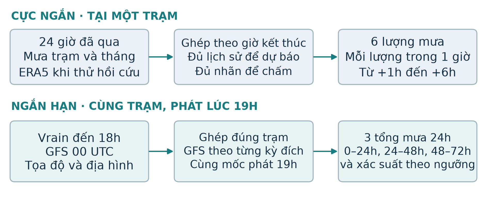
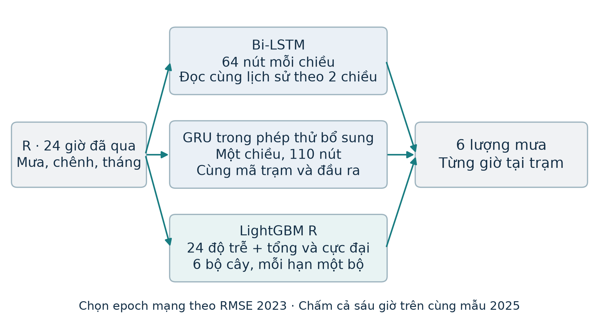
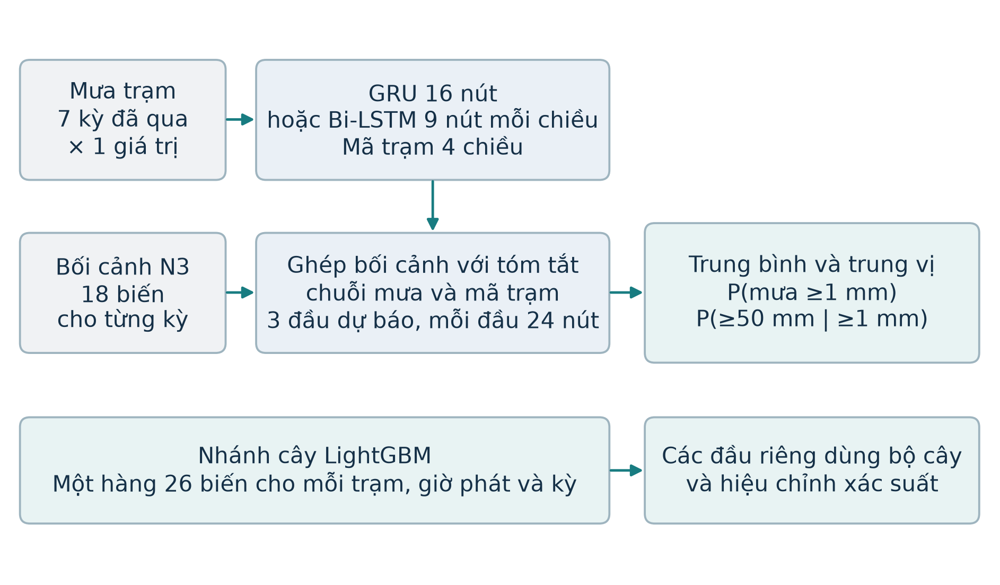
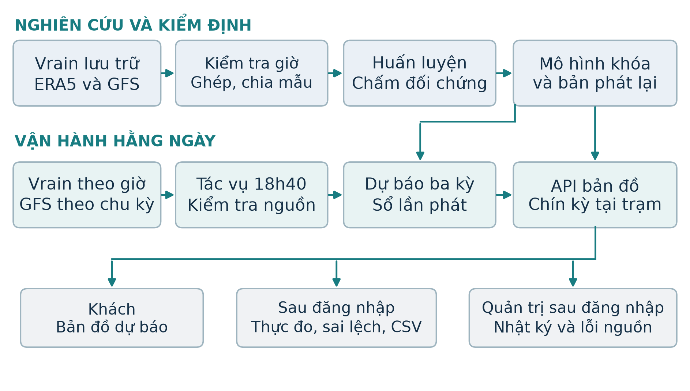
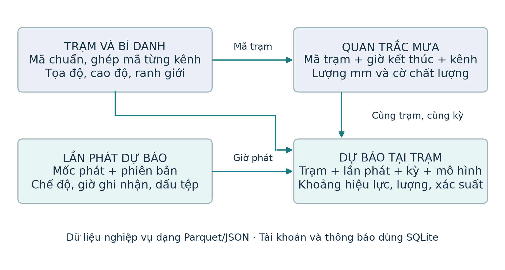
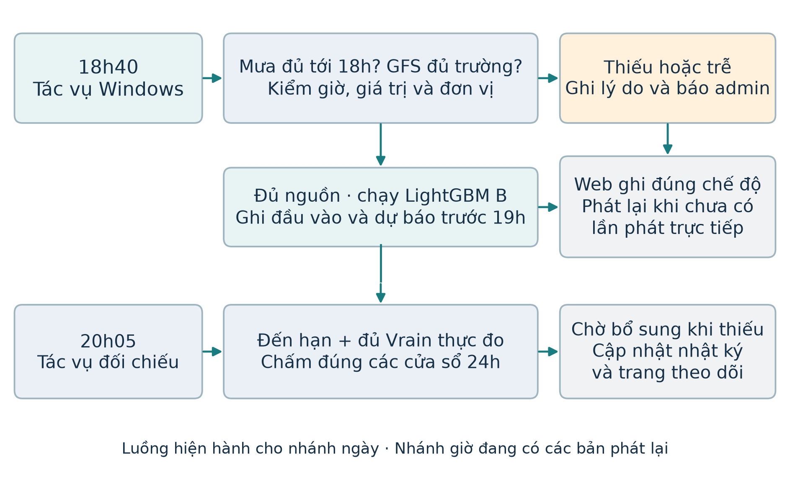

# Thiết kế hệ thống dự báo mưa tại trạm ở Đà Nẵng

## Dựng mẫu và cấu trúc mô hình

### Mỗi dự báo có một trạm, một mốc phát và một kỳ hiệu lực

Kho Đà Nẵng có 86 vị trí trong danh mục. Nhánh 1–6 giờ có 79 trạm đủ điều kiện huấn luyện. Nhánh 1–3 ngày có 57 trạm, đều thuộc tập 79. Mỗi họ mô hình học chung từ nhiều trạm và trả lượng mưa riêng cho từng trạm. Bản đồ mặc định dùng 57 trạm chung và ghi số trạm thực tế có dự báo cho từng kỳ.

- **Cực ngắn.** Mưa Vrain được ghi theo giờ kết thúc. Số đo 10h là lượng của khoảng 09h–10h, giờ Việt Nam. Dự báo phát lúc 19h dùng 24 giá trị gần nhất đến mốc phát theo giao thức hồi cứu. Sáu kết quả là lượng của 19h–20h, 20h–21h và các khoảng một giờ tiếp theo đến 01h. Nhãn tương lai chỉ dùng để học và chấm. Khi phát thật, lịch sử phải đến máy trước lúc phát.
- **Ngắn hạn.** Lượt 19h dùng mưa đã qua tới 18h và dự báo GFS chu kỳ 00 UTC, tức 07h Việt Nam. GFS có giờ khởi tạo và giờ hiệu lực riêng. Nhóm nội suy theo tọa độ trạm, lấy các khoảng mưa dự báo tương ứng rồi ghép với lịch sử, lịch và địa hình. Nhãn Vrain là tổng của đúng 24 giờ cho từng kỳ 19h–19h. Ngày 1 đã chứa sáu giờ đầu, nên cộng cả chín ô trên giao diện sẽ đếm lặp phần này. [Sản phẩm GFS của NOAA](https://www.ncei.noaa.gov/products/weather-climate-models/global-forecast)
- **Kiểm tra dữ liệu.** Giữ mã trạm, múi giờ, kênh nguồn, cờ chất lượng và giờ kết thúc. Một số 0 mm là giờ đo được không mưa. Giờ thiếu được giữ riêng. Dự báo cần đủ dữ liệu đầu vào trước mốc phát. Huấn luyện hoặc chấm cần thêm nhãn đầy đủ, đúng kỳ và qua kiểm tra nguồn.

### Cực ngắn · Bi-LSTM, GRU và LightGBM

Bi-LSTM đọc 24 giờ lịch sử theo hai hướng và ghép hai trạng thái cuối với mã trạm học được. Một đầu ra chung cho sáu khoảng giờ. Cả hai hướng đều nằm trong cửa sổ quá khứ đã biết khi phát. Mạng học sai số bình phương trên log(1 + mm), rồi đổi lại sang mm khi chấm. Ba lần khởi tạo được lấy trung bình trong đơn vị mm.

GRU cũng tóm tắt một chuỗi bằng các cổng điều khiển trạng thái. Trong phép thử bổ sung, GRU đọc cùng 24 giờ và cùng nhóm R gồm mưa, chênh mưa và tháng, dùng cùng cách chọn epoch. Phiên bản này dùng số nút để tổng số tham số sát với Bi-LSTM, nhằm đánh giá việc thay bộ đọc chuỗi. [Kiến trúc hai chiều của Schuster và Paliwal](https://doi.org/10.1109/78.650093) · [GRU của Cho và cộng sự](https://aclanthology.org/D14-1179/)

LightGBM dùng 24 độ trễ mưa, tổng của 3, 6 và 24 giờ, cực đại của 6 và 24 giờ, tháng và mã trạm. Sáu bộ cây học cùng mạng trạm, mỗi bộ dự báo một hạn. Cấu hình tối ưu L2 theo mm. Các thống kê đều tính từ cùng lịch sử mưa đã qua. Vì cách mã hóa và hàm mất mát khác mô hình chuỗi, so LightGBM với mạng cho biết chất lượng của hai phương án dự báo hoàn chỉnh. [Bài báo LightGBM của Ke và cộng sự](https://papers.neurips.cc/paper/2017/hash/6449f44a102fde848669bdd9eb6b76fa-Abstract.html)

### Ngắn hạn · LightGBM, GRU nhỏ và Bi-LSTM

Với cấu hình N3, bộ đặc trưng có 26 biến. LightGBM đọc một hàng cho mỗi trạm và kỳ. Các đầu lượng trung bình, lượng trung vị và xác suất được học bằng những bộ cây tương ứng. Đây là cách xử lý thực dụng khi nhiều đầu vào là biến bảng như mưa dự báo GFS, địa hình, tháng và thống kê mưa trạm.

GRU nhỏ đọc đúng bảy tổng mưa 24 giờ đã qua theo thứ tự thời gian. Trạng thái chuỗi và mã trạm được ghép với 18 biến bối cảnh của từng kỳ. Ba đầu riêng cho Ngày 1, 2 và 3 cho lượng trung bình, lượng trung vị và hai tín hiệu xác suất. Xác suất mưa từ 50 mm bằng xác suất mưa từ 1 mm nhân xác suất từ 50 mm có điều kiện đã mưa từ 1 mm. Hiệu chỉnh trên năm 2023 giữ quan hệ này. Phép thử Bi-LSTM dùng cùng đầu ra và bối cảnh, thay bộ đọc lịch sử bảy kỳ bằng hai chiều.

## Kiến trúc hệ thống và vận hành

### Nghiên cứu, vận hành và trình xem có trách nhiệm riêng

- **Nghiên cứu trên máy dự án.** Dựng mẫu từ kho, khóa cách chia thời gian, huấn luyện và chấm đối chứng. Lưu trọng số, quy tắc biến đổi và phiên bản. Có thể xuất lượt phát lại từ trọng số đã khóa để trình diễn.
- **Tác vụ hằng ngày.** Windows Task Scheduler mở quy trình thu, kiểm tra và chạy đúng mô hình đã chọn cho nhánh ngày. Mỗi lần phát đủ điều kiện lưu dữ liệu đầu vào, giờ thực nhận, tệp dự báo và dấu kiểm tra tệp. Mô hình được nạp lại để suy luận, nên việc thu số đo mới không đòi hỏi huấn luyện mỗi ngày.
- **Web cục bộ.** Máy chủ Python đọc bản dự báo đã ghi, ghép theo đúng giờ phát và trả chín vị trí qua API. Trình duyệt vẽ bản đồ và đổi kỳ. Màu xã/phường dùng lượng cao nhất từ trạm hợp lệ trong ranh giới và ghi số trạm. Vùng thiếu trạm có số hiển thị màu xám.
- **Quyền sử dụng.** Khách xem dự báo và bản đồ. Sau khi đăng nhập bằng tài khoản chủ web, người dùng xem được thực đo, sai lệch, bảng kiểm chứng và CSV, đồng thời có quyền đọc nhật ký, nhận lỗi và kiểm tra nguồn. Trình duyệt đọc lại trạng thái định kỳ, còn lịch thu chạy trên máy dự án.

### Dữ liệu nối với nhau bằng các khóa gì

**Khóa và nơi lưu thành phần dữ liệu**

| Thành phần | Định danh dùng khi ghép | Công dụng |
| --- | --- | --- |
| Danh mục trạm | Mã ổn định và bí danh theo kênh | Nối vị trí, địa hình và mã của hai kênh Vrain |
| Quan trắc | Mã trạm, giờ kết thúc UTC, kênh | Dựng lịch sử và nhãn theo giờ kết thúc |
| Chu kỳ khí tượng | Giờ khởi tạo, kỳ hiệu lực, trường, vị trí trích | Biết giá trị GFS thuộc kỳ nào và có sẵn từ lúc nào |
| Bản dự báo | Trạm, thời điểm phát, kỳ, mô hình | Hiển thị và đối chiếu với đúng kỳ đo |
| Lần phát | Giờ phát, giờ ghi, phiên bản, chế độ | Phân biệt phát lại với dữ liệu ghi trước giờ phát |
| Tài khoản và lỗi nguồn | Tài khoản, loại lỗi, ngày và giờ | Đăng nhập, hiển thị và gộp cảnh báo lặp |

Sơ đồ dùng quan hệ logic. Parquet lưu bảng nghiên cứu và các bộ mẫu. Bản phát lại và nhật ký lần phát dùng các tệp riêng. SQLite lưu tài khoản và thông báo. API công khai như /api/forecast và /api/areas phục vụ dự báo và hình học. Thực đo, kết quả đối chiếu và tệp CSV được lọc theo phiên đăng nhập.

### Khi nguồn thiếu, hệ thống xử lý thế nào

1. Lượt 18h40 kiểm tra trường GFS và mưa tới 18h ở Đà Nẵng. Chỉ lượt được ghi trước 19h, đúng giờ hiệu lực và có tệp hợp lệ mới được trình xem nhận là phát trực tiếp. Lỗi nguồn được ghi vào nhật ký và hộp thông báo.
2. Lượt 20h05 tìm các bản đã đủ ba kỳ 24 giờ và thêm một giờ chờ số đo. Khi Vrain đủ, bước đối chiếu ghép đúng lượng thực đo của từng trạm và kỳ. Khi thiếu, nhật ký giữ trạng thái chờ.
3. Bản giờ hiện có ở chế độ phát lại, với các lượt đã ghép được cùng giờ phát của bản ngày. Cần kiểm tra độ trễ Vrain và ghi lượt dự báo trước giờ phát để xác nhận chạy theo giờ thật.

**Kiểm tra nguồn ngày 24/11/2026**

| Kiểm tra | Kết quả | Ý nghĩa |
| --- | --- | --- |
| Vrain cho ngày 24/11 lúc 20h20 và 22h20 | Danh mục 200 và có nhóm Đà Nẵng. Hai đường mưa giờ 404 | Phiên đọc được danh mục, tác vụ chưa lấy được số đo mới |
| Vrain cho ngày 12/11 đã có trong kho | Hai đường xuất mưa giờ cũng trả 404 | Hiện tượng lặp lại với một ngày đã biết có số đo |
| Kho mưa giờ trên máy | Mốc hợp lệ cuối là 19h 15/11, có số của 82 trạm | Web dùng các lượt đã lưu, với ngày phát và chế độ riêng |
| GFS ở lần kiểm tra 22h20 | Đủ 19 chỉ mục cần thiết | Bước tra chỉ mục thành công. Kiểm tra và ghép nguồn Vrain vẫn là điều kiện phát |

Ưu tiên làm lại đường thu **Đà Nẵng**. Có thể đối chiếu một tuần đã có trong kho với file do Vrain xuất hoặc dữ liệu được cấp qua Open API. Đối chiếu theo từng trạm và giờ giúp xác nhận đơn vị, độ đầy đủ và độ trễ trước khi ghép vào luồng phát. [VRain Open API](https://dev.vrain.vn/)
