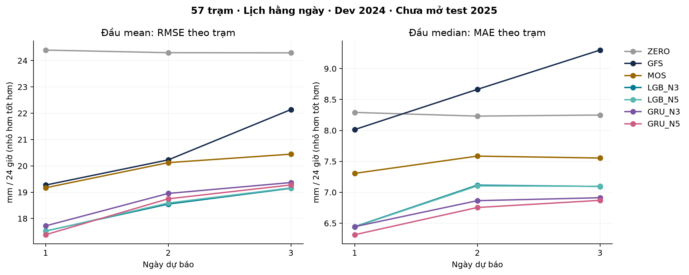
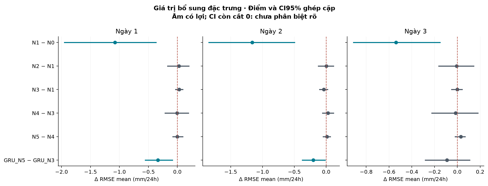

# Kết quả thí nghiệm dự báo mưa tại trạm — lịch hằng ngày v2

Cập nhật 11/11/2026. Đây là kết quả **phát triển trên năm 2024**, chưa phải kiểm định cuối. Năm 2025 vẫn giữ kín. Báo cáo này là một thí nghiệm riêng, không thay số liệu của pilot lịch tuần đã công bố.

## Kết luận để nhóm đọc trước

**Thí nghiệm mới có kết quả tích cực trên dev 2024, nhưng lợi ích phụ thuộc loại đặc trưng và mô hình.** Không có cơ sở gọi mọi thứ “đã ổn” hoặc khẳng định vượt các nghiên cứu khác; test cuối 2025 chưa mở.

1. **Khí tượng dự báo thô có ích rõ hơn việc chỉ dùng mưa GFS + lịch sử trạm.** N1 so N0 giảm RMSE mean 1,078 / 1,162 / 0,537 mm ở ngày 1/2/3. CI95% ghép cặp đều dưới 0 trong phân tích dev này. Đây là bằng chứng cho giá trị thêm T/RH/u/v850 và PWAT, không phải bằng chứng riêng cho dẫn xuất vật lý.
2. **Mô hình học máy vượt đối chứng hiệu chỉnh đơn giản, không chỉ vượt GFS thô.** RMSE mean của MOS là 19,169 / 20,124 / 20,445 mm; LightGBM N3 là 17,527 / 18,550 / 19,150; GRU N5 là 17,386 / 18,750 / 19,277. Chênh RMSE và MAE median của cả hai cấu hình này so MOS có CI95% dưới 0 ở cả ba hạn. Các CI là thăm dò trên dev, chưa hiệu chỉnh nhiều phép so sánh.
3. **Dẫn xuất chưa mang lợi ích rõ cho LightGBM, nhưng có tín hiệu ở GRU ngày 1–2.** Với LightGBM, N5−N3 có CI chứa 0 cho RMSE mean và MAE median ở cả ba hạn. Với GRU, N5−N3 giảm RMSE 0,336 mm ở ngày 1 (CI −0,554 đến −0,084) và 0,204 mm ở ngày 2 (CI −0,373 đến −0,017); MAE median cũng giảm. Ngày 3 chưa phân biệt rõ. Không nên kết luận “dẫn xuất vô ích” cho mọi mô hình, cũng không nên kết luận “cứ thêm vật lý là tốt”.
4. **GRU N5 nổi bật về đầu median, chưa thắng LightGBM trên mọi mục tiêu.** MAE median GRU N5 là 6,314 / 6,754 / 6,870 mm, thấp nhất trong các mô hình chính đã chạy. So với LightGBM N5, CI chênh MAE đều dưới 0; CI chênh RMSE đều chứa 0. LightGBM có điểm RMSE thấp hơn ở ngày 2–3. Không chọn một “mô hình thắng toàn diện” từ các bảng này.
5. **Xác suất đã nhất quán và có kỹ năng so khí hậu tham chiếu, nhưng cảnh báo mưa lớn vẫn còn nhiều báo nhầm.** BSS ≥50 mm của LightGBM N3 là 0,280 / 0,227 / 0,164; GRU N5 là 0,287 / 0,228 / 0,158. Tuy vậy, GRU N5 có POD/FAR lần lượt khoảng 0,734/0,606; 0,486/0,506; 0,672/0,678 ở các cutoff chọn từ 2023. POD cao không đồng nghĩa cảnh báo đã đủ tin cậy để vận hành.

**Hướng phù hợp lúc này:** giữ LightGBM dùng khí tượng thô (N1 hoặc N3) làm phương án đơn giản, mạnh và dễ giải thích; giữ GRU N5 làm ứng viên cho đầu median và phép kiểm chứng giá trị biểu diễn dẫn xuất. Quyết định mô hình cuối phải gắn với mục tiêu lượng/xác suất, không chỉ một metric. Không bổ sung kiến trúc lớn chỉ để có thêm tên mô hình.

N5 thêm sáu biến suy ra từ cùng dữ liệu gốc, đồng thời làm GRU tăng số trọng số ở lớp đầu của các head. Vì vậy kết quả hỗ trợ **giá trị của cách biểu diễn trong thiết lập đã chạy**, chưa tách hoàn toàn lợi ích đặc trưng khỏi thay đổi dung lượng mạng và chưa chứng minh cơ chế vật lý nhân quả. Nếu tiếp tục nghiên cứu phần này, cần phép kiểm soát dung lượng mạng và protocol mới trước khi mở test cuối.

Các điểm còn cần xử lý trước vận hành: độ trễ tiếp nhận Vrain chưa được đo đầy đủ; GFS Last-Modified không chứng minh giờ phát hành gốc; còn khoảng thiếu sau QC và sai số đại diện không gian của GFS; chỉ mới đánh giá phát triển trên một năm. Không so trực tiếp giá trị MAE mới với pilot lịch tuần vì tập ngày và mức độ khó đã đổi.

## 1. Bài toán được thực hiện

Mỗi ngày lúc **19:00 Việt Nam**, dự báo lượng mưa tại từng trạm cho ba cửa sổ riêng: 19:00 hôm nay → 19:00 ngày mai; 19:00 ngày mai → 19:00 ngày kế; và 24 giờ kế tiếp nữa. Đây là **ba tổng 24 giờ**, không phải ba tổng tích lũy 24/48/72 giờ và không phải mưa trung bình toàn Đà Nẵng.

Một mẫu là một cặp **trạm–thời điểm phát hành**. Mô hình học chung nhiều trạm; LightGBM có mô hình theo từng hạn/đầu dự đoán, GRU trả ba hạn cùng lúc. Có 57 trạm đủ điều kiện train, thuộc danh mục tài khoản nhóm Đà Nẵng. Không khẳng định đủ 86 trạm hay phủ toàn bộ ranh giới hành chính.

Nhãn là tổng 24 số đo giờ Vrain sau QC tại chính trạm. Người dùng đã xác nhận: 10:00 là mưa 09:00–10:00 UTC+7. Không phân rã mưa ngày vệ tinh, không điền nhãn thiếu bằng 0 hoặc GFS. GFS cung cấp **dự báo khí tượng tương lai có khởi tạo trước issue**; không đưa ERA5 của ngày cần dự báo vào đầu vào.

## 2. Bốn đề xuất đã chuyển thành các phép thử cụ thể

| Đề xuất | Mục đích | Đã thực hiện |
| --- | --- | --- |
| Lịch issue hằng ngày + độ trễ | Đánh giá nhiều ngày/thời tiết hơn, tránh dùng thông tin chưa đến | 1.449 chu kỳ hợp lệ; kiểm tra metadata GFS và API Vrain; trễ trạm 1/3/6 giờ |
| ZERO + hậu xử lý GFS đơn giản | Biết mô hình có ích hơn đoán khô hoặc hiệu chỉnh đơn giản không | ZERO, CLIM, persistence, GFS thô, MOS; tách mean/median |
| Khí tượng thô và dẫn xuất | Đo phần lợi ích do cách biểu diễn vật lý, tránh gán lợi ích dữ liệu mới cho công thức | N0–N5 cùng mẫu; các cặp đối chiếu nguyên liệu tương ứng |
| Xác suất + mưa lớn + tuning | Xác suất không mâu thuẫn; nhìn được bỏ sót/báo nhầm; tránh chọn theo dev | Tuning trong 2021–22, calibration 2023, p50=p1×q50, chẩn đoán ≥50 mm |

## 3. Thu thập và chia dữ liệu

Lịch cố định 08/01/2021–28/12/2024, **1.451 chu kỳ dự kiến**. Có **1.449 chu kỳ dùng được**: 02/02/2021 không có chỉ mục trong hai bố cục kho chính thức; 30/11/2022 nội dung GRIB không khớp offset của chỉ mục ở lead 36/84, đã tải lại xác nhận. Loại cả issue cho mọi mô hình bằng bằng chứng nguồn, trước fit và không dựa trên lượng mưa hay điểm dự báo. Không gọi đây là kho đủ 100%.

| Tập | Mục đích | Mẫu trạm–issue | Hàng × 3 hạn | Ngày issue | Trạm |
| --- | --- | --- | --- | --- | --- |
| train | 2021–22: học + tuning nội bộ | 35116 | 105348 | 717 | 57 |
| cal | 2023: hiệu chỉnh xác suất/ngưỡng | 18365 | 55095 | 362 | 57 |
| dev | 2024: đánh giá phát triển | 19405 | 58215 | 363 | 57 |

Phân bố nhãn dev 2024 (thống kê micro để mô tả tập, không dùng chọn hyperparameter):

| Hạn | Mẫu | Tỷ lệ <1 mm | Trung vị | P99 | Mẫu ≥50 mm | Ngày issue ≥50 |
| --- | --- | --- | --- | --- | --- | --- |
| 1 | 19405 | 63.3% | 0.000 | 122.784 | 890 | 96 |
| 2 | 19405 | 63.4% | 0.000 | 122.400 | 886 | 95 |
| 3 | 19405 | 63.3% | 0.000 | 122.400 | 884 | 94 |

Mỗi mẫu có ba nhãn nên số hàng dài bằng ba lần số mẫu. Ngày/trạm thiếu bất kỳ nhãn, lịch sử hoặc đặc trưng cần thiết đều không vào phép so sánh. Mask chung còn yêu cầu hợp lệ ở cả ba kịch bản trễ 1/3/6 giờ. **Không loại cả mạng chỉ vì một trạm thiếu**. Các cửa sổ có nhãn vượt ranh train/cal/dev bị bỏ.

57 trạm giữ nguyên điều kiện từ pilot: tối thiểu 365 ngày train đầy đủ và 30 ngày train có mưa ≥1 mm. Không chọn lại trạm theo điểm 2024. Trong tuning cuốn chiếu, trạm validation phải đã xuất hiện trong phần train của fold. Cohort tổng thể vẫn là cohort chọn trên 2021–22, nên diễn giải CV có điều kiện trên cohort này, không phải thử tổng quát hóa sang trạm chưa thấy.

## 4. Dữ liệu có sẵn tại thời điểm dự báo không?

GFS dùng chu kỳ **00UTC = 07:00 Việt Nam**, issue 12UTC = 19:00 Việt Nam. Giả định độ trễ nguồn 8 giờ; có 12 giờ từ khởi tạo đến issue. Bốn tổng mưa tích lũy GFS ở lead 12/36/60/84 giờ được lấy hiệu để khớp ba cửa sổ 19–19. Khí tượng ở lead 24/48/72 là **trạng thái tại giữa cửa sổ**, chưa đại diện toàn bộ diễn biến 24 giờ.

Audit hiện tại của chu kỳ 10/11/2026 cho Last-Modified khoảng 3,65–4,04 giờ sau khởi tạo. Audit lịch sử kiểm tra 27,531 message; có 48 chu kỳ đầu 2021 mang thời điểm sửa archive sau issue. Timestamp sửa/chuyển kho **không chứng minh giờ phát hành gốc**; cũng không được diễn giải là chắc chắn nguồn phát hành trễ. Bản v2 này chưa có phép retrain loại riêng 48 chu kỳ đó. Không thể kết luận đã chứng minh vận hành realtime. [Trạng thái sản xuất NOAA](https://www.nco.ncep.noaa.gov/pmb/nwprod/prodstat/production_status.html).

Kiểm tra API Vrain đăng nhập thành công tại thời điểm audit; kênh hiện hành trả hàng giờ nhưng nhãn khoảng giờ không phải timestamp tiếp nhận. Chưa đo được độ trễ tiếp nhận lịch sử của từng số đo. Lịch sử ngày và nhãn giờ đã xác định; **độ trễ vận hành là một câu hỏi khác**. Dữ liệu hiện tại 2026 chỉ dùng kiểm tra API, không fit.

Kịch bản GFS trễ 8 hoặc 12 giờ còn đủ thời gian dùng cùng chu kỳ; trễ 16 giờ thì chu kỳ này chưa sẵn sàng tại 19:00, không có dự báo cùng chu kỳ hợp lệ. Thay bằng chu kỳ trước cần dữ liệu/protocol riêng, chưa tự thay trong thí nghiệm này. Trễ Vrain được đánh giá bằng retrain N3 ở 1/3/6 giờ, giữ nguyên mẫu, cấu hình tuning và nhãn.

## 5. Đặc trưng và cách kiểm tra giá trị bổ sung

| Cấu hình | Số biến | Nội dung | So sánh có ý nghĩa |
| --- | --- | --- | --- |
| N0 | 16 | Mưa GFS, lịch, tọa độ/ID, lịch sử mưa Vrain | Nền chung |
| N1 | 21 | N0 + T/RH/u/v ở 850 hPa + PWAT | N1 − N0: thêm khí tượng dự báo |
| N2 | 25 | N1 + q850, q×u, q×v, tốc độ gió | N2 − N1: dẫn xuất khí tượng |
| N3 | 26 | N1 + cao độ, trung bình/độ lệch địa hình, hai độ dốc | N3 − N1: thêm địa hình |
| N4 | 30 | N3 + bốn dẫn xuất khí tượng của N2 | N4 − N3: dẫn xuất, cùng dữ liệu gốc |
| N5 | 32 | N4 + gió theo dốc + ẩm theo dốc | N5 − N4: tương tác gió–ẩm–địa hình |

N0 gồm: một lượng mưa GFS đúng hạn, sin/cos ngày trong năm, vĩ độ/kinh độ/ID trạm; bảy tổng ngày 19–19 đã hoàn thành trước hôm nay; tổng mưa 1/6/24 giờ gần nhất kết thúc ở 18:00 trong kịch bản trễ 1 giờ. N0 giữ mưa trạm trong mọi cấu hình; thí nghiệm này chưa tách riêng giá trị của từng lag mưa.

q850 suy từ nhiệt độ/độ ẩm bằng cùng công thức Magnus ở mọi năm; q×u và q×v là **proxy vận chuyển ẩm một mực**, không gọi là IVT tích phân cột khí quyển. DEM là proxy địa hình từ Mapzen tại tọa độ hiện có, không phải cao độ khảo sát tại trạm. Mean/std địa hình lấy từ chín điểm trong ô ±5 km, không phải thống kê mọi pixel của một vùng tròn bán kính 5 km. Gió theo dốc là u×độ dốc đông + v×độ dốc bắc; nhân q tạo proxy ẩm theo dốc. Đây là giả thuyết đặc trưng, không phải bằng chứng quan hệ nhân quả.

GFS gốc 0,25° được nội suy bốn nút về vị trí trạm. Nội suy không tạo độ phân giải khí tượng thật ngang khoảng cách giữa các trạm. Độ dốc/địa hình hỗ trợ hiệu chỉnh nhưng không tự khôi phục đối lưu địa phương.

## 6. Vì sao có hai đầu lượng mưa?

**Mean** ước lượng lượng mưa kỳ vọng có điều kiện; đánh giá chính bằng RMSE. **Median** ước lượng trung vị có điều kiện; đánh giá chính bằng MAE. Với nhiều ngày khô, median có thể gần 0 dù mean vẫn dương. Đây là hai câu hỏi thống kê khác nhau, không được chọn đầu tốt nhất theo từng metric sau khi xem dev rồi gọi là một dự báo duy nhất.

Ví dụ giả định: 80% khả năng 0 mm, 20% khả năng 50 mm. Mean =10 mm, median =0 mm. Dự báo 0 có thể tốt về MAE nhưng không mô tả kỳ vọng hay cảnh báo trận mưa. Vì vậy ZERO là phép chẩn đoán cần có; nó không phải hệ cảnh báo hữu ích. Cơ sở về gắn hàm mất mát với đại lượng cần dự đoán: [Gneiting, Making and Evaluating Point Forecasts](https://arxiv.org/abs/0912.0902).

LightGBM mean dùng Tweedie p=1,5, median dùng quantile α=0,5; early stopping của mean theo RMSE và median theo MAE trong fold tuning. Tweedie là lựa chọn huấn luyện cho dữ liệu không âm/lệch, không đảm bảo tối ưu RMSE trong mọi mẫu hữu hạn. [Tài liệu LightGBM 4.5](https://lightgbm.readthedocs.io/en/v4.5.0/Parameters.html).

MOS là đối chứng hậu xử lý đơn giản: chỉ mưa GFS + sin/cos mùa; Ridge cho mean, hồi quy phân vị tuyến tính cho median, logistic cho các xác suất lồng nhau. Không có địa hình/ID/lịch sử mưa. Vượt GFS thô nhưng không vượt MOS thì chưa đủ nói cần mô hình nhiều biến/phức tạp.

## 7. Tuning và calibration đã tách như thế nào?

Tuning trên bốn quý 2022. Mỗi fold chỉ train phần quá khứ; toàn bộ nhãn train kết thúc ít nhất bảy ngày trước đầu quý validation, toàn bộ ba nhãn validation nằm trong quý. Không random các cửa sổ. Ba ứng viên LightGBM: 7/15/31 lá, depth 3/4/5, min leaf 40/40/80, L2 5/2/5; learning rate 0,04, tối đa 600 cây, patience 50. N3 là cấu hình chung dùng tuning, sau đó chia sẻ tham số đã chọn cho N0–N5 và các kịch bản độ trễ.

| Đầu dự đoán | Cấu hình chọn từ 2022 | Số cây D1 / D2 / D3 |
| --- | --- | --- |
| mean | small | 109 / 109 / 93 |
| median | medium | 68 / 40 / 72 |
| wet | small | 150 / 169 / 147 |
| conditional | small | 162 / 106 / 85 |

Số cây final là trung vị best iteration qua bốn fold, theo từng đầu/hạn. Fit cuối chỉ trên 2021–22, không dùng 2023 để early stop. Mean chọn theo RMSE tương đối GFS; median theo MAE tương đối GFS; hai classifier cùng chọn theo Brier tương đối tần suất train, trung bình hai ngưỡng.

GRU thử ba cấu hình nhỏ, cũng trên bốn fold và N3, tối đa 60 epoch/patience 10. Cấu hình được chọn: **small**, hidden=16, head=24, learning rate=0.001, **17 epoch final**. GRU nhận lịch sử bảy ngày theo thứ tự thời gian, context GFS/tĩnh theo từng hạn, embedding trạm. Loss gồm Tweedie mean + pinball median + 0,5×(BCE mưa + BCE mưa lớn điều kiện đã có mưa); lựa chọn bằng trung bình bốn điểm chuẩn hóa RMSE/MAE/BS1/BS50.

Final LightGBM và GRU dùng seed **17, 29, 43**; lấy trung bình đầu lượng và xác suất đã calibration của ba seed. Ba seed đo một phần biến thiên huấn luyện, không thay ba năm test. GRU được chạy **N3 và N5** để kiểm tra tác dụng toàn bộ dẫn xuất trên cùng mô hình; chưa chạy GRU N0/N1/N2/N4, không tuyên bố ma trận đầy đủ sáu cấu hình × hai kiến trúc.

Năm 2023 dành cho Platt calibration và chọn ngưỡng quyết định. Khi chọn ngưỡng, dùng xác suất cross-fit để từng quý được hiệu chỉnh bằng ba quý khác, bỏ lân cận bảy ngày. Đây là validation cho tuning calibration, không phải mô phỏng forecast lịch sử tại chính năm 2023. Calibrator cuối fit toàn 2023 rồi áp dụng 2024. Đầu lượng và xác suất được ước lượng riêng; ràng buộc lồng nhau không biến chúng thành một phân phối chung nhất quán hoàn toàn.

## 8. Các metric cần đọc

| Chỉ số | Ý nghĩa dễ hiểu | Cách sử dụng | Chiều tốt |
| --- | --- | --- | --- |
| RMSE, mm/24h | Sai số lượng, phạt mạnh lỗi lớn | Chính cho đầu mean; vẫn báo cả hai đầu | Nhỏ |
| MAE, mm/24h | Sai lệch tuyệt đối trung bình | Chính cho đầu median; đối chiếu ZERO | Nhỏ |
| Bias, mm/24h | Dự báo thừa (+) hay thiếu (−) trung bình | Phát hiện thiếu lượng mưa | Gần 0 |
| BS | Trung bình (xác suất − nhãn 0/1)² | Chấm xác suất trước khi chọn cutoff | Nhỏ |
| BSS | 1 − BS/BS của khí hậu tham chiếu | >0 tốt hơn CLIM; <0 kém hơn CLIM | Lớn |
| CSI | H/(H+M+F) | Cân bằng trúng, bỏ sót, báo nhầm | Lớn |
| POD | H/(H+M) | Bắt được bao nhiêu sự kiện thật | Lớn, phải đọc cùng FAR |
| FAR | F/(H+F) | Bao nhiêu cảnh báo là báo nhầm | Nhỏ |

H=trúng, M=bỏ sót, F=báo nhầm; FAR ở đây là false alarm **ratio**, không phải F/(F+correct negatives). Macro tính từng trạm rồi trung bình đều; micro gộp mọi mẫu. RMSE macro là trung bình RMSE trạm, không phải căn của MSE trung bình toàn mạng. BSS macro là trung bình BSS trạm, không nhất thiết bằng 1−macroBS/macroBSref. Trạm không có mẫu/sự kiện thích hợp làm POD/FAR không xác định được báo số hỗ trợ trong CSV, không gán 0 tùy ý.

Tham chiếu CLIM dùng tần suất và mean/median theo trạm–tháng từ các ngày train 2021–22 hợp lệ; shrink về trung bình mạng cùng tháng với trọng số tương đương 20 ngày. Có hai ngưỡng **≥1 và ≥50 mm/24h**. 50 mm là ngưỡng khảo sát mưa lớn của thí nghiệm, chưa khẳng định là ngưỡng cảnh báo chính thức.

Không có ngưỡng POD=0,4 chung để gọi mọi bài toán là tốt. POD phụ thuộc ngưỡng mưa, cutoff xác suất, hạn, địa bàn, số sự kiện và FAR. Luôn dự báo có mưa có thể nâng POD lên 1 nhưng làm báo nhầm lớn. Không so trực tiếp POD ngày tại trạm ở đây với POD mưa giờ/vùng trong một paper khác.

## 9. Kết quả lượng mưa trên dev 2024

| Mô hình | RMSE mean D1 | D2 | D3 | MAE median D1 | D2 | D3 |
| --- | --- | --- | --- | --- | --- | --- |
| ZERO | 24.398 | 24.299 | 24.293 | 8.291 | 8.232 | 8.249 |
| PERSISTENCE | 27.030 | 29.742 | 30.572 | 10.520 | 12.041 | 12.469 |
| GFS | 19.271 | 20.228 | 22.139 | 8.014 | 8.664 | 9.299 |
| CLIM | 22.347 | 22.286 | 22.280 | 8.061 | 8.001 | 8.011 |
| MOS | 19.169 | 20.124 | 20.445 | 7.306 | 7.585 | 7.554 |
| LGB_N0 | 18.574 | 19.749 | 19.688 | 6.768 | 7.302 | 7.231 |
| LGB_N1 | 17.497 | 18.586 | 19.151 | 6.461 | 7.142 | 7.138 |
| LGB_N2 | 17.523 | 18.589 | 19.145 | 6.419 | 7.133 | 7.111 |
| LGB_N3 | 17.527 | **18.550** | 19.150 | 6.444 | 7.116 | 7.095 |
| LGB_N4 | 17.522 | 18.579 | **19.133** | 6.420 | 7.109 | 7.106 |
| LGB_N5 | 17.521 | 18.590 | 19.164 | 6.440 | 7.104 | 7.097 |
| GRU_N3 | 17.722 | 18.954 | 19.368 | 6.444 | 6.865 | 6.912 |
| GRU_N5 | **17.386** | 18.750 | 19.277 | **6.314** | **6.754** | **6.870** |

**In đậm là giá trị điểm thấp nhất trong cột giữa các mô hình chính cùng mẫu**, không phải kết luận hơn có ý nghĩa thống kê. Đơn vị mm/24h. Các đầu mean/median của ZERO/GFS/persistence dùng cùng giá trị dự báo; CLIM/MOS/ML có hai giá trị phù hợp hai mục tiêu. Toàn bộ MAE, RMSE, Bias cho cả hai đầu và các split ở `point_metrics.csv`.

Đối chiếu quan trọng hơn chỉ GFS thô: mô hình nhiều biến có vượt **MOS đơn giản** không?

| Mô hình − MOS | Ngày | Mục tiêu | Chênh lệch [CI95%] |
| --- | --- | --- | --- |
| GRU_N3 | 1 | mean / rmse | -1.447 [-1.939; -0.833] |
| GRU_N3 | 1 | median / mae | -0.862 [-1.267; -0.526] |
| GRU_N5 | 1 | mean / rmse | -1.783 [-2.402; -1.030] |
| GRU_N5 | 1 | median / mae | -0.992 [-1.403; -0.629] |
| LGB_N3 | 1 | mean / rmse | -1.642 [-2.269; -0.913] |
| LGB_N3 | 1 | median / mae | -0.862 [-1.236; -0.552] |
| LGB_N5 | 1 | mean / rmse | -1.648 [-2.277; -0.962] |
| LGB_N5 | 1 | median / mae | -0.866 [-1.248; -0.547] |
| GRU_N3 | 2 | mean / rmse | -1.170 [-1.751; -0.560] |
| GRU_N3 | 2 | median / mae | -0.720 [-1.089; -0.397] |
| GRU_N5 | 2 | mean / rmse | -1.374 [-2.071; -0.632] |
| GRU_N5 | 2 | median / mae | -0.831 [-1.247; -0.481] |
| LGB_N3 | 2 | mean / rmse | -1.574 [-2.275; -0.861] |
| LGB_N3 | 2 | median / mae | -0.469 [-0.671; -0.295] |
| LGB_N5 | 2 | mean / rmse | -1.533 [-2.211; -0.860] |
| LGB_N5 | 2 | median / mae | -0.481 [-0.683; -0.306] |
| GRU_N3 | 3 | mean / rmse | -1.078 [-1.845; -0.201] |
| GRU_N3 | 3 | median / mae | -0.642 [-1.047; -0.285] |
| GRU_N5 | 3 | mean / rmse | -1.169 [-2.046; -0.162] |
| GRU_N5 | 3 | median / mae | -0.684 [-1.162; -0.273] |
| LGB_N3 | 3 | mean / rmse | -1.296 [-2.184; -0.528] |
| LGB_N3 | 3 | median / mae | -0.459 [-0.744; -0.211] |
| LGB_N5 | 3 | mean / rmse | -1.281 [-2.203; -0.464] |
| LGB_N5 | 3 | median / mae | -0.457 [-0.736; -0.213] |

Chênh âm có lợi cho mô hình đầu. CI95% bao gồm 0 nghĩa là dữ liệu/ước lượng chưa phân biệt rõ trong phép so sánh đó; không có nghĩa hai mô hình chắc chắn bằng nhau. CI không gồm 0 vẫn chỉ là bằng chứng phát triển trên một năm, không phải chứng minh vượt mọi nghiên cứu.

## 10. Xác suất và phát hiện mưa lớn

Mọi seed và ensemble tuân thủ **P(mưa≥50)=P(mưa≥1)×P(mưa≥50 | mưa≥1)**, kể cả sau calibration. Bộ kiểm tra xác nhận không có trường hợp p50>p1. Chọn cùng cutoff cho hai ngưỡng trong từng mô hình/hạn giúp tránh cảnh báo mưa lớn nhưng không cảnh báo có mưa.

| Mô hình | BSS ≥1 D1 | D2 | D3 | BSS ≥50 D1 | D2 | D3 |
| --- | --- | --- | --- | --- | --- | --- |
| ZERO | -0.926 | -0.930 | -0.938 | -0.073 | -0.071 | -0.071 |
| PERSISTENCE | -0.398 | -0.732 | -0.812 | -0.655 | -0.871 | -0.928 |
| GFS | -0.799 | -0.968 | -1.083 | -0.067 | -0.034 | -0.234 |
| CLIM | 0.000 | 0.000 | 0.000 | 0.000 | 0.000 | 0.000 |
| MOS | 0.165 | 0.099 | 0.105 | 0.162 | 0.170 | 0.103 |
| LGB_N0 | 0.283 | 0.186 | 0.177 | 0.179 | 0.155 | 0.130 |
| LGB_N1 | 0.300 | 0.224 | 0.217 | 0.278 | 0.230 | 0.163 |
| LGB_N2 | 0.300 | 0.224 | 0.220 | 0.288 | 0.234 | 0.158 |
| LGB_N3 | 0.300 | 0.224 | 0.217 | 0.280 | 0.227 | 0.164 |
| LGB_N4 | 0.302 | 0.224 | 0.220 | 0.287 | 0.234 | 0.158 |
| LGB_N5 | 0.302 | 0.225 | 0.220 | 0.289 | 0.233 | 0.156 |
| GRU_N3 | 0.270 | 0.199 | 0.213 | 0.269 | 0.208 | 0.160 |
| GRU_N5 | 0.273 | 0.204 | 0.213 | 0.287 | 0.228 | 0.158 |

GFS/ZERO/persistence trong bảng dùng xác suất suy từ dự báo quyết định 0/1, **không phải dự báo ensemble đã hiệu chỉnh**. BSS so CLIM và đối chứng MOS phù hợp hơn khi đánh giá chất lượng xác suất ML. BSS âm vẫn có thể đi kèm POD cao: mô hình bắt được sự kiện bằng nhiều cảnh báo nhưng xác suất tổng thể kém tham chiếu.

Bảng phát hiện **≥50 mm/24h**, cutoff của MOS/ML được chọn từ 2023, giữ cố định khi chấm 2024; GFS dùng lượng dự báo vượt ngưỡng:

| Mô hình | Ngày | Ngưỡng p | CSI | POD | FAR | Sự kiện trạm |
| --- | --- | --- | --- | --- | --- | --- |
| LGB_N3 | 1 | 0.150 | 0.317 | 0.742 | 0.643 | 890 |
| LGB_N5 | 1 | 0.150 | 0.318 | 0.740 | 0.642 | 890 |
| GFS | 1 | 0.500 | 0.182 | 0.221 | 0.473 | 890 |
| MOS | 1 | 0.350 | 0.241 | 0.355 | 0.532 | 890 |
| GRU_N3 | 1 | 0.150 | 0.300 | 0.767 | 0.670 | 890 |
| GRU_N5 | 1 | 0.200 | 0.344 | 0.734 | 0.606 | 890 |
| LGB_N3 | 2 | 0.250 | 0.308 | 0.551 | 0.571 | 886 |
| LGB_N5 | 2 | 0.250 | 0.319 | 0.566 | 0.561 | 886 |
| GFS | 2 | 0.500 | 0.178 | 0.209 | 0.392 | 886 |
| MOS | 2 | 0.250 | 0.228 | 0.361 | 0.585 | 886 |
| GRU_N3 | 2 | 0.200 | 0.286 | 0.627 | 0.656 | 886 |
| GRU_N5 | 2 | 0.300 | 0.319 | 0.486 | 0.506 | 886 |
| LGB_N3 | 3 | 0.200 | 0.268 | 0.586 | 0.664 | 884 |
| LGB_N5 | 3 | 0.200 | 0.259 | 0.588 | 0.679 | 884 |
| GFS | 3 | 0.500 | 0.177 | 0.239 | 0.577 | 884 |
| MOS | 3 | 0.150 | 0.267 | 0.565 | 0.655 | 884 |
| GRU_N3 | 3 | 0.150 | 0.251 | 0.752 | 0.726 | 884 |
| GRU_N5 | 3 | 0.200 | 0.279 | 0.672 | 0.678 | 884 |

Không chọn model chỉ bằng POD. Xem đồng thời CSI/FAR/BS/BSS, số sự kiện và độ tin cậy calibration. CSV còn báo cutoff cố định 0,5, ngưỡng ≥1 và số trạm có POD/FAR xác định; không chỉ giữ bảng cho điểm đẹp.

## 11. Dẫn xuất vật lý có giúp không?

| So sánh | Ngày | Δ RMSE mean [CI95%] | Δ MAE median [CI95%] | Δ BS50 [CI95%] |
| --- | --- | --- | --- | --- |
| LGB_N1 − LGB_N0 | 1 | **-1.078 [-1.950; -0.370]** | **-0.308 [-0.509; -0.125]** | **-0.00406 [-0.00737; -0.00151]** |
| LGB_N1 − LGB_N0 | 2 | **-1.162 [-1.841; -0.496]** | **-0.160 [-0.264; -0.075]** | **-0.00310 [-0.00573; -0.00117]** |
| LGB_N1 − LGB_N0 | 3 | **-0.537 [-0.912; -0.152]** | -0.093 [-0.245; 0.057] | -0.00135 [-0.00337; 0.00026] |
| LGB_N2 − LGB_N1 | 1 | 0.027 [-0.168; 0.200] | -0.041 [-0.110; 0.014] | -0.00030 [-0.00086; 0.00018] |
| LGB_N2 − LGB_N1 | 2 | 0.003 [-0.124; 0.113] | -0.009 [-0.054; 0.032] | -0.00017 [-0.00052; 0.00012] |
| LGB_N2 − LGB_N1 | 3 | -0.006 [-0.164; 0.143] | -0.027 [-0.078; 0.025] | 0.00027 [-0.00032; 0.00096] |
| LGB_N3 − LGB_N1 | 1 | 0.031 [-0.032; 0.091] | -0.017 [-0.044; 0.005] | -0.00005 [-0.00023; 0.00009] |
| LGB_N3 − LGB_N1 | 2 | -0.037 [-0.102; 0.022] | -0.026 [-0.071; 0.011] | 0.00016 [0.00002; 0.00031] |
| LGB_N3 − LGB_N1 | 3 | -0.001 [-0.051; 0.042] | **-0.043 [-0.085; -0.008]** | -0.00001 [-0.00014; 0.00015] |
| LGB_N4 − LGB_N3 | 1 | -0.005 [-0.212; 0.191] | -0.024 [-0.106; 0.042] | -0.00023 [-0.00085; 0.00032] |
| LGB_N4 − LGB_N3 | 2 | 0.029 [-0.059; 0.113] | -0.007 [-0.031; 0.017] | **-0.00033 [-0.00071; -0.00002]** |
| LGB_N4 − LGB_N3 | 3 | -0.016 [-0.224; 0.180] | 0.011 [-0.047; 0.069] | 0.00027 [-0.00032; 0.00095] |
| LGB_N5 − LGB_N4 | 1 | -0.001 [-0.079; 0.093] | 0.019 [0.000; 0.047] | -0.00006 [-0.00020; 0.00008] |
| LGB_N5 − LGB_N4 | 2 | 0.011 [-0.047; 0.064] | -0.005 [-0.036; 0.031] | 0.00001 [-0.00012; 0.00017] |
| LGB_N5 − LGB_N4 | 3 | 0.031 [-0.019; 0.069] | -0.009 [-0.043; 0.022] | 0.00008 [-0.00013; 0.00027] |
| GRU_N5 − GRU_N3 | 1 | **-0.336 [-0.554; -0.084]** | **-0.130 [-0.243; -0.045]** | -0.00071 [-0.00191; 0.00024] |
| GRU_N5 − GRU_N3 | 2 | **-0.204 [-0.373; -0.017]** | **-0.110 [-0.225; -0.029]** | **-0.00085 [-0.00177; -0.00010]** |
| GRU_N5 − GRU_N3 | 3 | -0.091 [-0.281; 0.109] | -0.042 [-0.134; 0.025] | 0.00006 [-0.00054; 0.00065] |

Mỗi ô là chênh lệch mô hình đầu trừ mô hình sau. In đậm khi toàn bộ CI95% dưới 0 trong phép so sánh này. N1−N0 là **thêm dữ liệu khí tượng**; N2−N1 và N4−N3 mới trực tiếp hỏi giá trị biểu diễn từ cùng biến gốc. N5−N4 hỏi tương tác gió–ẩm–địa hình. Không lấy N5−N0 rồi gán toàn bộ cải thiện cho công thức vật lý.

Bootstrap lấy khối **14 ngày lịch**, 1.000 lần, ghép cặp cùng mẫu và giữ các trạm trong cùng đợt thời tiết; lấy khối kiểu vòng tròn để xử lý biên chuỗi. Không lấy từng trạm–ngày như quan sát độc lập. CI giữ mô hình đã fit cố định, phản ánh việc lấy mẫu các ngày đánh giá, không bao trùm mọi bất định của huấn luyện/cảm biến. Các khoảng là thăm dò, chưa hiệu chỉnh kiểm định nhiều so sánh; chưa kiểm tra độ nhạy độ dài khối. Lịch hằng ngày vẫn chỉ trải bốn năm nguồn và một năm dev, không biến số mẫu lớn thành hàng chục mùa khí hậu độc lập.

## 12. Khi số đo trạm đến trễ hơn

| Trễ Vrain | RMSE D1 | D2 | D3 | MAE median D1 | D2 | D3 |
| --- | --- | --- | --- | --- | --- | --- |
| 1 giờ | 17.527 | 18.550 | 19.150 | 6.444 | 7.116 | 7.095 |
| 3 giờ | 17.425 | 18.559 | 19.152 | 6.509 | 7.106 | 7.128 |
| 6 giờ | 17.437 | 18.532 | 19.117 | 6.514 | 7.112 | 7.124 |

Đây là N3 retrain với input bị cắt sớm 1/3/6 giờ, giữ siêu tham số đã chọn, cùng nhãn/mẫu. Có thể điểm tăng hoặc giảm do thông tin và nhiễu huấn luyện; không lấy biến động điểm nhỏ làm bằng chứng nguồn trễ tốt hơn. CI ghép cặp nằm trong `paired_bootstrap.csv` (model `LGB_N3_delay3`/`delay6`). Độ trễ là kịch bản, chưa phải phân bố độ trễ Vrain đo thực tế.

## 13. Nhìn riêng các ngày mưa lớn

| Mô hình (mean) | Ngày | MAE ≥50 | Bias ≥50 | Số mẫu | Số ngày issue |
| --- | --- | --- | --- | --- | --- |
| LGB_N3 | 1 | 55.359 | -52.301 | 890 | 96 |
| LGB_N5 | 1 | 56.005 | -52.907 | 890 | 96 |
| ZERO | 1 | 95.930 | -95.930 | 890 | 96 |
| GFS | 1 | 65.372 | -63.414 | 890 | 96 |
| MOS | 1 | 64.588 | -63.524 | 890 | 96 |
| GRU_N3 | 1 | 55.481 | -52.484 | 890 | 96 |
| GRU_N5 | 1 | 54.113 | -50.346 | 890 | 96 |
| LGB_N3 | 2 | 62.711 | -61.600 | 886 | 95 |
| LGB_N5 | 2 | 62.994 | -62.066 | 886 | 95 |
| ZERO | 2 | 95.851 | -95.851 | 886 | 95 |
| GFS | 2 | 69.066 | -64.236 | 886 | 95 |
| MOS | 2 | 72.191 | -71.764 | 886 | 95 |
| GRU_N3 | 2 | 63.722 | -61.257 | 886 | 95 |
| GRU_N5 | 2 | 62.634 | -59.566 | 886 | 95 |
| LGB_N3 | 3 | 64.892 | -64.424 | 884 | 94 |
| LGB_N5 | 3 | 65.293 | -64.635 | 884 | 94 |
| ZERO | 3 | 95.875 | -95.875 | 884 | 94 |
| GFS | 3 | 68.959 | -60.122 | 884 | 94 |
| MOS | 3 | 72.154 | -71.137 | 884 | 94 |
| GRU_N3 | 3 | 62.892 | -60.283 | 884 | 94 |
| GRU_N5 | 3 | 62.025 | -58.985 | 884 | 94 |

Bảng này **micro**, chỉ chọn mẫu theo mưa thực đo ≥50 mm để chẩn đoán. Bias âm là thiếu lượng. Các mẫu cùng trận có thể phụ thuộc; số ngày issue không phải số trận độc lập và chưa có CI cho bảng này. Không được dùng điều kiện biết trước y để quyết định lúc nào dùng mô hình nào trong vận hành. Toàn bộ các dải <1, 1–10, 10–50, ≥50 và các tháng nằm trong CSV.

Vì nhóm được chọn theo **y thực tế lớn**, ngay cả một dự báo mean được hiệu chỉnh tốt cũng có thể có bias âm trong nhóm này do bất định chưa giải thích được. Do đó, bias có điều kiện là dấu hiệu mô tả hạn chế ở các trận lớn, không tự chứng minh mô hình sai calibration. Cần đọc cùng bias toàn tập, xác suất và đối chứng trên đúng các mẫu.

## 14. Độ dao động giữa ba seed

| Mô hình | Ngày | RMSE mean qua 3 seed | MAE median qua 3 seed | BS50 qua 3 seed |
| --- | --- | --- | --- | --- |
| GRU_N3 | 1 | 17.665–17.836 | 6.439–6.475 | 0.03051–0.03097 |
| GRU_N3 | 2 | 18.958–19.026 | 6.865–6.891 | 0.03323–0.03350 |
| GRU_N3 | 3 | 19.371–19.421 | 6.910–6.933 | 0.03512–0.03542 |
| GRU_N5 | 1 | 17.395–17.481 | 6.316–6.346 | 0.02959–0.03064 |
| GRU_N5 | 2 | 18.753–18.815 | 6.746–6.787 | 0.03203–0.03290 |
| GRU_N5 | 3 | 19.249–19.367 | 6.872–6.905 | 0.03490–0.03570 |
| LGB_N0 | 1 | 18.564–18.607 | 6.756–6.813 | 0.03410–0.03425 |
| LGB_N0 | 2 | 19.690–19.794 | 7.294–7.327 | 0.03521–0.03539 |
| LGB_N0 | 3 | 19.661–19.734 | 7.229–7.243 | 0.03626–0.03640 |
| LGB_N1 | 1 | 17.469–17.527 | 6.437–6.486 | 0.02996–0.03029 |
| LGB_N1 | 2 | 18.552–18.632 | 7.131–7.179 | 0.03212–0.03242 |
| LGB_N1 | 3 | 19.108–19.214 | 7.140–7.179 | 0.03492–0.03506 |
| LGB_N2 | 1 | 17.487–17.576 | 6.421–6.443 | 0.02972–0.02988 |
| LGB_N2 | 2 | 18.574–18.635 | 7.088–7.194 | 0.03194–0.03222 |
| LGB_N2 | 3 | 19.134–19.177 | 7.116–7.136 | 0.03516–0.03533 |
| LGB_N3 | 1 | 17.509–17.585 | 6.425–6.486 | 0.03005–0.03008 |
| LGB_N3 | 2 | 18.509–18.600 | 7.103–7.158 | 0.03233–0.03244 |
| LGB_N3 | 3 | 19.142–19.186 | 7.089–7.116 | 0.03483–0.03509 |
| LGB_N4 | 1 | 17.487–17.579 | 6.422–6.445 | 0.02958–0.03005 |
| LGB_N4 | 2 | 18.528–18.680 | 7.099–7.152 | 0.03195–0.03218 |
| LGB_N4 | 3 | 19.107–19.206 | 7.106–7.129 | 0.03525–0.03527 |
| LGB_N5 | 1 | 17.506–17.559 | 6.417–6.475 | 0.02962–0.03006 |
| LGB_N5 | 2 | 18.570–18.632 | 7.108–7.115 | 0.03201–0.03215 |
| LGB_N5 | 3 | 19.123–19.197 | 7.073–7.139 | 0.03518–0.03547 |

Khoảng trên là min–max của **ba mô hình đơn** sau calibration, không phải CI và không phải điểm ensemble. Bảng chính dùng trung bình ba dự báo rồi mới tính metric. Tính trung bình metric của các seed sẽ không cho đúng cùng kết quả.

## 15. Đã kiểm chứng và còn giới hạn gì?

- 288 estimator LightGBM và 6 GRU final được nạp lại để đối chiếu dự báo; scaler GRU/MOS kiểm tra chỉ fit train. Calibrator được fit lại đúng 2023; xác suất và quyết định không mâu thuẫn ngưỡng.
- Dữ liệu đối chiếu toàn bộ 218,658 hàng bằng timestamp giờ Vrain, nhãn 24 giờ và các kịch bản trễ; kiểm tra độc lập một mẫu GRIB bằng bốn tọa độ nút. Đây là kiểm tra ghép và tính toán, không phải chứng nhận cảm biến tại trạm.
- Protocol, dữ liệu, chính sách nguồn và mã training có SHA khóa trước fit. Kết quả cũ và slide người dùng sửa đã kiểm tra không đổi. Bộ kiểm thử repository 179 test đã đạt trong đợt triển khai; bằng chứng chi tiết ở log private.
- Tập 2024 đã dùng phát triển ở pilot trước. Giữ nó làm dev là trung thực hơn gọi là test mới. **Chưa mở 2025**; không kết luận thắng nghiên cứu gần đây từ các metric khác miền/nhãn/split.
- GFS thay đổi phiên bản qua năm; nội suy 0,25° và metadata trạm/DEM có giới hạn. Chưa kiểm định trạm chưa thấy, chưa xác nhận cập nhật/cảm biến lịch sử, chưa thử nhiều mùa test độc lập.
- Chỉ chấm phần dữ liệu đầy đủ sau QC. Nếu trạm dễ mất dữ liệu khi mưa lớn, phần bị loại có thể khó hơn phần được chấm; chưa chứng minh thiếu dữ liệu là ngẫu nhiên. Cùng 57 trạm không có nghĩa mỗi issue đều có đủ 57 mẫu.
- Bản mới thay đồng thời lịch mẫu, mục tiêu mean/median, tuning và calibration. Không quy toàn bộ chênh lệch với pilot tuần cho riêng việc tăng tần suất issue.

## 16. Nhóm nên dùng kết quả này như thế nào?

Dùng các bảng đầy đủ để quyết định liệu phần nhiều biến có đáng giữ so với MOS; xem giá trị dẫn xuất bằng các cặp N2−N1, N4−N3, N5−N4; kiểm tra mưa lớn bằng cả lượng lẫn xác suất. Nếu CI chưa phân biệt, ghi “chưa có bằng chứng rõ” thay vì cố chọn một bảng đẹp. Chưa dùng độ trễ giả định để khẳng định triển khai realtime.

Bước tiếp theo trước kiểm định cuối: chốt mô hình/cấu hình/cutoff/metric sau khi xem dev, xác định quy tắc xử lý nguồn trễ hoặc thiếu trong vận hành, ghi quyết định đóng băng, rồi mới cho phép đánh giá 2025 một lần. Mọi thay đổi sau khi thấy test phải được công bố là phát triển tiếp và cần holdout mới. Thí nghiệm hiện tại **chưa tự thực hiện bước mở test**.

## 17. Tệp bàn giao và tái lập

- Báo cáo này: `BAO_CAO_HANG_NGAY_V2.md` và bản Word cùng tên. `README.md` giải thích các bảng số.
- Các bảng CSV công khai chỉ chứa tổng hợp; không chứa mã/tọa độ trạm hay chuỗi số đo/dự báo từng thời điểm. `protocol.json`, `training_provenance.json`, `dataset_verification.json`, `model_verification.json` lưu bằng chứng.
- Dataset private: `data/processed/gfs_station_daily_v2_2026_11_10/dataset.parquet`. Một hàng là một trạm–issue–hạn; ba hàng liên tiếp tạo một mẫu. Feature N0–N5 được liệt kê chính xác trong protocol. Không dùng tên `full_features` cũ để thay file này.
- GFS cache, checkpoint, calibrator và dự báo private: `data/operational/gfs_station_daily_v2_2026_11_10/`. Không đưa dữ liệu trạm/thông tin đăng nhập lên GitHub công khai.
- Chuỗi lệnh: prepare → collect → audit sources → build → validate → trees → GRU → evaluate → verify models → publish. `scripts/run_gfs_daily_pipeline.py` chạy phần build đến evaluate và dừng nếu có lỗi. Chạy verify/publish sau đó. Không tái tune bằng cách xóa khóa hoặc ghi đè kết quả cũ.
