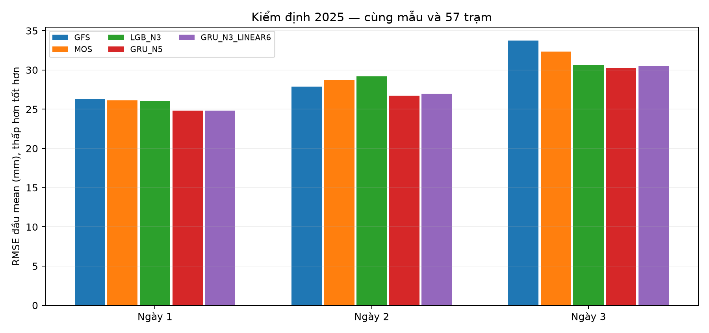
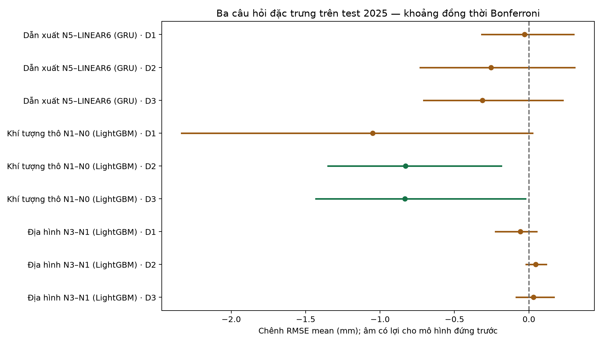
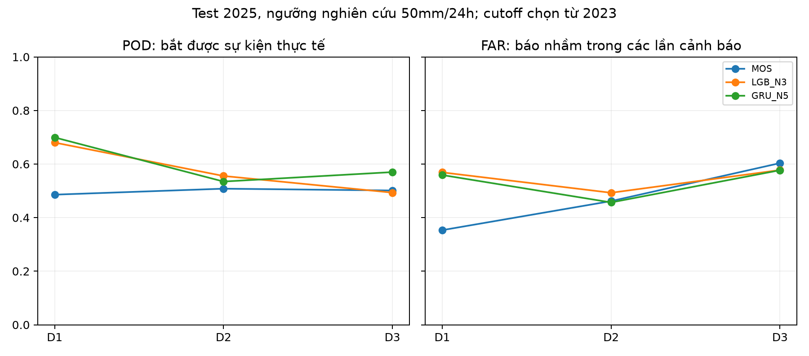

# Báo cáo kiểm chứng cuối — dự báo mưa ngắn hạn tại trạm

Bản công bố 17/11/2026. Đã thực hiện đối chứng dung lượng mạng, khóa mô hình và kiểm định 2025; đánh giá 2026 tách theo API. Dữ liệu/chấm điểm thuộc nhánh GFS–Vrain, độc lập với bộ ERA5 giờ của Bi-LSTM. Kết quả cũ được giữ nguyên.

## 1. Kết luận đọc trước

- **Khí tượng thô N1–N0 (LightGBM):** đủ tiêu chí cải thiện trên test ở ngày 2, 3.
- **Địa hình N3–N1 (LightGBM):** chưa đủ tiêu chí xác nhận cải thiện trên test sau hiệu chỉnh nhiều so sánh.
- **Dẫn xuất N5–LINEAR6 (GRU):** chưa đủ tiêu chí xác nhận cải thiện trên test sau hiệu chỉnh nhiều so sánh.
- **LGB_N3 so MOS, RMSE mean:** đủ tiêu chí cải thiện ở ngày 3.
- **GRU_N5 so MOS, MAE median:** đủ tiêu chí cải thiện ở ngày 1, 3.

Các kết luận trên áp dụng cho mô hình và 57 trạm đã khóa, theo tiêu chí định trước. Một chênh lệch điểm số nhỏ hơn 0 chưa đủ để kết luận cải thiện: cần xem khoảng bất định và hiệu chỉnh nhiều so sánh. Không đổi mô hình chính sau khi xem bảng test.

## 2. Đầu vào, đầu ra và cách chia dữ liệu

Mỗi ngày lúc 19h Việt Nam, mỗi trạm có một mẫu; nhãn là ba tổng mưa Vrain riêng trong 0–24h, 24–48h và 48–72h. Ví dụ phát lúc 19h thứ hai, nhãn ngày 1 kết thúc 19h thứ ba; ngày 2 là từ 19h thứ ba đến 19h thứ tư. Mưa thiếu không được thay bằng 0 hay lấp bằng GFS/ERA5/vệ tinh.

Đầu vào gồm bảy tổng mưa ngày quá khứ, tổng 1/6/24h gần nhất kết thúc trước thời điểm phát tin theo giả định trễ 1h, lịch/vị trí/ID, mưa và khí tượng dự báo GFS, địa hình. GFS 00UTC khởi tạo trước issue 12UTC; trạng thái khí tượng +24/+48/+72h là giữa cửa sổ, không phải trung bình ngày. Nội suy 0,25° tới trạm không tạo thêm độ phân giải thật.

| Cấu hình | Số biến | Bổ sung |
| --- | ---: | --- |
| N0 | 16 | Mưa GFS, lịch/vị trí/ID và lịch sử mưa trạm |
| N1 | 21 | N0 + nhiệt, RH, u/v850 và PWAT |
| N2 | 25 | N1 + q850, q×u, q×v và tốc độ gió |
| N3 | 26 | N1 + năm biến địa hình |
| N4 | 30 | N3 + bốn dẫn xuất gió–ẩm |
| N5 | 32 | N4 + gió·độ dốc và dòng ẩm·độ dốc |

Train 2021–2022 có 35.116 mẫu trạm–issue, cal 2023 có 18.365, dev 2024 có 19.405, mỗi mẫu ba hạn. Mọi biến đổi có học được fit chỉ trên train. Cal 2023 chỉ hiệu chỉnh xác suất và cutoff; không dùng early stopping. Tập 57 trạm được chọn bằng train, không chọn lại theo điểm 2025/2026.

| Tập đánh giá | Mẫu trạm–issue | Trạm | Ngày issue | Sự kiện≥50 D1/D2/D3 | Ngày issue có≥50 D1/D2/D3 |
| --- | --- | --- | --- | --- | --- |
| Phát triển 2024 — legacy | 19.405 | 57 | 363 | 890/886/884 | 96/95/94 |
| Kiểm định 2025 — legacy | 18.723 | 57 | 362 | 1047/1043/1037 | 115/115/115 |
| Kiểm tra 2026 — legacy | 1.725 | 56 | 62 | 2/2/2 | 1/1/1 |
| Kiểm tra 2026 — modern | 14.488 | 57 | 280 | 600/604/603 | 61/62/62 |

- Phát triển 2024 — legacy: các issue hợp lệ từ 01/01/2024 đến 28/12/2024.
- Kiểm định 2025 — legacy: các issue hợp lệ từ 01/01/2025 đến 28/12/2025.
- Kiểm tra 2026 — legacy: các issue hợp lệ từ 01/01/2026 đến 03/03/2026.
- Kiểm tra 2026 — modern: các issue hợp lệ từ 06/02/2026 đến 12/11/2026.

Sự kiện trong bảng là trạm–ngày, không phải số cơn bão hay các mẫu độc lập. Cùng một đợt mưa có thể xuất hiện ở nhiều trạm và hạn. Số mẫu giữa hai API 2026 khác nhau; không so trực tiếp hai trung bình rồi quy nguyên nhân cho mô hình hay API. Riêng legacy 2026 chỉ có hai sự kiện trạm–ngày ≥50mm ở một ngày issue cho mỗi hạn, nên không đủ để đánh giá ổn định khả năng cảnh báo mưa lớn.

Phân phối nhãn cũng khác giữa hai năm: ở ngày 1, mưa trung bình từ nguồn là 8,265mm trên dev 2024 và 10,896mm trên test 2025; nhãn lớn nhất là 366,0 và 772,6mm. Đã đối chiếu hậu nghiệm 36 nhãn lớn với đủ 24 giờ và tổng ngày gốc của Vrain: khớp về cấu trúc/tổng, chưa xác nhận được độ chính xác cảm biến. Không bỏ các nhãn lớn hoặc thay đổi điểm test sau kiểm tra này. Không quy toàn bộ chênh lệch điểm giữa hai năm thành overfitting hay thay đổi khí hậu từ riêng các thống kê này.

## 3. Đối chứng dung lượng GRU

N3 gốc có 4.364 tham số, N5 gốc có 4.796. Hai đối chứng mới là N3_LINEAR6 có đúng 4.796 tham số và N3_WIDE có 4.751 (head 27, lệch 45 tham số so N5). LINEAR6 thêm sáu tổ hợp tuyến tính cố định của 10 biến khí tượng thô/địa hình, chuẩn hóa chỉ bằng train; không thêm quan trắc hoặc thông tin nhãn. Ma trận tổ hợp và seed đã ghi trong protocol trước fit.

Cả hai đối chứng dùng ba seed 17/29/43, hidden 16, learning rate 0,001, batch 256, 17 epoch cố định, cùng loss và optimizer với GRU cũ. Không tìm thêm siêu tham số. N3_WIDE được chọn head 27 chỉ vì gần số tham số N5 nhất tại hidden 16; không chọn theo điểm phát triển/test. Seed là số khởi tạo quá trình ngẫu nhiên; ba seed giúp thấy dao động khi khởi tạo và xáo trộn mẫu khác nhau, không phải ba bộ dữ liệu độc lập.

Phép so N5 với LINEAR6 kiểm tra giá trị của dẫn xuất phi tuyến vượt việc thêm các kênh tuyến tính dư thừa, trong cùng kích thước mạng. Phép so với WIDE kiểm tra độ nhạy với số tham số gần tương đương. Các mạng vẫn khác cách biểu diễn và tối ưu; kết quả không phải chứng minh nhân quả vật lý.

## 4. Mô hình và nguyên tắc khóa trước kiểm định

Có 17 phương án trong bảng: ZERO, khí hậu CLIM, persistence, GFS, MOS, LightGBM N0–N5 và N3 trễ 3/6h, GRU N3/N5 và hai đối chứng mới. MOS là hiệu chỉnh thống kê đơn giản của GFS, giúp kiểm tra ML có hơn một cách sửa sai số dễ triển khai hay không. Persistence lặp lại lượng mưa 24h gần nhất; CLIM dùng thống kê khí hậu theo trạm/tháng chỉ từ train; ZERO luôn dự báo 0mm.

Mô hình lượng mưa chính được chốt là **LightGBM N3**, ứng viên đầu trung vị là **GRU N5**. Các checkpoint, chuẩn hóa, calibrator, cutoff và mã suy luận/chấm đã được khóa SHA lúc **19:31:45 17/11/2026** giờ Việt Nam; lần mở đánh giá mô hình trên hàng kiểm định bắt đầu **19:31:46 17/11/2026**. Việc nguồn 2025 đã được tải/QC trước đó được ghi rõ; không gọi toàn kho chưa từng đọc 2025.

Sau khóa không có fit/tuning/hiệu chỉnh/cutoff mới hoặc đổi mô hình chính dựa trên test. Dự báo mean và median là hai đại lượng khác nhau: đầu mean đánh giá chính bằng RMSE, đầu median bằng MAE. Không chọn đầu có điểm đẹp hơn cho từng metric sau khi nhìn kết quả. Xác suất ≥50 bằng xác suất ≥1 nhân xác suất ≥50 khi đã mưa ≥1; hiệu chỉnh và ensemble vẫn giữ p50≤p1.

## 5. Kết quả lượng mưa trên kiểm định 2025

Đơn vị mm, macro là trung bình đều giữa các trạm. Chữ đậm chỉ điểm thấp nhất trong từng cột của bảng, không thay đổi lựa chọn mô hình chính đã khóa. ZERO có thể cạnh tranh về MAE khi nhiều ngày khô nhưng không vì thế trở thành dự báo mưa lớn hữu ích.

| Phương án | RMSE mean D1 | D2 | D3 | MAE median D1 | D2 | D3 |
| --- | --- | --- | --- | --- | --- | --- |
| ZERO | 35,294 | 36,153 | 36,419 | 10,787 | 10,904 | 10,944 |
| CLIM | 32,655 | 33,524 | 33,750 | 10,576 | 10,705 | 10,760 |
| PERSISTENCE | 37,080 | 43,349 | 44,899 | 13,341 | 15,830 | 16,566 |
| GFS | 26,345 | 27,899 | 33,765 | 9,768 | 10,383 | 11,743 |
| MOS | 26,131 | 28,683 | 32,346 | 9,019 | 9,404 | 10,026 |
| LGB_N0 | 27,142 | 29,985 | 31,447 | 8,328 | 9,442 | 9,695 |
| LGB_N1 | 26,092 | 29,157 | 30,614 | 8,148 | 9,254 | 9,549 |
| LGB_N2 | 26,098 | 29,078 | 30,473 | 8,074 | 9,173 | 9,532 |
| LGB_N3 | 26,035 | 29,203 | 30,645 | 8,142 | 9,246 | 9,501 |
| LGB_N4 | 26,155 | 29,094 | 30,436 | 8,091 | 9,173 | 9,482 |
| LGB_N5 | 26,079 | 29,130 | 30,475 | 8,117 | 9,195 | 9,540 |
| LGB_N3_delay3 | 26,419 | 29,172 | 30,629 | 8,278 | 9,263 | 9,560 |
| LGB_N3_delay6 | 26,711 | 29,217 | 30,725 | 8,341 | 9,325 | 9,540 |
| GRU_N3 | **24,667** | 27,184 | 30,620 | 7,975 | 8,808 | 9,454 |
| GRU_N5 | 24,812 | **26,711** | **30,233** | **7,969** | **8,724** | **9,399** |
| GRU_N3_LINEAR6 | 24,841 | 26,965 | 30,545 | 8,011 | 8,786 | 9,446 |
| GRU_N3_WIDE | 24,823 | 27,021 | 30,637 | 8,000 | 8,743 | 9,462 |

## 6. Bằng chứng cải thiện và bất định

Ba phép so đặc trưng ở ba hạn tạo một họ 9 so sánh; hai phép so kỹ năng với MOS ở ba hạn tạo một họ 6 so sánh. Bootstrap ghép cặp khối 14 ngày, 5.000 lần, giữ các trạm/hạn cùng lịch. Khoảng đồng thời Bonferroni được hiệu chỉnh trong từng họ, không phải một tuyên bố kiểm soát chung cho mọi bảng và mọi metric. P từ bootstrap định tâm và hiệu chỉnh Holm là xấp xỉ, không phải kiểm định hoán vị chính xác.

Trong bảng dưới, chênh âm có lợi cho mô hình đứng trước. “Có” yêu cầu đồng thời chênh âm, cận trên khoảng đồng thời <0 và p Holm <0,05. “Chưa đủ” có thể gồm cải thiện điểm nhưng bất định lớn, không cải thiện, hoặc kết quả ngược chiều. Khoảng percentile và p bootstrap định tâm không phải hai cách diễn đạt tương đương trong phân phối bất đối xứng; tiêu chí đã khóa yêu cầu cả hai cùng đạt. Các bảng khác được ghi thăm dò.

| Mô hình − tham chiếu | Ngày | Metric | Chênh | CI95% | Khoảng đồng thời | Đủ tiêu chí |
| --- | --- | --- | --- | --- | --- | --- |
| GRU_N5 − GRU_N3_LINEAR6 | 1 | mean_rmse | -0,029 | [-0,264; 0,194] | [-0,317; 0,301] | Chưa đủ |
| GRU_N5 − GRU_N3_LINEAR6 | 2 | mean_rmse | -0,254 | [-0,574; 0,181] | [-0,731; 0,308] | Chưa đủ |
| GRU_N5 − GRU_N3_LINEAR6 | 3 | mean_rmse | -0,312 | [-0,597; 0,105] | [-0,707; 0,227] | Chưa đủ |
| LGB_N1 − LGB_N0 | 1 | mean_rmse | -1,050 | [-1,944; -0,153] | [-2,334; 0,023] | Chưa đủ |
| LGB_N1 − LGB_N0 | 2 | mean_rmse | -0,829 | [-1,203; -0,338] | [-1,350; -0,185] | Có |
| LGB_N1 − LGB_N0 | 3 | mean_rmse | -0,833 | [-1,279; -0,286] | [-1,432; -0,024] | Có |
| LGB_N3 − LGB_N1 | 1 | mean_rmse | -0,056 | [-0,177; 0,026] | [-0,224; 0,052] | Chưa đủ |
| LGB_N3 − LGB_N1 | 2 | mean_rmse | 0,047 | [-0,001; 0,093] | [-0,019; 0,117] | Chưa đủ |
| LGB_N3 − LGB_N1 | 3 | mean_rmse | 0,031 | [-0,065; 0,135] | [-0,085; 0,167] | Chưa đủ |
| GRU_N5 − MOS | 1 | median_mae | -1,050 | [-1,618; -0,579] | [-1,837; -0,436] | Có |
| GRU_N5 − MOS | 2 | median_mae | -0,680 | [-1,387; -0,218] | [-1,789; -0,129] | Chưa đủ |
| GRU_N5 − MOS | 3 | median_mae | -0,627 | [-1,128; -0,240] | [-1,355; -0,139] | Có |
| LGB_N3 − MOS | 1 | mean_rmse | -0,095 | [-3,623; 3,442] | [-4,283; 4,783] | Chưa đủ |
| LGB_N3 − MOS | 2 | mean_rmse | 0,520 | [-1,258; 2,483] | [-1,450; 3,090] | Chưa đủ |
| LGB_N3 − MOS | 3 | mean_rmse | -1,701 | [-2,688; -0,838] | [-3,036; -0,615] | Có |

Khoảng này điều kiện theo ensemble ba seed đã fit, chưa bao gồm sai số cảm biến hoặc mọi lần huấn luyện có thể xảy ra. Dao động theo seed được báo riêng trong `holdout_seed_metrics.csv`. Tập 2024 đã được xem trước, nên các khoảng trên 2024 vẫn là phân tích phát triển dù đã hiệu chỉnh nhiều phép so sánh.

## 7. Xác suất và mưa lớn

Ngưỡng 50mm/24h là ngưỡng nghiên cứu thăm dò, chưa nhận là chuẩn cảnh báo chính thức. Cutoff xác suất chọn bằng cross-fit 2023, giữ nguyên cho 2025 và 2026. BS là sai số bình phương của xác suất dự báo; thấp hơn tốt hơn. BSS dương nghĩa BS tốt hơn khí hậu tham chiếu chỉ fit bằng train; BSS âm nghĩa kém hơn tham chiếu theo cách tính đã nêu.

POD là tỷ lệ sự kiện thực tế bắt được. FAR là tỷ lệ cảnh báo bị nhầm trong các lần đã cảnh báo. Ví dụ FAR 0,6 nghĩa khoảng 60% lần cảnh báo không có sự kiện theo ngưỡng đó. CSI cân nhắc cả trúng/bỏ sót/báo nhầm. Không có mốc POD 0,4 tốt chung cho mọi ngưỡng, hạn và khu vực. Các chỉ số dưới là macro; xem CSV để có micro và số đếm H/M/F.

| Mô hình | Ngày | BSS50 | CSI50 | POD50 | FAR50 | Cutoff |
| --- | --- | --- | --- | --- | --- | --- |
| GFS | 1 | 0,086 | 0,347 | 0,438 | 0,340 | 0,50 |
| GFS | 2 | 0,040 | 0,348 | 0,445 | 0,372 | 0,50 |
| GFS | 3 | -0,166 | 0,258 | 0,360 | 0,490 | 0,50 |
| MOS | 1 | 0,275 | 0,373 | 0,486 | 0,353 | 0,35 |
| MOS | 2 | 0,235 | 0,346 | 0,508 | 0,462 | 0,25 |
| MOS | 3 | 0,092 | 0,278 | 0,501 | 0,603 | 0,15 |
| LGB_N3 | 1 | 0,345 | 0,358 | 0,680 | 0,569 | 0,15 |
| LGB_N3 | 2 | 0,248 | 0,354 | 0,555 | 0,493 | 0,25 |
| LGB_N3 | 3 | 0,197 | 0,289 | 0,493 | 0,578 | 0,20 |
| GRU_N5 | 1 | 0,349 | 0,370 | 0,699 | 0,559 | 0,20 |
| GRU_N5 | 2 | 0,267 | 0,364 | 0,535 | 0,457 | 0,30 |
| GRU_N5 | 3 | 0,186 | 0,316 | 0,570 | 0,577 | 0,20 |

## 8. Tái hiện phát triển 2024 và kiểm tra 2026

Hai API đều thuộc Vrain; legacy/modern là tên dự án đặt cho đường truy xuất, không phải xác nhận hai cảm biến hoặc hai cấp chất lượng. Chưa có xác nhận chính thức về nguyên nhân khác độ phủ hay tính liên tục. Các mẫu giữ cùng API cho lịch sử và nhãn; điều này không chứng minh phân phối giữa các năm không thay đổi.

### Phát triển 2024

| Phương án | RMSE mean D1 | D2 | D3 | MAE median D1 | D2 | D3 |
| --- | --- | --- | --- | --- | --- | --- |
| ZERO | 24,398 | 24,299 | 24,293 | 8,291 | 8,232 | 8,249 |
| CLIM | 22,347 | 22,286 | 22,280 | 8,061 | 8,001 | 8,011 |
| PERSISTENCE | 27,030 | 29,742 | 30,572 | 10,520 | 12,041 | 12,469 |
| GFS | 19,271 | 20,228 | 22,139 | 8,014 | 8,664 | 9,299 |
| MOS | 19,169 | 20,124 | 20,445 | 7,306 | 7,585 | 7,554 |
| LGB_N0 | 18,574 | 19,749 | 19,688 | 6,768 | 7,302 | 7,231 |
| LGB_N1 | 17,497 | 18,586 | 19,151 | 6,461 | 7,142 | 7,138 |
| LGB_N2 | 17,523 | 18,589 | 19,145 | 6,419 | 7,133 | 7,111 |
| LGB_N3 | 17,527 | 18,550 | 19,150 | 6,444 | 7,116 | 7,095 |
| LGB_N4 | 17,522 | 18,579 | 19,133 | 6,420 | 7,109 | 7,106 |
| LGB_N5 | 17,521 | 18,590 | 19,164 | 6,440 | 7,104 | 7,097 |
| LGB_N3_delay3 | 17,425 | 18,559 | 19,152 | 6,509 | 7,106 | 7,128 |
| LGB_N3_delay6 | 17,437 | **18,532** | **19,117** | 6,514 | 7,112 | 7,124 |
| GRU_N3 | 17,722 | 18,954 | 19,368 | 6,444 | 6,865 | 6,912 |
| GRU_N5 | **17,386** | 18,750 | 19,277 | **6,314** | **6,754** | **6,870** |
| GRU_N3_LINEAR6 | 17,705 | 18,993 | 19,413 | 6,412 | 6,827 | 6,898 |
| GRU_N3_WIDE | 17,657 | 18,853 | 19,372 | 6,417 | 6,810 | 6,923 |

### Năm 2026 — legacy

| Phương án | RMSE mean D1 | D2 | D3 | MAE median D1 | D2 | D3 |
| --- | --- | --- | --- | --- | --- | --- |
| ZERO | 5,711 | 5,616 | 5,644 | 2,582 | 2,424 | 2,342 |
| CLIM | 5,330 | 5,305 | 5,458 | 2,584 | 2,430 | 2,355 |
| PERSISTENCE | 6,299 | 7,286 | 7,707 | 3,295 | 3,926 | 4,106 |
| GFS | 4,319 | 4,743 | **4,533** | 2,291 | 2,489 | 2,398 |
| MOS | 5,596 | 5,724 | 5,869 | 1,918 | **2,009** | **1,955** |
| LGB_N0 | 3,951 | **4,321** | 4,747 | 1,906 | 2,073 | 2,086 |
| LGB_N1 | 3,958 | 4,539 | 4,720 | 1,864 | 2,069 | 2,071 |
| LGB_N2 | 3,997 | 4,381 | 4,734 | **1,830** | 2,049 | 2,044 |
| LGB_N3 | 3,954 | 4,462 | 4,729 | 1,853 | 2,040 | 2,051 |
| LGB_N4 | 3,993 | 4,357 | 4,724 | 1,855 | 2,081 | 2,054 |
| LGB_N5 | 3,980 | 4,400 | 4,712 | 1,859 | 2,074 | 2,047 |
| LGB_N3_delay3 | **3,919** | 4,496 | 4,743 | 1,865 | 2,027 | 2,051 |
| LGB_N3_delay6 | 4,062 | 4,471 | 4,726 | 1,903 | 2,061 | 2,054 |
| GRU_N3 | 4,208 | 4,730 | 4,841 | 2,262 | 2,325 | 2,255 |
| GRU_N5 | 4,280 | 4,721 | 4,891 | 2,266 | 2,296 | 2,231 |
| GRU_N3_LINEAR6 | 4,390 | 4,777 | 4,878 | 2,287 | 2,313 | 2,250 |
| GRU_N3_WIDE | 4,269 | 4,772 | 4,895 | 2,244 | 2,301 | 2,249 |

### Năm 2026 — modern

| Phương án | RMSE mean D1 | D2 | D3 | MAE median D1 | D2 | D3 |
| --- | --- | --- | --- | --- | --- | --- |
| ZERO | 25,590 | 25,702 | 25,722 | 7,837 | 7,886 | 7,892 |
| CLIM | 23,907 | 23,983 | 24,015 | 7,748 | 7,790 | 7,804 |
| PERSISTENCE | 26,454 | 30,793 | 32,507 | 9,442 | 11,284 | 11,966 |
| GFS | 20,445 | 19,738 | 24,953 | 7,590 | 7,718 | 8,832 |
| MOS | 18,203 | 18,078 | 22,378 | 6,407 | 6,845 | 7,447 |
| LGB_N0 | 16,448 | 18,323 | 21,254 | 6,207 | 6,788 | 7,409 |
| LGB_N1 | **16,220** | 18,093 | 20,582 | 5,919 | 6,567 | 7,161 |
| LGB_N2 | 16,344 | 18,042 | 20,590 | 5,866 | 6,569 | 7,145 |
| LGB_N3 | 16,227 | 18,029 | 20,538 | 5,901 | 6,575 | 7,158 |
| LGB_N4 | 16,274 | 18,039 | 20,543 | 5,853 | 6,529 | 7,116 |
| LGB_N5 | 16,340 | 17,997 | 20,571 | 5,868 | 6,538 | 7,092 |
| LGB_N3_delay3 | 16,350 | 17,986 | 20,551 | 5,911 | 6,569 | 7,207 |
| LGB_N3_delay6 | 16,452 | 18,044 | 20,518 | 5,958 | 6,587 | 7,111 |
| GRU_N3 | 17,057 | 16,831 | 20,856 | 5,616 | 6,104 | 6,802 |
| GRU_N5 | 17,105 | **16,686** | **20,504** | **5,489** | **6,035** | **6,722** |
| GRU_N3_LINEAR6 | 17,782 | 16,856 | 20,827 | 5,596 | 6,095 | 6,776 |
| GRU_N3_WIDE | 17,481 | 16,741 | 20,688 | 5,630 | 6,094 | 6,772 |

Năm 2026 chỉ đến issue 12/11, chưa đủ năm và độ phủ từng API thay đổi theo tháng. Đây là kiểm tra độ bền kèm giới hạn nguồn; không tự quy thay đổi điểm cho riêng mô hình, khí hậu hay API. Có bảng theo tháng/từng trạm riêng; số mẫu và số sự kiện phải đọc kèm mọi phép so sánh. Bảng theo trạm và dự báo từng thời điểm nằm private.

## 9. Những gì đã kiểm chứng và chưa chứng minh

Đã tái hiện toàn bộ 218.658 hàng phát triển và 68 cột dự báo, chuẩn hóa/projection chỉ fit trên train, sáu checkpoint mới, các calibrator 2023, và thử đổi nhãn tương lai mà không đổi dự báo. Kiểm tra độc lập cuối gồm 104.808 hàng kiểm định, 9.936 đối chiếu metric, 1.296 đối chiếu seed và 360 đối chiếu bootstrap. 181 artifact cũ/slide được giữ nguyên. Có 26 tests liên quan đạt trước mở test.

Chưa chứng minh độ chính xác cảm biến, lịch sử di chuyển tọa độ, tính liên tục hai API hoặc dữ liệu lịch sử đã có sẵn đúng thời điểm phát tin. Trễ GFS 8h/Vrain 1h vẫn là giả định; kết quả trễ 3/6h trong bảng không tự giải quyết độ trễ thật. Không tuyên bố vượt paper khác khi khác khu vực/nhãn/hạn/split. Cả 2025 và phần 2026 này nay đã được chấm: thí nghiệm tiếp theo dùng chúng để chỉnh mô hình phải gọi đúng là phát triển mới, và cần giai đoạn/địa bàn chưa sử dụng nếu muốn có kiểm định độc lập mới.

## 10. Tái lập và bàn giao

Protocol: `protocol.json`; khóa cuối: `final_manifest.json`; kiểm tra độc lập: `control_verification.json`, `final_verification.json`; toàn bộ bảng ở CSV cùng thư mục. Checkpoint, dự báo theo trạm/thời điểm và raw ở `data/operational/gfs_station_final_2026_11_17/`, không đưa lên GitHub công khai. Các script prepare/runcontrols/verifycontrols/score/verifyresults/publish mang tiền tố gfs_final hoặc gfs_capacity_controls; scripts cũ không bị ghi đè.

Tham khảo nguyên tắc không dùng test để chọn mô hình: [scikit-learn](https://scikit-learn.org/stable/common_pitfalls.html#data-leakage). Định nghĩa BS/BSS/CSI/POD/FAR giữ cùng thí nghiệm daily-v2 để so sánh nhất quán.
