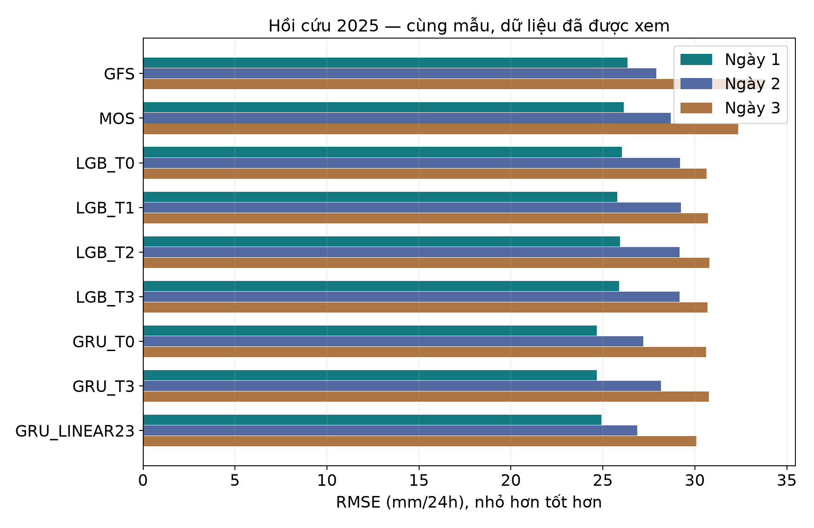
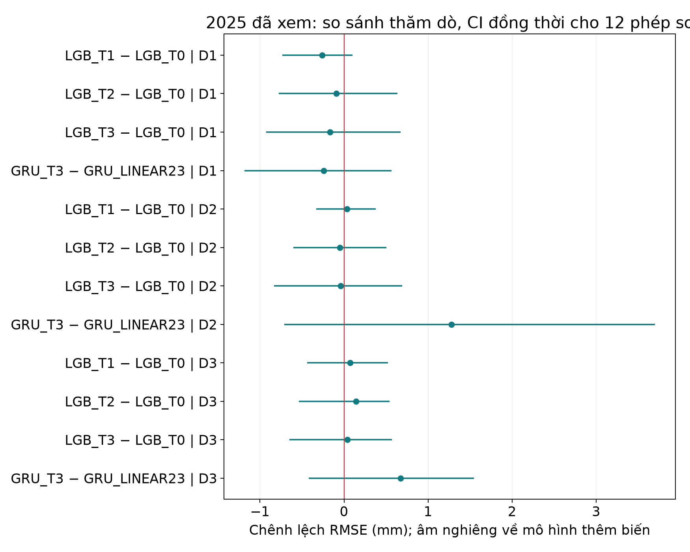
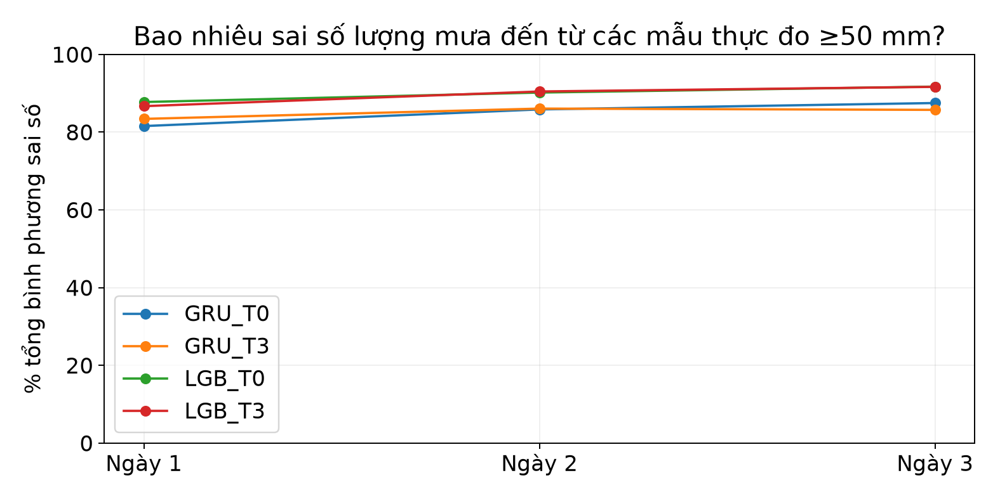

# Báo cáo cải tiến dự báo mưa ngắn hạn tại trạm

Cập nhật ngày 18/11/2026; phiên bản thí nghiệm khởi tạo ngày 17/11. Giữ nguyên bản kiểm định trước đó.

## Kết quả đọc trước

Trong thiết kế và ngân sách hiện tại, chưa có bằng chứng ổn định để chốt bộ 49 biến làm đầu vào chính. Giữ cấu hình gọn và phương án đã kiểm chứng trước đó làm tham chiếu.

LightGBM T3−T0, chênh lệch RMSE năm 2025: D1: -0,167 mm, D2: -0,041 mm, D3: 0,038 mm.

GRU T3−LINEAR23: D1: -0,241 mm, D2: 1,280 mm, D3: 0,672 mm.

Có 0/12 phép so chính có tín hiệu qua cả CI đồng thời và Holm; vẫn là thăm dò vì 2025 đã được xem.

Không thay kết luận kiểm chứng cũ. Chưa chứng minh vận hành realtime hoặc tính liên tục hai API.

Số âm trong chênh lệch RMSE nghiêng về cấu hình thêm biến. Điểm thấp hơn chưa đủ để khẳng định tăng chất lượng ổn định: cần đọc khoảng tin cậy, tính nhất quán giữa năm và hạn dự báo, sai số mưa lớn và báo nhầm. Các kết quả 2025–2026 của vòng này là hồi cứu vì những năm này đã được phân tích trước đó.

## Thiết kế đã định trước

## 1. Mục tiêu cụ thể

Mỗi ngày lúc **19:00 giờ Việt Nam**, dùng thông tin được giả định có trước thời điểm này để dự báo **ba tổng lượng mưa 24 giờ riêng biệt tại chính trạm**:

| Đầu ra | Khoảng thời gian tính từ lúc phát dự báo | Ví dụ phát lúc 19h thứ Hai |
| --- | --- | --- |
| Ngày 1 | 0–24 giờ tiếp theo | 19h thứ Hai → 19h thứ Ba |
| Ngày 2 | 24–48 giờ tiếp theo | 19h thứ Ba → 19h thứ Tư |
| Ngày 3 | 48–72 giờ tiếp theo | 19h thứ Tư → 19h thứ Năm |

Nhãn là tổng 24 số đo mưa giờ Vrain, cùng trạm và cùng API trong cả lịch sử lẫn ba nhãn. Không chia mưa ngày thành giờ; không thay nhãn bằng GFS, ERA5 hay vệ tinh. Giữ 57 trạm đạt điều kiện từ tập huấn luyện trước đây để so sánh được với nghiên cứu cũ. Một mô hình dùng chung cho nhiều trạm.

## 2. Vì sao thử hướng này?

Đầu vào cũ đã có tổng mưa GFS của từng ngày, nhưng khí tượng của một ngày chỉ được đại diện bởi **một trạng thái dự báo ở giữa ngày đó**. Hai ngày cùng tổng 80 mm có thể khác nhau: một ngày mưa tập trung vào vài giờ, ngày kia trải đều. Một trạng thái giữa ngày cũng có thể bỏ qua quá trình ẩm tăng hoặc gió đổi hướng.

Đề xuất mới giữ nguyên bản GFS khởi tạo 00 UTC, bổ sung diễn biến bên trong mỗi cửa sổ ngày. Đây là giả thuyết cần kiểm tra; thêm biến không bảo đảm giảm sai số.

## 3. Bốn cấu hình LightGBM

26 biến nền T0 gồm: một tổng mưa GFS, hai biến lịch sin/cos ngày trong năm, ba biến vị trí/ID, mười biến mưa quá khứ, năm trường khí tượng giữa ngày và năm biến DEM. Vị trí/ID chỉ giúp phân biệt trạm trong mô hình; không biến lượng mưa tại điểm thành mưa trung bình một vùng.

| Cấu hình | Số đặc trưng | Thông tin |
| --- | ---: | --- |
| T0 | 26 | Đúng N3 cũ: mưa GFS ngày; lịch, vị trí/ID; bảy ngày mưa quá khứ và tổng gần nhất 1/6/24 giờ; T/RH/gió 850 hPa/PWAT ở giữa ngày; năm đặc trưng DEM |
| T1 | 34 | T0 + bốn lượng mưa GFS 6 giờ, lượng lớn nhất 6 giờ, tỷ trọng lớn nhất, vị trí trọng tâm mưa theo thời gian và tỷ trọng mưa nửa đầu ngày |
| T2 | 41 | T0 + trung bình của ba mẫu, biên độ và chênh lệch cuối–đầu của từng trường T/RH/u/v/PWAT: 5 × 3 = 15 biến |
| T3 | 49 | T0 + cả phân bố mưa 6 giờ lẫn diễn biến khí tượng |

Các trạng thái khí tượng mới nằm ở **+6, +12, +18 giờ trong từng cửa sổ 24 giờ đích**. Trung bình ba mẫu tức thời không được gọi là trung bình khí tượng toàn ngày. Bốn lượng mưa 6 giờ là dự báo GFS lấy bằng hiệu tích lũy, không phải số đo mưa Vrain được nội suy.

Mưa bằng 0 có các tỷ trọng/trọng tâm quy ước bằng 0. Chỉ sửa chênh lệch âm rất nhỏ trong dung sai đóng gói GRIB và ghi cờ; chênh lệch âm lớn bị từ chối. Tổng mưa ngày cũ được giữ nguyên để đối chiếu.

Ví dụ giả định, chỉ xét thông tin mưa dự báo: hai chuỗi 6 giờ `[0, 0, 80, 0]` và `[20, 20, 20, 20]` đều có tổng 80 mm/ngày. Dữ liệu mới phân biệt được mưa dồn hay mưa rải đều. Chọn bốn khoảng 6 giờ để mô tả diễn biến với ít biến và khối lượng trích xuất phù hợp; đây là lựa chọn thiết kế, chưa chứng minh tối ưu hơn khoảng 3 giờ hoặc 1 giờ. Không dùng lựa chọn này để biện minh việc nội suy nhãn mưa trạm.

## 4. Mô hình và so sánh công bằng

LightGBM chạy đủ T0–T3. GRU nhỏ chạy T0, T3 và **LINEAR23**: thêm 23 tổ hợp tuyến tính cố định của dữ liệu T0, không thêm nguồn thông tin mới. LINEAR23 có cùng số kênh và số tham số với GRU T3. Đối chứng này giúp xem lợi ích có vượt việc tăng dung lượng đầu vào hay không; cùng số tham số chưa đồng nghĩa cùng khả năng tối ưu.

Giữ ba seed 17/29/43, ngân sách cây theo từng đầu/hạn đã chọn bằng cross-validation chỉ trên 2021–2022. GRU giữ 17 epoch, hidden 16, head 24, learning rate 0,001. Không tìm thêm nhiều kiến trúc để chọn theo kết quả 2025. Các đối chứng gồm 0 mm, khí hậu, mưa 24h gần nhất, GFS thô và MOS hiệu chỉnh đơn giản.

Seed là mã khởi tạo ngẫu nhiên. Ba mã 17/29/43 tạo ba lần huấn luyện trên cùng dữ liệu và cách chia năm; kết quả có thể khác vì trọng số ban đầu, xáo trộn batch hoặc cách lấy mẫu. Lấy trung bình ba dự báo và báo điểm từng seed để thấy độ ổn định. Ba seed không tạo ra ba bộ số đo độc lập. LightGBM học từ bảng đặc trưng; GRU dùng thêm bộ mã hóa chuỗi mưa bảy ngày, giúp kiểm tra hành vi với một cách biểu diễn khác.

Mọi cấu hình được chấm **trên đúng cùng các mẫu trạm–ngày**, đủ cả ba nhãn và toàn bộ đầu vào T3. Báo riêng việc mất mẫu nếu trường mới bị thiếu. T0 được huấn luyện lại cùng quy trình và đối chiếu dự báo cũ; không lấy điểm hai tập mẫu khác nhau để kết luận tăng chất lượng.

Với T3, LightGBM nhận bảng `[số mẫu ở một hạn, 49 biến]` và học riêng từng hạn. GRU nhận lịch sử mưa `[số mẫu, 7 ngày, 1]`, context dự báo `[số mẫu, 3 ngày đích, 41]` và ID trạm. Con số 41 bằng 49 trừ bảy biến lịch sử đã đưa qua nhánh chuỗi và một mã trạm đã đưa qua embedding. Cả hai cùng dùng thông tin được phép tại issue; chỉ khác cách biểu diễn.

Mỗi mẫu trả ba lượng mean, ba lượng median, ba xác suất mưa từ 1 mm và ba xác suất mưa từ 50 mm. Mean và median là hai cách ước lượng lượng mưa cho hai mục tiêu đánh giá, không phải hai nhãn đo khác nhau.

## 5. Chia dữ liệu và giới hạn kết luận

| Giai đoạn | Vai trò trong thí nghiệm mới |
| --- | --- |
| 2021–2022 | Fit mô hình và mọi phép chuẩn hóa |
| 2023 | Hiệu chỉnh xác suất và chọn ngưỡng qua cross-fit theo quý |
| 2024 | Phát triển, đã được phân tích trước đây |
| 2025 | Đánh giá hồi cứu; đã chấm ở vòng cũ, không còn là test chưa dùng |
| 2026 hiện có | Đánh giá hồi cứu, tách hai API; chưa đủ năm và chưa xác nhận tính liên tục |
| Dữ liệu sau thời điểm khóa mô hình tương lai | Có thể tạo kiểm định mới thực sự chưa sử dụng |

Lần này vẫn không fit/tuning bằng nhãn 2025–2026. Tuy nhiên, việc đã xem kết quả những năm đó ảnh hưởng lựa chọn hướng nghiên cứu; không thể khôi phục tính độc lập bằng cách chỉ đổi tên tập hoặc khóa lại checkpoint. Giữ nguyên toàn bộ kết quả kiểm chứng cũ.

## 6. Chấm điều gì?

Mô hình có hai đầu lượng: **mean** phục vụ RMSE và **median** phục vụ MAE. Không chọn mỗi mô hình một đầu tốt nhất sau khi thấy kết quả. Đầu xác suất gồm P(mưa ≥ 1 mm) và P(mưa ≥ 50 mm), luôn bảo đảm xác suất ngưỡng lớn không vượt ngưỡng nhỏ. 50 mm/24h là ngưỡng phân tích nghiên cứu ở đây, không tự nhận là chuẩn cảnh báo vận hành.

| Chỉ số | Diễn giải | Chiều tốt |
| --- | --- | --- |
| RMSE của đầu mean | Phạt mạnh các lần sai lượng mưa lớn | Nhỏ hơn |
| MAE của đầu median | Sai số tuyệt đối điển hình theo mm | Nhỏ hơn |
| Bias | Trung bình dự báo thừa hay thiếu | Gần 0 |
| BS | Sai số xác suất sự kiện mưa | Nhỏ hơn |
| BSS | BS tốt hơn khí hậu tham chiếu bao nhiêu; âm là kém tham chiếu | Lớn hơn |
| POD | Trong sự kiện mưa thực tế, bắt đúng bao nhiêu | Lớn hơn, phải đọc cùng FAR |
| FAR | Trong các lần báo mưa, tỷ lệ báo nhầm | Nhỏ hơn |
| CSI | Cân nhắc báo đúng, bỏ sót và báo nhầm | Lớn hơn |

Chấm từng trạm rồi lấy trung bình giữa trạm; kèm phân tích theo tháng, mức mưa và từng seed. Bootstrap ghép khối 14 ngày, giữ các trạm cùng đợt mưa trong cùng lần lấy mẫu. Bốn so sánh chính × ba hạn = 12, hiệu chỉnh nhiều so sánh. Kết quả hiệu chỉnh ở các năm đã xem vẫn là bằng chứng thăm dò.

## 7. Kiểm tra nhãn và nguồn

Kiểm tra độc lập tổng 24 giờ, độ đầy đủ, xung đột API, mưa ở trạm lân cận và GSMaP chưa hiệu chỉnh trạm. Vệ tinh là đối chiếu bối cảnh, không phải chân lý để sửa trạm. Trạm gần nhau cũng có thể cùng chịu lỗi hệ thống; mưa cục bộ có thể khác xa lân cận. Không loại mưa lớn chỉ vì mô hình dự báo sai.

Hai đường API đều thuộc Vrain. Tọa độ hiện tại khớp không chứng minh lịch sử cảm biến hoặc tính liên tục số đo. Chưa có xác nhận chính thức nguyên nhân đổi độ phủ hai API. Độ trễ GFS 8 giờ và trạm 1 giờ vẫn là giả định cần đo khi vận hành, không phải điều đã được chứng minh từ archive.

GSOD không được ghép trực tiếp để kiểm chứng cùng ngày: ngày UTC của GSOD khác cửa sổ 19h–19h Việt Nam của nhãn hiện tại. Cần tái tổng hợp từ số giờ đúng khoảng trước khi dùng đối chiếu lượng.

## 8. Số mẫu và ngân sách huấn luyện thực tế

| Giai đoạn | API | Mẫu trạm–issue | Trạm | Ngày issue |
| --- | --- | --- | --- | --- |
| cal2023 | legacy | 18365 | 57 | 362 |
| dev2024 | legacy | 19405 | 57 | 363 |
| retrospective2025_legacy | legacy | 18723 | 57 | 362 |
| retrospective2026_legacy | legacy | 1725 | 56 | 62 |
| retrospective2026_modern | modern | 14488 | 57 | 280 |
| train2021_2022 | legacy | 35116 | 57 | 717 |

LightGBM chạy đủ T0–T3: mỗi cấu hình có 3 hạn × 3 seed × 4 đầu, tổng cộng 144 estimator. Giữ số cây và siêu tham số đã được chọn qua cross-validation chỉ trên train ở vòng trước. GRU có T0, T3 và LINEAR23, mỗi cấu hình ba seed, tổng cộng 9 lần fit. Giữ 17 epoch, hidden 16 và head 24. Không tìm thêm cấu hình theo điểm 2025–2026.

T0 được huấn luyện lại để kiểm tra đối chiếu với bản cũ. Xem `baseline_refit_parity.json` về độ khớp. Ngưỡng quyết định sự kiện vẫn chỉ chọn trên cross-fit năm 2023. Mỗi mô hình được chấm trên cùng các mẫu trong từng giai đoạn.

## 9. Bảng kết quả đầy đủ

**In đậm là điểm nhỏ nhất mỗi cột**, không đồng nghĩa khác biệt có ý nghĩa thống kê. Đơn vị lượng mưa: mm/24h. Đầu mean được đánh giá chính bằng RMSE; đầu median được đánh giá chính bằng MAE.

### Phát triển 2024 — RMSE của đầu mean

| Mô hình | Ngày 1 | Ngày 2 | Ngày 3 |
| --- | --- | --- | --- |
| ZERO | 24,398 | 24,299 | 24,293 |
| CLIM | 22,347 | 22,286 | 22,280 |
| PERSISTENCE | 27,030 | 29,742 | 30,572 |
| GFS | 19,271 | 20,228 | 22,139 |
| MOS | 19,169 | 20,124 | 20,445 |
| LGB_T0 | 17,527 | 18,550 | 19,150 |
| LGB_T1 | 17,454 | 18,489 | 19,145 |
| LGB_T2 | 17,389 | 18,482 | 19,173 |
| LGB_T3 | **17,230** | **18,432** | **19,141** |
| GRU_T0 | 17,722 | 18,954 | 19,368 |
| GRU_T3 | 17,703 | 18,725 | 20,169 |
| GRU_LINEAR23 | 17,483 | 18,909 | 19,360 |

### Phát triển 2024 — MAE của đầu median

| Mô hình | Ngày 1 | Ngày 2 | Ngày 3 |
| --- | --- | --- | --- |
| ZERO | 8,291 | 8,232 | 8,249 |
| CLIM | 8,061 | 8,001 | 8,011 |
| PERSISTENCE | 10,520 | 12,041 | 12,469 |
| GFS | 8,014 | 8,664 | 9,299 |
| MOS | 7,306 | 7,585 | 7,554 |
| LGB_T0 | 6,444 | 7,116 | 7,095 |
| LGB_T1 | 6,518 | 7,161 | 7,115 |
| LGB_T2 | 6,425 | 7,088 | 7,096 |
| LGB_T3 | 6,445 | 7,140 | 7,143 |
| GRU_T0 | 6,444 | 6,865 | **6,912** |
| GRU_T3 | **6,288** | **6,715** | 7,165 |
| GRU_LINEAR23 | 6,354 | 6,794 | 6,914 |

### Hồi cứu 2025 — RMSE của đầu mean

| Mô hình | Ngày 1 | Ngày 2 | Ngày 3 |
| --- | --- | --- | --- |
| ZERO | 35,294 | 36,153 | 36,419 |
| CLIM | 32,655 | 33,524 | 33,750 |
| PERSISTENCE | 37,080 | 43,349 | 44,899 |
| GFS | 26,345 | 27,899 | 33,765 |
| MOS | 26,131 | 28,683 | 32,346 |
| LGB_T0 | 26,035 | 29,203 | 30,645 |
| LGB_T1 | 25,777 | 29,239 | 30,718 |
| LGB_T2 | 25,943 | 29,155 | 30,789 |
| LGB_T3 | 25,869 | 29,163 | 30,683 |
| GRU_T0 | **24,667** | 27,184 | 30,620 |
| GRU_T3 | 24,675 | 28,154 | 30,761 |
| GRU_LINEAR23 | 24,916 | **26,874** | **30,089** |

### Hồi cứu 2025 — MAE của đầu median

| Mô hình | Ngày 1 | Ngày 2 | Ngày 3 |
| --- | --- | --- | --- |
| ZERO | 10,787 | 10,904 | 10,944 |
| CLIM | 10,576 | 10,705 | 10,760 |
| PERSISTENCE | 13,341 | 15,830 | 16,566 |
| GFS | 9,768 | 10,383 | 11,743 |
| MOS | 9,019 | 9,404 | 10,026 |
| LGB_T0 | 8,142 | 9,246 | 9,501 |
| LGB_T1 | 8,210 | 9,252 | 9,475 |
| LGB_T2 | 8,285 | 9,257 | 9,649 |
| LGB_T3 | 8,278 | 9,220 | 9,604 |
| GRU_T0 | **7,975** | 8,808 | 9,454 |
| GRU_T3 | 7,998 | 8,882 | 9,525 |
| GRU_LINEAR23 | 8,045 | **8,766** | **9,431** |

### Hồi cứu 2026 — API hiện hành — RMSE của đầu mean

| Mô hình | Ngày 1 | Ngày 2 | Ngày 3 |
| --- | --- | --- | --- |
| ZERO | 25,590 | 25,702 | 25,722 |
| CLIM | 23,907 | 23,983 | 24,015 |
| PERSISTENCE | 26,454 | 30,793 | 32,507 |
| GFS | 20,445 | 19,738 | 24,953 |
| MOS | 18,203 | 18,078 | 22,378 |
| LGB_T0 | **16,227** | 18,029 | **20,538** |
| LGB_T1 | 16,269 | 17,827 | 21,272 |
| LGB_T2 | 16,478 | 18,021 | 20,964 |
| LGB_T3 | 16,626 | 17,868 | 21,299 |
| GRU_T0 | 17,057 | 16,831 | 20,856 |
| GRU_T3 | 16,275 | 16,979 | 20,664 |
| GRU_LINEAR23 | 16,981 | **16,781** | 20,586 |

### Hồi cứu 2026 — API hiện hành — MAE của đầu median

| Mô hình | Ngày 1 | Ngày 2 | Ngày 3 |
| --- | --- | --- | --- |
| ZERO | 7,837 | 7,886 | 7,892 |
| CLIM | 7,748 | 7,790 | 7,804 |
| PERSISTENCE | 9,442 | 11,284 | 11,966 |
| GFS | 7,590 | 7,718 | 8,832 |
| MOS | 6,407 | 6,845 | 7,447 |
| LGB_T0 | 5,901 | 6,575 | 7,158 |
| LGB_T1 | 5,961 | 6,494 | 7,181 |
| LGB_T2 | 5,923 | 6,587 | 7,034 |
| LGB_T3 | 5,961 | 6,480 | 7,159 |
| GRU_T0 | 5,616 | 6,104 | 6,802 |
| GRU_T3 | 5,610 | 6,204 | 6,766 |
| GRU_LINEAR23 | **5,540** | **6,063** | **6,759** |

### Hồi cứu 2026 — API cũ, ít sự kiện mưa lớn — RMSE của đầu mean

| Mô hình | Ngày 1 | Ngày 2 | Ngày 3 |
| --- | --- | --- | --- |
| ZERO | 5,711 | 5,616 | 5,644 |
| CLIM | 5,330 | 5,305 | 5,458 |
| PERSISTENCE | 6,299 | 7,286 | 7,707 |
| GFS | 4,319 | 4,743 | **4,533** |
| MOS | 5,596 | 5,724 | 5,869 |
| LGB_T0 | 3,954 | 4,462 | 4,729 |
| LGB_T1 | **3,942** | **4,461** | 4,642 |
| LGB_T2 | 3,995 | 4,515 | 4,780 |
| LGB_T3 | 3,961 | 4,524 | 4,672 |
| GRU_T0 | 4,208 | 4,730 | 4,841 |
| GRU_T3 | 4,237 | 4,843 | 4,669 |
| GRU_LINEAR23 | 4,436 | 4,786 | 4,906 |

### Hồi cứu 2026 — API cũ, ít sự kiện mưa lớn — MAE của đầu median

| Mô hình | Ngày 1 | Ngày 2 | Ngày 3 |
| --- | --- | --- | --- |
| ZERO | 2,582 | 2,424 | 2,342 |
| CLIM | 2,584 | 2,430 | 2,355 |
| PERSISTENCE | 3,295 | 3,926 | 4,106 |
| GFS | 2,291 | 2,489 | 2,398 |
| MOS | 1,918 | **2,009** | **1,955** |
| LGB_T0 | **1,853** | 2,040 | 2,051 |
| LGB_T1 | 1,873 | 2,085 | 2,070 |
| LGB_T2 | 1,889 | 2,062 | 2,043 |
| LGB_T3 | 1,874 | 2,088 | 2,052 |
| GRU_T0 | 2,262 | 2,325 | 2,255 |
| GRU_T3 | 2,201 | 2,191 | 2,173 |
| GRU_LINEAR23 | 2,204 | 2,278 | 2,261 |

### Tham chiếu bổ sung với GRU N5 đã có

| Mô hình | Ngày 1 | Ngày 2 | Ngày 3 |
| --- | --- | --- | --- |
| GRU_N5_previous | 24,812 | **26,711** | **30,233** |
| GRU_T0 | **24,667** | 27,184 | 30,620 |
| GRU_T3 | 24,675 | 28,154 | 30,761 |
| LGB_T0 | 26,035 | 29,203 | 30,645 |
| LGB_T3 | 25,869 | 29,163 | 30,683 |

GRU_N5_previous là mô hình cũ, không được fit lại. Dự báo cũ đã được khớp đúng trạm, issue, hạn và API với các hàng của tập đánh giá mới. Bảng này giúp đọc kết quả mới trong bối cảnh phương án đã có; đây là so sánh mô tả bổ sung, không phải phép so chính định trước hay bằng chứng chọn lại mô hình theo test. Bảng `previous_model_reference.csv` có cả đầu median và các giai đoạn còn lại.

## 10. Hiệu quả đặc trưng và bất định

| Mô hình | Đối chứng | Ngày | ΔRMSE | CI thấp | CI cao | p Holm |
| --- | --- | --- | --- | --- | --- | --- |
| LGB_T1 | LGB_T0 | 1 | -0,259 | -0,734 | 0,100 | 0,576 |
| LGB_T2 | LGB_T0 | 1 | -0,092 | -0,774 | 0,638 | 1,000 |
| LGB_T3 | LGB_T0 | 1 | -0,167 | -0,924 | 0,673 | 1,000 |
| GRU_T3 | GRU_LINEAR23 | 1 | -0,241 | -1,183 | 0,567 | 1,000 |
| LGB_T1 | LGB_T0 | 2 | 0,035 | -0,330 | 0,378 | 1,000 |
| LGB_T2 | LGB_T0 | 2 | -0,048 | -0,602 | 0,504 | 1,000 |
| LGB_T3 | LGB_T0 | 2 | -0,041 | -0,833 | 0,690 | 1,000 |
| GRU_T3 | GRU_LINEAR23 | 2 | 1,280 | -0,712 | 3,700 | 1,000 |
| LGB_T1 | LGB_T0 | 3 | 0,073 | -0,441 | 0,521 | 1,000 |
| LGB_T2 | LGB_T0 | 3 | 0,144 | -0,535 | 0,540 | 1,000 |
| LGB_T3 | LGB_T0 | 3 | 0,038 | -0,651 | 0,570 | 1,000 |
| GRU_T3 | GRU_LINEAR23 | 3 | 0,672 | -0,418 | 1,548 | 1,000 |

Khoảng tin cậy trên đã hiệu chỉnh đồng thời cho 12 phép so. Chỉ ghi nhận tín hiệu khi chênh lệch âm, cận trên CI đồng thời âm và p Holm < 0,05. Đây vẫn là kết quả thăm dò sau khi đã xem 2025 ở vòng trước; không dùng từ “kiểm định độc lập mới”.

### Biến thiên giữa ba seed

| Mô hình | Ngày | RMSE trung bình | Độ lệch chuẩn |
| --- | --- | --- | --- |
| GRU_T3 | 1 | 24,735 | 0,219 |
| LGB_T3 | 1 | 25,881 | 0,121 |
| GRU_T3 | 2 | 28,211 | 0,049 |
| LGB_T3 | 2 | 29,170 | 0,173 |
| GRU_T3 | 3 | 30,813 | 0,011 |
| LGB_T3 | 3 | 30,687 | 0,032 |

Đây là biến thiên giữa ba lần fit, không phải khoảng tin cậy theo dữ liệu khí hậu. Bảng chính chấm ensemble sau khi lấy trung bình dự báo; trung bình ba RMSE là một đại lượng khác. Xem đầy đủ từng seed trong `seed_metrics.csv` và thống kê trong `seed_variation.csv`.

## 11. Mưa lớn và nguồn nhãn

Trong bản cũ, các mẫu từ 50 mm/24h chỉ chiếm khoảng 5,6% số mẫu năm 2025 nhưng đóng góp 88–92% tổng bình phương sai số của LGB N3. Các bảng mới `error_contribution.csv` và `conditional_amount_metrics.csv` báo riêng mức dự báo thiếu và tỷ trọng sai số của nhóm này. Bảng `event_metrics.csv` có POD/FAR/CSI cùng số báo đúng, bỏ sót và báo nhầm; báo cả ngưỡng xác suất 0,5 và ngưỡng được chọn trên 2023.

### BSS đối với mưa từ 50 mm/24h

| Mô hình | Ngày 1 | Ngày 2 | Ngày 3 |
| --- | --- | --- | --- |
| LGB_T0 | 0,345 | 0,248 | **0,197** |
| LGB_T3 | 0,340 | 0,252 | 0,180 |
| GRU_T0 | **0,346** | **0,257** | 0,177 |
| GRU_T3 | 0,343 | 0,241 | 0,171 |

BSS lớn hơn tốt hơn. Các giá trị dương cho thấy hơn khí hậu tham chiếu, nhưng T3 không hơn T0 đồng đều. Những khác biệt nhỏ này là mô tả, chưa phải kết luận có ý nghĩa thống kê.

### POD/FAR/CSI tại cutoff đã chọn trên 2023

| Mô hình | Ngày | Cutoff | POD | FAR | CSI |
| --- | --- | --- | --- | --- | --- |
| LGB_T0 | 1 | 0,150 | 0,680 | 0,569 | 0,358 |
| LGB_T3 | 1 | 0,250 | 0,628 | 0,441 | 0,414 |
| GRU_T0 | 1 | 0,150 | 0,716 | 0,624 | 0,326 |
| GRU_T3 | 1 | 0,200 | 0,656 | 0,531 | 0,374 |
| LGB_T0 | 2 | 0,250 | 0,555 | 0,493 | 0,354 |
| LGB_T3 | 2 | 0,300 | 0,489 | 0,451 | 0,346 |
| GRU_T0 | 2 | 0,200 | 0,600 | 0,584 | 0,322 |
| GRU_T3 | 2 | 0,250 | 0,540 | 0,523 | 0,336 |
| LGB_T0 | 3 | 0,200 | 0,493 | 0,578 | 0,289 |
| LGB_T3 | 3 | 0,200 | 0,505 | 0,579 | 0,293 |
| GRU_T0 | 3 | 0,150 | 0,655 | 0,668 | 0,279 |
| GRU_T3 | 3 | 0,250 | 0,436 | 0,448 | 0,318 |

### Cùng một mô hình, đổi ngưỡng thì các chỉ số đổi

| Mô hình / quy tắc | Cutoff | POD | FAR | CSI |
| --- | --- | --- | --- | --- |
| LGB_T0 / cố định | 0,500 | 0,476 | 0,254 | 0,406 |
| LGB_T0 / chọn2023 | 0,150 | 0,680 | 0,569 | 0,358 |
| LGB_T3 / cố định | 0,500 | 0,488 | 0,258 | 0,412 |
| LGB_T3 / chọn2023 | 0,250 | 0,628 | 0,441 | 0,414 |

Bảng này là mưa từ 50 mm/24h ở ngày 1 năm 2025. T0 có POD khoảng 0,680 và FAR 0,569 ở cutoff chọn trên 2023; dùng cutoff cố định 0,5 thì POD khoảng 0,476 và FAR 0,254. Vì thế không đánh giá “POD 0,4 tốt hay xấu” nếu chưa biết ngưỡng và mức báo nhầm. Cả hai quy tắc đã định trước; không chọn lại cutoff theo năm 2025.

Một vài CSI/FAR của T3 tốt hơn ở cutoff riêng, đi cùng thay đổi POD. Ở ngày 1, BSS của LightGBM T3 lại thấp hơn nhẹ T0. Đây là lý do cần phân biệt chất lượng xác suất và lựa chọn điểm vận hành; chưa đủ cơ sở kết luận thêm biến giúp mọi mục tiêu.

Dòng từ 200 mm trong bảng đóng góp sai số là tập con của dòng từ 50 mm, không cộng hai tỷ trọng đó với nhau. Năm 2026 thiếu phần cuối năm và thay đổi độ phủ API; không so riêng điểm thấp hơn giữa 2026 và 2025 để kết luận mô hình tự tốt lên.

| Giai đoạn | Số ≥200 | Có trạm gần ≥50 | Có GSMaP | GSMaP ≥50 |
| --- | --- | --- | --- | --- |
| dev2024 | 38 | 38 | 38 | 31 |
| external2026_legacy | 0 | 0 | 0 | 0 |
| external2026_modern | 55 | 55 | 29 | 29 |
| test2025_legacy | 136 | 136 | 136 | 128 |

Đã đối chiếu tổng giờ với nhãn ngày, trạm trong bán kính 30 km và GSMaP thô chưa hiệu chỉnh trạm. Trong 2025, cả 136 ngày–trạm từ 200 mm/24h đều có ít nhất một trạm gần ghi nhận từ 50 mm; 128/136 trường hợp có GSMaP từ 50 mm. Điều này hỗ trợ bối cảnh mưa lớn nhưng chưa chứng nhận cảm biến. Không sửa hoặc loại nhãn. Mưa ước tính trên ô vệ tinh có thể thấp hơn số đo tại một điểm; cờ rà soát không phải tiêu chuẩn loại trạm.

Hai API cùng thuộc Vrain, chưa được nhà cung cấp xác nhận nguyên nhân khác độ phủ và tính liên tục. Nhóm API cũ trong 2026 có rất ít mưa lớn, chưa đủ kết luận cảnh báo ổn định. GSOD dùng ngày UTC khác cửa sổ 19h–19h Việt Nam nên không được đối chiếu trực tiếp cùng nhãn hiện tại. Bảng đối chiếu GSMaP là so sánh sản phẩm quan trắc, không phải điểm dự báo mô hình.

## 12. Kiểm chứng và khuyến nghị

Đã kiểm chứng độc lập 163,023 hàng đánh giá, 4,320 giá trị metric và replay 108 hàng. Thay nhãn tương lai không làm đổi dự báo. Scaler và projection chỉ dùng train. Giữ nguyên 225 artifact cũ.

Giữ kết quả kiểm chứng trước đó làm bằng chứng chính. Vòng mới bổ sung phép so thông tin trong ngày. Chỉ đề nghị dùng thêm nhóm biến khi tín hiệu nhất quán giữa hạn dự báo và giai đoạn, đồng thời không đánh đổi bất lợi với mục tiêu cảnh báo. Dù điểm tốt hơn, cần khóa ứng viên trước một giai đoạn tương lai chưa dùng để xác nhận tiếp. Đo độ trễ thực tế và xác minh nguồn API/cảm biến trước khi tuyên bố dùng được trong vận hành.

Với kết quả vòng này, không chốt mặc định T3 chỉ vì có nhiều biến. Kết luận chỉ áp dụng cho cấu hình, dữ liệu và ngân sách đã thử; chưa chứng minh diễn biến GFS luôn vô ích. Tuning hoặc mở rộng số năm huấn luyện cần một protocol riêng, ghi lại vai trò dữ liệu và kiểm định bằng giai đoạn mới chưa sử dụng.

Cơ sở tích cực đã có từ nghiên cứu trước: khi bổ sung khí tượng GFS thô, N1 so với N0 giảm RMSE ngày 2 khoảng 0,829 mm và ngày 3 khoảng 0,833 mm, đạt tiêu chí đã khóa sau hiệu chỉnh nhiều so sánh. [Bản kiểm định trước](../gfs_station_final_2026_11_17/KET_LUAN.md) giữ nguyên bằng chứng đó. Vòng mới chưa chứng minh thêm lợi ích RMSE ổn định từ diễn biến trong ngày; kết quả này giúp thu gọn cấu hình nghiên cứu.

Dữ liệu, tọa độ/registry, checkpoint và dự báo từng thời điểm nằm riêng ngoài Git. GitHub chỉ chứa mã và thống kê tổng hợp. Nhánh Bi-LSTM để sau theo yêu cầu.

## 13. Nguồn và tệp kiểm tra

[NOAA GFS](https://www.nco.ncep.noaa.gov/pmb/products/gfs/); [JAXA bin giờ](https://sharaku.eorc.jaxa.jp/GSMaP/faq/GSMaP_faq03.html); [JAXA raw/GC](https://www.eorc.jaxa.jp/GPM/doc/product/format/en/07.GPM_GSMaP_Product_Format_E.pdf); [NOAA GSOD](https://www.ncei.noaa.gov/access/metadata/landing-page/bin/iso?id=gov.noaa.ncdc%3AC00516).

Đọc cùng `protocol.json`, `feature_catalog.csv`, `source_verification.json`, `dataset_verification.json`, `baseline_refit_parity.json`, `model_verification.json`, `seed_metrics.csv`, `paired_comparisons.csv` và các bảng metrics. [Đối chiếu phương pháp với nghiên cứu](DOI_CHIEU_PHUONG_PHAP.md) giải thích phạm vi có thể so sánh, chưa tuyên bố vượt bài báo.
