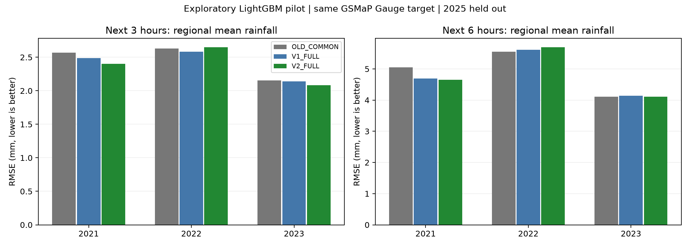

# Hai phiên bản dữ liệu vùng Đà Nẵng: khác biệt và dấu hiệu thực nghiệm

Ngày 20/10/2026. Đã tạo hai bộ dữ liệu và chạy thử nghiệm thăm dò (pilot). **Có tín hiệu cải thiện ở một số năm, nhưng chưa ổn định để kết luận V2 luôn tốt hơn V1 hoặc dữ liệu cũ.**

## 1. Hai bộ dữ liệu đã tạo

| Bộ | Nội dung | Quy mô |
| --- | --- | --- |
| V1 | Trung bình diện tích của các biến theo giờ; lịch, nhãn và cờ chất lượng riêng | 102.984 giờ; 49 đặc trưng đầu vào ứng viên; 53 cột kể cả thời gian/nhãn/QC; khoảng 44 MB |
| V2 | Nguyên vẹn V1 + phân bố không gian và tương tác | 102.984 giờ; 138 đặc trưng đầu vào ứng viên; 142 cột kể cả thời gian/nhãn/QC; khoảng 122 MB |

Thời gian: 01/01/2015–30/09/2026, theo UTC. Năm 2026 chưa đủ cả năm. Năm 2025 được tổng hợp cơ học trong bản xuất dữ liệu, **không dùng để huấn luyện, chọn mô hình, chấm điểm hoặc thống kê chẩn đoán pilot**.

Phạm vi là tập 93 ô hiện có của Đà Nẵng mới (gồm Đà Nẵng cũ và Quảng Nam cũ). Mỗi phiên bản tạo một chuỗi theo giờ cho cả vùng. Đầu ra là lượng mưa trung bình vùng, nên hai bộ này phù hợp với bài toán một giá trị cho cả vùng; chúng không cung cấp đầu ra bản đồ mưa từng ô.

- [V1 Parquet](../../data/processed/regional_danang/v1_hourly.parquet).
- [V2 Parquet](../../data/processed/regional_danang/v2_hourly.parquet).
- [Trọng số và tiểu vùng của từng ô](../../data/processed/regional_danang/cell_weights.parquet).
- [Danh mục đặc trưng](feature_catalog.csv), [manifest/nguồn/checksum](build_manifest.json).

V2 thêm 89 cột: 54 thống kê độ lệch chuẩn/phân vị 90%/cực đại của 18 biến; 24 trung bình theo tiểu vùng của 8 biến; 8 chênh lệch ven biển − miền núi; 3 chỉ báo gần đúng về gió, ẩm và địa hình. Phân vị 90% được tính theo diện tích có trọng số.

Tiểu vùng được định trước từ địa hình, không xem nhãn mưa: 23 ô có khoảng cách biển xấp xỉ ≤ 30 km; 26 ô ngoài nhóm này có độ cao trung bình ≥ 600 m; 44 ô nội địa còn lại. Đây là phân tầng kỹ thuật, không phải phân vùng khí hậu chính thức.

## 2. Nhãn và trọng số

Nhãn chung là trung bình diện tích của mưa GSMaP Gauge v8 trên 93 ô. Mỗi hàng t mô tả khoảng [t, t + 1 giờ) UTC. Trung bình giữ đơn vị mm cho khoảng một giờ; không cộng mm của các ô.

Trọng số theo **diện tích toàn ô trên cầu**, tổng diện tích các ô khoảng 11,074.1 km². Chưa có phần diện tích giao giữa từng ô và đa giác ranh giới hành chính trong dữ liệu cục bộ; vì vậy đây là trung bình của vùng 93 ô hiện có, chưa là trung bình địa giới Đà Nẵng chính xác. Tổng diện tích các ô không phải diện tích hành chính. Chưa nhân trọng số theo phần đất/biển riêng.

Một biến thiếu ở bất kỳ ô nào thì trung bình/thống kê biến đó là NaN; không tự đổi mẫu không gian hoặc điền 0. Nhãn được tách khỏi các đặc trưng đầu vào. Tám biến tĩnh không được nhân bản thành các cột hằng số cho một vùng; địa hình được dùng để phân tầng và tạo tương tác động với gió/ẩm.

Nguồn gốc vẫn là ERA5/GSMaP/Copernicus DEM. Gộp ô không tạo quan trắc mới hoặc nâng độ phân giải thật của ERA5. Nhãn vẫn là sản phẩm ước lượng; chưa chứng minh mưa thực từng giờ của toàn vùng.

## 3. Khác gì với full_features cũ?

| Nội dung | full_features cũ | V1/V2 |
| --- | --- | --- |
| Không gian | Trộn biến tại một điểm với trung bình các hộp vùng khác nhau | Tổng hợp cùng 93 ô; các biến bối cảnh vùng vẫn giữ ý nghĩa nguồn riêng |
| Cột trong file | 15 biến dữ liệu + datetime | V1 có 49 đầu vào ứng viên; V2 có 138; nhãn/QC tách riêng |
| Nhãn gốc | Mưa Open-Meteo tại tọa độ | Mưa GSMaP Gauge trung bình 93 ô |
| Nguyên liệu | Bề mặt, 850 hPa, CAPE/CIN/TCWV, SST, đất, ONI | Thêm mây, tầng 500 hPa, IVT, chuyển động đứng, lớp biên, chênh áp vùng…; chưa tích hợp ONI |
| Thông tin không gian | Đã rút thành một chuỗi, không còn phân bố từng ô | V1 giữ trung bình; V2 thêm phân bố và tiểu vùng |
| Đơn vị gió/ẩm | Gió 10 m: km/h và góc; q850: kg/kg theo script nguồn | Pilot đổi sang u/v (m/s) và q850 (g/kg) để so |

Ví dụ trung bình 2015–2023 trên các giờ chung, **khác giá trị không đồng nghĩa mới chính xác hơn**:

| feature | old_mean | v1_mean | correlation |
| --- | --- | --- | --- |
| mean__t2m_c | 26.2206 | 24.4869 | 0.9384 |
| mean__sp_hpa | 1009.8602 | 958.6838 | 0.9958 |
| mean__cape | 856.5847 | 424.6311 | 0.8512 |
| mean__tcwv | 48.1856 | 42.1521 | 0.9877 |
| mean__swvl1 | 0.2399 | 0.4146 | 0.8746 |

Nhiệt độ vùng thấp hơn và áp suất bề mặt vùng thấp hơn có thể phù hợp khác biệt địa hình/độ cao giữa điểm cũ và vùng rộng. Chưa có quan trắc độc lập để quy chênh lệch thành lỗi của một nguồn.

## 4. Pilot so sánh có kiểm soát

Giữ lịch sử 24 giờ → tổng mưa vùng 3/6 giờ sau, phát hành cách 6 giờ. Chỉ dùng đặc trưng quá khứ, không dùng ERA5 tại giờ đích. Mô hình là LightGBM với hàm mất mát Tweedie. Mỗi đặc trưng được biểu diễn bằng giá trị cuối, trung bình 6 giờ, trung bình 24 giờ và thay đổi sau 6 giờ; biến lịch dùng giá trị cuối. Đây là thử nghiệm thăm dò, chưa phải toàn bộ khung E0–E7 hoặc kết quả Bi-LSTM mới.

| eval | train_start | train_end | cal | n_train | n_cal | n_eval |
| --- | --- | --- | --- | --- | --- | --- |
| 2021 | 2015 | 2019 | 2020 | 7300 | 1464 | 1460 |
| 2022 | 2015 | 2020 | 2021 | 8764 | 1460 | 1450 |
| 2023 | 2015 | 2021 | 2022 | 10224 | 1450 | 1460 |

Mỗi lượt đánh giá dùng cùng hàng huấn luyện/hiệu chỉnh/đánh giá cho mọi cấu hình. Các hàng được lọc chung theo các biến cần dùng; khoảng nhãn 6 giờ không vượt năm. Các năm 2021–2023 đã được khám phá trước đây nên đây là bằng chứng thăm dò, chưa là kiểm định độc lập.

| Tên | Đầu vào | Câu hỏi |
| --- | --- | --- |
| OLD_COMMON | 12 đại lượng khí tượng từ file cũ + 4 biến lịch | Mốc đầu vào cũ khi chấm trên cùng nhãn vùng |
| V1_COMMON | 12 đại lượng tương ứng lấy trung bình vùng + 4 biến lịch | Nguồn/đại diện không gian mới có giúp không? |
| V2_COMMON | V1_COMMON + thống kê không gian từ cùng loại nguyên liệu | Riêng cách biểu diễn không gian có giúp không? |
| V1_FULL | Tất cả đặc trưng khí tượng trung bình vùng và lịch, loại các cột mưa | Thêm nguyên liệu khí tượng |
| V2_FULL | V1_FULL + các đặc trưng không gian không chứa mưa | Thêm biểu diễn không gian trên bộ nguyên liệu rộng |

12 đại lượng chung: nhiệt độ 2 m, độ ẩm tương đối 2 m, áp suất bề mặt, u/v ở 10 m, SST, CAPE, TCWV, độ ẩm đất, u/v/q ở 850 hPa. ONI cũ không dùng vì nguy cơ chứa tháng tương lai; CIN cũ không dùng trong phép so cùng nguyên liệu vì ý nghĩa thiếu/0 chưa khôi phục được. CIN mới có trong FULL. Các cột mưa vẫn được xuất trong V1/V2 nhưng bị loại khỏi **tất cả** mô hình pilot để hạn chế tác động nguồn mưa hồi cứu. Vì vậy OLD_COMMON không phải tái lập nguyên mô hình cũ hoặc toàn bộ 15 cột cũ.

LightGBM dùng một seed cố định và chế độ xác định, không lấy mẫu ngẫu nhiên hàng/biến. Ngân sách tối đa 400 cây, 15 lá, dừng sớm sau 30 vòng không cải thiện trên năm hiệu chỉnh; cùng tham số cho mọi cấu hình. Khoảng tin cậy (CI) không bao gồm bất định do thay kiến trúc, siêu tham số hoặc seed huấn luyện mạng nơ ron.

## 5. Kết quả

RMSE (mm tổng 3/6 giờ), càng thấp càng tốt; toàn năm, cùng mẫu và nhãn:

| Năm | Tổng giờ | OLD_COMMON | V1_COMMON | V2_COMMON | V1_FULL | V2_FULL |
| --- | --- | --- | --- | --- | --- | --- |
| 2021 | 3 | 2.5690 | 2.5357 | 2.4297 | 2.4884 | 2.4031 |
| 2021 | 6 | 5.0540 | 4.9718 | 4.6632 | 4.6920 | 4.6504 |
| 2022 | 3 | 2.6325 | 2.6752 | 2.6909 | 2.5842 | 2.6481 |
| 2022 | 6 | 5.5559 | 5.7489 | 5.6000 | 5.6131 | 5.6922 |
| 2023 | 3 | 2.1562 | 2.1061 | 2.1073 | 2.1418 | 2.0820 |
| 2023 | 6 | 4.1103 | 4.1467 | 4.1986 | 4.1422 | 4.1141 |

Chênh RMSE V2_FULL − V1_FULL và CI 95% từ bootstrap theo khối 5 ngày, 1.000 lần; âm là V2 tốt hơn:

| Năm | Tổng giờ | V2−V1 | CI thấp | CI cao |
| --- | --- | --- | --- | --- |
| 2021 | 3 | -0.0853 | -0.1412 | -0.0234 |
| 2021 | 6 | -0.0416 | -0.1175 | 0.0297 |
| 2022 | 3 | 0.0639 | -0.0008 | 0.1097 |
| 2022 | 6 | 0.0791 | -0.0400 | 0.1559 |
| 2023 | 3 | -0.0598 | -0.1441 | 0.0231 |
| 2023 | 6 | -0.0281 | -0.0944 | 0.0258 |

Diễn giải:

- So với V1_FULL, V2_FULL giảm RMSE 3 giờ khoảng 3,4% ở năm 2021, tăng khoảng 2,5% ở năm 2022 và giảm khoảng 2,8% ở năm 2023. Chỉ CI năm 2021 nằm hoàn toàn dưới 0; năm 2022/2023 chưa phân biệt chắc.
- V2_COMMON − V1_COMMON cải thiện RMSE năm 2021 ở cả hạn 3 giờ và 6 giờ với CI dưới 0; không lặp lại chắc ở năm 2022/2023. Đây là tín hiệu đáng thử tiếp, chưa xác nhận lợi ích ổn định.
- V1_COMMON − OLD_COMMON có CI chứa 0 ở cả 3 năm và cả 2 hạn. Chuyển từ đại diện cũ sang trung bình vùng chưa chứng minh tăng kỹ năng.
- V1_FULL có RMSE 3 giờ thấp hơn OLD_COMMON ở cả 3 năm về điểm ước lượng, nhưng khác biệt gồm cả thêm biến, thay nguồn/cách xử lý và phạm vi không gian. Không quy toàn bộ lợi ích cho gộp lưới.
- Ở hạn 6 giờ, kết quả dao động hơn; chưa chọn V2 làm cấu hình thắng chung.
- Đối chứng giữ nguyên mưa Gauge quá khứ (persistence) có RMSE 3 giờ thấp hơn các mô hình khí tượng ở cả 3 năm. Nó có thêm thông tin mưa quá khứ và là đối chứng hồi cứu lý tưởng hóa, chưa là nguồn vận hành. Điều này gợi ý lượt tiếp theo nên đo thêm mưa quá khứ với điều kiện thông tin rõ ràng; không kết luận kiến trúc nào thua từ phép so khác đầu vào.
- Bảng theo mùa trong scores.csv cho thấy năm 2022, tháng 5–10, FULL xấu hơn OLD_COMMON. Cần trình bày cả những mùa/năm bất lợi. Nhãn mùa đông vẫn có bất định riêng.

CI là có điều kiện theo các mô hình đã fit, chưa hiệu chỉnh nhiều phép so. Dấu hiệu dương ở một năm chưa đủ để kết luận đóng góp vật lý, kết quả toàn Việt Nam hoặc chất lượng mưa thực độc lập.

## 6. Khuyến nghị sử dụng

Giữ V1 làm bộ nền dễ diễn giải; V2 là nhánh nghiên cứu để kiểm tra giá trị phân bố không gian. Giữ full_features cũ làm đối chứng sau chuẩn hóa đơn vị/thời gian và cùng nhãn vùng. Tiếp tục giữ kín tập kiểm tra năm 2025.

Bước tiếp có căn cứ: chốt đầu ra/hạn nghiên cứu; bổ sung đối chứng mưa quá khứ phù hợp; sau đó dùng hai phiên bản để thêm/bớt nhóm đặc trưng trên cùng mẫu và mô hình. Nếu mục tiêu cuối là trung bình địa giới chính xác, cần sửa trọng số theo phần giao ranh giới trước khi đóng băng dữ liệu.

## 7. Tái lập và kiểm tra

- Đã kiểm tra nguồn: 2.233/2.233 tệp khớp; thiếu 0, sai 0.
- Tạo dữ liệu: `.venv\Scripts\python.exe -X utf8 scripts/build_regional_datasets.py`.
- Pilot: `.venv\Scripts\python.exe -X utf8 scripts/pilot_regional_datasets.py`.
- Báo cáo/hình: `.venv\Scripts\python.exe -X utf8 scripts/report_regional_datasets.py`.
- Đã chạy 22 kiểm thử liên quan, gồm phép tổng hợp, đơn vị, cửa sổ không nhìn tương lai và việc đặc trưng không phụ thuộc nhãn: `tests/test_regional_dataset.py`, `tests/test_verification.py`, `tests/test_dataset_v2.py`.
- [Scores theo năm/mùa](scores.csv), [CI theo cặp](paired_bootstrap.csv), [run/siêu tham số](run.json), [so sánh cột cũ/mới](legacy_field_comparison.csv).

Dữ liệu Parquet, trọng số, checkpoint và dự báo từng dòng nằm ngoài Git. Chỉ code, manifest/danh mục và thống kê tổng hợp được giữ trong báo cáo công khai. Các file gốc không bị ghi đè.
