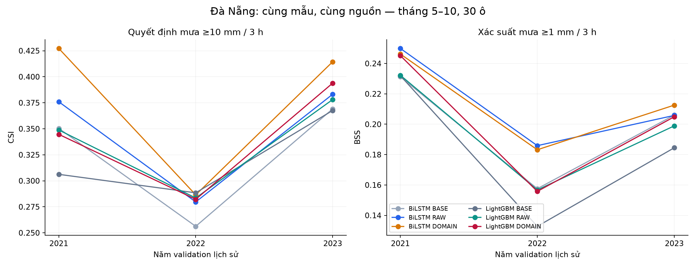
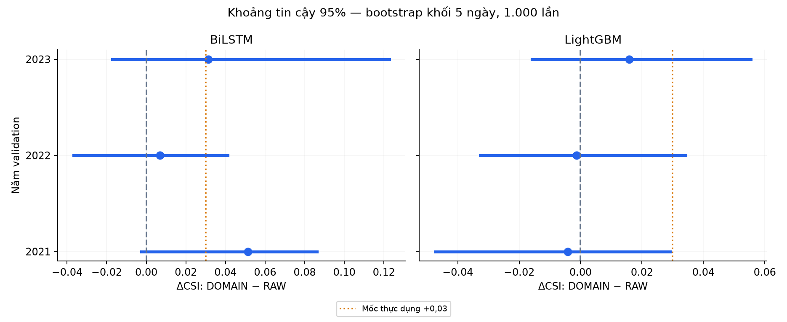
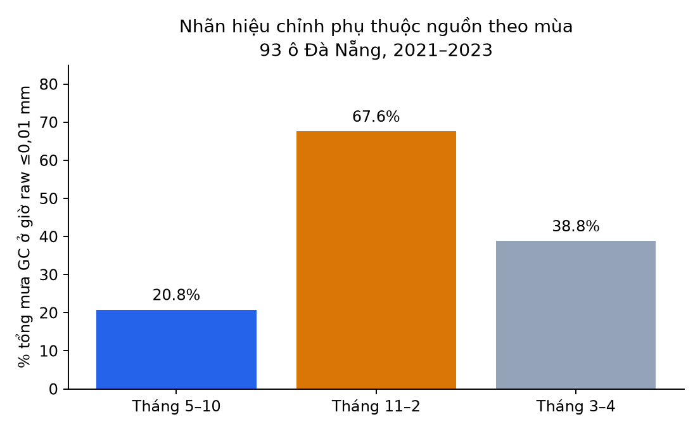
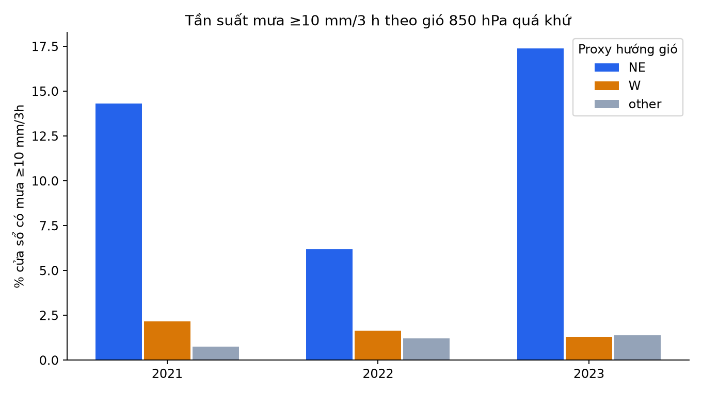

# Kết quả thực hiện và đề xuất trao đổi ngày 14/10/2026

## Kết luận cần trình bày trước

Đã thực hiện phép so có kiểm soát trên dữ liệu Đà Nẵng, gồm ba năm validation lịch sử, Bi-LSTM ba seed và LightGBM. Phần hiểu biết địa phương được kiểm tra bằng cách thêm biểu diễn gió–ẩm–địa hình vào chính các biến khí tượng thô đó; không quy lợi ích thêm nguồn dữ liệu cho biểu diễn vật lý.

Bi-LSTM thêm biểu diễn vật lý tăng CSI quyết định ≥10 mm/3 h so RAW lần lượt 0,051 / 0,007 / 0,031 ở 2021 / 2022 / 2023. Hai năm đạt mốc thực dụng +0,03, nhưng cả ba CI95% chứa0 và LightGBM chưa cho lợi ích lặp đủ lớn. Giữ DOMAIN cùng RAW làm ứng viên kiểm định tiếp, chưa chọn model cuối cho app. Đầu lượng mưa vẫn thiên thấp; không coi tăng CSI đầu xác suất là cải thiện tương đương của lượng mm.

Đây là kết quả nghiên cứu hồi cứu có code và checkpoint tái lập. Chưa xác nhận vận hành; test 2025 chưa mở. Đầu xác suất và đầu lượng mưa trả lời hai mục tiêu khác nhau, nên giữ riêng hai loại CSI.

## Cập nhật sau các phép thử kế tiếp tối 13/10

Giảng viên có thể xem đây là kết quả mới rõ nhất: **đổi cách học lượng mưa cải thiện ước lượng mm ổn định hơn việc thêm proxy domain**. Trên cùng 30 ô, mùa 5–10, tổng 0–3 h, RMSE LightGBM RAW L1(log) → Tweedie lần lượt 4,607→3,947; 4,841→4,534; 4,205→3,610 mm ở 2021–2023. Bi-LSTM RAW log-Huber → Tweedie: 4,046→3,876; 4,661→4,581; 3,963→3,540 mm. Chỉ số CSI theo **lượng mm** ≥10 của Bi-LSTM tăng 0,191→0,289; 0,164→0,272; 0,092→0,391. Đây vẫn là validation lịch sử và nhãn vệ tinh, chưa phải kết quả vận hành.

Cái giá cần nói thẳng: BSS xác suất ≥1 của Bi-LSTM Tweedie năm 2022 giảm 0,186→0,148. DOMAIN−RAW CSI xác suất trên 63 ô chưa train = +0,042/−0,003/+0,029, CI95% từng năm chứa0; phép bỏ proxy địa hình cũng chưa có CI tách0. Vì vậy app chưa chốt model thắng chung; đầu lượng mm và xác suất phải đánh giá riêng, rồi so ECMWF cùng mẫu trên dữ liệu phát hành thật.

Đã có giao diện demo archive cho 93 ô Đà Nẵng từ checkpoint thật; 36 kiểm tra dự báo API với kết quả lưu khớp. JAXA FTP đã đăng nhập và tải raw/Gauge_NRT v8 cùng giờ; SHA-256/format đúng, raw cho 93/93 ô hữu hạn. Raw/Gauge gần nhau (tương quan 0,998 trên 93 ô), nhưng popup web khác cả hai tại ba ô có mưa; nguyên nhân chưa xác định. Tab live chỉ hiển thị ECMWF nguồn, điểm web tham khảo và cổng NRT as-of: đã có 24 tệp raw liên tiếp và 93/93 ô hữu hạn. Với lag4/issue16 UTC, 21/24 tệp được máy nhận kịp; lag5/issue17 UTC thử (khi kiểm còn ở tương lai), 24/24 tệp kịp. Đây là **lần tải backlog**, không đo thời điểm JAXA công bố. Checkpoint đang train lag4; lag5 cần chấm lại trên validation, nên **chưa bật AI live**. Cần thu lịch sử NRT, kiểm tra dịch chuyển nguồn và so T-OPS cùng ECMWF. Test 2025 giữ kín. QC nguồn ở `reports/followup_danang/jaxa_binary_audit.json`; cổng tiếp theo trong `execution_plan.md`.

**Lý do vẫn so ECMWF:** bảng Bi-LSTM/LightGBM và ablation cùng dữ liệu cho biết thay đổi thiết kế có ích không; ECMWF IFS thô/hiệu chỉnh là mức dự báo đã dùng được, để hỏi AI có thêm giá trị cho app không. Lấy các bản dự báo ECMWF phát hành trong năm 2024 từ [Single Runs](https://open-meteo.com/en/docs/single-runs-api) rồi chấm như lúc ấy, chỉ dùng run đã có trước giờ dự báo (kể cả độ trễ công bố 4–6 h). ERA5 hồi cứu không thay thế phép so này. Bảng ECMWF cùng mẫu chưa chạy, do đó chưa tuyên bố AI thắng. Cụ thể hiện có 4 snapshot forecast 93 ô trong một buổi (không biết run), một phép so ECMWF cũ ở trạm/ngày hạn 1–5 ngày và pilot Single Runs đã hoàn tất **56/56 run, 30 ô × 14 ngày 2024**, 1.680 cặp forecast/nhãn đủ. ECMWF qua Open-Meteo 0–3 h RMSE 3,950 mm, CSI≥10 0,089; 62 sự kiện thật tập trung ở 4/14 ngày. Luôn dự báo 0 cùng mẫu có RMSE 3,878; CI95% chênh RMSE ECMWF−0 [−0,873; +1,235] mm chứa 0. Đây là baseline thăm dò, không chứng minh ECMWF kém hoặc AI tốt. **Chưa có run lịch sử 2024 cho 93 ô và chưa so AI cùng mẫu.** Checkpoint hiện huấn luyện bằng ERA5 hồi cứu/mưa vệ tinh lưu trữ; cần thay/kiểm tra đầu vào as-of trước khi so vận hành. Xem `ecmwf_pilot_14d/README.md`.

**Phát hiện mới về độ trễ vận hành:** Tải24h NRT đủ dữ liệu/93ô, nhưng tải backlog qua giờ issue khiến lag4/issue16 chỉ21/24 tệp đến kịp máy; lag5/issue17 thử đạt24/24. Không suy latency JAXA từ lần tải này; watcher 12h đã bắt đầu16:31 UTC và thấy file raw mới ở poll2 lúc16:41, lỗi0; file12 UTC xuất hiện trong khoảng watcher bắt đầu→16:41, age sau cuối khoảng mưa bị chặn [3,53;3,70]h. Đây chỉ một quan sát live, chưa là latency điển hình. Với file mới, cổng lag4/issue thử17 UTC đạt24/24 tệp kịp máy nhận (lúc audit issue còn tương lai), AI vẫn tắt vì khí tượng/T-OPS chưa đạt. Train lại Bi-LSTM RAW Tweedie ở lag5 với cùng30ô/index, 3seed/3fold, Platt/tau chọn trên calibration: RMSE3h tăng 3,876→3,929 / 4,581→4,624 / 3,540→3,578 mm (2021/22/23), CI95% hiệu số dương cả ba; CSI xác suất ≥10 giảm mô tả hai năm nhưng CI chứa0. Đây là validation khám phá, không là AI live. [Chi tiết](../followup_danang/bilstm_tweedie_lag5/README.md).

## Những gì đã làm và kiểm tra

- 27 lượt Bi-LSTM (3 cấu hình × 3 năm × 3 seed), 9 pipeline LightGBM (135 đầu), cố định 30.000 mẫu train mỗi fold; 131400 cửa sổ evaluation, 30 ô chọn theo địa hình/khoảng cách biển.
- Train/cal/eval cuốn chiếu; chuẩn hóa chỉ trên train; RAW/DOMAIN cùng số tham số và cùng cửa sổ. Tương lai chỉ gồm lịch. Loss khác giữa NN/cây nên so learner có giới hạn.
- 87 kiểm tra đạt. Suy luận CPU từ checkpoint/normalizer/Platt đã khớp dự báo CUDA đã lưu trong sai số số học nhỏ; API HTTP đã trả dự báo thật từ checkpoint ở chế độ archive.
- Đã lấy snapshot forecast và kiểm tra hợp đồng khí tượng cho 93/93 ô; bộ ghi theo giờ chạy trong 2,1 giờ. NRT quan trắc và T-OPS chưa hoàn tất.

## Kết quả chính

Tháng 5–10, tổng mưa 0–3 giờ; CSI ở đây là quyết định từ xác suất, ngưỡng chọn năm calibration trước evaluation. BSS tham chiếu khí hậu ô/tháng/giờ chỉ học trên train; BSS dương là tốt hơn tham chiếu đó, chưa phải tốt hơn ECMWF.

| Năm | Cấu hình | CSI xác suất ≥10 | CSI lượng mưa ≥10 | BSS ≥1 | BSS ≥10 | FAR ≥10 | RMSE mm/3h |
| --- | --- | --- | --- | --- | --- | --- | --- |
| 2021 | BiLSTM_BASE | 0.350 | 0.113 | 0.231 | 0.336 | 0.622 | 4.250 |
| 2021 | LightGBM_BASE | 0.306 | 0.000 | 0.232 | 0.201 | 0.670 | 4.650 |
| 2021 | BiLSTM_RAW | 0.376 | 0.191 | 0.250 | 0.351 | 0.569 | 4.046 |
| 2021 | LightGBM_RAW | 0.349 | 0.000 | 0.232 | 0.323 | 0.625 | 4.607 |
| 2021 | BiLSTM_DOMAIN | 0.427 | 0.168 | 0.246 | 0.381 | 0.512 | 4.026 |
| 2021 | LightGBM_DOMAIN | 0.345 | 0.000 | 0.245 | 0.305 | 0.613 | 4.466 |
| 2022 | BiLSTM_BASE | 0.256 | 0.124 | 0.158 | 0.207 | 0.616 | 4.757 |
| 2022 | LightGBM_BASE | 0.288 | 0.000 | 0.133 | 0.231 | 0.636 | 4.946 |
| 2022 | BiLSTM_RAW | 0.280 | 0.164 | 0.186 | 0.240 | 0.630 | 4.661 |
| 2022 | LightGBM_RAW | 0.283 | 0.025 | 0.157 | 0.242 | 0.568 | 4.841 |
| 2022 | BiLSTM_DOMAIN | 0.286 | 0.117 | 0.183 | 0.238 | 0.602 | 4.768 |
| 2022 | LightGBM_DOMAIN | 0.282 | 0.044 | 0.156 | 0.241 | 0.610 | 4.847 |
| 2023 | BiLSTM_BASE | 0.369 | 0.142 | 0.206 | 0.293 | 0.560 | 3.915 |
| 2023 | LightGBM_BASE | 0.368 | 0.000 | 0.184 | 0.293 | 0.491 | 4.282 |
| 2023 | BiLSTM_RAW | 0.383 | 0.092 | 0.206 | 0.312 | 0.442 | 3.963 |
| 2023 | LightGBM_RAW | 0.378 | 0.015 | 0.199 | 0.312 | 0.490 | 4.205 |
| 2023 | BiLSTM_DOMAIN | 0.414 | 0.120 | 0.213 | 0.328 | 0.409 | 3.931 |
| 2023 | LightGBM_DOMAIN | 0.394 | 0.053 | 0.205 | 0.333 | 0.472 | 4.175 |

Không so trực tiếp mức tăng với pilot cũ: lượt này giữ một tập 30.000 mẫu train cố định qua epoch, còn pilot cũ lấy các tập con khác qua epoch và dùng cấu hình/cửa sổ khác.

## Biểu diễn vật lý có giúp ổn định không?

| Learner | Năm | ΔCSI DOMAIN−RAW | CI thấp | CI cao | BS ≥1 giảm tương đối |
| --- | --- | --- | --- | --- | --- |
| BiLSTM | 2021 | 0.051 | -0.002 | 0.086 | -0.005 |
| BiLSTM | 2022 | 0.007 | -0.037 | 0.041 | -0.003 |
| BiLSTM | 2023 | 0.031 | -0.017 | 0.123 | 0.009 |
| LightGBM | 2021 | -0.004 | -0.047 | 0.029 | 0.017 |
| LightGBM | 2022 | -0.001 | -0.033 | 0.034 | -0.001 |
| LightGBM | 2023 | 0.016 | -0.016 | 0.056 | 0.007 |

Cột giảm BS là tỷ lệ, ví dụ 0,05 nghĩa là giảm 5%; âm nghĩa là xấu hơn. Tiêu chí thực dụng đặt trước: ΔCSI ≥0,03 hoặc BS ≥1 giảm ≥5%, lặp ít nhất 2/3 năm và xét bất định/chỉ số còn lại. Số năm đạt tín hiệu: Bi-LSTM 2/3, LightGBM 0/3. Chạm ngưỡng này chỉ là sàng lọc, không thay xác nhận độc lập.

Nếu tín hiệu không lặp qua năm/learner, giữ RAW và BASE làm ứng viên nguồn đơn giản hơn; DOMAIN chỉ là giả thuyết đã thử, chưa bắt buộc đưa vào app. Nếu có tín hiệu lặp, vẫn cần tăng dữ liệu và kiểm tra bằng forecast thật trước khi chọn checkpoint.

## Đóng góp domain ngoài việc thêm cột

Audit cho thấy cube và Earth Engine tại ô chứa trạm khớp tổng ngày; 1.042 ngày chung 2021–2023 đối chiếu GSOD. GC có CSI ngày ≥50 mm 0,438 tại trạm này, raw 0,246 và ERA5 0,352. Đây là đánh giá nguồn nhãn, không phải điểm mô hình; GSOD có thể tham gia hiệu chỉnh GC nên không bảo đảm độc lập.

67,6% tổng GC mùa tháng 11–2 nằm ở giờ raw ≤0,01 mm, so với 20,8% mùa tháng 5–10. Vì vậy chấm giờ/3 giờ trong mùa 5–10 và tách 6 giờ mùa đông. Chỉ báo này phản ánh phụ thuộc hiệu chỉnh, không chứng minh thời điểm mưa thật sai; cần nhãn trạm theo giờ để kết luận mạnh hơn.

Hiểu domain còn giúp lựa chọn nguồn và kiểm tra tính khả thi: IFS 9 km thiếu trường 850; IFS 0,25° có 850 nhưng thiếu CIN trong probe. Đã làm chuyển mây %→0–1, hướng gió→u/v và q850 từ T/RH; dữ liệu thiếu/đơn vị sai bị từ chối. Chưa coi q suy ra là tương đương q ERA5 hoàn toàn.

## Tín hiệu khí tượng địa phương trong dữ liệu

| Năm | Gió | Số mẫu | Sự kiện ≥10 | Tần suất sự kiện | Tỷ lệ mẫu | Tỷ lệ sự kiện |
| --- | --- | --- | --- | --- | --- | --- |
| 2021 | NE | 2834 | 406 | 0.143 | 0.128 | 0.572 |
| 2021 | W | 11358 | 245 | 0.022 | 0.514 | 0.345 |
| 2021 | other | 7888 | 59 | 0.007 | 0.357 | 0.083 |
| 2022 | NE | 3908 | 242 | 0.062 | 0.177 | 0.465 |
| 2022 | W | 12789 | 212 | 0.017 | 0.579 | 0.408 |
| 2022 | other | 5383 | 66 | 0.012 | 0.244 | 0.127 |
| 2023 | NE | 2679 | 466 | 0.174 | 0.121 | 0.646 |
| 2023 | W | 14900 | 193 | 0.013 | 0.675 | 0.268 |
| 2023 | other | 4501 | 62 | 0.014 | 0.204 | 0.086 |

Các tỷ lệ trong bảng ở thang0–1. Nhóm NE chỉ chiếm khoảng12–18% mẫu nhưng46–65% sự kiện mưa mạnh. Đây là bằng chứng mô tả để ưu tiên gió–ẩm tầng thấp; chưa chứng minh nhân quả vì còn khác tháng/đợt mưa/địa hình. NE chỉ là u/v trung bình6h đều<−0,5m/s, không phải xác định đợt không khí lạnh hoặc bão.

DOMAIN thêm bốn proxy cùng lúc nên chưa biết proxy địa hình đóng góp riêng bao nhiêu. Tiếp theo cần phép bỏ từng thành phần; tương tác gió với gradient địa hình hai chiều là giả thuyết tốt hơn hướng NE cố định, nhưng phải cung cấp cùng gradient cho đối chứng RAW. Không thêm dữ liệu địa hình mới chỉ ở DOMAIN rồi gọi là lợi ích biểu diễn.

## Ý nghĩa và giới hạn của tài liệu

Bài [PLOS One 2026](https://journals.plos.org/plosone/article?id=10.1371/journal.pone.0342825) tại Trung Bộ là bằng chứng gần nhất: bộ biến theo khí tượng đạt CSI 0,55 so 0,53, nhưng là ước lượng cùng giờ với Himawari/trạm, không dự báo tương lai 6 giờ. Cơ chế địa hình và hoàn lưu trong [nghiên cứu Trung Bộ 2023](https://onlinelibrary.wiley.com/doi/full/10.1155/2023/7256634) hỗ trợ giả thuyết gió–ẩm; không bảo đảm mức tăng mô hình. Chín nguồn và giới hạn chuyển giao nằm trong [literature_domain_review.md](literature_domain_review.md).

Một phép so có ý nghĩa cho PBL khi câu hỏi, đối chứng, chia thời gian và hệ quả lựa chọn app rõ ràng. Kết quả âm giúp loại một thiết kế và tiết kiệm phạm vi; không thể hứa tạo chênh lệch lớn bằng cách thử nhiều mô hình. Đóng góp hiện có là pipeline đánh giá cùng mẫu, chẩn đoán nhãn theo mùa, phép thử vật lý và đoạn nối từ checkpoint tới API.

## Hướng thực hiện và nội dung xin góp ý

Tên đề tài đề xuất: **Dự báo xác suất mưa cực ngắn tại Đà Nẵng: đánh giá đóng góp dữ liệu khí tượng và tương tác gió–ẩm–địa hình, triển khai ứng dụng dự báo**. Trọng tâm trước là một vùng và hạn 6 giờ; sản phẩm TFT 1–3 ngày ở giai đoạn sau.

Kế hoạch cụ thể, đầu ra và điều kiện chuyển tiếp: [execution_plan.md](execution_plan.md). Xin góp ý về phạm vi một vùng/hạn 6 giờ; ưu tiên xác suất và sự kiện mưa; khả năng tiếp cận nhãn trạm theo giờ; và mức bằng chứng cần có trước mở rộng kiến trúc. Đây là đề nghị trao đổi trực tiếp của nhóm, chưa gửi cho giảng viên.

Dữ liệu/checkpoint/snapshot ngoài Git. [Thiết kế đầy đủ](../domain_screen_danang/README.md), [scores.csv](../domain_screen_danang/scores.csv), [CI bootstrap](../domain_screen_danang/paired_bootstrap.json), [manifest run](../domain_screen_danang/run.json).
