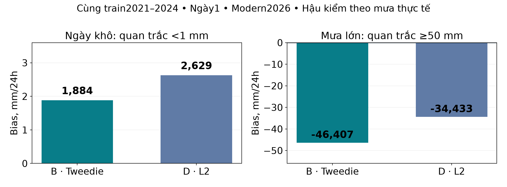
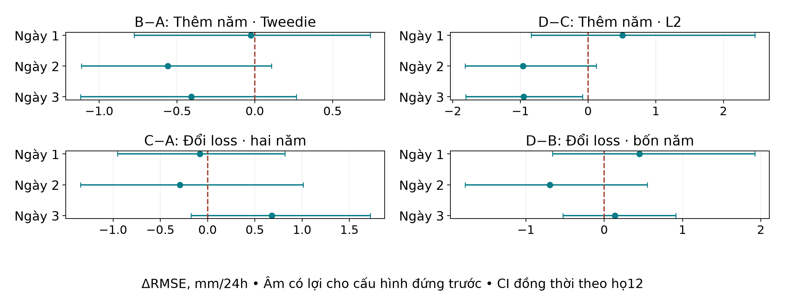

# Ghi chú thuyết trình: dự báo mưa ngắn hạn tại trạm

Dùng slide 1–31 cho 25–30 phút. Slide 32–62 là phụ lục để tra cứu, không cần đọc hết trong buổi báo cáo.

## 01. Dự báo lượng mưa tại trạm trong ba ngày tiếp theo

Luồng chính

Báo cáo tập trung vào dự báo lượng mưa tại từng trạm trong ba ngày tới. Đây là nghiên cứu về dữ liệu và mô hình, chưa phải báo cáo một ứng dụng đã vận hành. Trình bày 31 slide đầu trong khoảng 25–30 phút; các slide sau là phụ lục để trả lời câu hỏi. Các kết quả có thời kỳ và protocol khác nhau sẽ được ghi riêng, tránh so các con số không cùng điều kiện.

**Ý chính: Câu hỏi chính: dữ liệu địa phương và cách huấn luyện giúp dự báo tốt hơn đến mức nào?**

## 02. Ý tưởng: học cách hiệu chỉnh dự báo khí tượng

Luồng chính

Dự báo nền — GFS dự báo khí tượng và mưa của những ngày tới.

Thông tin địa phương — Lịch sử mưa Vrain,
vị trí trạm và
địa hình DEM.

Kiểm chứng cải thiện — Cùng mẫu, cùng thời gian và có đối chứng đủ mạnh.

Ý tưởng là dùng GFS làm dự báo nền, sau đó học cách hiệu chỉnh nó bằng lịch sử mưa và thông tin địa phương. Nhóm không huấn luyện một mô hình thay thế toàn bộ mô phỏng khí quyển. Có ba câu hỏi: thông tin nào thực sự hữu ích, cách học nào phù hợp, và cải thiện có bền trên dữ liệu đánh giá hay không. Vì thế cần cả mô hình học máy và đối chứng GFS/MOS đơn giản.

**Ý chính: Đầu vào tốt hơn hoặc mô hình phức tạp hơn đều cần được đo, không mặc định sẽ cải thiện.**

## 03. Dự báo cho từng trạm, bằng mô hình chung

Luồng chính

86 — vị trí danh mục

82 — vị trí kênh lịch sử

57 — trạm trong thí nghiệm

Một mẫu = một trạm × một thời điểm phát dự báo.
Không cần huấn luyện 57 mô hình tách biệt.

86 là danh mục vị trí mà tài khoản truy cập được, không phải 86 chuỗi đầy đủ từ 2021. Thí nghiệm giữ 57 trạm được chọn bằng phần train 2021–2022, theo tiêu chí ít nhất 365 ngày hợp lệ và 30 ngày mưa từ 1 mm. Mỗi mẫu là một trạm tại một thời điểm phát dự báo. Một mô hình học chung nhiều trạm; nhãn vẫn là số đo tại chính trạm đó. Chưa chuyển các điểm đo thành mưa trung bình diện tích Đà Nẵng.

**Ý chính: Dữ liệu đo tại điểm; chưa suy rộng thành lượng mưa trung bình toàn khu vực.**

## 04. Đầu ra là ba lượng mưa 24 giờ riêng

Luồng chính

Phát lúc 19 h Việt Nam, mô hình dự báo ba tổng 24 giờ kế tiếp. Với issue 18/11, ngày 1 kết thúc 19 h 19/11, ngày 2 kết thúc 19 h 20/11, ngày 3 kết thúc 19 h 21/11. Đây là ba lượng riêng, không phải các tổng cộng dồn 24/48/72 giờ. Mưa tại mốc 10:00 đã được xác nhận là tổng 09:00–10:00 giờ Việt Nam. Một nhãn ngày cần đủ 24 khoảng đo phù hợp.

**Ý chính: Dự báo tổng mưa tại chính trạm trong 0–24 h, 24–48 h và 48–72 h sau khi phát.**

## 05. Ba nguồn dữ liệu giữ ba vai trò khác nhau

Luồng chính

| Nguồn | Có thông tin gì? | Vai trò hiện tại |
| --- | --- | --- |
| Vrain | Mưa đo theo giờ tại trạm | Nhãn mưa + lịch sử mưa |
| GFS | Khí tượng và mưa dự báo | Đầu vào cho những ngày tới |
| ERA5 | Tái phân tích khí tượng quá khứ | Bộ lịch sử riêng, không làm nhãn mưa trạm |

Cần phân biệt ba vai trò. Vrain cung cấp số đo mưa tại trạm để tạo nhãn và lịch sử mưa. GFS cung cấp dự báo khí tượng tương lai đã khởi tạo trước issue. ERA5 mô tả quá khứ bằng tái phân tích, hữu ích nghiên cứu lịch sử nhưng không tự chứng minh đã có sẵn lúc phát dự báo. Nhánh ngắn hạn này dùng GFS–Vrain; bộ ERA5 theo giờ vẫn là một bộ riêng của dự án.

**Ý chính: Nhánh này dùng GFS + Vrain; không dùng ERA5 của kỳ tương lai làm đầu vào.**

[D1] NOAA/NCEI · GFS — https://www.ncei.noaa.gov/products/weather-climate-models/global-forecast

[D2] ECMWF/Copernicus · reanalysis — https://climate.copernicus.eu/climate-reanalysis

## 06. Vrain đã giải quyết được vấn đề gì?

Luồng chính

Hướng nhãn vùng trước đây: Mưa từ sản phẩm lưới/hiệu chỉnh.; Giờ suy ra từ tổng ngày chưa phải số đo giờ.; Nhãn mang ý nghĩa trung bình vùng.

Nhánh trạm sau khi có Vrain: Mưa giờ lấy trực tiếp từ API trạm.; Cộng đúng 24 khoảng giờ để tạo nhãn.; Nhãn gắn với một điểm đo cụ thể.

Trước khi có Vrain, hướng nhãn vùng từng dựa vào sản phẩm lưới và hiệu chỉnh tổng ngày; phân bố giờ suy ra không phải quan trắc trực tiếp từng giờ. Vrain giúp có chuỗi mưa giờ nguồn tại điểm đo và tạo tổng ngày đúng khoảng. Điều đó làm nhãn rõ hơn về nguồn gốc và kỳ đo, nhưng chưa chứng nhận cảm biến hoàn hảo. Đổi từ nhãn vùng sang nhãn trạm cũng đổi bài toán, nên không dùng điểm cũ để tuyên bố mô hình mới tiến bộ bao nhiêu.

**Ý chính: Giải quyết được tính rõ ràng của nhãn; độ chính xác cảm biến vẫn cần kiểm chứng.**

## 07. Dữ liệu đã có đến đâu, còn thiếu ở đâu?

Luồng chính

| Mốc / nhóm | Bằng chứng hiện có | Cần hiểu đúng |
| --- | --- | --- |
| 2021 / 2022 / 2023 / 2024 | 57 / 79 / 79 / 82 vị trí có số giờ | Không đồng nghĩa đầy đủ cả năm |
| Kho mưa đã tải | Tới 15/11/2026 | Giữ dữ liệu thiếu và cờ QC |
| Issue đủ ba nhãn | Tới 12/11/2026 | Nhãn cần thêm ba ngày sau issue |
| Hai kênh API Vrain | Có giao nhau nhưng có xung đột | Giữ riêng, không ghép tùy tiện |

Kho mưa đã tải tới 15/11/2026, còn issue đủ cả ba nhãn tương lai tới 12/11. Các số 57/79/79/82 theo năm chỉ là số vị trí có ít nhất một số giờ hợp lệ, không phải đầy đủ cả năm. Legacy và modern là tên dự án đặt cho hai đường API cùng nhà cung cấp. Phần giao nhau có xung đột số đo, nên giữ riêng và yêu cầu một cửa sổ dùng cùng nguồn. Không ép mọi vị trí phải có lịch sử từ 2021.

**Ý chính: Có dữ liệu để nghiên cứu, nhưng không có chuỗi 86 trạm đầy đủ và liên tục từ 2021.**

## 08. “Đảm bảo dữ liệu” phải được hiểu theo từng lớp

Luồng chính

Đã kiểm tra — Ghép đúng trạm/giờ; đủ nhãn; QC; checksum; tránh rò rỉ.

Chưa chứng nhận đầy đủ — Sai số cảm biến, lịch sử di chuyển, tương đương hai API.

Đang cần kiểm chứng — Độ trễ thực và chất lượng dự báo phát trước sự kiện.

Có thể bảo đảm một số điều về xử lý: ghép đúng thời gian, đúng trạm, đủ số giờ và không rò rỉ nhãn tương lai. Nhưng độ chính xác vật lý của cảm biến, việc di chuyển trạm hoặc tương đương hai API là các câu hỏi khác. Khả dụng khi vận hành còn phụ thuộc dữ liệu có tới trước issue hay không. Vì thế cách nói phù hợp là dữ liệu đủ điều kiện cấu trúc cho thí nghiệm, kèm các giới hạn đã nêu.

**Ý chính: Đủ X/y để train không đồng nghĩa số đo hoàn hảo hoặc hệ thống đã sẵn vận hành.**

## 09. Một mẫu được ghép từ nguồn như thế nào?

Luồng chính

Vrain quá khứ — 7 ngày + 1/6/24 h

GFS đúng chu kỳ — Bốn nút
quanh trạm

Ghép theo issue — Đúng cutoff và đơn vị

Kiểm tra mẫu — Đủ X + ba nhãn

Một mẫu ghép lịch sử mưa của trạm, dự báo GFS đúng chu kỳ và thông tin vị trí. GFS được nội suy song tuyến tính từ bốn nút gốc quanh tọa độ, thiếu nút cần thiết thì không tự lấp. Nhãn được tạo từ những giờ Vrain tương lai chỉ khi train hoặc đánh giá, không đưa vào X. Mọi mô hình và nhóm biến dùng chung danh sách mẫu đủ cả ba hạn; không bỏ mưa cực đoan vì mô hình dự báo sai.

**Ý chính: Giữ chung danh sách mẫu để chênh lệch điểm phản ánh mô hình/đặc trưng, không do đổi dữ liệu.**

## 10. Các nhóm đặc trưng đang được kiểm tra

Luồng chính

| Nhóm | Số biến | Thông tin bổ sung |
| --- | --- | --- |
| N0 | 16 | Mưa GFS; lịch/vị trí/ID; mưa Vrain quá khứ |
| N1 | 21 | N0 + nhiệt/ẩm/gió 850 hPa và hơi nước cột |
| N3 | 26 | N1 + cao độ, biến thiên cao độ và độ dốc DEM |
| N5 | 32 | N3 + dẫn xuất ẩm–gió và tương tác với sườn |

N0 đã chứa mưa dự báo GFS, lịch/vị trí/ID và mưa Vrain quá khứ. N1 thêm năm trường khí tượng dự báo thô. N3 thêm năm biến địa hình; đây là bộ 26 biến dùng cho phép so số năm và loss mới. N5 thêm các dẫn xuất ẩm–gió và tương tác với sườn trong nghiên cứu cũ. Khí tượng lấy trạng thái giữa cửa sổ dự báo, không gọi là trung bình ngày hoặc quan trắc tương lai.

**Ý chính: N1−N0 kiểm tra khí tượng thô; N3−N1 kiểm tra địa hình; N5 cần đối chứng biểu diễn.**

## 11. Vì sao chọn LightGBM và một GRU nhỏ?

Luồng chính

LightGBM — Bảng đặc trưng tại trạm — Học quan hệ phi tuyến và kiểm tra nhóm biến.

GRU nhỏ — Chuỗi mưa 7 ngày + GFS — Kiểm tra giá trị của việc học diễn biến quá khứ.

GFS / MOS / mốc đơn giản — Cùng kỳ dự báo và cùng mẫu — Đánh giá phần giá trị tăng thêm của học máy.

LightGBM được chọn vì dữ liệu chủ yếu là bảng đặc trưng và cần nhiều phép so có kiểm soát với chi phí vừa phải. GRU nhỏ kiểm tra giá trị của việc mã hóa chuỗi mưa quá khứ. GFS, MOS, khí hậu,0 mmvà lặp ngày trước là các mốc để đánh giá phần giá trị tăng thêm. TFT hoặc Informer không bị loại về nguyên tắc; chưa có phép so trên cùng bộ trạm này để kết luận chúng kém.

**Ý chính: TFT/Informer vẫn là ứng viên; chưa có phép so trên bộ trạm hiện tại để kết luận chúng kém.**

## 12. Có nghiên cứu dùng những ý tưởng này không?

Luồng chính

| Nghiên cứu | Điểm tương đồng | Giới hạn khi tham khảo |
| --- | --- | --- |
| Zhang & Ye, 2021 | Có LightGBM hậu xử lý mưa GEFS | Nguồn/miền và nhãn khác dự án |
| Salehi và cộng sự, 2025 | GRU + mưa quá khứ + dự báo nền | Một ngày; nhãn PRISM, khác Vrain |
| Iwase & Takenawa, 2026 | LightGBM, biến lân cận, loss mưa | Preprint; nhãn mưa 3 h |

Có paper gốc dùng LightGBM hậu xử lý dự báo mưa và paper dùng GRU ghép chuỗi mưa quá khứ với dự báo nền. P1/P2 là các bài tạp chí; P3 năm 2026 là preprint và được ghi rõ. Điểm tương đồng ở đây là cách đặt bài toán và phối hợp thông tin. Nguồn NWP, nhãn, kỳ đo và miền nghiên cứu khác nhau, nên không so trực tiếp điểm số hoặc hứa hẹn đạt mức cải thiện của họ.

**Ý chính: Có cơ sở phương pháp; chưa có benchmark chung để tuyên bố dự án vượt các paper.**

[P1] Zhang & Ye · 2021 · JHM — https://journals.ametsoc.org/view/journals/hydr/22/11/JHM-D-21-0096.1.xml

[P2] Salehi & Salehi Neyshabouri · 2025 — https://doi.org/10.1016/j.envsoft.2025.106635

[P3] Iwase & Takenawa · 2026 · preprint — https://arxiv.org/html/2604.19340 v 1

## 13. Cụ thể một lần huấn luyện nhận những gì?

Luồng chính

LightGBM · N3 — X: [số mẫu, 26 biến]
y: [số mẫu] cho mỗi hạn
Ba mô hình hạn 1/2/3

GRU · N3 — Mưa: [số mẫu, 7 ngày, 1]
GFS/context: [số mẫu, 3, 18]
ID trạm → ba bộ đầu ra

LightGBM nhận bảng N3 với 26 cột, một nhãn 24 hcho mỗi hàng; có mô hình riêng cho từng hạn nhưng dùng chung nhiều trạm. GRU thực tế không nhận 7 × 26 biến. Encoder chỉ nhận 7 ngày mưa, dạng[số mẫu,7,1]. Context cho ba hạn có dạng[số mẫu,3,18]vớiN 3, hoặc 3 × 24 vớiN 5; IDtrạm đi qua embedding. Cả ba nhãn được dự báo từ cùng một mẫu trạm–issue.

**Ý chính: Mẫu thuộc một trạm; thông tin của các trạm không bị gộp thành một nhãn vùng.**

## 14. Hai protocol dùng cùng kho nhưng chia năm khác

Luồng chính

Protocol cũ fit 2021–2022, hiệu chỉnh 2023, phát triển 2024 và kiểm định 2025 sau khi khóa. Nay các năm đó đã được xem. Protocol mới cho A/Cfit hai năm và B/Dfit 2021–2024; năm 2025 chỉ hiệu chỉnh xác suất/ngưỡng,2026 là hồi cứu. Vì vậy 2025 không còn là test độc lập của protocol mới. Không được ghép bảng khác protocol rồi quy mọi chênh lệch cho số năm hoặc mô hình.

**Ý chính: Không trộn hai bảng khác protocol để gán toàn bộ chênh lệch cho một mô hình.**

## 15. Các bước thực hiện trong lúc huấn luyện

Luồng chính

Chốt dữ liệu — Nguồn, trạm, mẫu

CV trong train — Chọn tham số/vòng

Fit + hiệu chỉnh — Theo đúng vai trò năm

Khóa + đánh giá — Replay và đối chiếu

Đầu tiên cố định nguồn, trạm, mẫu và chia thời gian. Chọn cấu hình và số vòng bằng CV trong phần train. Fit lại trên toàn bộ phần train được phép với số vòng cố định, rồi dùng calibration để chỉnh xác suất/ngưỡng. Khóa mô hình và mã trước khi đánh giá. Sau đó replay checkpoint và đối chiếu metric độc lập. Không random các cửa sổ chồng lấn giữa train/test hoặc dừng sớm bằng điểm 2026.

**Ý chính: Một phần dùng để học, một phần dùng để hiệu chỉnh, phần đánh giá không được điều khiển huấn luyện.**

## 16. Tinh chỉnh có giới hạn, chạy lại bằng ba seed

Luồng chính

72 — fit CV đầu mean

7 lá — cấu hình cây chung

17 / 29 / 43 — ba seed cố định

Số cây ngày 1 / 2 / 3: 171 / 109 / 76.
Không chọn lại bằng điểm năm 2026.

Vòng mới có 3 ứng viên cây,2 loss,4 quý 2022 và 3 hạn, thành 72 fit CV. Từng fold chỉ học từ quá khứ, có gap 7 ngày và kiểm tra toàn bộ 72 hnhãn. Chọn chung cây 7 lá và số vòng 171/109/76 cho ba hạn để A–D có cùng ngân sách. Ba seed 17/29/43 đổi nguồn ngẫu nhiên khi học, không đổi split. Dự báo chính lấy trung bình ba lần chạy; GRU của protocol cũ có tuning riêng và chốt 17 epoch.

**Ý chính: Ba seed đo độ nhạy của lần học, không phải ba lần chia lại train/test.**

## 17. Mô hình dự báo lượng mưa và xác suất riêng

Luồng chính

Mean — Mức mưa kỳ vọng, mm/24 h

Median — Trung vị lượng mưa, mm/24 h

p1 — Xác suất mưa ≥1 mm/24 h

p50 = p1 × q — Xác suất mưa ≥50 mm/24 h

Mỗi hạn có hai đầu lượng mưa: mean cho mức kỳ vọng và median cho trung vị. Hai đầu phân loại học xác suất mưa từ 1 mmvà xác suất mưa từ 50 mmvới điều kiện đã mưa. Nhân chúng tạo p50 không lớn hơn p1. Hiệu chỉnh Platt và chọn cutoff dùng năm calibration. Trong A–D chỉ đổi loss của mean; A/Cchung các đầu phụ, B/Dcũng chung. Vì vậy không gán thay đổi POD/FAR cho việc đổi loss mean.

**Ý chính: Không đồng nhất “dự báo 20 mm” với “xác suất mưa lớn 20%”.**

[P4] Gneiting · 2011 · JASA — https://arxiv.org/abs/0912.0902

## 18. Đọc sai số lượng mưa và chất lượng xác suất

Luồng chính

| Chỉ số | Ý nghĩa dễ hiểu | Vì sao dùng? | Chiều tốt |
| --- | --- | --- | --- |
| RMSE | Sai lượng mưa; phạt mạnh lỗi lớn | Ưu tiên đầu mean; thấy các lần sai nặng | Nhỏ hơn |
| MAE | Trung bình sai lệch tuyệt đối, mm | Dễ đọc độ sai; phù hợp đầu median | Nhỏ hơn |
| Bias | Dự báo trừ quan trắc | Phát hiện dự báo thừa hoặc thiếu mưa | Gần 0 |
| BS | Sai số của xác suất có/không | Chấm xác suất trước khi chọn cutoff | Nhỏ hơn |
| BSS | BS so với khí hậu tham chiếu | Có hơn cách dự báo theo mùa không? | Lớn hơn |

RMSE nhấn mạnh sai số lớn và là metric chính cho mean; MAE phù hợp đầu median. Bias cho biết xu hướng thừa hoặc thiếu lượng mưa. BS đánh giá xác suất trước khi chọn cutoff. BSS so BS với khí hậu trên cùng mẫu:0 ngang tham chiếu, âm là kém tham chiếu. Dự án báo macro giữa trạm và micro riêng; mọi BSS trong vòng mới dùng cùng khí hậu fit 2021–2024.

**Ý chính: Ưu tiên RMSE không có nghĩa bỏ qua MAE, Bias hoặc mưa lớn.**

## 19. POD cao chưa đủ: phải đọc cùng FAR và CSI

Luồng chính

H là báo trúng, M là bỏ sót, F là báo nhầm. POD trả lời bắt được bao nhiêu sự kiện thật; FAR trả lời bao nhiêu lần báo có bị sai; CSI cân cả hai loại lỗi. Ví dụ trên slide chỉ minh họa công thức, không phải điểm mô hình. Hạ cutoff có thể tăng POD cùng báo nhầm. Không có chuẩn POD 0,4 hoặc 0,6 tốt chung; phải biết ngưỡng mưa, kỳ đo, hạn, số sự kiện và đối chứng.

**Ý chính: Ngưỡng nghiên cứu: 1 và 50 mm/24 h. Cutoff xác suất là một ngưỡng khác, chọn trên calibration.**

## 20. Kiểm định 2025: mô hình học được gì?

Luồng chính · 2025 · legacy · 18.723 mẫu trạm–issue · train 2021–22 · cal 2023

| Mô hình · đầu mean | Ngày 1 | Ngày 2 | Ngày 3 |
| --- | --- | --- | --- |
| GFS gốc | 26,345 | 27,899 | 33,765 |
| MOS đơn giản | 26,131 | 28,683 | 32,346 |
| LightGBM · N3 | 26,035 | 29,203 | 30,645 |
| GRU · N3 | **24,667** | 27,184 | 30,620 |
| GRU · N5 | 24,812 | **26,711** | **30,233** |

Bảng này thuộc kiểm định 2025 của protocol cũ, cùng 57 trạm và 18.723 mẫu trạm–issue, fit 2021–2022/cal 2023. LightGBM N3 vàGRU N3 có cùng nhóm thông tin, cònGRU N5 thêm biến nên không quy mọi khác biệt cho kiến trúc. In đậm chỉ giá trị nhỏ nhất trong bảng, không tự có ý nghĩa thống kê. Dùng bảng cùng tập này để đánh giá khả năng học so với GFS/MOS; không so với điểm 2026 như cùng độ khó.

**Ý chính: RMSE, mm/24 h. Đối chiếu cùng tập; không so trực tiếp với RMSE của năm 2026.**

## 21. Nhóm biến nào có bằng chứng cải thiện?

Luồng chính · 2025 · protocol cũ · bootstrap ghép khối và hiệu chỉnh nhiều so sánh

| Phép so RMSE đã định trước | Ngày 1 | Ngày 2 | Ngày 3 |
| --- | --- | --- | --- |
| Khí tượng thô: N1−N0 | Chưa đủ | **Đạt tiêu chí** | **Đạt tiêu chí** |
| Địa hình: N3−N1 | Chưa đủ | Chưa đủ | Chưa đủ |
| Dẫn xuất: N5−LINEAR6 | Chưa đủ | Chưa đủ | Chưa đủ |

Các phép so về nhóm biến được đặt trước và có hiệu chỉnh nhiều so sánh. Khí tượng thô N1−N0 đạt tiêu chí ở ngày 2–3 trên 2025. Địa hình N3−N1 chưa đủ cả ba hạn. Với dẫn xuất GRU, phải so N5 với đối chứng LINEAR6 có cùng số tham số và nguyên liệu; sau kiểm soát này chưa đủ bằng chứng cả ba hạn. Đây là kết luận trong thiết kế/ngân sách đã chạy, không phủ nhận vai trò vật lý của địa hình hoặc độ ẩm.

**Ý chính: Bằng chứng rõ nhất hiện có là khí tượng thô; đặc trưng bổ sung chưa tự động tốt hơn.**

## 22. Vòng mới: thêm năm học hay đổi hàm mất mát?

Luồng chính

Phép so mới giữ 57 trạm,26 biến, cấu hình cây, số vòng và seed. A/Cdùng 2021–2022 với 35.116 mẫu; B/Dthêm 2023–2024 thành 72.886 mẫu. A/BdùngTweedie, C/DdùngL 2. B−AvàD−Cđo tác động số năm; C−AvàD−Bđo tác động loss. Tất cả dùng 2025 cho hiệu chỉnh xác suất, không fit cây. Lựa chọn loss cho theo dõi tương lai dựa CV 2022, không theo bảng 2026.

**Ý chính: Giữ cùng điều kiện để phân biệt tác dụng của số năm học và tác dụng của loss.**

## 23. Hồi cứu 2026: điểm số của bốn cấu hình

Luồng chính · 2026 · modern · 14.488 mẫu trạm–issue · cùng 57 trạm · đã xem

| Cấu hình · đầu mean | Ngày 1 | Ngày 2 | Ngày 3 |
| --- | --- | --- | --- |
| A · 2 năm/Tweedie | 15,708 | 18,029 | 20,677 |
| B · 4 năm/Tweedie | 15,683 | 17,469 | **20,270** |
| C · 2 năm/L2 | **15,627** | 17,736 | 21,356 |
| D · 4 năm/L2 | 16,135 | **16,776** | 20,406 |
| GFS gốc | 20,445 | 19,738 | 24,953 |
| MOS · 4 năm | 18,933 | 17,899 | 22,361 |

Đây là modern 2026, cùng 14.488 mẫu trạm–issue thuộc 57 trạm, chưa đủ năm. Năm 2026 đã xem ở các vòng trước nên gọi là hồi cứu. B có điểm thấp hơn A ở cả ba hạn; C/Dkhông thắng Tweedie nhất quán. So với GFS/MOS cùng mẫu có tín hiệu giá trị học máy, nhưng không lấy điểm nhỏ hơn của 2026 so với 2025 để gọi là tiến bộ, vì phân phối mưa và nguồn API khác nhau.

**Ý chính: RMSE, mm/24 h; nhỏ hơn tốt hơn. Kết quả có tính hồi cứu, chưa phải test tương lai mới.**

## 24. Khác biệt điểm số đã đủ chắc chắn chưa?

Luồng chính

Thêm năm cho Tweedie — Điểm RMSE giảm cả ba hạn.
Chưa đủ tiêu chí suy luận.

Thêm năm cho L2 — Ngày 3: D−C đạt tiêu chí.
Chỉ 1/12 phép so A–D.

Thêm biến N0→N1→N3 — Có thay đổi mức điểm.
0/6 phép đạt; địa hình đổi ít.

B−A giảm RMSE khoảng 0,025/0,560/0,407 mmnhưng chưa đạt cả hai tiêu chí suy luận. Chỉ D−Cngày 3 đạt trong họ 12 phép, chênh khoảng−0,949 mm; điều đó là thêm năm giúp L2 ở phép này, không phải D tốt nhất mọi mục tiêu. Ablation mới có 0/6 đạt. Bootstrap và hiệu chỉnh nhiều so sánh giúp đánh giá dao động nhưng không làm năm 2026 trở lại một test chưa dùng.

**Ý chính: “Có dấu hiệu tốt” và “đã có bằng chứng đủ mạnh” là hai kết luận khác nhau.**

## 25. Cảnh báo mưa lớn: đọc đủ xác suất và báo nhầm

Luồng chính · B · 2026 modern · ngưỡng mưa ≥50 mm/24 h · cutoff chọn bằng 2025

| Hạn | Cutoff | POD ↑ | FAR ↓ | CSI ↑ | BSS ↑ |
| --- | --- | --- | --- | --- | --- |
| Ngày 1 | 0,35 | 0,465 | 0,308 | 0,382 | 0,363 |
| Ngày 2 | 0,35 | 0,487 | 0,456 | 0,342 | 0,291 |
| Ngày 3 | 0,20 | 0,591 | 0,588 | 0,319 | 0,186 |

B là cấu hình theo dõi được định trước bằng CV và cửa sổ train dài. Các tỷ lệ này cho ngưỡng mưa 50 mm/24 h; cutoff xác suất được chọn bằng 2025. Ngày 3 POD cao hơn nhưng FAR cũng cao, nên không kết luận tốt từ POD riêng. BSS dương chỉ nói hơn khí hậu cùng mẫu. POD/FAR/CSI ở đây là macro giữa các trạm đủ điều kiện định nghĩa tỷ lệ, không dùng để suy ngược số trúng gộp.

**Ý chính: Không kết luận tốt chỉ vì POD >0,4 hoặc >0,6. Mưa lớn và báo nhầm vẫn là phần cần cải thiện.**

## 26. L2 đánh đổi mưa lớn với ngày khô như thế nào?

Luồng chính

B và D cùng train bốn năm, chỉ khác loss mean. Ở ngày 1, D dự báo bớt thiếu trong nhóm quan trắc từ 50 mmnhưng báo thừa hơn nhóm dưới 1 mm. RMSE chung của D vẫn cao hơn B. Phân nhóm theo mưa thật chỉ dùng hậu kiểm, không biết trước để chuyển mô hình khi vận hành. Đây là chẩn đoán mức điểm, chưa có CI riêng cho từng bias điều kiện. Các xác suất của B/D vẫn giống nhau.

**Ý chính: L2 bớt thiếu mưa lớn nhưng báo thừa hơn ngày khô; không thể chọn theo riêng một nhóm thuận lợi.**

## 27. Đã thử nhiều đặc trưng hơn, kết quả ra sao?

Luồng chính

26 → 34 biến — Thêm phân bố mưa GFS trong bốn khoảng 6 h.

26 → 41 biến — Thêm diễn biến nhiệt, ẩm, gió và hơi nước.

49 biến + đối chứng — 0/12 phép RMSE chính đạt trên 2025.
Chưa có cải thiện ổn định.

Vòng bổ sung đã thử thêm 8 biến phân bố mưa 6 hvà 15 biến diễn biến khí tượng, từ 26 lên 49 biến. LightGBM chạy T0–T3, GRU chạy T0/T3 vàđối chứng cùng số tham số; không gọi GRU đã chạy mọi nhóm. Trên 2025,0/12 phép RMSE chính đạt đủ tiêu chí. Một số chỉ số cảnh báo thay đổi nhưng không đều, nên chưa chốt 49 biến làm mặc định. Kết quả chưa cải thiện cũng giúp định hướng nghiên cứu.

**Ý chính: Kết quả không cải thiện cũng giúp loại giả thuyết và tránh tăng độ phức tạp thiếu bằng chứng.**

## 28. Những gì đã được kiểm chứng độc lập

Luồng chính

Phần mềm và dữ liệu ghép — 52 tests; 48.639 hàng; 3.000 giá trị metric đối chiếu.

Tái hiện dự báo — Replay checkpoint; thay nhãn tương lai không đổi đầu ra.

Giới hạn khoa học còn lại — Chưa đủ test tương lai mới; chưa chứng nhận cảm biến/độ trễ.

Vòng mới có 52 bài kiểm tra đạt,48.639 hàng đánh giá và 3.000 giá trị metric được đối chiếu độc lập. Replay checkpoint cho 2.880 giá trị dự báo; thay nhãn tương lai không đổi đầu ra.367 mục checksum tương ứng 336 tệp riêng biệt do cách viết đường dẫn cũ. Các kiểm tra này củng cố tính đúng và tái hiện của pipeline, không thay thế kiểm chứng cảm biến hoặc test tương lai độc lập.

**Ý chính: Tính tái hiện đã có bằng chứng; chất lượng dự báo thực tế còn cần kiểm chứng tiếp.**

## 29. Khó khăn, cách xử lý và phần chưa giải quyết

Luồng chính

| Khó khăn | Đã thực hiện | Còn phải kiểm chứng |
| --- | --- | --- |
| Nhiều ngày khô, ít mưa lớn | Mean/median; BS/BSS; POD/FAR; chẩn đoán | Sai số lớn ở mưa cực đoan |
| Thiếu giờ và thay API | Giữ NaN, QC và nguồn riêng | Liên tục cảm biến/lịch sử trạm |
| Thêm biến chưa chắc tốt | Ablation, cùng ngân sách, đối chứng dung lượng | Độ bền qua năm và mùa |
| Nguồn có trễ, tiến trình có thể ngắt | Snapshot trước issue, resume, PID/heartbeat | Độ tin cậy khi phát dự báo thật |

Những khó khăn gồm mưa lớn hiếm, thiếu giờ/thay API, thêm biến chưa chắc hữu ích và nguồn có trễ. Nhóm đã tách các mục tiêu mean/median/cảnh báo, giữ nguồn/QC, làm ablation/đối chứng và chuẩn bị ghi nguồn trước issue. Phần chưa giải quyết là độ chính xác cảm biến, dự báo mưa cực đoan và độ tin cậy vận hành dài hạn. Tiến trình chờ có thể bị ngắt; đã kiểm tra và khôi phục một phiên được duyệt, không coi đó là dịch vụ ổn định.

**Ý chính: Mỗi hạn chế cần bằng chứng riêng; không giải quyết tất cả chỉ bằng đổi mô hình.**

## 30. Hướng tiếp theo: đo trước sự kiện, rồi mới mở rộng

Luồng chính

1 · Theo dõi thật — Lưu nguồn và dự báo trước issue

2 · Tích lũy sự kiện — Cả ngày khô và
các đợt mưa lớn

3 · Kiểm định mới — Năm/mùa/trạm giữ riêng

4 · Mở rộng có điều kiện — Biến/mô hình mới theo giả thuyết

Bước trước mắt là lưu nguồn thực nhận và dự báo A–D trước issue 19 h 18/11. Ba nhãn khép lại 19 h 21/11, có thể đối chiếu từ 20 h 21/11 nếu máy/mạng và nguồn hoạt động. Lúc xuất bản chưa phát dự báo và chưa có kết quả prospective. Sau đó cần nhiều đợt mưa/ngày khô, kiểm tra drift và giữ riêng thời kỳ hoặc trạm mới. Chỉ thêm kiến trúc theo giả thuyết có kế hoạch kiểm định, không tiếp tục tuning 2026 rồi gọi là test mới.

**Ý chính: Hiện chỉ đang chờ ghi dự báo tương lai; cần thời gian và nhiều đợt mưa để kết luận chất lượng vận hành.**

## 31. Đóng góp hiện tại và thông điệp báo cáo

Luồng chính

Đã có nền nghiên cứu — Nhãn tại trạm, chia thời gian rõ và pipeline tái hiện.

Đã có kết quả có điều kiện — Khí tượng thô hữu ích; chưa có mô hình thắng mọi mục tiêu.

Bước cần làm tiếp — Kiểm chứng tương lai và mưa lớn trước khi chốt vận hành.

Đóng góp đã có là dữ liệu trạm có hợp đồng thời gian, bộ đối chứng, phép so có kiểm soát và khả năng tái hiện. Bằng chứng về khí tượng thô rõ hơn các dẫn xuất đang thử; thêm năm có tín hiệu nhưng không có mô hình thắng mọi mục tiêu. Dùng LightGBM/GRU hoặc có 57 trạm chưa tự tạo phương pháp mới. Để tuyên bố cải thiện khoa học mới, cần kiểm định chưa dùng và bằng chứng đủ mạnh với mưa lớn.

**Ý chính: Mục tiêu là bằng chứng đáng tin về dự báo ngắn hạn tại trạm, không phải cố làm bảng điểm đẹp.**

## 32. Phụ lục: cách dùng trong phần phản biện

Phụ lục

Dữ liệu và mô hình — Tên biến, đơn vị, cách ghép và tensor thực tế.

Bảng số và cách chấm — Mean/median, sự kiện,
CI và số seed.

Nguồn và trả lời câu hỏi — Paper gốc, giới hạn và gói bàn giao.

Dừng phần thuyết trình chính ở slide 31. Phụ lục dùng khi cần giải thích dữ liệu, tên biến, kiến trúc, bảng số, độ chắc chắn hoặc nguồn paper. Người nghe có thể đọc độc lập sau buổi báo cáo; không cần trình chiếu toàn bộ trong 30 phút.

**Ý chính: Phụ lục là tài liệu đầy đủ để tra cứu; không phải phần phải trình bày liên tục.**

## 33. Các thuật ngữ cần hiểu trước khi đọc báo cáo

Phụ lục

| Từ trong báo cáo | Nghĩa dùng ở dự án |
| --- | --- |
| Issue | Thời điểm phát dự báo: 19 h Việt Nam |
| Init | GFS khởi tạo 00 UTC = 07 h Việt Nam |
| Horizon 1/2/3 | Ba cửa sổ 24 h liên tiếp sau issue |
| Loss | Hàm phạt dùng khi cập nhật mô hình |
| Calibration / cutoff | Hiệu chỉnh xác suất / ngưỡng xác suất báo có |
| Ablation | So thêm/bớt nhóm biến, giữ các điều kiện khác |

Issue là thời điểm phát, init là thời điểm khởi tạo GFS. Horizon 1/2/3 trong file là ba cửa sổ ngày, còn lead phải nói rõ tính từ init hay issue. Loss điều khiển việc học; calibration điều chỉnh xác suất/ngưỡng trên phần riêng. Ablation giữ các điều kiện khác để kiểm tra nhóm thông tin.

**Ý chính: Không dùng lẫn lead tính từ init và lead tính từ issue.**

## 34. GFS được đổi về đúng cửa sổ nhãn như thế nào?

Phụ lục

| Nhãn | Mưa: lead sau init | Khí tượng: lead sau init | Sau issue |
| --- | --- | --- | --- |
| Ngày 1 | P 36 − P 12 | Trạng thái +24 h | 0–24 h |
| Ngày 2 | P 60 − P 36 | Trạng thái +48 h | 24–48 h |
| Ngày 3 | P 84 − P 60 | Trạng thái +72 h | 48–72 h |

Issue 12 UTCnằm sau init 00 UTC 12 giờ. Các mốc mưa tích lũy 12/36/60/84 hđược lấy hiệu thành ba tổng 24 hđúng nhãn. Các mốc khí tượng 24/48/72 hsau init nằm giữa ba cửa sổ đó. Có kiểm tra GRIB về init, thời gian hiệu lực, đơn vị và kỳ tích lũy; sai lệch âm do mã hóa chỉ được chặn trong dung sai đã định.

**Ý chính: Các mốc +24/+48/+72 h khí tượng là tính từ init, không tính từ issue.**

[D1] NOAA/NCEI · GFS — https://www.ncei.noaa.gov/products/weather-climate-models/global-forecast

## 35. N0: 16 biến nền, không phải “chỉ ERA5”

Phụ lục

| Nhóm tên biến | Số biến | Nội dung / đơn vị |
| --- | --- | --- |
| gfs_rain_mm | 1 | Mưa GFS đúng cửa sổ đích, mm/24 h |
| sin_doy, cos_doy | 2 | Mã hóa chu kỳ ngày trong năm |
| latitude, longitude, station_code | 3 | Tọa độ hiện có và ID phân loại |
| rain_lag_day1_mm … day7_mm | 7 | Bảy tổng ngày Vrain quá khứ, mm/24 h |
| rain_recent1h/6 h/24 h_mm | 3 | Tổng gần nhất kết thúc trước cutoff |

16 biến N0 gồm 1 mưa GFS,2 lịch,3 vị trí/ID,7 ngày mưa và 3 tổng mưa gần nhất. Mưa quá khứ lấy ở chính trạm, không phải mưa vùng. Các tổng gần nhất kết thúc trước issue 1 giờ; các ngày lag đã hoàn tất trước ngày issue. Station_code là biến phân loại, không phải trường khí tượng.

**Ý chính: Tên và đơn vị chính xác của từng cột nằm trong feature_catalog.csv.**

## 36. N1: thêm 5 biến khí tượng dự báo thô

Phụ lục

| Tên cột | Đơn vị | Ý nghĩa |
| --- | --- | --- |
| gfs_t850_c | °C | Nhiệt độ dự báo ở 850 hPa |
| gfs_rh850_pct | % | Độ ẩm tương đối dự báo ở 850 hPa |
| gfs_u850 | m/s | Gió thành phần hướng Đông |
| gfs_v850 | m/s | Gió thành phần hướng Bắc |
| gfs_pwat | kg/m² | Hơi nước toàn cột dự báo |

Năm biến khí tượng của N1 đều là dự báo GFS đã khởi tạo trước issue. T/RH/u/v 850 hPamô tả quy mô khí quyển, PWAT là hơi nước cột. Các trạm gần nhau có thể chia sẻ trường vì lưới thô. Nội suy tại tọa độ không biến chúng thành số đo chính xác của từng cảm biến.

**Ý chính: N1−N0 là phép kiểm tra thông tin khí tượng ngoài mưa GFS và mưa trạm quá khứ.**

## 37. N3: thêm 5 biến địa hình DEM

Phụ lục

| Tên cột | Đơn vị | Ý nghĩa |
| --- | --- | --- |
| dem_elev_m | m | Cao độ DEM tại tọa độ |
| dem_mean_5km_m | m | Trung bình cao độ vùng lân cận 5 km |
| dem_std_5km_m | m | Mức biến thiên cao độ vùng 5 km |
| dem_slope_east | m/m | Độ dốc theo hướng Đông |
| dem_slope_north | m/m | Độ dốc theo hướng Bắc |

Các biến DEM là proxy địa hình quanh tọa độ hiện hành. Không có ý nghĩa đã đo cao độ cảm biến ngoài thực địa. Chưa thấy cải thiện rõ của N3 không phủ nhận địa hình ảnh hưởng mưa; ID/vị trí đã chứa thông tin địa phương, dữ liệu và ngân sách cũng có giới hạn.

**Ý chính: Có cơ sở địa lý để thử, nhưng giá trị dự báo phải được đo bằng N3−N1.**

## 38. N0–N5 và các biến dẫn xuất khác nhau thế nào?

Phụ lục

| Cấu hình | Số biến | Công thức nhóm |
| --- | --- | --- |
| N0 | 16 | Nền GFS + lịch/vị trí + mưa Vrain |
| N1 | 21 | N0 + 5 khí tượng thô |
| N2 | 25 | N1 + 4 dẫn xuất ẩm/gió |
| N3 | 26 | N1 + 5 địa hình |
| N4 | 30 | N3 + 4 dẫn xuất ẩm/gió |
| N5 | 32 | N4 + 2 tương tác gió–sườn |

N2/N4 thêm bốn dẫn xuất ẩm–gió, N5 thêm hai tương tác với sườn. Q nhân gió tại 850 hPakhông phải IVT tích phân cả cột. Các dẫn xuất dùng cùng nguyên liệu nên cần đối chứng biểu diễn và dung lượng. Các nhóm N không được đồng nhất với E 0–E 7 của hướng nhãn vùng/ERA5 trước đây.

**Ý chính: Các nhóm N thuộc nghiên cứu GFS–Vrain; không đồng nhất với E 0–E 7 của hướng dữ liệu cũ.**

## 39. Kiến trúc GRU thực tế trong thí nghiệm đã chạy

Phụ lục

Encoder GRU nhận 7 ngày mưa sau log1p và chuẩn hóa train. Hidden 16, embedding ID 4 kênh, MLP head 24, dropout 0,1. N3 có 4.364 tham số; N5 có 4.796. AdamW lr 0,001, weight decay 0,001, batch 256, clip gradient 1; số epoch cuối 17 được chọn bằng CV train. Không fit scaler hoặc chọn epoch bằng 2025/2026.

**Ý chính: GRU học chuỗi mưa; context khí tượng tương lai được ghép theo từng hạn, không đưa nhãn tương lai vào encoder.**

## 40. Số cây: phân biệt phiên bản cũ và vòng A–D

Phụ lục

| Đầu dự báo · bản cũ | Số lá | Cây D1 | Cây D2 | Cây D3 |
| --- | --- | --- | --- | --- |
| Mean · Tweedie | 7 | 109 | 109 | 93 |
| Median · quantile 0,5 | 31 | 68 | 40 | 72 |
| P(y≥1) | 7 | 150 | 169 | 147 |
| P(y≥50 \| y≥1) | 7 | 162 | 106 | 85 |

Bảng số cây cũ giải thích các đầu phụ đang tái dùng. Mean A–D mới có ngân sách chung 171/109/76 cây,7 lá; không gọi A là checkpoint N3 cũ nguyên vẹn. Median/wet/conditional giữ cấu hình chọn từ CV cũ; năm 2025 chỉ fit Platt/cutoff trong protocol mới. Không dừng sớm bằng 2026.

**Ý chính: Đầu mean A–D mới: 7 lá, 171 / 109 / 76 cây. Các đầu phụ giữ cấu hình chọn từ CV cũ.**

## 41. Hiệu chỉnh xác suất và chọn cutoff diễn ra ở đâu?

Phụ lục

Giữ riêng từng quý calibration để tạo xác suất OOF và chọn cutoff, có gap 7 ngày. Sau đó fit Platt trên toàn năm calibration để áp dụng vào phần đánh giá. Một cutoff chung cho hai ngưỡng mưa giữ quyết định lồng nhau. OOF calibration không phải dự báo đã thực phát trước mỗi quý. Protocol cũ dùng 2023, A–D dùng 2025.

**Ý chính: Hiệu chỉnh và chọn ngưỡng là những bước học từ dữ liệu; phải được tách khỏi tập đánh giá.**

## 42. Macro và micro: vì sao phải báo cả hai?

Phụ lục

| Minh họa, không phải dữ liệu thật | Số mẫu | RMSE |
| --- | --- | --- |
| Trạm A | 100 | 1 mm |
| Trạm B | 10 | 9 mm |
| Macro: mỗi trạm như nhau | — | **5,000 mm** |
| Micro: gộp mọi mẫu | 110 | **2,876 mm** |

Ví dụ chỉ minh họa cách chấm. Macro RMSE tính RMSE từng trạm rồi lấy trung bình, nên A/Bcó trọng số ngang nhau. Micro gộp 110 mẫu, trạm 100 mẫu có ảnh hưởng lớn hơn. Với POD/FAR, một số tỷ lệ có thể không xác định ở trạm không có sự kiện hoặc không báo có; báo thêm số trạm chấm được.

**Ý chính: Dự án ưu tiên macro để trạm có nhiều giờ hợp lệ không lấn át phần còn lại.**

## 43. 2025: bảng đầy đủ RMSE đầu mean

Phụ lục · 2025 legacy · protocol cũ · mm/24 h · cùng mẫu

| Mô hình | Ngày 1 | Ngày 2 | Ngày 3 |
| --- | --- | --- | --- |
| GFS | 26,345 | 27,899 | 33,765 |
| MOS | 26,131 | 28,683 | 32,346 |
| LGB N0 | 27,142 | 29,985 | 31,447 |
| LGB N1 | 26,092 | 29,157 | 30,614 |
| LGB N2 | 26,098 | 29,078 | 30,473 |
| LGB N3 | 26,035 | 29,203 | 30,645 |
| LGB N4 | 26,155 | 29,094 | 30,436 |
| LGB N5 | 26,079 | 29,130 | 30,475 |
| GRU N3 | **24,667** | 27,184 | 30,620 |
| GRU N5 | 24,812 | **26,711** | **30,233** |

Bảng đầy đủ RMSE mean của 2025 giữ cùng cohort, mẫu và split cũ. In đậm là nhỏ nhất trong bảng chứ không chứng minh ý nghĩa thống kê. N5/N3 khác thông tin đầu vào; so kiến trúc thuần cần kiểm soát nhóm biến. Các mốc ZERO/CLIM/PERSIST và đối chứng dung lượng có trong CSV nguồn.

**Ý chính: Không so MAE median của một mô hình với RMSE mean của mô hình khác để chọn bên thắng.**

## 44. 2025: bảng đầy đủ MAE đầu median

Phụ lục · 2025 legacy · protocol cũ · mm/24 h · cùng mẫu

| Mô hình | Ngày 1 | Ngày 2 | Ngày 3 |
| --- | --- | --- | --- |
| GFS | 9,768 | 10,383 | 11,743 |
| MOS | 9,019 | 9,404 | 10,026 |
| LGB N0 | 8,328 | 9,442 | 9,695 |
| LGB N1 | 8,148 | 9,254 | 9,549 |
| LGB N2 | 8,074 | 9,173 | 9,532 |
| LGB N3 | 8,142 | 9,246 | 9,501 |
| LGB N4 | 8,091 | 9,173 | 9,482 |
| LGB N5 | 8,117 | 9,195 | 9,540 |
| GRU N3 | 7,975 | 8,808 | 9,454 |
| GRU N5 | **7,969** | **8,724** | **9,399** |

Bảng MAE dùng đầu median đã học bằng quantile 0,5. So các hàng cùng tập 2025; không so MAE median ở đây với RMSE mean để chọn mô hình thắng. Mưa nhiều ngày khô làm median có thể rất thấp, nên vẫn phải đọc mưa lớn và cảnh báo.

**Ý chính: Không so MAE median của một mô hình với RMSE mean của mô hình khác để chọn bên thắng.**

## 45. 2025: xác suất mưa lớn so với khí hậu

Phụ lục · 2025 legacy · BSS 50 · tham chiếu fit 2021–22

| Mô hình | Ngày 1 | Ngày 2 | Ngày 3 |
| --- | --- | --- | --- |
| GFS gốc | 0,086 | 0,040 | -0,166 |
| MOS đơn giản | 0,275 | 0,235 | 0,092 |
| LightGBM · N3 | 0,345 | 0,248 | 0,197 |
| GRU · N3 | 0,346 | 0,257 | 0,177 |
| GRU · N5 | 0,349 | 0,267 | 0,186 |

BSS 50 cũ dùng khí hậu fit 2021–2022 và hiệu chỉnh 2023. Giá trị dương nói hơn khí hậu trên cùng mẫu. Tham chiếu khác vòng mới 2021–2024, vì vậy không so hai BSS như chỉ thay mô hình. Chất lượng xác suất và quyết định cảnh báo là hai mặt cần báo song song.

**Ý chính: Đọc BSS cùng reliability, POD/FAR/CSI và số sự kiện, không chỉ xem dấu dương.**

## 46. 2026 legacy: báo riêng vì ít mưa lớn

Phụ lục · 2026 legacy · 1.725 mẫu trạm–issue · 56 trạm · chỉ 2 sự kiện ≥50/hạn

| Cấu hình · đầu mean | Ngày 1 | Ngày 2 | Ngày 3 |
| --- | --- | --- | --- |
| A · 2 năm/Tweedie | 4,101 | 4,462 | 4,659 |
| B · 4 năm/Tweedie | **3,888** | **4,290** | **4,520** |
| C · 2 năm/L2 | 4,135 | 4,497 | 4,755 |
| D · 4 năm/L2 | 4,058 | 4,529 | 4,639 |
| GFS gốc | 4,319 | 4,743 | 4,533 |
| MOS · 4 năm | 5,819 | 6,178 | 6,416 |

Legacy 2026 có 1.725 mẫu,56 trạm,62 issue; mỗi hạn chỉ 2 sự kiện trạm–ngày từ 50 mm. RMSE nhỏ không chứng minh API tốt hơn modern, vì thời kỳ/mùa/độ phủ khác. Không dựa vào nhóm này một mình để kết luận cảnh báo mưa lớn ổn định.

**Ý chính: Không dùng nhóm có hai sự kiện để kết luận ổn định chất lượng cảnh báo mưa lớn.**

## 47. 2026 modern: lặp kiểm tra N0/N1/N3

Phụ lục · 2026 modern · RMSE mean · train 2021–24 · cùng mẫu

| Mô hình | Ngày 1 | Ngày 2 | Ngày 3 |
| --- | --- | --- | --- |
| N0 · 16 biến | 16,055 | 17,888 | 20,833 |
| N1 · 21 biến | 15,710 | **17,450** | 20,288 |
| N3 · 26 biến | **15,683** | 17,469 | **20,270** |
| GFS | 20,445 | 19,738 | 24,953 |
| MOS · 4 năm | 18,933 | 17,899 | 22,361 |

Ablation mới dùng train dài và Tweedie chọn bằng CV 2022. N3 là bí danh củaB, không fit lại để tạo thêm kết quả. Điểm khí tượng thô cải thiện nhưng chưa đủ tiêu chí ở 2026; địa hình đổi rất ít. Kết luận này không xóa bằng chứng 2025 của protocol cũ vì đây là năm và cách học khác.

**Ý chính: Nhiều năm hơn làm thay đổi bối cảnh học; không giả định hiệu quả biến giữ nguyên qua mọi năm.**

## 48. 2026 modern: MAE median của các đầu phụ

Phụ lục · 2026 modern · MAE median · mm/24 h

| Cấu hình | Ngày 1 | Ngày 2 | Ngày 3 |
| --- | --- | --- | --- |
| A/C · 2 năm | **5,901** | 6,575 | 7,158 |
| B/D · 4 năm | 5,946 | 6,540 | **6,832** |
| N0 · 4 năm | 6,205 | 6,699 | 7,105 |
| N1 · 4 năm | 5,959 | **6,523** | 6,840 |
| GFS | 7,590 | 7,718 | 8,832 |
| MOS · 4 năm | 6,407 | 6,838 | 7,440 |

A/Cchung median, B/Dchung median; không phải thiếu chạyC/D. Việc đổi loss chỉ áp dụng cho mean trong phép so có kiểm soát. N0/N1 là ablation cửa sổ dài trên cùng mẫu. Đơn vị ở bảng là mm/24 hvà nhỏ hơn tốt hơn.

**Ý chính: Giá trị nhỏ hơn tốt hơn cho median; không thay cho RMSE của đầu mean.**

## 49. 2026 modern: BSS 50 và tham chiếu thống nhất

Phụ lục · 2026 modern · BSS 50 · chung khí hậu fit 2021–24

| Cấu hình | Ngày 1 | Ngày 2 | Ngày 3 |
| --- | --- | --- | --- |
| A/C · 2 năm | 0,329 | 0,254 | 0,124 |
| B/D · 4 năm | 0,363 | 0,291 | 0,186 |
| N0 · 4 năm | 0,338 | 0,299 | 0,180 |
| N1 · 4 năm | 0,364 | 0,293 | 0,186 |
| GFS | 0,120 | 0,049 | -0,236 |
| MOS · 4 năm | 0,297 | 0,256 | 0,104 |

BSS vòng mới dùng chung CLIM_LONG, fit 2021–2024. Platt dùng 2025. BSS âm là xác suất kém khí hậu, không phải lượng mưa âm. Hạ cutoff để tăng POD không làm BSS tự tốt lên vì BSS được tính trước cutoff.

**Ý chính: BSS dùng xác suất trước cutoff; tăng POD bằng hạ cutoff không tự làm BSS tốt lên.**

## 50. Độ chắc chắn của 12 phép so A–D

Phụ lục

Bootstrap ghép khối 14 ngày giữ sự phụ thuộc giữa trạm trong cùng đợt mưa;5.000 lần. Tiêu chí đòi cả CI đồng thời âm và Holm p nhỏ. D−Cngày 2 có p nhỏ nhưng CI đồng thời chứa 0 nên chưa đạt. Các kết quả vẫn là hồi cứu thăm dò vì năm 2026 đã được xem.

**Ý chính: CI cắt 0: chưa đủ phân biệt cải thiện với dao động theo các đợt thời tiết.**

## 51. Ba seed: khoảng điểm từng lần chạy

Phụ lục

| Cấu hình | Ngày 1 | Ngày 2 | Ngày 3 |
| --- | --- | --- | --- |
| A | 15,667 – 15,792 | 17,999 – 18,057 | 20,599 – 20,727 |
| B | 15,629 – 15,821 | 17,464 – 17,500 | 20,227 – 20,329 |
| C | 15,596 – 15,703 | 17,553 – 17,869 | 21,233 – 21,443 |
| D | 15,932 – 16,423 | 16,740 – 16,836 | 20,285 – 20,501 |

Đây là min–max của ba mô hình đơn, không phải CI. Ensemble lấy trung bình dự báo rồi mới tính RMSE, không lấy trung bình ba RMSE. Seed đo nhạy của lần học; bootstrap thời gian đo dao động theo các giai đoạn thời tiết. Hai loại kiểm tra không thay thế nhau.

**Ý chính: Cùng seed giữa các cấu hình giúp đối chiếu; bootstrap theo thời gian trả lời câu hỏi khác.**

## 52. Các nhóm diễn biến GFS trong ngày đã thử

Phụ lục

| Cấu hình | Số biến | Thông tin thêm so với T0 |
| --- | --- | --- |
| T0 | 26 | N3 của nghiên cứu cũ |
| T1 | 34 | 8 biến phân bố mưa trong ngày |
| T2 | 41 | 15 biến diễn biến khí tượng trong ngày |
| T3 | 49 | Cả phân bố mưa và diễn biến khí tượng |

T1 thêm 8 biến phân bố mưa 6 h; T2 thêm 15 thống kê của 5 trường khí tượng; T3 kết hợp thành 49. Các thống kê khí tượng dùng ba mẫu dự báo bên trong ngày, không phải đủ 24 mẫu giờ. Toàn bộ là thông tin từ cùng bản GFS có trước issue, không thêm quan trắc tương lai.

**Ý chính: T0–T3 là nghiên cứu riêng, không gọi lại thành E 0–E 7 hoặc A–D.**

## 53. 49 biến: kết quả và đối chứng cùng số tham số

Phụ lục · 2025 legacy · RMSE mean · cùng mẫu trong nghiên cứu temporal

| Mô hình | Ngày 1 | Ngày 2 | Ngày 3 |
| --- | --- | --- | --- |
| LGB T0 · 26 | 26,035 | 29,203 | 30,645 |
| LGB T3 · 49 | 25,869 | 29,163 | 30,683 |
| GRU T0 · 26 | **24,667** | 27,184 | 30,620 |
| GRU T3 · 49 | 24,675 | 28,154 | 30,761 |
| GRU LINEAR23 | 24,916 | **26,874** | **30,089** |

GRU T3 vàLINEAR 23 cùng 6.020 tham số; LINEAR23 chỉ thêm tổ hợp tuyến tính nguyên liệu cũ. Nhờ đó kiểm tra phần thông tin mới bên cạnh phần tăng dung lượng.0/12 phép RMSE chính đạt nên chưa chốt 49 biến. Không suy rộng kết quả này thành vô ích cho mọi ngân sách hoặc kiến trúc.

**Ý chính: Không chọn mô hình theo riêng một con số tốt, hoặc nhầm tăng tham số thành thêm thông tin.**

## 54. Vì sao không buộc phải dùng TFT hoặc Informer?

Phụ lục

TFT — Có thể ghép biến tĩnh, quá khứ và biết trước.

Informer — Nhắm bài toán chuỗi dài, attention hiệu quả.

Lựa chọn hiện tại — Đo chắc dữ liệu/đối chứng trước khi tăng kiến trúc.

TFT có cơ chế xử lý biến tĩnh/quá khứ/biết trước; Informer chú trọng chuỗi dài. Cả hai là ứng viên hợp lệ, nhưng chưa có phép so đúng GFS–Vrain tại trạm này. Ưu tiên mô hình nhỏ để kiểm tra dữ liệu và giả thuyết không đồng nghĩa chứng minh Transformer kém. Kết quả nhãn vùng cũ không thay cho phép so hiện tại.

**Ý chính: Chỉ thêm kiến trúc khi có giả thuyết, cùng dữ liệu/ngân sách và một kế hoạch kiểm định mới.**

[P5] Lim và cộng sự · 2021 · TFT — https://doi.org/10.1016/j.ijforecast.2021.03.012

[P6] Zhou và cộng sự · 2021 · Informer — https://arxiv.org/abs/2012.07436

## 55. Paper về LightGBM và GRU: giống ở ý tưởng nào?

Phụ lục

P1 · LightGBM — Có nghiên cứu hậu xử lý mưa GEFS bằng LightGBM.

P2 · GRU + dự báo nền — Chuỗi mưa quá khứ được ghép dự báo ngày tới.

Dự án này — GFS + nhãn Vrain tại 57 trạm; ba tổng ngày riêng.

Điểm tham khảo là có nghiên cứu dùng LightGBM cho hậu xử lý mưa và GRU kết hợp chuỗi quá khứ với dự báo nền. Nguồn PRISM/CNRFC của P2 khác Vrain/GFS, nên chỉ liên hệ phương pháp. Không sử dụng mức cải thiện của paper như một mốc phải đạt ở Đà Nẵng.

**Ý chính: Dùng paper để xây dựng giả thuyết và đối chứng, không sao chép mức cải thiện khác dữ liệu.**

[P1] Zhang & Ye · 2021 · JHM — https://journals.ametsoc.org/view/journals/hydr/22/11/JHM-D-21-0096.1.xml

[P2] Salehi & Salehi Neyshabouri · 2025 — https://doi.org/10.1016/j.envsoft.2025.106635

## 56. Tài liệu 2026 về chọn biến: tham khảo có điều kiện

Phụ lục

Đã xác định được — LightGBM + chọn biến/loss cho hậu xử lý NWP.

Khác dự án — JMA/MSM, nhãn mưa 3 h; không phải GFS–Vrain 24 h.

Mức bằng chứng — Preprint; tham khảo phương pháp, không xếp hạng.

P3 là preprint 2026 về LightGBM, dữ liệu MSM/JMA và lựa chọn biến/loss. Nhãn mưa 3 hkhác 24 hở dự án. Đây là bối cảnh tham khảo, không coi là bằng chứng bình duyệt hoặc phép so mô hình chung với dữ liệu Việt Nam.

**Ý chính: Tình trạng xuất bản và tính tương đồng của bài toán đều phải được ghi rõ.**

[P3] Iwase & Takenawa · 2026 · preprint — https://arxiv.org/html/2604.19340 v 1

## 57. Gói dữ liệu nào để gửi thành viên?

Phụ lục

| Thành phần | Cách dùng |
| --- | --- |
| Một Parquet X/y | Một trạm × issue × horizon; y_mm là nhãn 24 h |
| feature_sets.json / catalogue | Chọn đúng N0/N1/N3; không lấy mọi cột làm X |
| fit_short / fit_long | Train 2021–22 / 2021–24 |
| calibration_2025 | Chỉ Platt và cutoff; không fit cây |
| retrospective_2026 | Đã xem; dùng đánh giá hồi cứu, không gọi test mới |

Gói ngắn hạn mới có một Parquet 323.466 hàng,44 cột tổng cộng;26 cột là XcủaN 3. Dùng feature_sets.json để chọn X, không lấy mọi cột. Cờ fit_short/fit_long/calibration_2025/retrospective_2026 giải thích vai trò mới; split cũ giữ để truy vết. Không trộn toàn bộ file để train hoặc đưa nhãn/cờ chia tập vào X.

**Ý chính: Cờ chia dữ liệu, nhãn và số đo tương lai không được đưa vào X.**

## 58. Những câu hỏi dễ gặp khi bảo vệ

Phụ lục

| Giảng viên hỏi | Trả lời ngắn gọn |
| --- | --- |
| Vì sao chưa dự báo trung bình vùng? | Nhãn trạm là điểm đo; chưa chứng minh được trung bình diện tích tin cậy. |
| Vì sao không chỉ dùng ERA5? | Cần nhãn trạm và khí tượng dự báo có trước issue, không ERA5 kỳ đích. |
| Vì sao chỉ 57 trong 86? | Giữ tiêu chí lịch sử train và cohort chung để so công bằng. |
| Có vượt paper khác chưa? | Chưa có benchmark cùng nguồn, kỳ đo, split và ngưỡng. |

Câu hỏi về mục tiêu vùng cần trả lời rõ nhóm đã chốt dự báo theo trạm. Vrain là điểm đo, chưa chứng minh được trung bình diện tích toàn vùng. ERA5 vẫn hữu ích nghiên cứu lịch sử, nhưng nhánh ngắn hạn cần nhãn trạm và dự báo có trước issue. Chỉ 57 trạm nhằm giữ lịch sử đủ và phép so chung; chưa có benchmark cùng điều kiện để nói vượt paper.

**Ý chính: Trả lời đúng phạm vi bằng chứng, không phòng thủ bằng các con số khác bài toán.**

## 59. Những câu hỏi về mô hình và kết quả

Phụ lục

| Giảng viên hỏi | Trả lời ngắn gọn |
| --- | --- |
| POD 0,4 có tốt chưa? | Không có chuẩn chung; cần FAR/CSI, ngưỡng, kỳ đo và đối chứng. |
| L2 sao không thắng dù chấm RMSE? | Mẫu hữu hạn, cây hữu hạn; đổi cách học có đánh đổi ngày khô/mưa lớn. |
| RMSE 2026 thấp hơn 2025 là tiến bộ? | Không suy ra vậy: khác tập, mùa, mức mưa và API. |
| Đã dùng thực tế được chưa? | Mới có hồi cứu và tiến trình chờ; cần dự báo trước sự kiện và nhãn đến sau. |

Không có mốc POD tốt chung. L2 có thể đánh đổi nhóm mưa vì mẫu và cây hữu hạn. Điểm 2026 nhỏ hơn 2025 không chứng minh tiến bộ vì khác phân phối và API. Hiện có hồi cứu và tiến trình chờ; phải ghi dự báo trước sự kiện rồi mới nhận nhãn để tiến tới kết luận vận hành.

**Ý chính: Những kết quả chưa tốt là đầu vào để thiết kế phép kiểm chứng tiếp theo.**

## 60. Tài liệu gốc về hậu xử lý mưa

Phụ lục

Liên kết dẫn tới trang nhà xuất bản hoặc bản thảo tác giả. P1/P2 là bài tạp chí; P3 là preprint. Tài liệu nguồn ghi rõ phần đã đọc và trường hợp trang toàn văn chặn truy cập. Không lấy các bài khác nguồn/nhãn làm bảng xếp hạng chung.

**Ý chính: Ưu tiên nguồn gốc; phân biệt tạp chí bình duyệt, preprint và tài liệu kỹ thuật.**

[P1] Zhang & Ye · 2021 · JHM — https://journals.ametsoc.org/view/journals/hydr/22/11/JHM-D-21-0096.1.xml

[P2] Salehi & Salehi Neyshabouri · 2025 — https://doi.org/10.1016/j.envsoft.2025.106635

[P3] Iwase & Takenawa · 2026 · preprint — https://arxiv.org/html/2604.19340 v 1

## 61. Tài liệu về mục tiêu dự báo và kiến trúc

Phụ lục

P4 hỗ trợ việc khớp đại lượng cần dự báo với metric. P5/P6 là các nguồn kiến trúc TFT/Informer, không phải bằng chứng hai mô hình đã được chạy trong bộ thí nghiệm trạm hiện tại. Phân biệt cơ sở lý thuyết với kết quả thực nghiệm của nhóm.

**Ý chính: Ưu tiên nguồn gốc; phân biệt tạp chí bình duyệt, preprint và tài liệu kỹ thuật.**

[P4] Gneiting · 2011 · JASA — https://arxiv.org/abs/0912.0902

[P5] Lim và cộng sự · 2021 · TFT — https://doi.org/10.1016/j.ijforecast.2021.03.012

[P6] Zhou và cộng sự · 2021 · Informer — https://arxiv.org/abs/2012.07436

## 62. Tài liệu chính thức về nguồn và đối chứng

Phụ lục

Đây là các nguồn chính thức về GFS, tái phân tích và MOS. Mô tả sản phẩm không chứng minh mọi file lịch sử đã có sẵn trước issue. MOS đơn giản của nhóm cũng không phải tái hiện đầy đủ hệ thống vận hành NOAA. Dùng chúng để làm rõ khái niệm và nguồn dữ liệu.

**Ý chính: Ưu tiên nguồn gốc; phân biệt tạp chí bình duyệt, preprint và tài liệu kỹ thuật.**

[D1] NOAA/NCEI · GFS — https://www.ncei.noaa.gov/products/weather-climate-models/global-forecast

[D2] ECMWF/Copernicus · reanalysis — https://climate.copernicus.eu/climate-reanalysis

[D3] NOAA/MDL · MOS — https://vlab.noaa.gov/web/mdl/mos
